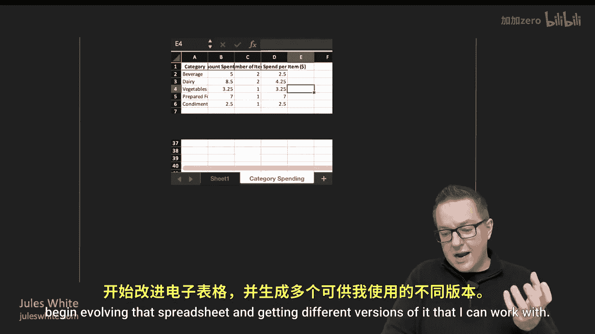

# 范德堡大学【中英⚡ChatGPT与Excel｜ChatGPT + Excel： AI-Enhanced Data Analysis & Insight】 p13 P13 03_通过ChatGPT多模态提示设计Excel电子表格 -BV1PdVizZE1d_p13-

It's really important to remember that Cha GT can see。Just like you and I can look at images。

 chatTD can look at images in its own way， and we want to make sure that we take advantage of that capability。

 particularly when we're thinking about designing of spreadsheets and things to capture data。

Now when we go in we provide a photo to chatGBT， this is called multimodal prompting。

 basically we're probably going to provide text and a photograph different modalities of communicating with it。

And so what we want to think about is how do we use this well one of the really effective ways that we can use this is many of the spreadsheets that we create are dealing with real- worldorld objects and systems and one of the things we can do is we can take pictures of these real objects and systems and environments in order to give chatGBT information about what we're going to need to track because what we're trying to do is we're trying to give it lots of context。

Our the quality of our design， the quality of the formulas and everything we're going to do is going to be driven by how much context or information about the thing that we're trying to solve for that we give to chatt。

 the more context we give it about our problems about our goals。

 the better it's going to be a translating those things into spreadsheets and computations and all the things that we care about So let's take a look at a really simple example of this。

 I think all of us can relate to which is， what if I want to track the items in my refrigerator What would a spreadsheet like that look like for that。

So I'm going to take a photograph of my refrigerator and please no judgment on what's in my refrigerator or not or cleanliness or other things。

 hopefully you'll focus on the prompt。I'm going to say help me design an Excel spreadsheet to create an inventory of what is shown in the photo。

 I need to be able to keep the inventory up to date and make important decisions with the data。

 design the rows columns and formulas for derived and formulas for derived columns。😊。

I'm telling it what my goal is to keep an inventory。

 I'm also telling it how I'm going to use this inventory。 I'm going to need to keep it up to date。

 And this is really important when we start communicating context。 Yes。

 we can have the context of a photograph， which is really rich context。

But also we want to have the context of how are we going to use the spreadsheet。

 what are we going to do with it， how is it going to evolve over time。

 that type of contextual information about use is really important。

And then I'm giving it context about what I want it to design rows columns and derived columns。

 and then I want the formulas for the derived column。 So I'm giving you information about。

What I'm going to do with this spreadsheet， how I'm going to use it over time and evolve it。

 but also what aspects of the design I want。 And then I'm giving it rich information or context through a photograph。

 and it comes back and it says， okay here's the spreadsheet layout。

 we're gonna have columns like item Id， item name， category， quantity。

 it's going then give me formulas that I can go and use like days until expiration。

 That's a great one right because if I buy something and I log it in and here's when it expires。

 it then can count down， how many days till expiration。

 And so because I'm going to giving it rich context about how I'm going to use it and what I want it to design。

 it's going and giving me you know a rich prototype that I can go and work with。😊。

And then it gives me a sample of what row might go into this and one of my favorite things about this is the sample is dreamed up based on what it saw in my refrigerator because I know there was silk coconut milk and my refrigerator。

 so it saw what was in my refrigerator and helped use that to inspire。

 became context for the design of the spreadsheet。And then it's going and thinking about some additional features I should add like conditional formatting if the days until expiration is in red。

 but you see how this helps me like start to dream up and think through from the context of a photograph what the spreadsheet would look like but the context the photograph helps it understand because it sees。

 okay， well this is a bunch of stuff that is in the refrigerator that's going to expire So expiration date's going to matter a lot。

 if I showed it a bunch of canned goods， maybe it doesn't even bother you know coming up with an expiration date because probably canids。

 you know， I don't know， maybe they sit there so long it doesn't matter you know but that photograph gives it context to help with the design。

😊，Now I can go in， I can say create the Excel spreadsheet and it comes back and it creates the Excel spreadsheet。

 realizing the things that it just talked about。 Now I'd have to go back and know prompt it to add in things like that conditional formatting to make things red but I also do something amazing with it which is I want to populate it。

 populate it from the photo。 Now I warn you advance populating fully accurately from a photograph into a complex spreadsheet like this it's something you absolutely are likely to get hallucination from。

 If you ask it for a small number of items or one item， it's very likely it'll get it right。

 if you go and take a picture of an entire grocery store aisle and say catalog everything in this photograph。

 it's not gonna to get it right。 it's going have hallucination， it's gonna to have missing data。

 It's gonna to get things wrong。 just know that here I'm really using this because I want to get a sample of the data so that I can imagine what the spreadsheet looks like。

 but it isn't impossible to enter data from photograph through this mechanism。😊。

And you actually can do it really well for certain things like an individual item at a time where you take a picture and say now log this into my inventory and in fact。

 I've done that with my son and I showed an example of how to do that in one of my classes so if you want to have an inventory management where you take it at one item at a time。

 yeah that's probably within the realm of possibility of using photographs to enter data into an Excel sheet but if you want to have it do an entire aisle with a grocery store good luck you're going to be spending more time fixing errors and you are probably actually getting useful work done。

But it goes and it populates it， it does a good job， it gets most of it right。

 it does get a few things wrong， it dreams up a rotisserie chicken which I'm pretty sure there's not a rotissie chicken in my fridge。

 I don't remember buying one， I don't think my wife bought one but if somebody discovers in that photograph that there is one there and I didn't notice it or if I discover later today that there is one there then I'll come and correct and apologize to chatGBT。

Now what if I want to be able to go and track how much I spend on things I'm going to say add a sheet to track expenditures and as fast as I can think of the other things I wanted to go into this。

 it will go and update the sheet and now I've got a separate sheet where I can go in traffic expenditures。

 I have the original sheet and now I've got category spending。And so I start with a photograph。

And it provides rich context to inform the brainstorming and the design of the spreadsheet。

 it helps it to see things like expiration and days to expiration is going to be important because we're dealing with a refrigerator here。

It also helps me to do things like populate sample data or if I'm in a very small sort of targeted photograph。

 actually put real concrete data into the Excel sheet。

And then as rapidly as I can go and think about how to evolve it。

 I can then go and prompt and using the context of that photograph。

 begin evolving that spreadsheet and getting different versions of it that I can work with。

