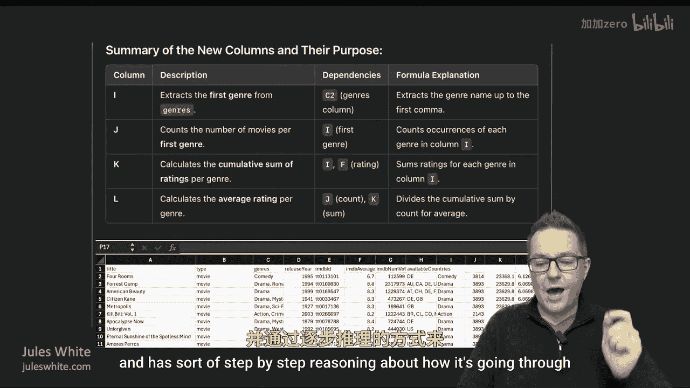

# 范德堡大学【中英⚡ChatGPT与Excel｜ChatGPT + Excel： AI-Enhanced Data Analysis & Insight】 p14 P14 04_使用ChatGPT创建Excel公式 -BV1PdVizZE1d_p14-

One of the first things that people think about when they think about Excel is building formulas and trying to figure out how to go and work with data through a bunch of formulas。

 Now， one thing that's tricky about these formulas is trying to make sense of like what all of the different columns are and how to use all the different functions that are available to try to build something that solves the problem that you're working on Now one of the things that chattGBT can really help us with is to understand how do we take some goal that we're trying to accomplish and translate it into a formula and Excel。

 So that's what we're gonna to take a look at is how do we go about prompting and getting chatGBT to assist us in building a formula。

Now we're working with this movie data set and one of the first things that is really。

 really important to do whenever we're going to go and create a formula。

 no matter how simple or how complicated it is。Is we want to make sure that we go and describe the data。

 but very importantly， we want to make sure that we get the column identifiers that Excel is going to use and expect to be in the formulas we want to make sure that those are explicit in the conversation and correct。

So I'm going to always start off a conversation with a very similar prompt to what I've done in the past。

 this is the data from an Excel sheet describe all of the columns and which identifier they have EG A through Z and a table and what we want to do is we want to get something like this out。

Where we have all of the column names for whatever sheet we're working on。

 if we have multiple sheets we want to make sure this is accurate for whatever sheets we're going to be working with。

 now we can tell it these are the sheets that I'm going to use or these are the sheets available to me or I'm only working with a sheet or maybe you have exactly one sheet。

 but you want to make sure that before you begin building a formula for a particular sheet if it's one or 10 sheets that you have an explicit table or some other format that says this is the identifier for the column and this is what the column is。

Now， ideally， you would also have some samples of data。

 some other things that are going to be needed。 but I'm going to start off with this very simple thing。

 Now this is important because there are so many formulas that humans create in Excel that go wrong because the columns are like off by1 where they meant A and they used B or they meant C1 and they use C2 and AI is not immune to this。

 chat GT is absolutely not immune to getting the column identifier wrong。

 which when you put it into a formula， it can lead to subtle and hard to detect errors。

 And we want to try to make sure that that's not the case。

 So we're going to start off by being really explicit about what the columns of the identifiers are in that mapping。

😊，Now， once we've done that， what we want to do is we want to go and express the goal of what we're trying to do。

 Now， you can certainly go in at micro detail and say， I want you to do X， Y， and Z very explicitly。

 But typically， what we want to do is back up。And give a high level goal of what we're trying to achieve and let chat GBT or the AI essentially fill in the details。

 figure out how to translate our goal into computation across the spreadsheet。So this is my prompt。

 I need a formula that I can put into a column or sorry。

 I need a formula that I can put into column I that weights the rating by the number of votes so that ratings with smaller numbers of votes are penalized So this is what I'm trying to accomplish。

 I'm trying to add a new column Now whenever you're working with formulas and you're using chat GBT to assist you。

 I strongly recommend thinking of it in terms of adding columns to your existing sheet。

Now you can go and try to modify existing things， but that can be harder to do。

 but let's start at least with the easier use case wines。

 I've got a sheet and I want to add a new column to it Now how do I add that column So that's what we're doing here where're saying we want you to add column I it can also be really helpful if you tell it what the identifier for the new column is going to be like I'm doing in this case where I'm saying column I。

Now it comes back and it says certainly to create that formula that weights by the rating by the number of votes and it goes and describes how to do that。

 and it's going to be based on a Bayesian average or weighting function。

 but it comes up with a simple one and it says， let's assume column F has IMDB average rating column G has IMD number of votes。

Whenever it does something like this， absolutely go and verify that column F is what it says。

 so I would just flip back here and I would look at it here or I could go back to my original sheet so it said F was IMDB average rating and G was IMD number votes。

 that's what we see right here， so it's got that right。That's a good start。

Then it's going to go through and it's going to explain how it's going to build the formula。

Now in this case， it says there's some number of votes that's going to matter because I said I want you to penalize that there's under some number of votes。

 it's saying that number of votes is going to be 5000。

 I could go into justice and do whatever I want with this。

 and then it says here's I'm going to do it and it generates a formula for me。

Now this is what I'm trying to accomplish right it's translated my high level goal into a specific formula and then I can copy that and put that into the cell and then go and use that formula wherever I want it So in this case what it's done is it's done the translation。

Now， what you want to do also is you want to make sure that you understand the formula。

 Now most of the time it's going to give you an explicit explanation of how the formula works。

 If it doesn't， you should go and follow up with a prompt of explain how this formula works step by step。

Now in this case， it goes and very explicitly explains what the formula does， why it works。

 and I can go and look at that and say， okay， well。

 maybe 5000 is the wrong number of votes like maybe I want some。

 you know number that's a smaller threshold to across or maybe I want it to you know be more explicit。

 like it just goes to zero if it's under 5000 rather than being scale。

So there's many different ways that you could go about this or you may say there's some maximum penalty or whatever you want。

 but at this point you want to understand what it's doing。

 this is so incredibly critical if you do not read it and you do not understand it。

 you should not use it。Because everything we're going to do is going to depend upon you。

 the human looking at it and trying to understand。 And if you don't understand。

 keep asking questions until you do and keep working with it until you understand it。

 This is not going to just magically solve everything。Then goes on with some example scenarios。

 I strongly suggest if it doesn't come up with example scenarios or examples of fill in it in that you ask it to fill in sample values and test that the formula does what you expect。

 So in this case， it's saying， well， if it's a movie with 8， a rating of 8 and 3000 votes。

 it's going to end up with a 4。8。 Now， I would look at that， I would try to calculate。

 Is that correct or not， I that what I'm expecting。

 But the key is you want to go and look at these things and make sure that they make sense。

This is really， really important。 One， make sure it explains it to you。 And two。

 if it doesn't go through and ask it to apply the formulas to some sample values so you can make sure that what it calculates looks right。

 Now， if you ask it to apply the formula to some sample values。

 it can't actually do it directly in Excel。 And this is going to be actually beneficial to us。

 we'll talk about this at some point later。 but。It's going to go and generate Python code probably to simulate the application of the formula。

And this can be really helpful。 Now， if the formula is really complex。

 if it relies on a bunch of stuff in Excel that it can't replicate， it may not be able to do this。

 It may not be able to show us example scenarios。 But if it can， if it is something that it can do。

 you should absolutely go and have it do it。And then it also gives us notes on what we could adjust。

Now this was a relatively simple formula that's pretty easy to generate a column that has this formula and to fill it in。

 but many of the formulas that we are going to be most。

 you know that we're going to get most benefit from are the ones where they're not so straightforward and we want to figure out how do we build some complicated formula。

Now I've come up with a scenario and I want to talk through this one that I'm about to ask for。

I'm going to say I'd like to calculate the average rating of movies within each genre for movies with more than one entry in the genre。

 I just want to use the first genre in the list。Now。

 this is a more complicated formula that needs to be generated。

And what I want to do is I want to be able to make sure that it's doing the right thing along the way。

 And then I understand it。 And then I agree。With how the formula works。

 the more complicated the formula is the harder it is as a human being to go and verify that it's right。

 And so what we want to try to do is use techniques to make sure that even when the formulas get complicated that as human beings。

 we can still go in and understand them and make sure that they're working right and check them。

Now one of the simplest ways that we can do this is I want to go back to this idea of adding columns right。

 we want to keep adding columns and adding columns now the reason columns are great it' because every time we add a new column we attach a formula to it is we get to see the results of that formula。

😊，And then if we go and add another column that depends on the other one before we can then see the result。

 and if we're building a computation that's complex and we do it through a series of columns。

 we can see the intermediate values of the computation。

 That is we can see what the result was for part of the computation that we can go and get the next part of the computation。

 and then the next part and the idea behind this is basically we can check its work step by step so。

😊，If we ask it for a plus B plus C， we can have it generate a column that's a plus B。

 and then we can have it generate a column that's the result of a plus B added to C and so that way we can see if it got a plus B right and then is it getting it right when it adds C into that Now obviously this is a really simple scenario but you get the point is like we get to see the intermediate results and it makes it so much easier for us。

So when you go in prompt for really complicated fourobs。

 we want to do something like what we see here， which is we're going to say。

I'd like you to calculate the average rating of movies within each genre。

 for movies with more than one entry in the genre， I just want to use the first genre in the list。

Now here's where we get sort of explicit about the approach。

 help me create a series of columns and formulas to realize this calculation。

I want to do this incrementally with a series of columns that capture intermediate results。

 This is critical。 We don't want it to just go one column， one really complicated formula。

 We would like to have intermediate columns to see intermediate results。

Each column should be a simple calculation based on the prior columns。

 the new column should start after the last column in the original set。

 so we're going to tell it where to start， and then we're going to say basically go and incrementally add some simple columns and each one should build on the last one。

Now this does some important things， one is that when it's based on simple sort of buildup as a human being。

 it's going to be easier for you to look at each column and check it。

And make sure that it looks right。It's going to help you to understand the formula because it's going to have to break up the formula into intermediate results。

But the other thing it's going to do is that particularly these large language models。

 they're really good when you have sort of step by step reasoning。

When we start breaking it up into multiple columns we're inherently having it do step by step reasoning because it's going to go and reason about okay what's the first column that I need to create now what's the next column I need to create based on that。

 what's the next column I need to create based on that。

 and it's essentially doing a chain of thought or a step by step reasoning that's going to lead to the result rather than a big bang。

 one big column， one big complicated thing， it's an incremental sort of step by step approach。

And then we say at the end， start by explaining the columns that will get created and what other columns each column will use。

 So the idea is we're trying to say here's incrementally how we're going to build it。Now。

It goes through and it starts describing the columns， column8。

 extract the first genre so it's breaking it down and saying， well。

 the first part of the problem is I need to go and look through all the genres and I need to figure out what is the first genre so there may be one or there may be multiple ones listed。

 so we're going to build a column just to capture the first genre in the list。

Then it comes back and it says， okay， now we're going to count the occurrences of each genre because we need to know the total number of movies in that genre。

 so we're going to build a column that captures or counts the number of occurrences of the genre and who's going to be give us the count of the number of movies in that genre。

Then it says I'm going to get the sum of the ratings per genre。

 so we're now going to have a column as the sum of the ratings。And we get the formula for that。

And then finally， it says now we're going to calculate the average rating per genre and we're gonna to get the formula for that。

 Now it just built out。 I think it was four columns for us。

 but what's important is each column was fairly simple if you think about it。

 The first one is just like， did it get the correct value for the genre。

 Did it pull off the right the first entry in the genre correctly and put it in。

 And now it's really easy to spot check and see if it got it right or not。

Then we're going to go and look at did it calculate and come up with the correct number for the total number of movies in each genre。

 And that's something that's pretty easy to check as well。

 And then we're going to go and did it get the sum right for the ratings yes or no。

 and then finally we will get the average， but it's broken it up in a way that allows us to introspect it。

 It makes it easier to go and spot check it， It makes it easier for it to sort of step by step think through the reasoning。

And then finally， we get a nice summary of all the columns Now。

 part of the reason that I think it does this consistently is because we're telling it to do it originally。

 we're telling it to describe what the columns are in the identifiers， what they do， the description。

 But now we're adding in things like what they depend on。

 And this creates this really valuable sort of output for us， which is a guide for us。

 then to look at the representation of the original formula in the spreadsheet。

 what is the meaning of the columns， this may be even something that you want to save and capture is documentation that goes with that spreadsheet。

Now applying it to that data， what we see is it went and calculated and created a bunch of new columns for us with a whole bunch of data。

 and all of this is very interesting because I was kind of fascinated about its approach because this is not the way I would have done this。

And when I saw its result I was like this is actually a pretty interesting approach that it took to build these columns incrementally because the route it took was something that was probably easier to spot check than the route I might have taken myself。

So。What we get at the end is our original data plus extra columns。

And extra columns don't delete what we've done。 They don't remove anything。 They add to it。

 And so if we ever may decide there's a mistake made， we can just go get rid of what it did。

 So that's one，2。 when we add these extracur columns where each one is an incremental step on the other。

 it's pretty easy to spot check。And you can go and build incrementally in terms of spot checking it。

When you're going and you're going to begin building formulas， one。

 start off with a table that explains what the columns are in the data where the spreadsheets that you're working with。

 make sure that the mappings of identifiers like A through Z two columns is correct。Ideally。

 you want to even have samples of data so that it can see values in the conversation before it starts building formulas。

If you go and you build a formula that's more complicated。

Don't accept some gigantic complicated formula being spit out that's going to go into one column。

 break that formula up into multiple columns。Both for your own sake so that you can check it。

 but also so that it reasons better about what it's going to produce and has sort of step by step reasoning about how it's going through and creating and calculating those values。

