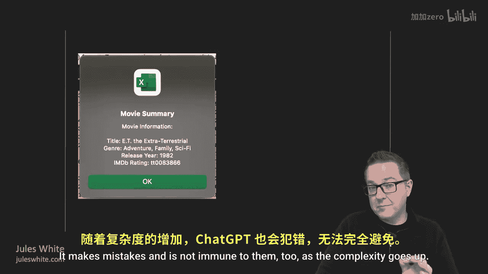

# 范德堡大学【中英⚡ChatGPT与Excel｜ChatGPT + Excel： AI-Enhanced Data Analysis & Insight】 p15 P15 05_使用ChatGPT在Excel中创建VBA脚本 -BV1PdVizZE1d_p15-

We don't want to limit our imagination and our goals to things that can be created simply with individual sets of columns and formulas。

 we want to be able to think bigger about the applications that we dream up in realize and exc through ChadGBT ChadGBT is our partner for translating our goals and ideas into computation and one of the ways that it can translate our goals and ideas into computation is by creating VBA scripts and VBA scripts can do things that are much more complicated than we can do necessarily in an individual cell with a formula or with one visualization I want you to think about applications when you start thinking about VBA script I want you to think about sort of like you know almost entire applications that do really valuable and useful things to you or automate complex steps。

😊，So let's take a look at what this means and how we use ChatGBT to realize computations and realize applications in VBA script。

So I always like to start off with grounding everything both for myself and ChadGBT with what are the columns。

 what are their identifiers， what is everything this is also always helpful for me to go back and look at chatGBT will' do some of this automatically but I just like to do this now you can probably skip it if you want but I think it's a good practice so I go through and I get a listing of what all the data is I then think about what would be something really cool that I could do with this spreadsheet because a lot of times I like to just go and brainstorm and get some ideas so I'm going start off with the brainstorming。

What would be an interesting VBA script that I could create to do something fun with this data and this is the movie data set right。

 it's probably all kinds of fun things we could do。

 but I want to just take some time to explore the possibilities and imagine。

And it comes back with a bunch of things， a genre based movie recommendation generator。

 create a EbaA script that allows the user to select a genre and it returns three random movies from that genre。

 I like that。 you know， I think about all the times that I'm trying to figure out what to watch on the weekend with the family It would be really cool if we could select a genre and get some suggestions。

Random movie night picker， that seems like an interesting one movie trivia game that could be really cool。

And it went ahead and you notice at the bottom this it says here's one of the VBA ideas written out。

 so it wouldn't even head and prototyped one of these ideas for us。

 the VBA script for the genre- based movie recommendation generator and what you'll see is it's going to go and create the code for essentially this application。

Now， when it goes and creates this code， it will also go and tell you how it works and this is really important。

When you start working with ChaGBT to realize VBA script。Truthfully。

 you need to have some minimal level of using VBA script in Excel if you don't have any you know knowledge of how to do this。

 you can kind of figure it out and follow its instructions。

 it's helpful if you have some sense of coding or other things now you don't have to you can follow this。

 but you're gonna to have a little bit more of a you know hard time when it runs into errors knowing what to do That said it is possible to start from scratch。

 have it generate VBA script and go and walk through its instructions and implement those applications in Excel but just know it's going to be a lot easier if you understand the code。

It's going to also be important as we'll see in a minute。

 because sometimes it likes to give you a little bit of work to do and if you don't know how to modify code。

 sometimes you won't be able to realize its applications。

Now it tells us here's how you take the script that I just generated and go into Excel。

 you go and you open up the VBA editor， you insert it as a new module， you paste in the code。

 and then you run the script or run it from the macro dialog。

 So let's take a look and go and do this。 So I took what it said。

 I go and I open up the visual basic editor。 I insert a new module。 I go and take the blank module。

 I copy and paste。 It's generated VB script in here， make sure you get the whole thing。

I then go through， I go to the macros， I select the macro for recommend movies by genre。

 awesome so far， super excited。Except that I get a runtime error。

And what you're going to see is this is one of the key things， right。

 is that it generates VBA script， but can't see your Excel sheet in front of you Now you can。

 if you give it a screenshot。And we'll talk about that in a minute。

 but he can't necessarily see what's going on and errors are very likely to happen with VBA script we're doing much more complex things。

We're also going in taking what it's told us to do， we're translated into the sheet。

 we also may have made changes that we forgot to tell it about。

 that it needs to know like we tweaked a column name or the name of a sheet and now it's using and referring to the wrong sheets or in this case I gave it a CSV file that corresponded to the Excel file。

 but they didn't have the sheet name in it so。There's all kinds of little subtleties here because most of the time。

 a lot of the time， the mistakes it makes are because it cannot see the actual Excel sheet in front of you。

And because of that， it makes assumptions that are incorrect。 many， many times that is the case。

 or it doesn't know the exact version of Excel you're working with or the exact version of something。

 and it makes an assumption that is incorrect。 So a lot of what we're gonna to be doing is taking back and explaining it into it。

 when errors happen or what are assumptions are that it's missing things like that。 So in this case。

 we get an error。 but fear not。 What I do is I take a screenshot of this error。

 And I just put this screenshot back in as my prompt using multimodal prompt。

 and I'm going to show you this is what happened when I ran it。 Not even going to tell it anything。

 Yeah， you could copy and paste the error in。 Yes， you could describe and text what the error is。

 All of those ways will work。 I just like to take a screenshot， dump it in and say yo。

 here's what happened。 That's often faster for me。😊，And when I do that， it says， oh， okay。

The error runtime error 9 subscript out of range typically means that VB is trying to access an element worksheet or range that doesn't exist or is misspelled and this is what you're going to see often is that you go and change sheet names or column names or things like that or you move them around and it's going to try to reference something that's the wrong column or the wrong name and so a lot of the work is going back and forth and making sure that what you're doing in Excel matches up to what chat GBT knows about Now in this case。

 it's saying， well， this workbook sheet sheet1 the script uses that line is very possible that that's the wrong name for the sheet。

I look at this and I immediately know no， that's not the name of the sheet， I need to fix that。

But if I'd actually looked at the code and I encourage you。

 no matter if you understand the code or not to look at the code before you do it。

 if you don't understand the code and you're using it to make decisions。

Like you're going to have it generate some analysis or something like that now in this case。

 it's just recommending movies， right？If it gets the code wrong and the code's not perfect。

 who cares， right， it's inspiring me， not a big deal。

If you're using it to decide something impactful that's going to in fact impact a human being。

 then you absolutely need to understand the code in order to do this。

 Do not rely on it to perform the work for you。 if you cannot understand the VBA script。

 So when this makes sense to use and does not use directly depends on you in your use case。

 if it's a fun whimsical， interesting use case， something that's easy to check。

 you're gonna it's not going cause a problem like a movie recommendation to me personally for my own list。

Not a big deal if it gets it wrong and I don't understand the script。

If this is going to decide if a human being gets treatment or a mortgage or whether or not somebody gets laid off or a raise or something like that。

 you better absolutely understand the script before you go in and use it and throughout all of these things if you're using it to make a consequential decision you need to understand it if you're going to make the consequential decision with it because at the end of the you are responsible not it if it makes a mistake。

 it's your fault for taking its mistake and using it and applying it when you didn't understand or when you didn't do the due diligence to check it so make sure if you're going to use it for something consequential that you understand。

Now， when it generates code， you should read it。 You should look for comments like this where it says change sheet one to the name of your sheet。

 which I didn't do originally because I didn't I got sloppy I ran through it， I just。Executed it。

 So I'm gonna to go and look for those tasks in the code。 Now in the code。

 I see one task which is I need to change the sheet name。 it told me to do that。

 I didn't bother reading it。 I'm gonna to go and fix that。 Now when I run it。

 I get my you know my movie recommendations。 So it pops up a dialogue now I enter in drama is what I want a recommendation for and now it gives me a list of recommendations。

 Now I suspect this Ds is another bug and I could go and track it down。

 I'm not gonna track it down for now， but I do want to emphasize that it does make mistakes in the code。

 It's very， very good。 but this is where you having some skill or expertise or ability to evaluate if it's correct or not as important because mistakes to get made you don't want to have consequential decisions that you know you didn't bother checking its code and it made a mistake Now in this case。

 there's this interesting movie go mall3， I have never heard of this before。

 went and looked it up on Wikipedia。 Oh， there it is。 that's an interesting one。

 Maybe I'll go check that out this week。😊，And I have no idea。Now。Once it dreams up ideas。

 one of the things we can always do is we can go back and say， hey， that idea。

 I want you to implement it now one of the beautiful things when it expands on an idea is it's basically building out the instructions and the requirements to do that。

They' not forcing us to type it all in， So I'm going to give me the VBA for idea number two。

 the random movie night picker。It goes through， gives me all the DBA script。

 describes how to go and implement it。And what to do。

 I'm going to go and use this movie Night picker which I've implemented， and yep， there it is。

 it was working， giving me a random pick for a movie。Now we can have it brainstorm ideas。

 but of course we can go to it and express what we want it to do or what our goals are and we could say。

 like you know， I want something to help inspire me with movies and maybe we generate those ideas or I could go in and say create a VBA script that takes a title of a movie and looks up its information and shows a summary of its genre release here and IMDB rating So I'm giving it much more specific requirements。

 So isn't brainstorming anymore。 This is I know what I want。

 I want you to implement it in VB script for me。 translatelate what I want into computation and the computation is going to be realized through VB script。

It goes through and it generates and explains， here's the script， and I'm not showing it all。

 you get the idea， it can generate VBA script， but it explains the script and how to use it。

 I go and implement it will look up ET， the extraterrestrial movie and it goes and gives me the summary of it Now again。

 little mistake IMDB rating is actually I think the IMDB ID So it's looked up the column wrong。

 which again， this is one of the most common mistakes you're going to see is its reference for what the column identifiers and sheet identifiers and names and things are is slightly different from the Excel sheet that's right in front of you。

And so in this case， I could follow up and say， yo， you know the IMD rating is actually not。

 you know F or whatever the heck it is here， I don't remember what it is， it's G。

 and I could tell it and it could go and adjust， but that's something you're always going to be doing is making sure but you're also always going be checking。

 checking， checking。Now this is rapid prototyping， help me to create the application。

 I know how to look at this， check it， I can chat with it to evolve the code and fix it or because I'm a computer scientist I can directly go in and because I'm skilled in this I can go and edit the VBA script to do what I want you got to figure out how you're going to do it。

If you go and edit the VBA script by hand， you need to bring it back into CheGBT and say， hey。

 here's how I updated it myself manually now let's work off of this version If you don't do that you're going to run into mistakes so always you're gonna to be going back and forth between Excel and ChetGBT and you want to keep things synchronized in terms of the column identifiers。

 sheet names， code that you're currently working with formula you're working with data。

 things like that， it needs to have that context in order to accurately work with it。

The other thing is as we translate into computation。

 as we use it to translate into bigger and more complex things like BBA script。

It's going to be more and more likely that there are smaller， subtle errors。

 and it's going to be really important that we check and run and test things。

Human beings make mistakes too as the complexity goes up。

 the more complex the code for some software is， the more likely I am to make mistake。

 how do we handle that in human systems， we write tests， we check。

 we run the stuff same thing goes for you when you're going and building stuff up you have to go and test and check and make sure it's right because the more complex it gets the harder it is to get it right on the first time and chat GBBT is no different from a human being it makes mistakes and is not immune to them too as the complexity goes up。

