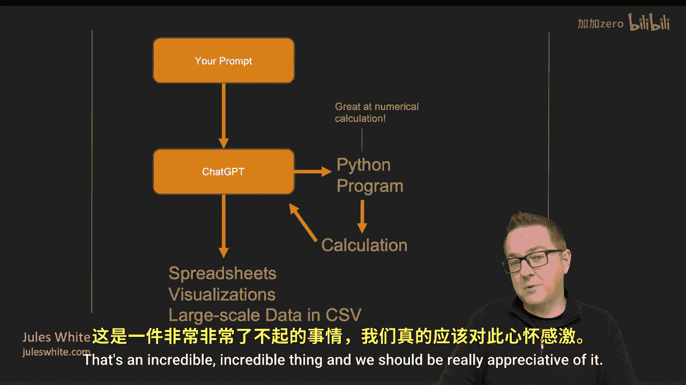

# 范德堡大学【中英⚡ChatGPT与Excel｜ChatGPT + Excel： AI-Enhanced Data Analysis & Insight】 p16 P16 01_ChatGPT如何进行数值计算与数据分析 -BV1PdVizZE1d_p16-

I want to walk you through what I think is one of the most amazing things in ChattbyT right now that I just am absolutely shocked that no ones talking about。

 but it's also important for you to understand what's happening because sometimes not having this knowledge is really。

 really helpful in thinking about how to put Chattby together with Excel。

And that's how ChadGBD calculates things。 Now， we've seen some amazing things。

 but let's dive under the hood for a moment to really understand what's going on in certain circumstances。

😊，So。😊，When I said design a very simple spreadsheet to help me track coffee。

 it generated something like this。 and this is the type of thing that we're used to seeing in ChaGBT。

 It's outputting text。 Now the table is also text， it's actually some formatting it's some text that describes the table and so it draws the table but it's not chatGBT drawing it。

 it's not doing anything unusual， it's just generating a bunch of text Now ChaGBT can generate text really effectively and normally what's happening in when we're doing this type of thing as we go in and put in our prompt which is our message we'retyping in and hitting submit on it gets sent to chatgBT and it directly produces some output and the output is that stuff we're seeing before that you table that shows the design for that coffee tracking spreadsheet。

The problem is that chat GBT is not very good at numbers。

 and once numerical calculations get up to a certain size or complexity。

 chat GBT can't really do it very effectively， and it makes mistakes。 So this is a problem。 Now。

 when you're working with chat GBT。Occasionally， you may see something like this little sort of arrow。

 Now it may change every time it used to look different。

 but there's going be some indication when this is happening。 hopefully forever。

 hopefully they won't start hiding this。 I don't think they will。But right now。

 what it looks like and it may change at some point is you want to look for this little like。

 you know， greater than and then a little underline in the brackets， or what does that mean？

That is where ChatGBT is building a tool for itself， this is absolutely amazing。

But what I want you to think of in the analogy I use is imagine that you've got a shovel。

 right ChatGBT is your shovel。 and right before you go to dig a hole。

 your shovel looks down and sees， wait， there's a rock in the way and your shovel jumps out of your hands。

 your shovel builds itself a pickaxe and your shovel breaks up the rock with a pickaxe and the shovel jumps back into your hands and you continue digging That is your tool builds itself a tool。

And right there， that is ChadGBT building itself a tool Now。

 if you think about how amazing this is when we discovered cha chimpanzees。

 were using blades of grass to extract termites from termite bounds， we said， oh my gosh。

 animals are building tools。What is the tool that ChaGT is building？It's code。

So when you said for example， I want this Excel spreadsheet。

 it went and wrote Python code to create that spreadsheet because it can't directly create an Excel spreadsheet。

 so it went and wrote Python code that could because it realized basically there's this obstacle this rock。

 I can't create an Excel spreadsheet， but I can build myself a tool that can and use my tool。

 so it wrote Python code to create an Excel sheet， it executed its own Python code and then handed back the Excel sheet to you。

 which the output from this software， this Python code which is software。

 the output from that software was your Excel file。😊。

Now it also can go and create visualizations and then you see a visualization。

 it can go and do complex calculations on data and what you see is the result of those calculations。

 it can go and generate CSV files for you， and then the result is the CSV file that you download。

 but it is tool building， It is building tools to help you realize your ideas and goals through computation。

The reason this is important is that。When it goes and builds itself a tool。

 it can do things very accurately， numerically。It can go and do things that it can't normally do。

 like create an Excel file。So when you go in prompt and send the prompt to CheGBT。

 it looks at it and says， is this something that I'm good at？

And the answer is if it's like creating an Excel file or running a large scale numerical computation or the other things that it knows it's not that good at or can't do。

 it says， oh， I can't do that， but I will write a Python program that can。

 I'll build myself a tool that can solve that problem。

And so what it'll do is it'll go and write a little Python program。

 which is when you see that special indicator showing up that one that I showed you a minute ago。

 the greater than it'll write itself a Python program， it'll execute it。

 it'll take the result of that Python program it could be an Excel file or it could be a number you know it could be a computation and then it'll get the result of it and then it'll say hey。

 here's your Excel file or hey， the result is 10 or 32 or whatever it is and so it can help itself by building itself tools to help get to an answer that you need So the reason this is important is that when it goes and and does things in Python。

 it can be very accurate， but it's also writing code。

 you can go and look at the Python code so you can know what it did。😊。

But it's also important to know that sometimes it's going to do things directly。

 sometimes it's going to go and write Python code to do what it's doing now。When you want to have it。

 go and work directly。Is when you want to do brainstorming， designing of things。

 telling you how to do something， telling you what the formula should be。

 you know generating small scale CSV or sets of data and we'll see different ways that you can you know do that all throughout this you'll see it doing instructions and samples of data and all kinds of things like that that's when it's going to be doing it directly through the model。

If you ask it to create a spreadsheet， if you ask it to create a visualization to do some large generation of data or transformation of data。

 something else， it's going to go and run Python to get there， and so you have to be aware of that。

 know that it can do it either way when you're seeing the messages。

 look for that icon and you know how it did that part of the work。

One of the most amazing things on the planet that we have tools now that can build themselves tools。

 essentially by writing software on the fly， you should not fail to appreciate how amazing this is every time it happens。

 so easy for us to lose appreciation for these incredible tools。

 every se time you see that icon pop up。Know that what you just had was like some really sophisticated software engineering happening just from you saying this is what I want to do。

 and it figured out how to make that happen， how to translate into computation。 That's an incredible。

 incredible thing， and we should be really appreciative of it。

