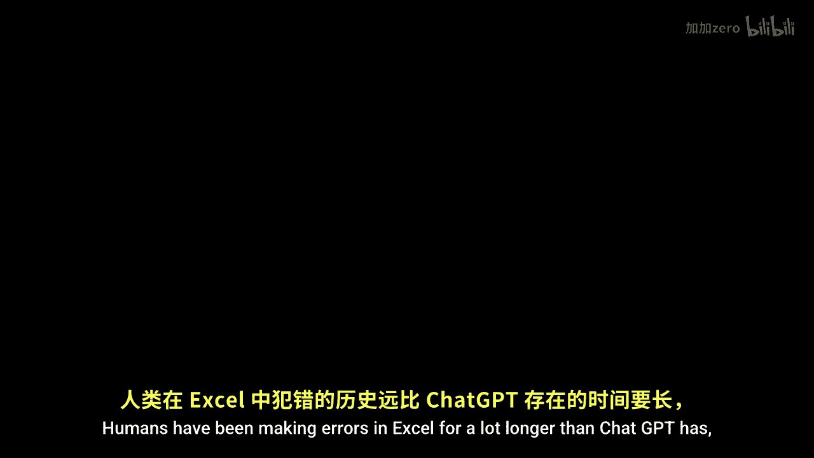
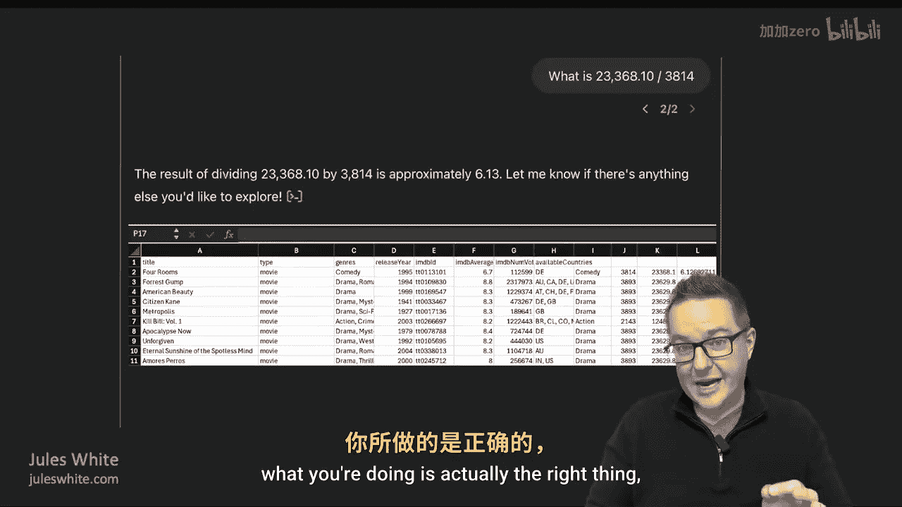

# 范德堡大学【中英⚡ChatGPT与Excel｜ChatGPT + Excel： AI-Enhanced Data Analysis & Insight】 p17 P17 02_使用ChatGPT对Excel公式进行双向稳健性准确性检查 -BV1PdVizZE1d_p17-

Humans have been making errors in Excel for a lot longer than ChatGBT has。

And we've learned ways to go and try to check and make sure things are right。

 Now we always have to check when we're using Cha GPT， not only because chat GPT might make an error。

 but when chat GPT explains it to us or gives us the output。

 We may make an error in translating what it's stated into an implementation in an Excel。

 So we may copy and paste the formula wrong。 We may put it into the wrong column。

 We may make all kinds of other mistakes， we could go and explain the structure of our spreadsheet wrong。

 We could misunderstand what the different columns mean and lead chat GPT astray。

 There's so many things that we could do incorrectly。

 And so it's really important that we check the answers。

 check the results that we're getting and make sure that they make sense now。

ChadGbT gives this incredibly powerful tool to do this checking， I call it two sided checking。

Rather than just checking within Excel itself， we can go inside of ChatGBT and we can go and try to check within chattGBT if it arrives at the same answer。

 So we run the formula we get an answer in Excel， then we go and run exactly the same calculation that the formula provides but within Python because chattGBT can go and write and execute Python as part of its advanced data analysis。

 And so if we go and tell it， this is what the formula is or it has already generated the formula。

 we can say go and do the same thing with Python and we can see if the number it gets is the same。

 No， this becomes really， really powerful because we can go in verify in two very different ways the same calculation。

 It doesn't always work not everything that happens in Excel can be replicated in Python within chattGBT advanced data analysis。

 but in general， we can do most of the really important things that we want to do。

So let's take a look at what this looks like。So。I had this prompt where I wanted to go。

 and I wanted to calculate the average rating of movies within each genre。

 but I only wanted to include a movie based on the first entry in its genre。

 So sometimes you would have movies that were like comedy comma action。 Well。

 if it was action comedy， I didn't want to include it。 if it was comedy comma action。

 I want to include it。 in this add some trickiness to this formula。If it's just comedy。

 I want to include it。 So I went and I prompted Chad GPT to help me build this formula within an Excel。

 and it told me how to build a series of columns because we're using this prompting approach that asked it to build a set of columns that incrementally build on each other to implement the formula now。

It went and did that， and it gave me a whole set of columns that are going to implement this complex formula。

I went and created those columns in Excel， and it all looks pretty good。 When I spot check this。

 it appears to be right in Excel。 Now， what I would like to do is I would like to go and check it with a greater level rigor by also replicating that same formula and analysis within chat and GT itself。

😊，So what I would do typically to do this is I would either go and copy and paste the formula that was created or the description of what I wanted to do into a new chat。

 or in this case， just follow up at the bottom of the conversation。And basically go column by column。

To replicate the analysis for a particular row。 So I'm going to start off with one of the rows。

 which was in the in the comedy category or comedy genre。

 And I'm just going to say how many comedy movies are there。

 And it says there are 3814 movies in this genre。 I can go back and I can look at my data here。

 And I can see that is correct。 Comedy has 3814 movies in it。

 So I've just verified one row the of the first column。 And it's a fairly simple one to do。 Now。

 if there was a discrepancy， now I can go and start debu in it and trying to figure out why。

And then go back and I say， okay， what is the sum of the ratings Because if you looked at it。

 it told me that， you know， what we' see， Let's see here column let's see Cal the sum of the ratings column K。

 So I know column K should be the sum of the ratings for for the genre comedy。

 So I go and I say what is the sum of the ratings， it goes and it says the sum of the ratings for the genre comedy is approximately 23368。

10。 I now can go back and I can look at the data and I can verify， yes， that's what Excel arrived at。

 And so each time I'm doing this one column by column I'm basically verifying a different part of the formula。

 And I'm verifying it by checking if I go and I run the same analysis in Python do I get the same result that I'm getting in Excel on that side。

 Now I could run the whole thing。😊，And try to do some type of you different diffing of the two and seeing if there's differences。

 but it's easier to kind of start off by picking a row at a time and going in and verifying that that's the same thing。

So I go through that， I then go through and calculate the average by saying， what is 23，368。10？

Divided by 3814， I also could have set average。 many ways you could do it。

 I'm just being really explicit here。 And it says the result is approximately 6。13。

 I went and checked that， and that's the same answer that I got in Excel。

 That gives me a lot of comfort。😊，That I'm getting the same result I am in Excel out of Python。

 At the very least， what I can do is I can know that。It whatever I have told it， I wanted。

It has been able to implement correctly in Python， it has been able to implement it in Excel。

 and those two things match up。Now it is totally possible that I have some fundamental mistake in the what I'm expressing it that I want to do。

 and if I look at all this data， there may be subtle issues and how I've expressed the requirements of what that formula should do。

But I can go through and I can column by column， check the reasoning and the formula implementation against what I would get if I ran this in Python within JGBD because when I go and I say this is what I want It's going in writing Python executing it and then coming back with the result that it got。

 and so I can go column by column， I can check different rows that I think are valid test cases。

 I can make sure that they align with what I'm seeing in Excel。Now， what's beautiful about this。

 just to go back and emphasize the importance of this is because I'm going column by column。

The moment I find a column where I have a discrepancy between what。Excel says and what Chat GPT says。

 I have isolated the issue more than likely to one specific part of the formula。

If I had a really complicated formula that's being dumped into a column and there's no intermediate columns。

 if I have an issue， it's going to be really hard to know well why like I'm sort of like at a loss and now I'm going to have to do a lot of work to try to go back and figure out why because we've broken up the formula into multiple columns。

 we can go and incrementally check them in Python to see if we arrive at the same result and the moment that we have a discrepancy we've isolated and that's one of the key results and part of the key reasons that we go and do this and multiple sort of simple columns is that when we have a problem we've isolated it down to hopefully one specific part of the formula we can go and fix that one little part of the formula and then move on and see if that fixes the rest of the columns and it might fix all of them it might then ripple down and fix most of them but there's still a problem and we can isolate now to the next problem。

 but if we build incrementally we can also check incrementally in checking incrementally。

allows us to spot and isolate errors for debugging purposes。

 but having Python on the other side that chat GT is running and executing Python to verify for this super valuable。

 it's a two sided verification of the formula， but again， just to emphasize。

If you tell it the wrong thing to do， if you give it the wrong requirements， it doesn't matter。

How good its implementation is because it will have built a formula that's exactly what you told it to do。

 which is the wrong thing， and that of course requires you to keep thinking and keep paying attention and keep making sure that what you're doing is actually the right thing。

 that you're actually telling it the right thing to do。

