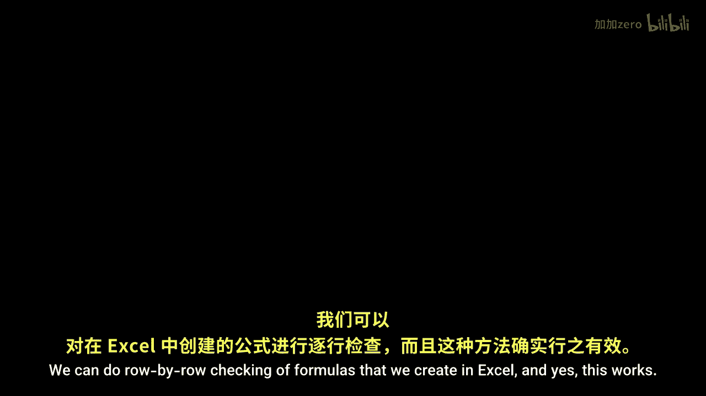
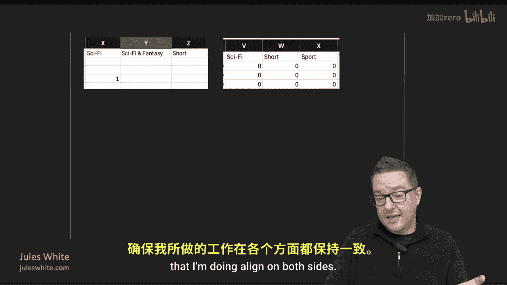

# 范德堡大学【中英⚡ChatGPT与Excel｜ChatGPT + Excel： AI-Enhanced Data Analysis & Insight】 p18 P18 03_使用ChatGPT批量双向校验Excel公式的扩展性与准确性 -BV1PdVizZE1d_p18-

We can do row by row checking of formulas that we create in Excel。And yes， this works。

 We can look at the intermediate data。 We can go one value at a time。

 but this isn't always the most effective way or the fastest way to go and check the work at scale。

 particularly when we have very large spreadsheets。

 You can't realistically go row by row and check that everything matches up exactly。

 So I want to show you another way to do this to do twosided checking where we're looking at do we arrive at the same result when we implement that logic or idea in Python that we get when we take that idea and implement it in Excel。

 So we've built some formulas in Excel， we've created a bunch of new columns。

 we've reshaped our data or created some new derived data from that those calculations that we've done Now。

 how do we know that the right， right， Well， when do we do it is we learned that we can go and we can check both within Python and within Excel that we've arrived at the same answer。

😊，But so far， what we've only done is we've looked at it sort of on a row by row column by column basis where we're sort of interactively doing it。

 Now what we're going to do is we're going to scale this idea up and we're going to do it in batch。

So what we do is we go and we create our formulas that we want。

 right we're going to go and do some calculations。 we're going to describe what it is that we're trying to do in the data and we're going to create the formulas。

 we're going to create the columns we're going to implement it all in Excel。

 and then we're going to have our derived data。 What we want to do now is we want to go and create a version of that same derived data。

 but as a CSV file through Python。😊，And the idea is we're going to take these two files。

 we're going to get them into the exact same shape and format。

 and then we're going to ask ChatGBT to use Python to compare them。

Now it's possible could make a mistake at this at this stage， but if it makes a mistake。

 you know often it errors on the side of making a mistake where it doesn't realize that two things are the same thing。

 Now it's possible it might make a mistake and say， hey。

 they're both exactly the same that's not my experience but again。

 this is one more form of due diligence in addition to the human due diligence that we're going to do So it's adding due diligence not replacing so you should still do whatever human due diligence you would have done before。

 this is adding an additional check that you can do it should not replace so。

I've gotten to the end of implementing a formula now I'm going to go and tell it to reproduce what those formulas do in those new columns in CSV。

 So what I say is read the original data and create a CSv file that has years as rows and the unique genres as columns then list the count of movies released in each genre per year。

 only consider the first genre in the list if there's more than one movie So I've recreated basically something that I've done in Excel where I went and I reshaped my data in Excel by using some guidance from ChadgBT so that I could have my data in the shape of rows as years and genres as columns and then within that I could look at the number of movies released each year。

 I went and implementing that in Excel with ChagBT's guidance Now in a separate conversation I'm telling it to replicate the same thing but in Python and in to give me a CSV file with the data in that shape which I download here。

😊，Now， once I've gotten that file， now I'm off to the races and I go and I start a new conversation。

 you don't have to start a new conversation， but I often think that this is a good practice to try to make sure that no bias from the prior conversation influences what we're doing。

And I'll upload both files。And then what I do is I say please compare these two files to see if they show identical counts for each genre per year。

Now notice I've shaped these in exactly the same shape where I believe I've shaped them in exactly the same shape。

And what I should expect is that I get roughly the same result。

 Now there's some minor variations and I could go and fix that， for example。

 there's basically gaps in how the data is represented in one file。

 this check two file versus how it's implemented in this other file movies by year in genre。

 so that may create an issue and I have to just be aware of that。

 but we want to get the rows and columns and sort of representation to be exactly the same so that we can do the batch comparison。

It goes and it does a comparison in across。A all these rows and genres that actually spots that there are discrepancies。

So for example， it says the scifi genre the count differs substantially from 1990 onwards showing that one file often has higher values than the other。

 and the difference increases more for recent years。

Now I need to go and follow up on that because this is a calculation that I've implemented in Excel。

 I've also implemented in Python and I'm arriving at a different answer Now there's a couple potential reasons for this one it could be that I implemented what chattGB told me incorrectly in Excel。

 it could be that chattTBT implemented what I told it incorrectly in Python or there's subtle variations in the interpretation that are both probably equally correct。

 but when you change the interpretation there's a difference in the concrete values that we get and we have to sort out what is the issue。

😊，So。Once it's identified that there's an issue， I tell it show me Scifi accounts side by side for 1990 onwards。

And well， what I see is， yeah， there's a difference in the counts。I see 2020 looks pretty good。

 2021 looks okay， but 2022 is wrong， 2024 is wrong， now it's not huge。

 but there is some subtle issue there。Now I then go and pull up the files because this tells me directly where I need to go and look for the differences。

 and what I see is。I've got a difference in how the data is being produced。

 I've got scifi and then scifi and fantasy in one data set， and I've got scifi in the other。

Now I can think about， okay， what is the right way of handling this and when I go back and I look at the data。

 well， oh， there's multiple ways that scipi gets represented。

And did I really think about the right way of handling that and the answer might be no I didn't。

 and I need to go and think about that and deal with it in my data。

 but it helped me discover something about my data that maybe I didn't know that influences the analysis。

And it did it at scale， right， because it went through all the genres。

And it pinpointed specific genres where there's an issue， the music genre。

 and I suspect that is probably something similar with music or maybe maybe it's not reality TV。

 maybe there's a different way in hyphenation or maybe it's just TV in some places or TV comma reality。

 I don't know， but now I can dig into it and I can spot these issues。

That comes out when I try to replicate on both sides in batch Now I can scale up that analysis。

 I can start spotting potential discrepancies and issues at scale。

 and I learn something about my data by doing this。

 Now it doesn't replace my human checking that I would have done anyways。

 but it gives me a new tool in my toolbox to improve the robustness of what I'm doing because I can look at it from different perspectives and make sure that they align and I can do it really rapidly and easily and I can spot things like this and I may not have seen like different representations of scifi and the data that maybe I hadn't accounted for。

 and so that will help me make sure that my analyses， my visualizations。

 all of my decision making is more robust because I can catch mistakes by making sure that things that I'm doing align on both sides。

😊。

