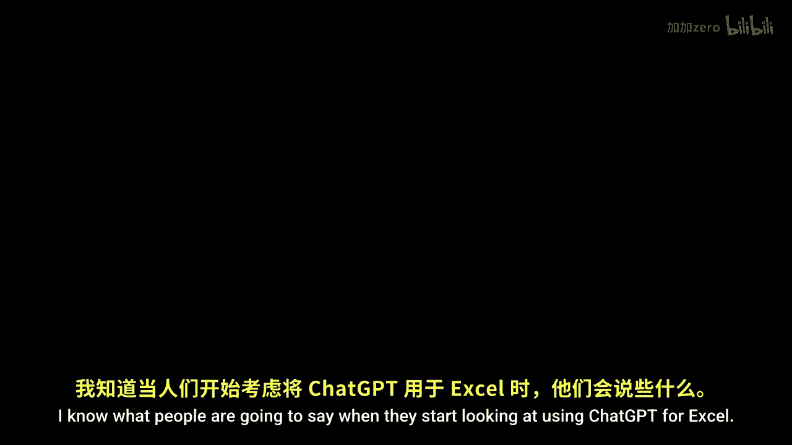
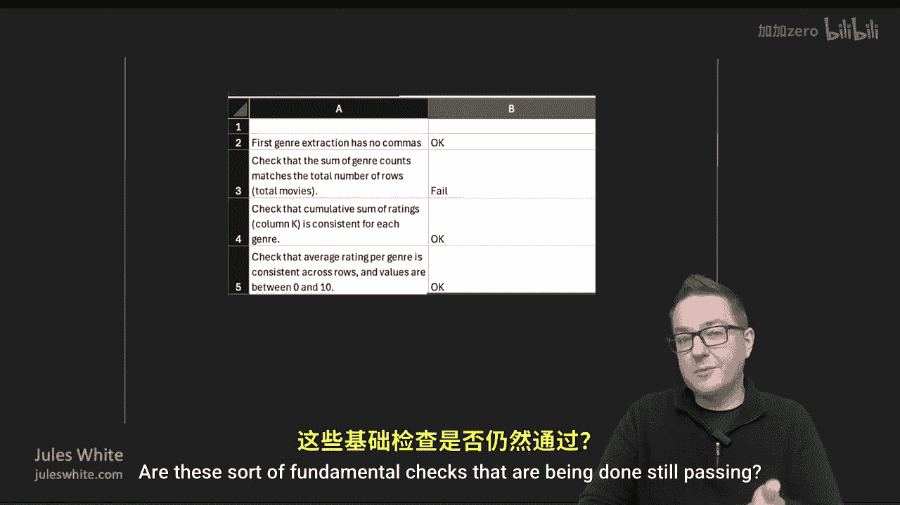

# 范德堡大学【中英⚡ChatGPT与Excel｜ChatGPT + Excel： AI-Enhanced Data Analysis & Insight】 p19 P19 04_使用ChatGPT创建Excel测试用例的稳健性测试 -BV1PdVizZE1d_p19-

I know what people are going to say when they start looking at using Cha GBT for Excel， like。

 oh my gosh， this thing makes so many errors， why would anybody trust this thing？

And that's why it's really important when we start thinking about putting them together that we become even more rigorous in the work that we do。

 that we check even more thoroughly。 Now， I believe we can actually do better work than we could without chatTBT that we can actually reduce the number of errors because if you think about all the errors that humans have put into spreadsheets。

 it's probably a huge number。Now one of the things that we get at a chatGBT is it gives us the ability to move fast。

 it can help us design these formulas and get them implemented。

 but that doesn't mean that we get to skip the checks that we need to do about the quality of the data and to make sure that we're implementing things correctly。

So what we're going to talk about is how to go through and use some of that time we're saving to actually do better work by going and building different checks and tests into our Excel sheets and our our work to make sure that what we're getting is the right answer。

 not just a faster answer。 I actually want to get a better， more robust answer。😊。

So one of the things that we did when we began building these formulas is that we focused on building individual columns。

 or we have one column thats a fairly simple formula and then another column that builds on it。

 and we build incrementally in columns， now part of the thing that gives us as we talked about was the ability to pinpoint where errors are occurring。

 but also makes it easier to check individual parts of the computation。Now。

 coming from a computer science and software engineering background。

 one of the things that we do to make sure that human beings implement software correctly is we write tests Now we're going to have human beings us implementing often what chatDBT is outputting this formulas。

 we're also likely going to be modifying them and reasoning about them。

 it's also possible that chatTBT itself can make a mistake and so just like in software engineering and we're going to have to go and check and make sure that we've done our work correctly we've implemented into computation correctly。

So we're going to tap into this idea that we have separate columns and we're going to build tests for each individual column to check that the answers and the results of the computations that we're getting are consistent with the rest of the data。

And one of the things that we can get out of chatGBT is it can help us you know think about what are tests that we could run。

 It actually works really well for designing tests when we're building software as well。

 because it often gives us an outside perspective， sometimes as human beings or implementers of an idea。

 we have a hard time stepping aside and thinking what are checks that we could do that come at the problem from a different perspective。

So here's our prompt that we're going to use to help engage ChetGBT in designing tests for what we're doing。

For each column， propose a simple check to make sure that I implemented the formula correctly and that there are no unexpected values。

 produce your proposal and a table。So chattTBT comes back and it gives us a table of checks or tasks that we can run against each column to help make sure that the results that we're getting are correct。

So for example， for column I， it extracts the first genre from genres and it says we can implement a check to verify that there are no commas in the output。

 so this is a real basic check， it looks like what we would do in software engineering。

 did we end up with a single value that doesn't have a column because or it doesn't have a comma because if it has a comma then we really haven't split the values up。

Or column J counts the number of movies per genre， we could go and implement a check when sum all values in common J and compare it to the total number of rows in the data set。

And so then we could go and use this as a check。Now。

 it then goes through and explains for each of the potential checks how to go and implement it。

 and this is essentially a test that we can go and implement。Now。

 one of the beautiful things about this is as we go through each of these tests。

 and there's a whole bunch of them， one per column， which is really great。

 is that if one of these is wrong，And it goes and tests it and we get， oh no， there's a problem。

 it failed。Well， the worst case is it causes us to look more deeply at the data， right。

 the tests don't tell us that theres not bugs， it tells us we can't prove the absence of bugs necessarily。

 but what we can prove typically is that we've run a lot of checks to build our confidence that we haven't made a mistake somewhere。

And if it gets the check wrong and the check fails， then we go pay more attention。

 well we may discover that there's a problem with the test。

 we may discover there's a problem with the data itself or the way that we implemented the formula。

 but the fact that it brought our attention to it is valuable even if the test itself was broken。

 it brought our attention and made us spend time checking and aligning and ensuring that things are working correctly So this is really valuable to us to draw our attention to different aspects and make sure that we are actually providing the rigor in the analysis and the implementation that we want。

Now。What I like to do is to turn these ideas of ways that we could check into tests where we can go and look at are the tests passing？

And so what I do is I go back and I say， let's assume that we're going to implement all of the checks in a separate sheet。

The original sheet was named original data， write each check so that outputs okay or fail based on the result。

 it could also be pass fail， whatever you want it to be。

 but the idea is that we want to go and implement another sheet that's basically our set of tests where each row or column depending on how you want to design it is running some test against the results that we are producing through our calculations in the other formulas that we're bringing in so that we can check and make sure certain basic things make sense。

And this is something that we commonly do in software engineering。So it comes back and it tells us。

 okay， here's how your columns are labeled， we'll add a set of checks in a sheet called data checks。

And basically， it walks us through step by step， how to go and implement the checks。

And for each check it describes what it is， for example。

 that the first genre extraction has no commas， and then it gives us the formula。

 which is essentially our test。 So we're going to go and build a separate sheet we'll put in。

 here's a description of the test。 Here's the formula that implements the test。

 and then the formula output either okay or fail， it could be pass fail that probably wouldn't even better naming and then what we do is we look at that sheet and we see are we getting past or fail or okay or fail。

 And if we're getting fail， then that's something we need to go and investigate and we want to look at very carefully the logic of the test and the logic of the implementation of that column that we're checking against and see if there's some problem。

 It goes through each of the different checks that it's going to produce。

And gives us the formula to implement each one。 And then at the end of it， it gives us a combined。

 here's all of the different checks we're going to run all the different formulas。

 And then when we go and implement that， what we get is we get something that looks like this。

 Now you can do it different ways。 But basically you get a list of all the checks that it suggested and whether or not they pass。

 Now， in this case， I see that there's a failure around genre count matches the total number of rows。

 total movies。😊，Now I could go and I can look， is it the test that it produced was wrong？

Is it the fact that my calculation is wrong。 I theres something wrong with the data。

 but it's focusing my attention。 All these other ones where I'm getting okay。

 it doesn't mean that there's no bug there， but it's increasing my confidence that I got things right because I did a check that looked at the result from a different angle and it passed。

 Now， it doesn't mean that there's not some missing angle that I haven't looked at it from where I would see that it fails。

 but it's at least telling me that， hey， I'm going and kind of look at this from a different angle and it still looks right。

But in one case we're saying nope， it doesn't look right and then that gives us something to follow up on and make sure that we did not make a mistake in implementation Now I have an idea of why we're getting this fail there。

 but I would go off and drill into this in more detail。

 check it more thoroughly and the more of you these you build up right？

That was really quick to go and build those up， right I said go and give me checks now I could go and say give me additional checks and give me additional checks。

And I can do it really quickly。 I can begin building up checks and it will give me what I should check the formula for it。

 and I can get a really robust set of checks， and then as I go and build the implementation。

 meaning as it tells me here's different formulas to do different things that I care about。

 I bring them into Excel， and then I follow up in the conversation with give me some different checks or I start in another conversation and I get back to the context and I say give me some checks。

 but I like to do it in the same conversation give me some different checks。

 I then take those over and I implement them in tests like this with pass fail or okay fail so that I can go and make sure that what I'm doing looks right and then as I begin manipulating things I can also always go back and check here are these sort of fundamental checks that are being done still passing。

😊。

