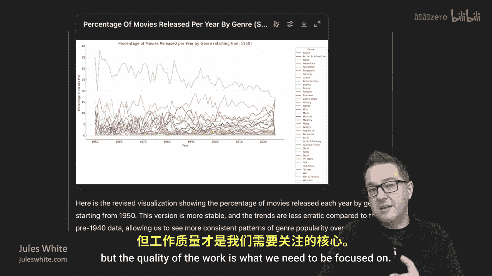

# 范德堡大学【中英⚡ChatGPT与Excel｜ChatGPT + Excel： AI-Enhanced Data Analysis & Insight】 p20 P20 01_更优可视化：利用ChatGPT快速生成Excel图表原型 -BV1PdVizZE1d_p20-

ChatTBT allows us to do something very important， where we're going in and we're thinking about how do we visualize data and that is and it helps us figure out what is the right visualization in the first place。

Now often when we go and we start thinking about visualizing data。

 what we do is we immediately decide on one particular visualization。

 often a visualization that we already know about and we already know how to create。

 and we jump straight to the implementation， but when we start thinking about how do we communicate what's happening in data。

 picking the right visualization is absolutely critical。Now。

 the way that we can support this on ChaGBT and we can help make sure that we arrive at a better visualization is we can use ChatGBT to support rapid prototyping of visualizations。

 and that's what we're going to talk about now is how do we use ChaGBT in a way that can help us explore the ways of visualizing data and do a better job of making sure that we arrive at not only the right implementation of a visualization but also the right visualization in the first place that we thought through。

Now we're going to start off with doing something that we do every time just to make sure that we fully understand the data that we're working with。

 both the human being understands it and ChGBT understands it。

 which is we're going to go and upload the data and then we're going to describe the columns。

 get the column identifiers Now in the case of data。I think it's very。

 very helpful to just take a moment to pull in a snapshot of samples of that data。

 because often there will be things in there that we didn't expect， missing values， not a number。

 all kinds of random things that maybe we weren't anticipating and we didn't realize we're there。

 And this always gives us a chance of spotting them。

 which can be helpful when we start going and creating visualizations of knowing why does it look weird in some place。

 Sometimes we may not have spotted one of those things。

 we always want to just have an opportunity to catch some of these types of challenges。😊。

So I'm just following up with a prop because originally I was telling it give me a list of the columns and the identifiers。

 but it didn't really tell it to give me all the data。

 and now I'm going and I'm saying add three random samples of data per column。

Now we get a bunch of samples and it also inform me of something important。

 there's not a number in certain columns， but it also tells me that。

 you know I have some things that maybe I didn't anticipate。

 that I'm getting NAN in places that you know it says our genre and IMDBID and other places and so I'm going to have to account for that when I go and start building visualizations。

 How does this impact things， but it brings it out and brings it up to the forefront in the conversation。

 I can see it but also generative AI can see it and reason about it more effectively and easily。Now。

 one of the places that I suggest that you start when you're building visualizations is you do a little bit of brainstorming first before jumping in saying this is the exact visualization that I want。

 and maybe it is， take a moment and actually make sure that that's the case。

By doing a little brainstorm meat， so we start off with just a simple prompt， which is。

 give me some ideas for visualizations to show the popularity of different genres over time。

So typically what you want to do is you want to go and state that you want multiple ideas to achieve some goal。

 so multiple different visualizations that could help you achieve some goal。

 The goal is not to say this is a visualization that I want initially instead what you want to do is say show me options that would help me achieve this goal。

 whatever it is that you're trying to understand， tell it so that it can try to achieve appropriately。

😊，You can also get kind of wild and just go in and say。

 come up with some interesting visualizations that I could create with this data so that you can go and explore it and try to understand it。

But if you have a specific goal in mind already， state that right here。Now in this case。

 I'm looking for how have genres changed in popularity over time。

 and it comes back with a number of different ideas。

 We could have a line chart of genre popularity over time。

 We could have a stacked area chart for genre popularity over time， We could have a heat map。

 we could have a bar chart。And what it gives us is a lot of different ideas now I could also go and follow up and say。

 okay， and this is just something good to know is if give if it gives you a bunch of options and then they're all numbered。

 you can go back and say okay， show me number three or show me number four and it will have a specification for exactly what that visualization is supposed to be because it just created。

Now， in this case， I'm going to come back and I'm going to say， well， I looked at all those things。

 but I want something slightly different。 It helped inspire my thinking。

I want you to visualize the number of movies per year that are released in each genre now。

I'm inherently making this underspecified。You notice what I'm not telling it。

 I'm not telling it still。How concretely to visualize it what type of visualization I'm not telling that heat map or line chart or that。

 I'm just saying visualized number of movies per year。

 So what I'm doing is I'm adding additional specificity。

 I'm saying what I want to do is I want to track the number of movies per year。

 That's how I'm going to measure popularity。 So I've add specificity to my you know instructions。😊。

But I'm still leaving it somewhat underspecified。 And the idea behind this is this gives us the opportunity to engage with that natural generative nature。

 sort of randomness and， you know， creativity that is underneath the hood in the model to give us different possibilities。

 So when I go and do this。😊，It visualizes it in a way that I didn't initially think about。

 which is kind of interesting， which is it's using this heat map。Now， if I had told it explicitly。

 no， I want a line chart because that's what I was originally thinking in my head。

I wouldn't have gotten to see this option。Now， what does it cost me to look at the option？Very。

 very little。 It was seconds of my time sitting in there waiting for it to create that。

 So it just informed my thinking。 It gave me another picture in my head of how I might look at this data。

 and it's one that's kind of interesting to me because immediately， I can look at this and say， wow。

 drama is really popular， particularly it looks like in you know the late 2020s。 but you know。

 it actually dropped off， it looks like around 2024， potentially your 2025。

 maybe there's a trend like it came up in popularity。

 there was kind of a wave and then it's dying out in popularity。 but also I see， man。

 there are a bunch of things that aren't really popular at all。

 But comedy has always been pretty popular。 And like this is actually pretty effective visualization。

 If I wanted to go and really see the top things。 it's kind of an interesting way of looking at the data that I hadn't thought of。

😊，Now， it's not exactly what I wanted。And so I went back and I said， well。

 maybe the difference is that I don't really want counts because counts isn't fully what I want and I'm going to say let's create a visualization that shows the percentage of movies released in each year from each genre。

So what I'm doing is I'm adapting the prompt but I'm adapting what data goes into the visualization。

 but I'm not directly controlling the visualization Yes I could go back and say put it into a line chart。

 but I always like to focus on what is the actual data。That I want to see。

 and oftentimes I let generative AI figure out what it thinks is the best way to present that data to me now。

Yes， you can go in and be really explicit， put this into the X type of chart。

 I like to just get some of that， you know， I like to be surprised a little bit and see things that maybe I wouldn't have seen before。

In this case， I see something that looks like what I was originally thinking in the first place which is sort of popularity of genres over time。

 and this is like a really helpful picture to see because this is what I had in my head originally Now I learned a lot of things along the way。

 And that's part of the reason that I like doing sort of the exploration is even if I have a mental model of exactly what I want。

 I often like to see other things because one day I may come back and those things that I saw me inspire me to create some other visualization that may be helpful to me or I may end up saying something that I like even better。

 I really did like that heat map。😊，Now。One of the things that's really amazing about visualizations is that as we go and create them。

 we can also interactively talk about those visualizations with ChatGBT。😊，Now。

I want to talk about how to do this effectively Now we've just created this visualization。

Now what chattGBT normally sees is it's going to see the code that it created to produce this visualization。

It doesn't see a picture of it in the same way that we do。

But it turns out we can actually bridge that gap through something called multimodal prompting。

That is， just like we can go and attach a file or a data set to our prompt。

 we can go and attach an image to our prompt。So whenever we build a visualization。

And then we realize that there's something that we want to talk about that is shown in that visualization。

 and we want chat toBD to see what we are seeing。 What we can do is we can simply take a screenshot of the visualization and attach it to our prompt。

So what I'm doing here is although it looks like this is the same stuff that we're seeing in all the other prompts that it's looking at and visualizing our data set。

 actually what I've done is I've taken a screenshot of just that part of the screen I've attached it to my prompt and I'm saying explain the strange look before 1940 because there's this weird sort of like hourlas shape that showed up in the visualization and I'm like why is that there because I don't really like that I want to get rid of that thing I think I want to get rid of it I don't really think it's helpful。

😊，And。I want it to see that I see this thing， I want it to be able to look at it from my perspective。

 and so simply by grabbing a screenshot or a photo of what we see so that we can then talk about it through sort of a shared picture。

😊，So I've attached a screenshot to the prompt， and I encourage you to do this use multimodal prompting whenever you want to talk about what you are seeing。

 take a picture of what you're seeing， a screenshot of what you're seeing and provide it with the prompt because otherwise it cannot see in the same way that you can。

Now once I do this， it says， okay， well the strange look of the graph before 1940。

 which includes dramatic spikes and fluctuating trends can likely be attributed to several data related issues or historical errors Now this is fascinating。

 it's seen exactly that thing and it's describing now in words what I saw and that I told it to look at。

It could be because of limited movie production in genre classification before the 1940s。

 the film industry was still in its infancy with relatively few films being produced each year。

 As a result， genre diversity was not as pronounced。 data quality and incomplete records。

 records from early 1900s may not be as comprehensive。😊，Gre assignment challenges。

 genres often were not often standardized or clearly defined in the early film industry。

 sample or small sample size effect due to the smallest number of movies produced 1940。

 the visualization's percentage based approach may cause percentages to vary significantly year to year。

Excellent， excellent analyses。 And then it goes on and。Then it comes back with this nice summary。

Okay， it could be sparse data availability， changing genre definition， small number of films。

 data inconsistencies。So。😊，What we can do once we go and say。

 why is this the case and it proposes a bunch of things because it's seen what we're looking at。

Is then we can follow up and tell it， go and take your explanations or your instructions about how we might solve this problem and get to the root of the issue and implement them。

So what I'm telling it now is analyze the data and determine which of these is responsible。

 So basically what I'm telling it is everything you just said might be an issue。

 I want you to do an analysis to determine which one of them is the cause。 Now。

 I want you to take a moment。And think about the complexity of what's being done here。

 and just appreciate how amazing this is。 You imagine a human being coming into you and showing you this chart。

 And you're like， that looks weird on the chart。 Youre right， It's somebody who reports to you now。

 And you're like， that looks really strange。 Why is that。 And they say， well， it could be this。

 It could be this。 You could be this。 It could be this。 It could be this。 And you say， great。

 all those things you just said， go analyze all of them and figure out which one is the cause。

 And that's exactly what we're doing here and it can go and do that for us。😊。

Now what it's doing is it's doing rapid prototyping。

 it's also doing rapid analysis of the visualization itself and helping to understand why does it look the way it does。

 how is that right or is it something we need to fix in the visualization。

 so when we say just analyze the data and determine which of these is responsible。

 we're telling to go and follow its own instructions or proposals about what might be the issue with the visualization。

It then comes back and it says， okay， it looks like here's the key findings。

 sparse movie production and number of unique genres， so there's not many movies。

 a ton of genres we basically see that these are the issues so I say that's great。

Let's start from 1950 so we have a problem before 1940， let's just go past 1940 to 1950。

 I'm still okay with that in my case for the analysis。

And notice we're doing this really rapidly right we're fixing the visualization。

 If I had to go and mess around with this directly。

 it's going to take me a lot longer to do this in Excel。

 but basically by going in and doing it interactively， I can really rapidly， you know。

 explore the data。😊，Much， much faster than I can in a tool that's going to be later used to realize the data。

 you know， like Excel。 So when I tell it to redo it in 1950。

 it really quickly filters the data and now redoes it from 1950。

 And I've got a nice looking visualization that I can work with。😊。

At this point that I've got the visualization， I can either take this visualization and export it and just make that my stopping point。

 I can put it into a PowerPoint slide， I can export you know a whole bunch of things that I need artifacts and discussion of how I created this so that somebody else can replicate it。

Or at this point， then I've got something that I can go and take into another tool and implement so I can take it now into Excel and implement the same visualization in Excel。

 So as I work with the interface of Excel， the visualization within Excel can be updated。

 but the rapid prototyping freezes up to explore many different options for understanding that data。

 it then frees up to much more you know effectively understand potential issues in the data or issues in the visualization that may limit。

 you what we see or create weird artifacts that we want to eliminate。😊。

We can go through and eliminate them， analyze， do all of these interesting things。

 And then once we figured out yes， this is what I actually want to show。

 then we can spend the time to do the implementation。

 And this allows us one to get to a better result at the end of the day。

 The real reason we should be doing this is because we want to arrive at a better。

 more rigorous analysis， a better visualization， a better communication of what's going on the data。

 not something that's more error prone or less thought through。

 We want to end up with better thought in what we're doing。 and we explored more options。

 We explored the data in more detail。 Now we can focus on the nitty gritty details of how do we implement this thing。

 How do we figure out how to make this work in Excel。

 And that frees up to produce better quality work。 Now well probably get there faster， too。

 but the quality of the work is what we need to be focused on。😊。

