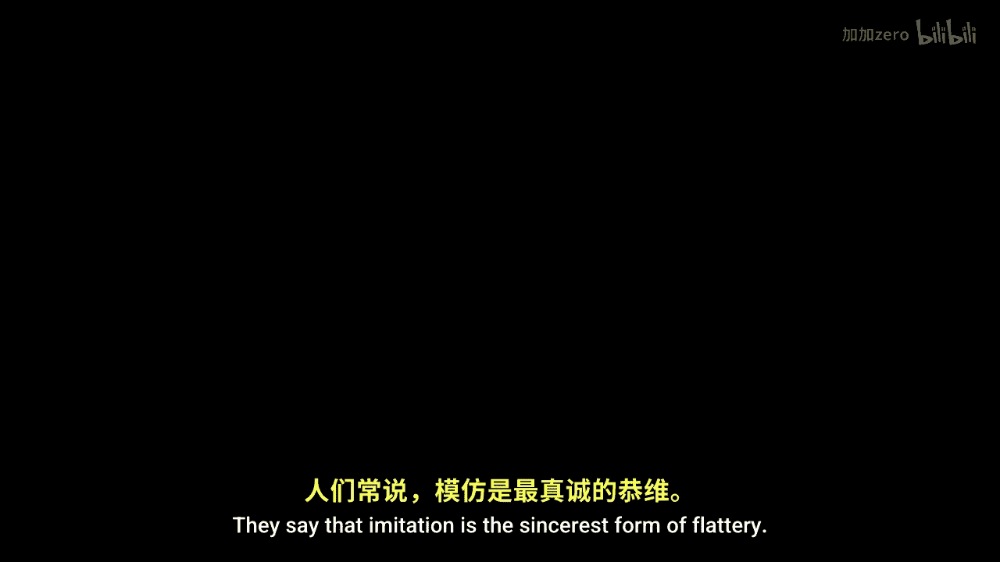
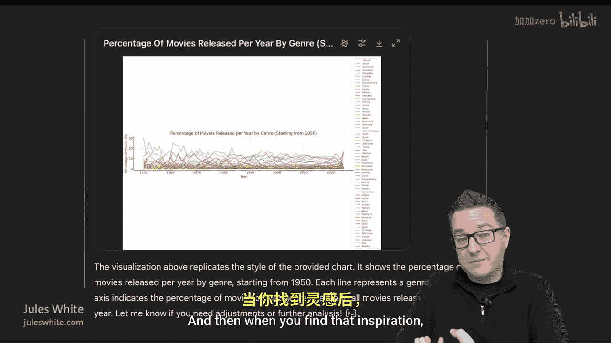

# 范德堡大学【中英⚡ChatGPT与Excel｜ChatGPT + Excel： AI-Enhanced Data Analysis & Insight】 p21 P21 02_从灵感到实现：根据图片复现Excel可视化图表 -BV1PdVizZE1d_p21-

They say that imitation is the sincerest form of flattery。

And I think this is really true when it comes to visualizations， you know。

 one of the things that I love to do is to go get an inspiration。

 to go to a museum and to walk around and see all the beautiful ways that people can express ideas。

 but the same thing is true for everything from logos to data visualization to going in and seeing beautiful visualizations。

 clear pictures of what people have done and how they've expressed ideas from data is really。

 really important。😊，Now one of the challenges that comes is like once we found that perfect picture。

 the style that we are trying to express our data into is， how do we go and realize it？Now。

 what's amazing is that we can use ChatGBT as a tool to help us translate our goals and ideas into data visualizations one of the ways that we can do that is by showing it pictures of what we would like to achieve。

😊，So what I want to do is go back to this data visualization that we've been created。

 Let's imagine that I hadn't created this visualization that was in my head。

And I wanted to figure out how do I create it Like I saw somebody that created this great visualization。

 and I would like to do the same thing with my data。 How do I get there。

So I've started a new conversation in ChatGBT and I'm going to show you one of the ways that you can get there in a really powerful technique that you can use with chatGBT and this goes back to this idea that we can show chatGBT pictures or screenshots of things that we would like to discuss。

 but also to give it a context and information about what we're trying to do。😊，In this case。

 I've taken a screenshot actually of the final visualization it produced in another conversation。

 I started a totally new conversation and now what I want to do is say I want to replicate this。😊。

And so I've attached a screenshot plus my original data set。And then I've created this prompt。First。

 describe the data in this file， list each column and what it is， the data comes from an Excel file。

 and so I'm doing my typical thing that I do about saying。

 telle me what's in the structure of the data， what the identifiers are so that it can go and reason about them effectively。

And then what I say is then look at the provided visualization。

 try to create a similar visualization with the provided data。

So this is something that's just going to be tremendously important throughout your experience and work with chatGBT for visualization is that you want to take screenshots and pictures of what it's producing。

 but also the things that you see that you want it to know about like if you see a beautiful picture。

😊，In a magazine， take a picture of it， show it to ChatGBT if you're browsing the web and you see an incredible infographic or data visualization that you want to figure out how to recreate。

 snap a picture of it， give it to chattGBT， but images are context that ChatGBT can use to help target what it does。

Now in this case， it says， okay， here's what the dataset contains， here's the following columns。

 it says I'll now create a visualization similar to the one created in the screenshot。

 and it goes through and it does a pretty good job。 Now note it's not exactly the same thing。

 And the reason for that is is because it's not producing pixels。

 What it's doing is it's looking at the screenshot and it' figuring out how to write Python code to replicate it。

😊，And then later， of course， we're going to go and figure out if we want to how to replicate this visualization in other tools like Excel and what it'll do is it'll translate what we're trying to do the image that it saw into something that can be implement in another tool like Excel。

 but it's a simple technique to help kickstart the creation of visualization。

 guess we can go and explore through language and text and interacting back and forth with prompts。

 we can also go and explore with the images。 we can say here's an image of what I'd like you to visualize。

 you know here's the style of visualization I'm looking for。 here's the data。

 and then you could come back and you could say now here's a picture of what you produced。

 I want you to tweak it in this way。 You might even draw and annotate。

 You might print it out and annotate it and say I don't like this part of it。

 or this is weird You could also draw in a screenshot digitally on your computer and then hand it to it。

 Many different ways that you can do this or annotate it within one of these tools itself。😊。

But it gives the model a shared picture of what you're looking at and what you're trying to achieve。

 and you can express your goals， your changes， your desires。

 whatever it is through imagery and through annotations on that imagery。

 and it's a really powerful way of going in interacting。 Yes， you can do it through text。

 but you could also support your discussion with imagery to help arrive at a better visualization。

 and also allows you to go get inspired by the things you've seen around you。

 And then when you find that inspiration， bring it into ChadgBT and start figuring out how to realize it with your data。

😊。

