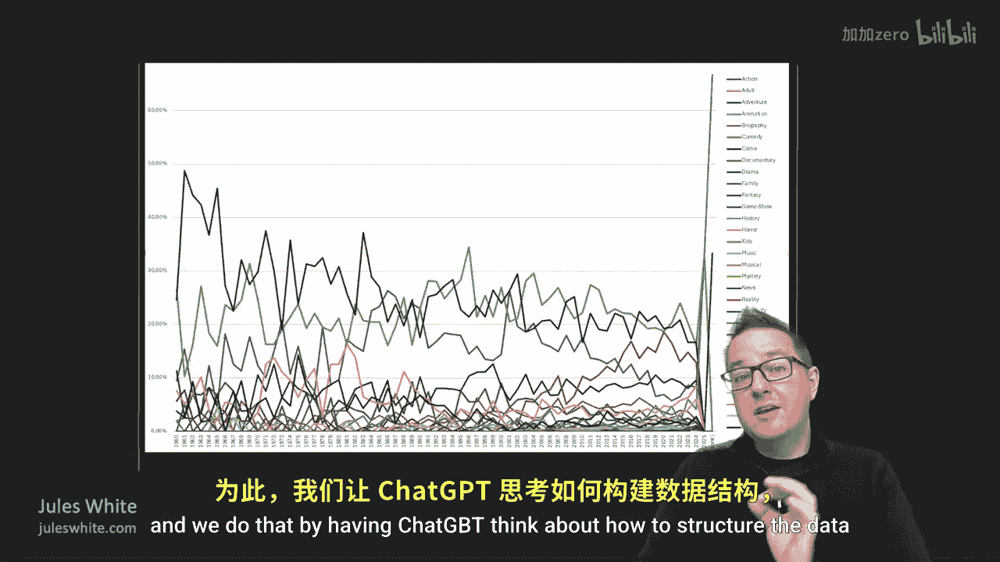

# 范德堡大学【中英⚡ChatGPT与Excel｜ChatGPT + Excel： AI-Enhanced Data Analysis & Insight】 p22 P22 03_简化实现：在ChatGPT指导下创建Excel可视化图表 -BV1PdVizZE1d_p22-

Once we built an incredible visualization， now it's time to take it and implement it in the tool of choice that we want to create it in。

 which in this case， we're gonna implement it in Excel。

 So how do we take this visualization that's been realized and now replicate it so that we can visualize data as we change it in Excel。

 for example， how do we go about doing that。 Well what we do is we start off by continuing the conversation or going and bootstrapping the conversation again with some context like an image or something else that we want to use。

 we could say here's a picture of the visualization I want to create in Excel or we could have gone through and rapidly prototype something in a conversation and we get to the end of it like we did in this case where we had created this visualization after giving it to picture and now we want to go and we want to take it into Excel。

 how do we go prompting for that and there's many different strategies we can take But I want to teach you one that's very effective and that is we want to think about what is the simplest way that we could do this。

😊，We want to do is we want to try to create a table or set of columns within Excel thatll make the visualization absolutely a breeze。

 we wanted to make it so it's almost as easy as just selecting the data and hit insert chart Ily that's how easy it is that we've done all the work on the front end to shape the data and to represent the data and analyze the data so that producing the visualization is just dead simple。

Now， you don't have to do it this way， but it's going to make your life a lot easier。

 And part of the reason is is because it's probably easier for chatGBT to reason about formatting and representation of data in columns than it is to think about the expression and visualization itself。

 That's not the easiest thing。 And so I find that it's more effective to think about how do we get the data into a shape where the visualization is the trivial detail in order of implementing So I'm going to start off at the end of this conversation。

 I'm adding an additional prompt， which is to replicate this in Excel。

 What columns would I need to make this as easy as possible to visualize。😊。

And it's going to come back and it's going to describe the shape of the data that I should have to make this visualization easy Now。

 when we were rapid prototyping the visualizations， we were rapid prototyping in Python。

And it can do some really sophisticated things in Python and automate all of it for us once we head into Excel。

It can't automate it all for us。 Now it can， in some circumstances， it can do VBA script。

 and we'll talk about that at some point。But right now I want you to think about not using something like V VA Sc and when you're not using it。

 you're going to have to do some manual work and we want to minimize the manual work and make it it as the least likely that or we want to make it very unlikely that we're going to make a mistake and the easiest way to do that is to try to generate a bunch of columns or a new sheet where we get the data in the right format where we can see it all and see what's going on。

So it says this is the best way to do it。 We should have years as rows。

 and then we should have across it all the genres。 this is not the current shape of our data。

 So it's basically telling us this is how you're going to reshape your data to make the visualization easy。

So once we've got that， and that's our goal is to get it to describe。Essentially。

 a format that will be really easy to work with for visualization。 Then we can say。

 give me step by step instructions to recreate this format as a separate sheet using my current data instruction。

 I want to use a pivot table。 Now you don't have to say I want to use a pivot table In this case。

 I knew I wanted to use a pivot table because I thought that was going to make this easier for me。

 You could also say don't use a pivot table or whatever you want to do。

 So of course you're going to need some expertise in Excel to be able to go and say things like I want to use a pivot table if you don't know。

 you can leave those types of details out and let chatdgPT choose for you。

 But the goal is you want to get it to describe the shape of the data。

 then you want to follow up and say now tell me how to get my current data into that shape within Excel。

😊，Now。I want to give a moment to just say that like every time you ask this question。

 it may give you a subtly different way of doing it。

 It may give you a completely different way of doing it。 And you should exploit that。 right， if you。

 if it gives you an option and you're like， I don't like that， that seems like a lot of manual work。

 For example， if I didn't say use a pivot table， It might say。

 go and manually create a column for every genre。 It might say， I don't like that。

 And if I just edit my prompt and resubit it， it may come back and say， okay， well。

 here's the pivot table version。😊，And so don't just accept whatever the first answer is because it can give you many different answers。

 many different ways of implementing this shape Also。

 if you don't like the shape that it's giving you initially， so if you look at this and you're like。

 this isnt what I want to do， I think there's a better shape for it we'll describe that shape。

 get there， but you don't have to accept whatever it says you can always go back and resubmit the same prompt or edit it slightly and resubmit it or continue the conversation and say no it's not quite what I want to want to do something else。

 but just know that。😊，Now， in this case， it comes back and says， okay。

 here's how you're gonna to do it with a pillow of a table， load the data into Excel。

 That's pretty obvious。 prepare the data， split the genre column。 Now this is interesting right。

 I want to get from because of the shape I have to get from basically having this one column that has all like action comea comedy you know adventure。

 whatever the heck it is and split it up into separate columns or entries and I only want the first one and it's telling me well to do that。

 here's how you're going do it。😊，It turns out that it's idea。Is correct。

 but it doesn't fully understand the layout of my data。

 And there's an interesting ramification that's hard for it to see。

 which is if I split this column up into separate columns， I may overwrite data to the right。

 And since my genre column is far enough to the right。 It could end up overr it。

 Now I discovered this when I went in and started looking at it them。 So oh。

 that's not going to do what I want。 And so I tweaked it a little bit， I move that column over。

 then I split it， then I took the values that I want。 So it's a guide for you。

 but at the end of the day， you still have to pay attention。 It shouldn't replace your thinking。

 if you can't understand what it's doing， you really shouldn't go and try to implement all of this because if you don't understand it。

 there's a great chance that you will make a mistake。

 you'll produce a visualization that's wrong and you will make an incorrect decision。

 The end of the day， you want to keep asking questions。

 keep working with it until you understand what it is doing。😊。

If you do not understand what it's doing， don't proceed。 Now in this case。

 I spotted that it was doing something that was subtly wrong。

 I just went ahead and manually corrected it。But you could also go and tell it， hey。

 that step is wrong， can you give me another way because I'm going to run into this issue？

Then it says insert the pivot table。Describes how to set up the pivot table。

 I go through all of this。 It tells me how to change it so it's based on percentages。

 goes through some cleanup， some other things。 and then this is what I get out of it is I get a pivot table that gives me the data in that format basically that it provided earlier。

 So if you look at this pivot table This is essentially doing what we see here。

 we have the genres basically across as columns and we have years as rows。

 and then we have percentages as the values。 now there's slight variation in sort of the formatting。

 but we see we have rows going down now， we have genres across as columns。😊，And then from there。

 it tells us here's how you go and create the line chart。

 You're going to go and highlight everything， hit insert tab， go to the line chart。

 and then we get the visualization out。😊，And so。When you're going and you're working and you're trying to reproduce visualizations。

 I want you to not think so much about how do I implement the visualization。

 I want you to think first about what is the simplest format that I could put the data into in order to create the visualization and your work should go into getting the data shaped correctly。

Before you try to create the visualization， shaping the data is the work。

 you want the work to go into shaping the data。 The other reason is because all the skills that you've learned about how to build formulas。

 how to do it as separate columns， how to debug things and look at wheres the where's the problem。

 All of those skills then come into play and you can use those same techniques to make sure the data is shaped correctly because more than likely what you're going to do is you're going to use some formulas to reshape the data into the format that you want。

 And you can then apply all of the techniques you've used for how to make sure that。😊。

As you create those columns that you do it in a way that's simple and easy to understand and helps you pinpoint where errors are。

 and then once the data is shaped correctly and you know it's correct and you've checked it for errors then you can produce the visualization。

 But if you try to do too much in one step， it's really easy to make a mistake。

 And I've said it once， I want to say it again， humans have been making mistakes in Excel long before chat GBT was around。

 We didn't need chat GBT in the mix to make mistakes in Excel and chat GBT makes mistakes in Excel just like we do what we don't want to do is put the two together and have mistakes that the human doesn't understand and chatGBT doesn't realize it made and then we're all pretending everything's correct。

 We don't want to go there。 what we want to do is we want to use chatGBT in a way that helps us increase the level of rigor of the analysis and visualizations and the correctness of the formulas we do that by using chatGBT to help us think through what the visualization should be to check more。

But then to help us implement in a way that we can check incrementally and only once we've got really robust data that we've really carefully checked。

 do we then go and produce the visualization and when we produce the visualization。

 we want it to be so straightforward that there's minimal chance that we're going to make a mistake and we do that by having chatTputT think about how to structure the data to make the visualization as easily as possible。

