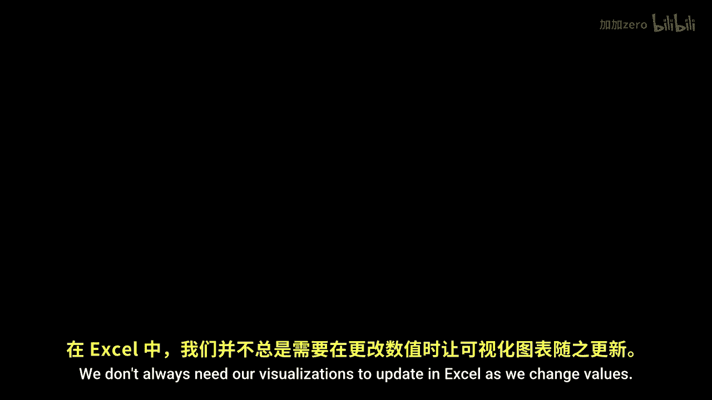
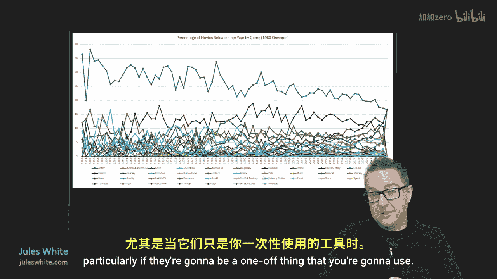

# 范德堡大学【中英⚡ChatGPT与Excel｜ChatGPT + Excel： AI-Enhanced Data Analysis & Insight】 p23 P23 04_速度技巧：用ChatGPT快速构建Excel可视化图表 -BV1PdVizZE1d_p23-

We don't always need our visualizations to update in Excel as we change values。

 We don't always have to have Excel be the way that we go and calculate all the intermediate sort of data or that shape of the data that we need to implement the visualization。

 one are that really sort of effective ways to do if the real goal is to get the visualization。

 but we don't care if we get to all the intermediate data within Excel。

 we can actually do sort of what we can look at。 I think of it as like the cheat mode for getting Excel visualizations and getting them created faster。

 Now we can so go and check all the data， which is kind of one of the beautiful parts of this。

 But there's actually a faster way to get get to implement。

 if we don't have to have the intermediate data directly connected to the original data。

 And so I want to show you how to do this， this is one of my favorite ways to rapidly implement a visualization in Excel。

 And if it's okay if I edit the individual sort of intermediate。😊，Data items。

 then this is really effective also at having visualizations that we can update。

So Im going to go back to this visualization。Now， at the end of this conversation。

 I went and I created all of the formulas and other things that I needed in Excel， in this case。

 I used a pivot chart or a pivot table to basically create the shape of the data that I needed to produce as visualization。

Now the reason I did that is because I wanted to reshape my data into a format that made it easy to create the visualization。

 I don't actually have to reshape the data within Excel。

What I can do instead is I can follow up in the conversation。And I can say。

 I need to recreate this visualization in Excel， give me any derived data that I need as CSV。

 and then step by step instructions to create it。So what I'm trying to do is I'm telling it， look。

Here is the original data。 Now， I want you to go ahead and do all the reshaping of the data into the format that's going to make it easy to visualize inside of Python within chattGBT。

 And then once you've created that reshaped data， just give me the reshaped data。

 I don't need the visualization anymore。 What I need is the reshaped data。

In a format that I export and import into Excel。 So in this case。

 I can go and do the intermediate calculations， reshape the data into that table that I need that has。

 you know years as rows and genres as columns。 It can reshape it for me to produce a CSV file that I can then download。

😊，And I can then import that CSV data into the sheet that I need or into Excel in order to create the visualization in Excel。

 But I don't actually have to go and recalculate within Excel， that intermediate table。

 I can have it do it for me and have a static version of it that I import into Excel。

 So depending on your needs， this can be a faster， I mean。

 much faster way to go and get the visualization into Excel。

 if you don't care about the intermediate data being connected through formulas to the original source data。

😊，So once I do this， I get a prompt or sorry I get an output back where it gives me a link to download the data。

 so it's already prefiltered， notice it's starting from 1950 onwards。

 it's already reshaped into the right format， it then gives me instructions on how I go about and download it。

 import it into Excel and then create the line chart and format it correctly。

 and once I go through all of these things it also gives me all these hints about legibility etctera。

 fine tuning， then I get the data。And the visualization brought into Excel， but it makes it much。

 much faster to implement this because。The real work is the reshaping of the data into the format that Excel can then easily visualize。

 I can do that work directly within an Excel， which is what we did originally。

 where I can have it automate that work for me in Python。

 Give me a CV file that I can take into Excel and then visualize from there。

 This is the fast way to do it。 It has limitations in that。😊。

Once it's exported this CSV and you copied into Excel。

 you've essentially disconnected the intermediate data from the original source data。

 They're now separate entities that may or may not be a problem for you。

 Most times it's not a problem for me as long as I'm willing to go check that intermediate data and make sure it's correct。

 And I can do that pretty easily。 by looking at the values and you know。

How I get there is not always as important as that I've gone through， I've checked everything。

 I've produced the visualization。 I've gotten to the intermediate data。

 I've checked it and that the visualization is correct and whether or not I got there directly with an Excel and whether or not it can immediately update it with an Excel is not always as important to me if it's not as important to you。

 then you can rapidly create these visualizations， particularly if there're going to be a one-off thing that you're going to use。

