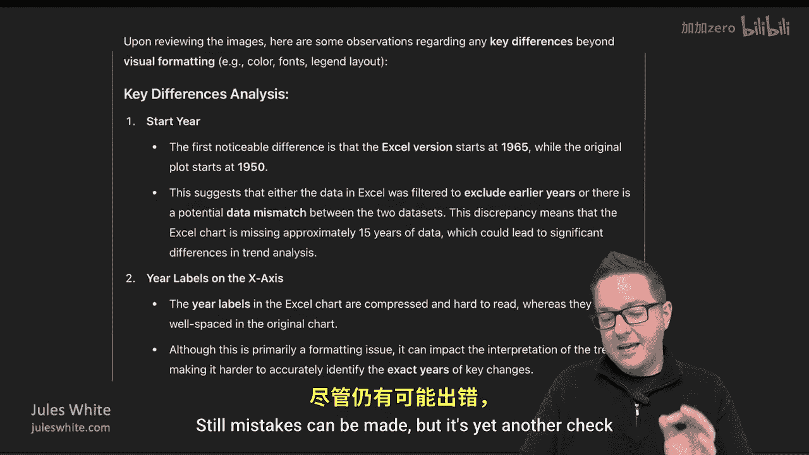

# 范德堡大学【中英⚡ChatGPT与Excel｜ChatGPT + Excel： AI-Enhanced Data Analysis & Insight】 p24 P24 05_双重校验：用ChatGPT对Excel可视化图表进行双向检查 -BV1PdVizZE1d_p24-

My eyes aren't always perfect when I'm looking at things， sometimes I'm moving too quickly。

 sometimes I really don't pay enough attention， especially when we have a complex visualization。

 and I miss subtle discrepancies or differences in visualizations。

Now it's kind of fascinating because ChadTT can serve as a second set of eyes for us to look at visualizations。

Yes， we can go and have it do all kinds of things to check formulas to check data。

 and we can do twosided checking of data formulas， these types of things。

 but we can also have it be a second set of I for us Now again。

 the goal of this is not to replace your eyes。 The goal of this is not to replace human review It's to supplement human review and odd it to make it less likely that we make a mistake And so what I want to show you is how to do two sided checking of visualizations。

 meaning how are we going to use chatgBT to be a second set of eyes for us so。😊。

I created this visualization within Chat GBT。 I really liked this visualization。

 and then I went and I had chatt GBT walk me through recreating the visualization and implementing it within Excel。

😊，Now what I want to know is， is this version that I got in Excel。

 does it have any obvious errors that I may have missed？

Now I've eyeballed it and it looks pretty good to me。But me eyeballing it and。

 and something that complex。 I may not have gotten it right。 So what I like to do。

 and it's a really simple check， is simply grab screenshots of both visualizations。

And take them into ChaGBT for two sided checking or that second set of eyes。

 let's ask ChatGBT to eyeball it as well and see if it notices any discrepancies。

So I say other than legend， layout， color， fonts， et cea。

 you see any key differences in the visualization and data that would lead you to believe there's this discrepancy between the two charts。

So again， this is not perfect， I'm not expecting you know ChadGBT to be able to see necessarily better than me。

 I just want a second check now just because we both don't notice anything doesn't mean it's perfect。

 you would still want to go look at the underlying data and other things。

 but this is just for me to you know get a second opinion。And it comes back and it says。

Let's analyze key differences， Both charts show consistent general trends for drama。

 genre shows a similar pattern in both charts with steady prominence from 1950 onwards。

 so it's capturing that there is this trend around genre we've seen it in multiple different visualizations。

Line placement and consistency across X axis years and trends from 1950 to recent years appear correctly aligned in both graphs。

The Y axis values shows similar ranges for key genres in both charts the genre range stays in the 25 to 40% range。

 lesser genres such as sci fi in action follow roughly the same percentage levels in both charts。

Comes back line order and density， one of the notable features of the chart is the density of genres in the lower percentage of ranges。

Neither chart shows any anomalous spikes or drops so would indicate a data issue in one chart that is not visible in the other。

Legend and John renames the legend is positioned differently， but I told it that's okay。

Summ of analysis， no discrepancy in data， visual differences are cosmetic and key trends align。

That's actually probably a more in depthth analysis of these two than I probably would do。

 Looking at them side by side， I'd probably look at them and knowing me I'd be like， yeah。

 it looks pretty good。 That's a way more detailed analysis。 Now， it might be flawed。

 It might have errors， but that gives me some comfort that they are correct。😊。

Let's go and mess with our chart in Excel， let's purposely change something like let's start the chart at a different starting year so that yeah。

 the data does look a little bit different。 What happens when we give it a screenshot where it's still the same visualization but we've just shifted a little bit where the data starts。

 will it notice。😊，So again， I give it screenshots now in this case。

 I'm giving it screenshots of to make it even more sort of fair and even more difficult to challenge and see where the differences are。

 I'm basically giving it screenshots of the original Excel visualization which was cracked。

And the incorrect Excel visualization where there's a slight arrow。

 can it match up and see a difference between Excel visualizations？And the answer is yes， it can。

The first notable difference is that in the Excel version， it starts at 1965。

 well the original plot starts at 1950。And so what it's seeing is is that basically I have gone and shifted the starting point of the visualization。

Now I just want to like one， this is pretty amazing that it kind of gives us a second set of eyes to go and check visualizations。

Again， I want to emphasize we don't want to replace human review。

 we don't want to replace any second checks that you would get from other human beings， but for me。

 I want an additional check， I want to augment my rigor and I can do that by using ChaGBT to take a look at both what I get out of Python what I get out of Excel。

 do they align。Because if I can align both visualizations that they both look similar on both sides。

 I can build confidence that I implemented W chatt GBT correctly and I didn't make any mistakes。

 I can also have confidence that，There is not some data corruption or other issue that might have reared its head。

Now， does it mean that chattGBT correctly implemented my goal as stated and didn't misinterpret， No。

 it doesn't mean that， but it gives me comfort that my implementation and following of ChaGBT's instructions and in Excel matches what it did on its side in Python and that gives me comfort that things were done correctly still mistakes can be made。

 but it's yet another check that we can do to increase the rigor and the quality of what we're doing。

