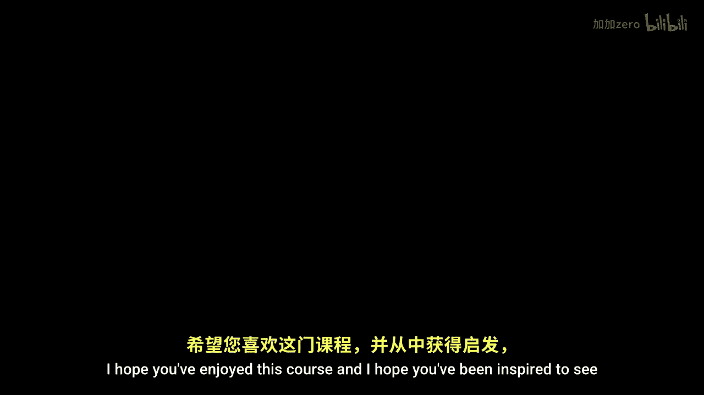

# 范德堡大学【中英⚡ChatGPT与Excel｜ChatGPT + Excel： AI-Enhanced Data Analysis & Insight】 p25 P25 06_谢谢 -BV1PdVizZE1d_p25-

I hope you've enjoyed this course and I hope you've been inspired to see that we can go and do things that seems like they should be impossible。

 but now that are totally possible with ChaGBT and it really opens us up to go and sort of rethink how we approach work how we approach a simple tool like Excel and turn it into something where we can go from a photograph from a document into an amazing computation where we can help realize all these complex ideas and applications It empowers us to do more than we could have ever done before with Excel by having ChatGBT as our partner in this。

 Now if you've enjoyed this course， I would really appreciate if you would tell other people about it if you could relate the certificate。

 please post it on LinkedIn， please reach out to me on LinkedIn and connect I'd love for you to keep following what we're doing at Vanderbilt and the work that I'm doing in creating new courses but most of all。

 I really appreciate you taking the time to go through this course with me and I hope that you go and create some amazing things and if you create something amazing。

 please post it and I would love。😊，To have a mention in anything you put out there about something amazing you did to go check out this course and learn how to do it yourself Thank you so much and I really appreciate all of your time in this class。

