# 范德堡大学【中英⚡ChatGPT与Excel｜ChatGPT + Excel： AI-Enhanced Data Analysis & Insight】 p31 P31 01_什么是提示词 -BV1PdVizZE1d_p31-

So what does the word prompt actually mean Now we talk a lot about prompt engineering。

 and we're talking about interaction with large language models。

And so let's dive into this word a little bit because I want to give you a sense of the depth of what a prompt can be。

 It's more than just a question that you're asking to the large language model。 so to do this。

 I think that's helpful to go through a couple prompts and actually interact with chatGPT to understand the concept of a prompt and sort of the dimensions to a prompt。

So I start off here by just asking chatGPT， what does the word prompt mean？

And it comes up with some really helpful， I think， information for us to use when we're talking about prompts。

 one， it says it's a verb。To cause or encourage someone to do something， to spur them to action。

 And as says example， the teacher's reminder about the upcoming exam prompted the students to start studying。

 So part of what a prompt is， it is a call to action to the large language model。

 It is something that is getting the large language model to start generating output for us。

 Basically to start generating words that will form the basis of our output。

 and those words could take all kinds of different formats。 It could be software。 you know。

 defining the instructions and a program。 It could be the words that we need for that。

 It could be words and a poem。 It could be words in many， many different types of things。

 we could do it as structured data that we need。 All of these things are possible。

 but the key is the prompt is basically our way of getting the large language model to begin to。😊。

Provide some output for us。The second thing it says is it's an adjective。

 It's done without delay on time。 And this is an important thing to think about with large language models is we're prompting them right now do this。

 But this is also a useful point of discussion， because a prompt doesn't necessarily。

 depending on how you work with it， have to be something that happens right now。

 prompts can have time as associated with them。 And now we have a little bit of an illusion of time。

 And I'll talk about this later in the course。 But when we give prompts to the large language model like chat GPT。

 The prompt could affect what's happening right now in my next statement that I give it or in the current statement。

 or it could affect something in the future。😊，And this is because of some of the conversational capabilities of these large language models now we're going to talk about prompts。

Themselves as conversations later on。 But for now， the way to think about it is a prompt doesn't just have to be something that's immediate。

 It can be， but it doesn't have to be。The next thing it says is a prompt can be a noun， a cue。

 or reminder that helps someone remember what they were supposed to do or say。Now。

 this is important because we can use prompts to remind the large language model of information or of things that it needs to do。

And so we may be asking it to do something now， we may be asking it something to do in the future。

 in which case it needs to remember something， so we need to give it a reminder of what it's trying to do。

We may。Need to go back and you give it a history of the conversation of things that have happened。

 other things that'll help it remember what it's trying to do。And then it can be another noun。

 a message or screen that appears on a computer or electronic device asking the user for input。

So this is kind of a helpful thing because we can prompt the large language model to produce things for us。

But the large language model， if we structure things correctly。

 can actually elicit information from the user， so the large language model can ask questions to us so a prompt could both serve as a call to action or to spur spurring the large language model to action or it can actually be an input。

 it can be asking us for input， so the last output from the large language model could have been a question for the human。

And basically， we are then providing information back to it。

 So prompts have a lot of different dimensions to them。

 And if you actually look at the definition of prompt， in fact， the definition that chat GT gives us。

It gives us sort of that nuance to the capabilities of a prompt。Now I've gone on a little bit here。

 and I'm going to give you an example of this time aspect to a prompt。

 because I think this helps to see the complexity and dimensionality of this concept。

I'm going to say from now on， when I ask a question。

 suggest a better version of my question and ask me if I would like to use it。

 So right here I'm starting off by saying from now on， I'm attaching time to my prompt。

 so it's not just immediate。And we get a response sure I can do that， however。

 I will start out to ask you the original question to the best of my ability and it goes on to try to reframe this original question which wasn't what I necessarily needed。

 but then I say what color is the sky？Now notice we're done， right。

 we asked the original prompt was back here， I said from now on when I ask a question。

And it immediately gave us a response because of that prompt。

 but now I'm going to ask a follow on question， but the earlier prompt is going to affect this question。

Right now， I'm asking something immediate what color is the sky。

 and it responds with a possible better version of the question could be。

 what is the scientific explanation for the blue color of the sky during the daytime？

Would you like me to use this version instead， and then I say yes？

Now notice here we have a lot of those different dimensions of a prompt that we talked about。Up here。

 we are。Creating a prompt that isn't just immediate。 It is going to affect us in the future。

 It's going to continue to influence the output of the large language model。

 So it is we can have immediate prompts that right now， right， right at this moment do something。

 but we can also have prompts that span time。And in this case， that's what we're doing。

 we're creating something from now on， go and do this。Now we're going to have an immediate prompt。

 which is what color is the sky we're asking this right now。

 and now our earlier prompt that we provided that was spanning time is now impacting the way that the large language model responds to our questions。

 So now what's happening is it's taking our current immediate question what color is the sky。

 but it's using the context that we had previously said to suggest better versions of all of our questions and then ask us if we'd like to use them to generate its output and its output is。

😊，Here's a better question。 What is the scientific explanation for the blue color of the sky during daytime。

 And you can see how that really is a better question than my first question。

 My first question was sort of vague， didn't provide enough context。

 And now it's giving us a more specific question that truly is better。

 And that's because of this prompt that we attached some time to it， we said from now on。

 And so it's influencing what said now。😊，The other thing that we can see is we talked about a prompt being something that can elicit information from the user。

 and so now we're seeing that the chattGBT in this case a large language model is asking us for information It's prompting us' soliciting information and it's saying would you like me to use this version of the question instead So now we've got that extra dimension of a prompt。

 It's soliciting information from us and we say yes， and then it goes and answers the question。

 and it says great to answer your revised question。

 the blue color of the sky during the daytime is due to a phenomena called Raleigh scattering or raylely scatter and I apologize。

 I don't know this term， and I'm actually learning something from chattGBT as I read this the Earth's atmosphere is composed of various gases and particles that's scatter sunlight in all directions。

😊，Blue light has a shorter wavelength and higher frequency than other colors。

 which causes it to scatter more easily in the atmosphere。 The results。

 this results in the blue color that we see when we look up the sky in a clear day。 Now。

 we've seen a lot of different dimensions to prompts through this short interaction。

 We've seen creating time prompts that span。😊，Longer we then see an immediate prompt that's spurring the large language model to action。

 we see the concept of the large language model prompting and getting input from us。

 and then we see the output of all of this now。One of the things to note is we also talked about memory。

 that the prompt had a source of a concept of sort of memory to it。

And we'll talk about how this works in the future， but right here I say from now on。

 when I ask a question， that's something that the large language model has to remember in the future interactions。

 and we'll see how it actually does this and so then when I say what color is the guy。

 it's remembering that I said whenever I ask a question。

 ask a better version of a question and then it's responding right here with the better version of the question。

And then if I go and I do this again， we'll see that it still remembers my original statement that it need to suggest better versions of my question。

 So I said how many countries are there in the world and it says a better version of your question would be what is the current estimated number of countries in the world and how is a country defined would you like me to use this version instead。

 and then I say yes， and then says great as of my knowledge cut off in September 2021。

 there were 195 recognized sovereign states or countries in the world， however。

 this number may vary depending on how a country is defined the United Nations， for example。

 has 193 member states while other organizations and countries may recognize different numbers。

 generally a country is defined as a sovereign state with its own government territory and international recognition。

Now， one other interesting thing that we talked about is that a prompt has some memory associated with it。

 and this also shows us some of the limitations。That the large language model's knowledge cuts off in September 2021。

So one of the other things that we may need to do for the large language model is we may need to remind it of what has happened since it was finished being trained。

We can use a prompt to provide information to the large language model like chattGPT about what happened after it was trained so we can also use it to provide information that the large language model didn't have access to when it was trained like our own private information or other things Now。

 of course you have to be cognizant that when you're using chattGPT or many of these other tools you're actually sending information to their servers。

 So you do want to make sure that that is something that you're willing to do before doing this。

 but if you're using a large language model locally on your machine or you're willing to send the information you can provide information that it doesn't have access to in order to reason about。

 So a prompt can also be about providing information to one of these language model。

 So if we look at this example when we say what was Vanderbilt universities。

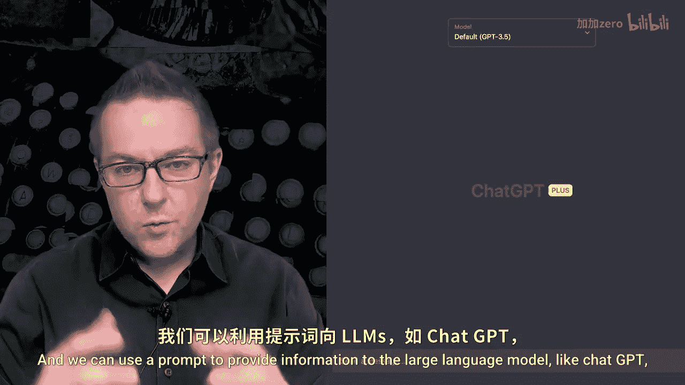

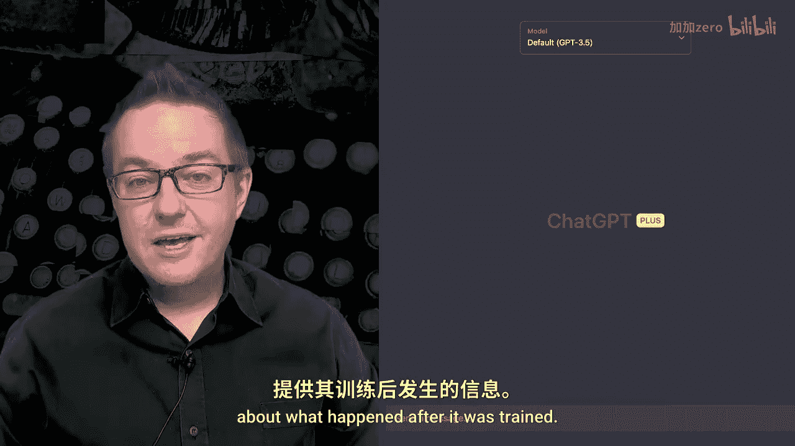

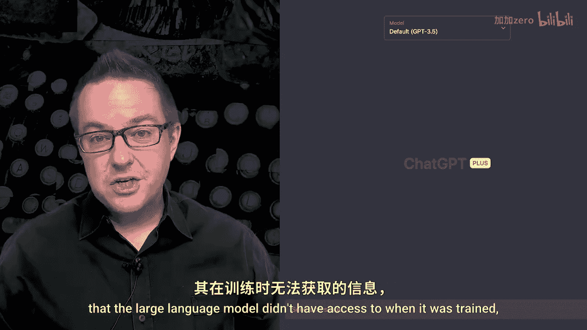

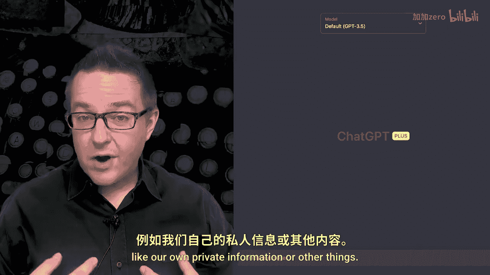

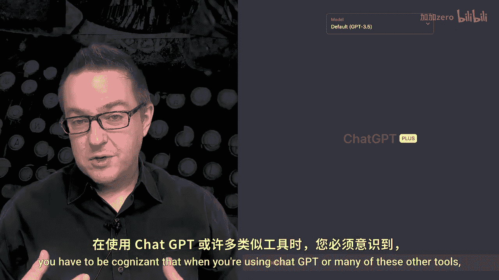

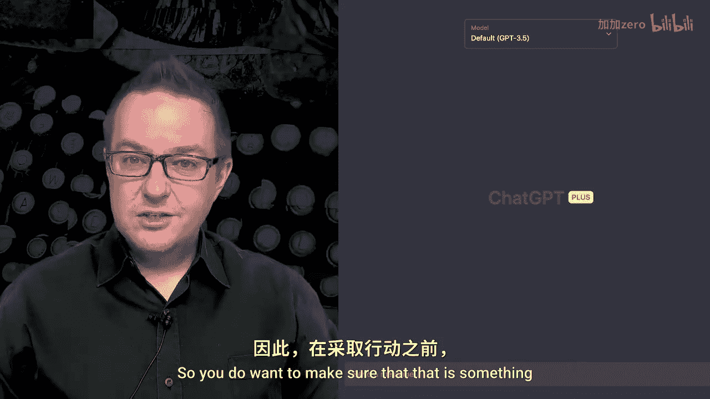

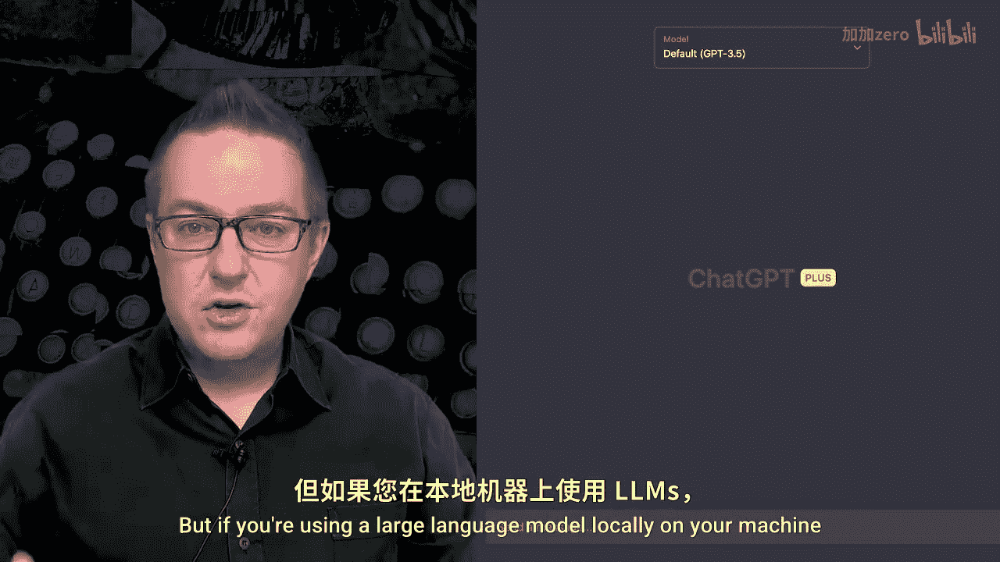

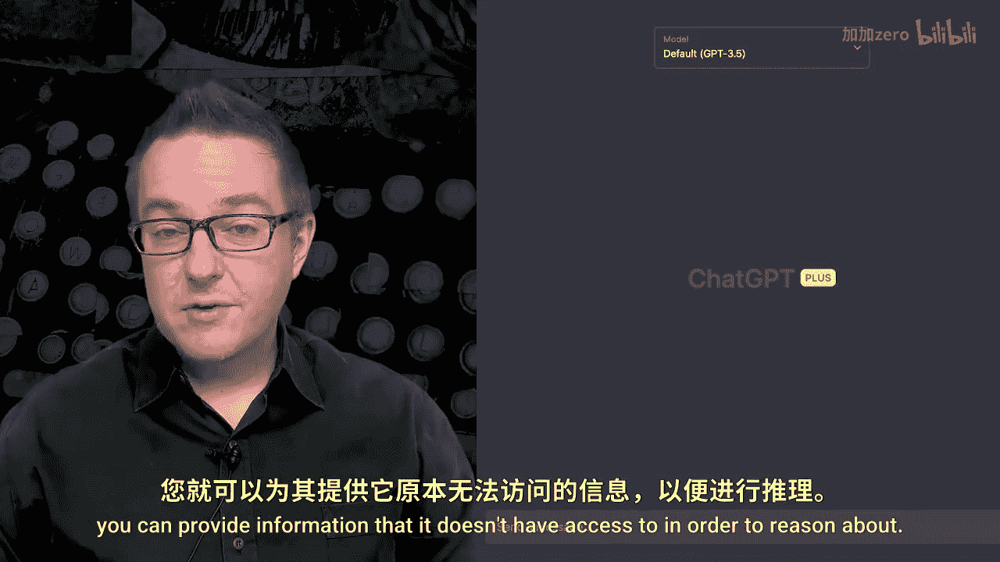

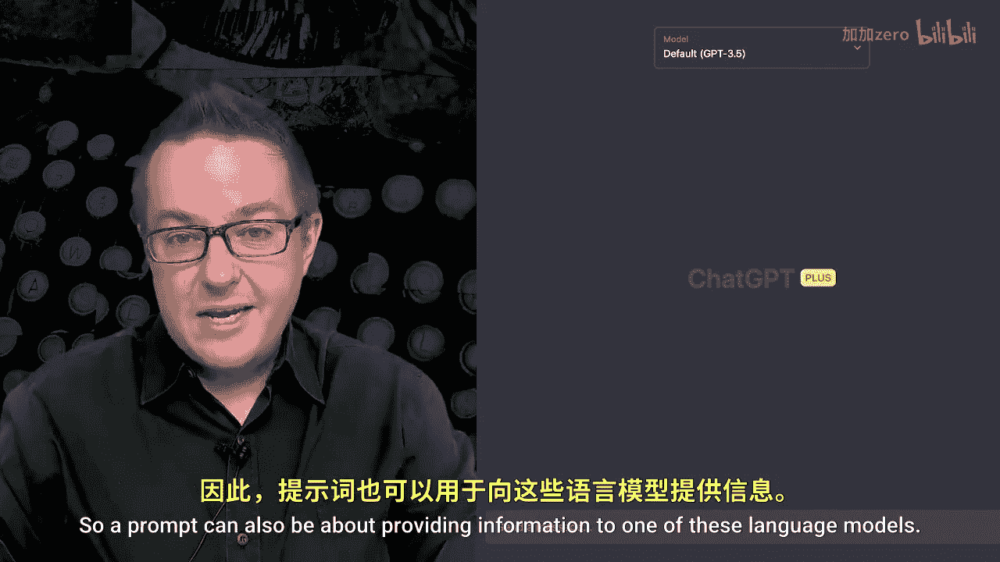

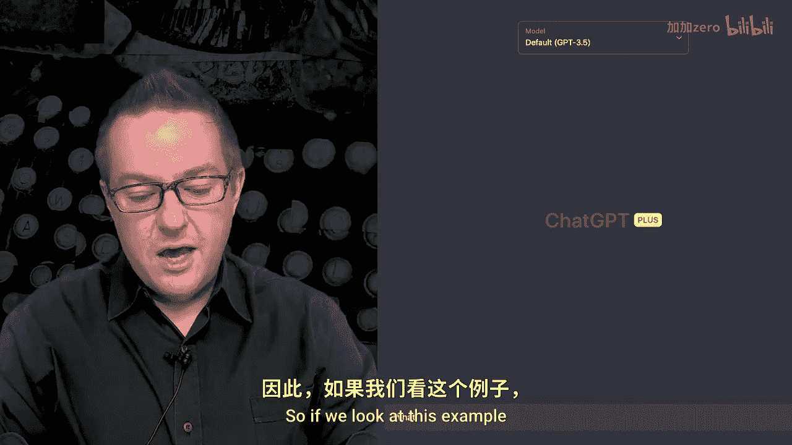

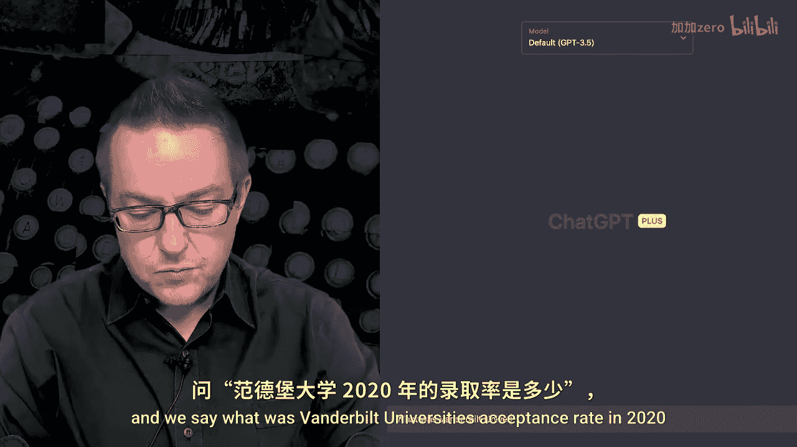

Acceptance rate in 2020， it should have access to that。

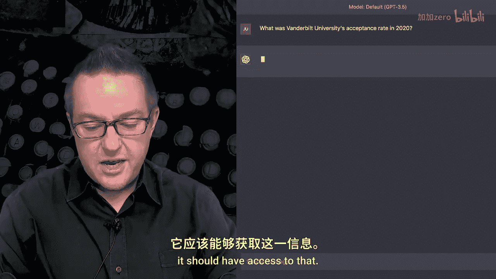

And so it provides us information， it says the acceptance rate was 9。

6% if we say what was Vanderbilt university's acceptance。Rate in 2022。It'll say I'm sorry。

 but it doesn't have access to that information because it was cut off in 2021。

If we then provided that information， so here I'm cutting and pasting the admissions data that was released and published by Vanderbilt just a few days ago。

 so it clearly didn't have access to this but I now provide this to it in a prompt。

Then it says based on the information you provided。

 it appears that Vanderbilt University's acceptance rate for the regular decision applicants of the class of 2026 was 4。

7%， so a prompt can also serve as a way of providing new and updated information to the large language model like we saw in this example。

