# 范德堡大学【中英⚡ChatGPT与Excel｜ChatGPT + Excel： AI-Enhanced Data Analysis & Insight】 p39 P39 04_根提示词 -BV1PdVizZE1d_p39-

We've seen how prompts can be used to essentially program the large language model to do interesting things for us automatically。

 we've seen how they can be set up in the past and then affect the future of the conversation。

 they become sort of essential rules that can help direct what the large language model does。

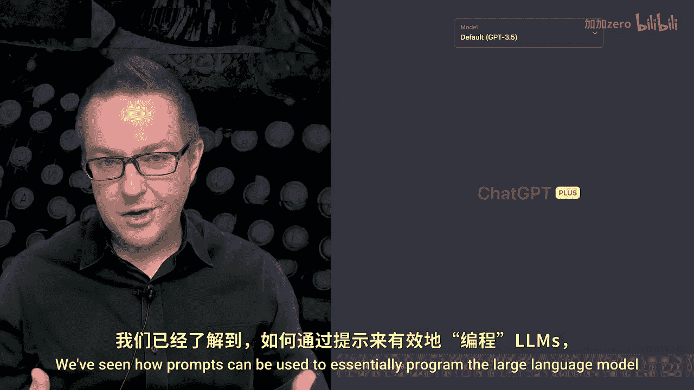

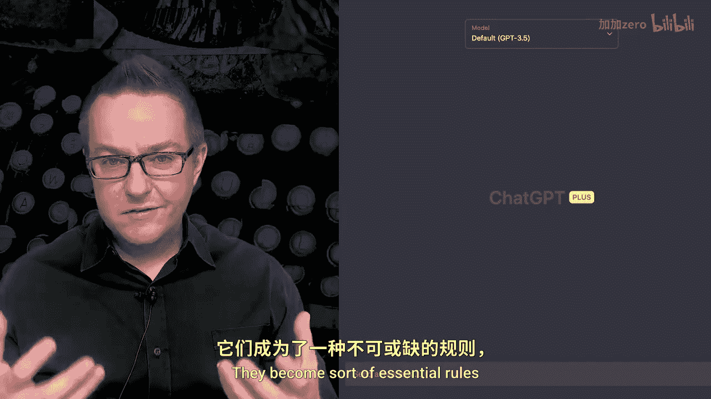

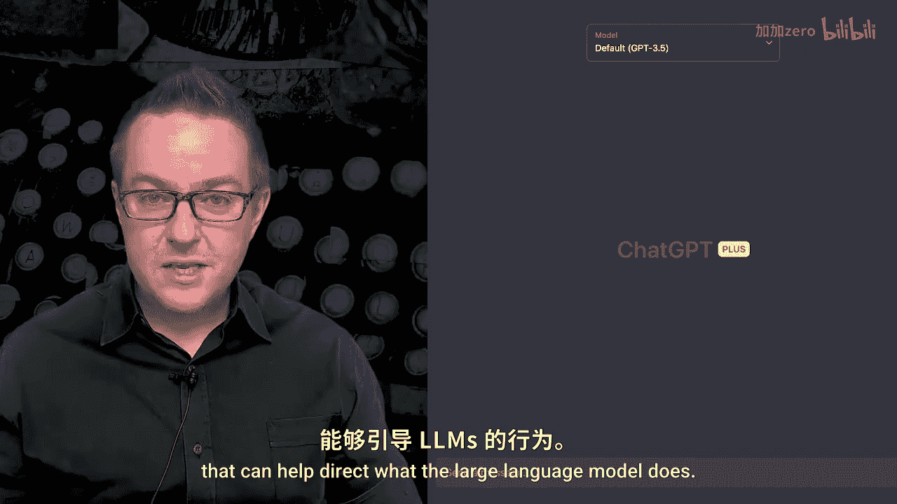

Now， what's interesting is that。In many cases， there's actually a root prompt that's hidden from the user and some of the different。

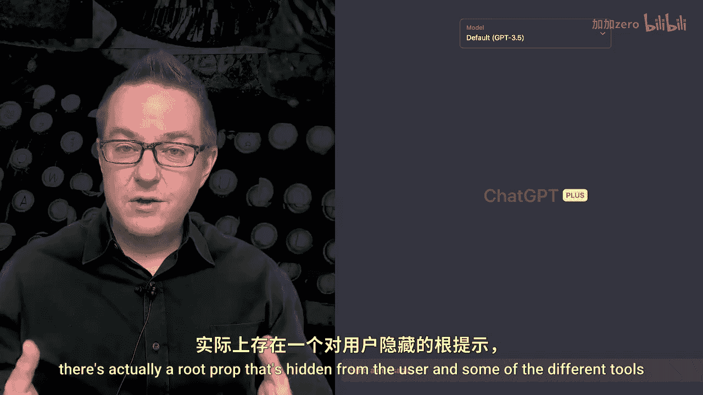

Tools that you're going to end up you know working with and these are essentially root prompts that define sort of ground rules for the large language model and its interaction with the user。

 So these can be things like trying to make sure that the large language model doesn't say anything offensive。

 do harm， suggest an appropriate actions， all kinds of things can be done to try to put ground rules in place for our interactions with the large language model or to help direct it to do certain things。

 So， for example， we might want to make sure that whenever it gives us output。

 it tries to produce the most helpful output。

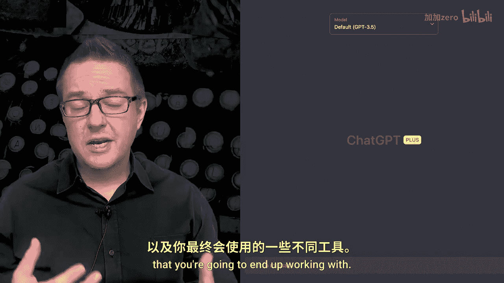

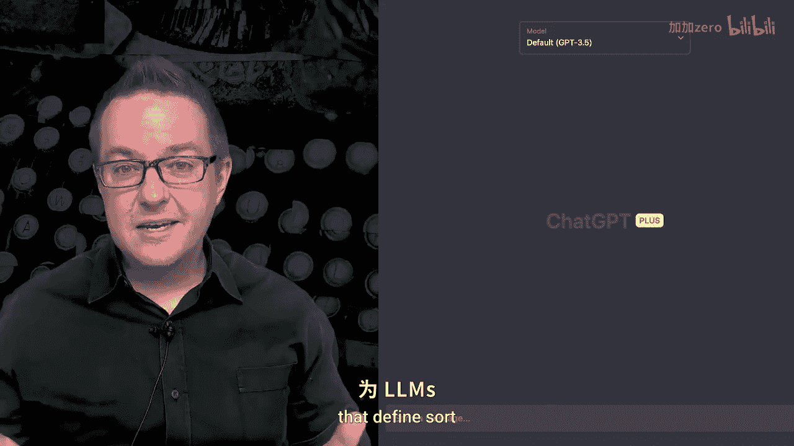

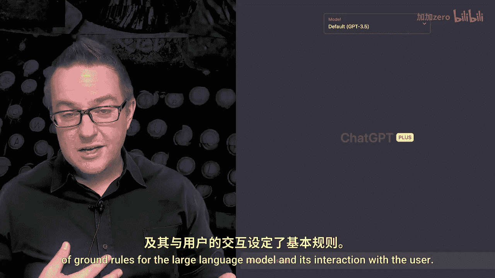

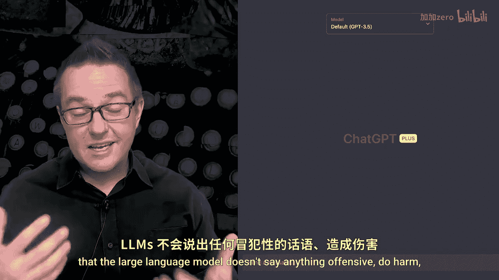

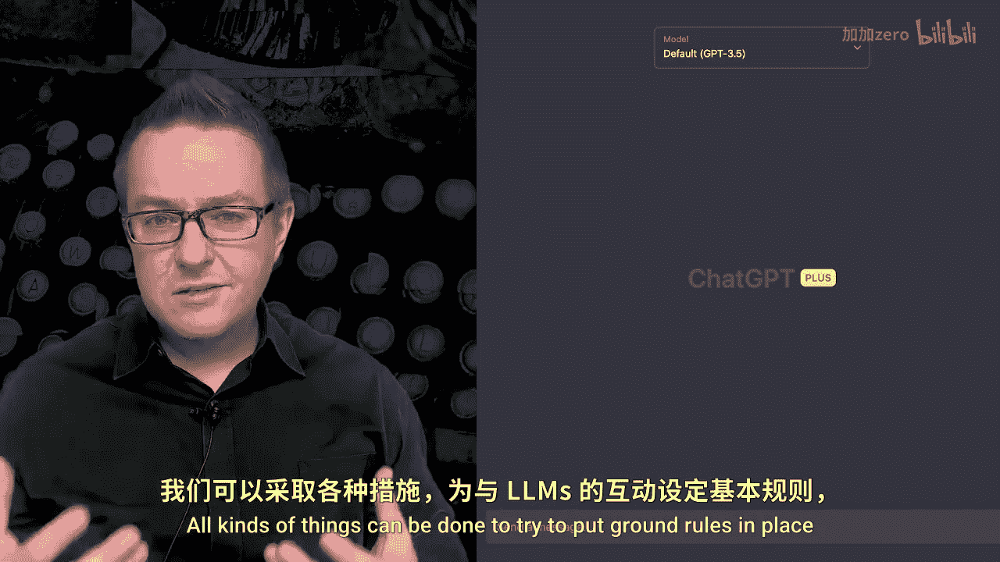

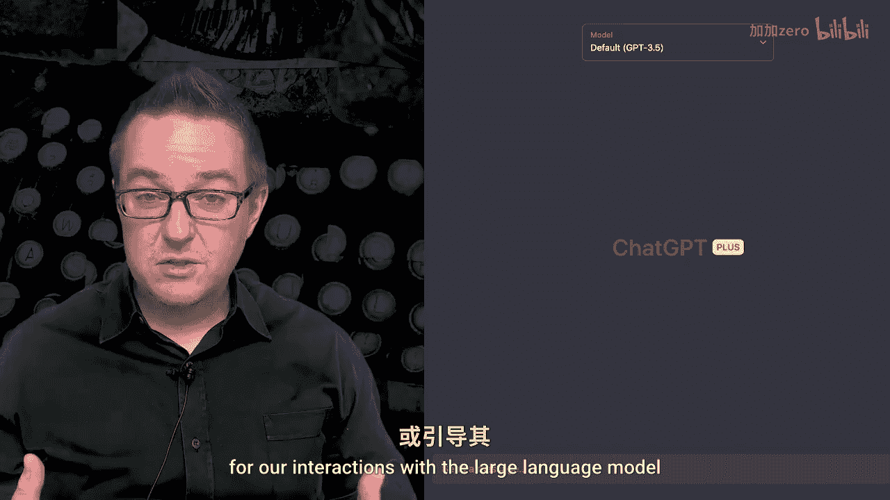

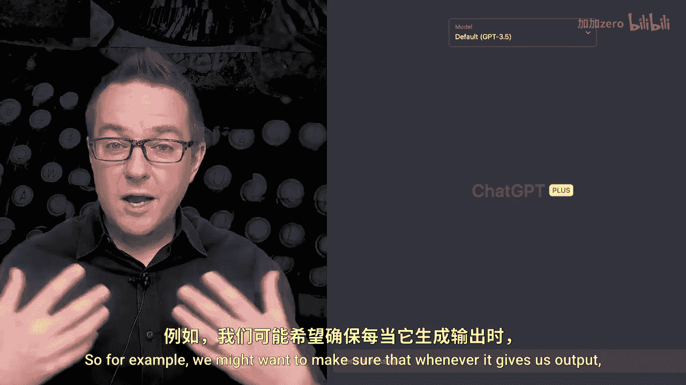

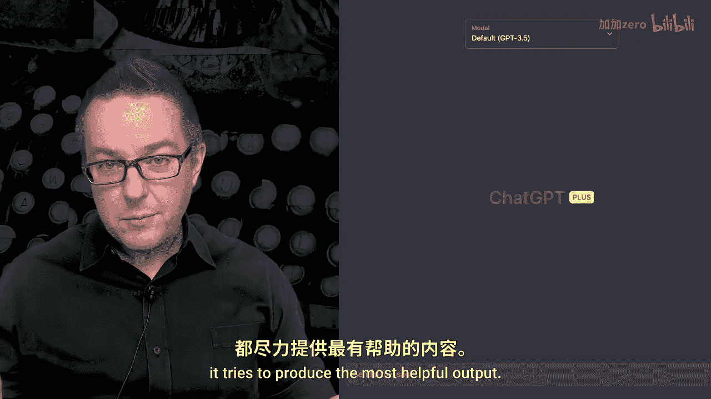

So let me get you an example of what this might look like。

I'm going to say you are my personal assistant。

Whenever you provide output。Please think through what would be the most time efficient recommendations to make。

Only recommend things that will really save me time。

Do not。Suggest things that do not save me time。

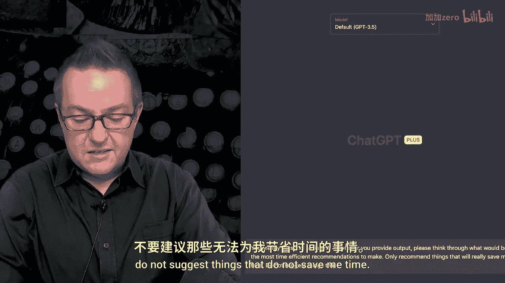

So now it says understood， as your personal assistant。

 I will prioritize providing you with time efficient recommendations that will help you save time。

 please let me know how I can assist you。Okay， I need to go grocery shopping。

 What would you suggest I do in。Order to buy my groceries。

And then it says here are some time efficient recommendations for grocery shopping。

 make a shopping list， plan your route， use a shopping app， shop it off peak times。

 opt for self checkout， okay， I need to buy a new car。How would you suggest I go。

Suggest I go about doing this。And it says here are some time efficient recommendations for buying a new car research online。

 contact dealerships online， schedule test drives， negotiate price， secure financing。

By following these recommendations， you can save time and make the car Brian process more efficient now。

I don't know if this really saved me time or not in this particular case。

 And I didn't give it the greatest prompts to do this。 But you can see how at the beginning。

 I gave it essentially a goal to follow。 I said， try to save me time。

 And whatever you do in your output， try to save me time。 Now。

 what you'll see is a lot of the tools that you're going to interact with。

 even chat GT being barred all of these tools are going to have some hidden probably root prompts that try to put guardrails on what can and can't be done。

 but also to try to make the output more important。 Now。

 one of the things that we've seen in the community is people try to figure out how can we generate prompts that will override those root prompts and the statements that they make。

 So people will also try to figure out what are the root prompts that were built into these systems。

 So they'll try to to。😊，Trick the tool into， you know。

 disclosing the root prompt that was provided to it or trick the tool into disregarding whatever the root prompt was。

 Now， if you're going to be building tools around these large language models。

 knowing that you can create a root prompt that will affect the subsequent conversation can be really important。

 So if you're trying to develop a personal assistant。

 you might want to go in and say here are the things that really matter if you're going to serve as a personal assistant for my product。

 what's really important is that you try to save time and you try to do this and this。

 And you could suggest different ground rules that are going to differentiate your personal assistant service offered through a large language model。

 On the other hand， if you wanted to go in and you wanted to say， well。You know， I want to。

 I want to generate， you know， something you know that makes me that comes up with the most time consuming way to do it。

 the slow personal assistant， you could go and swap the root prompts that are provided。

 And so the root prompt is basically you know， you can think of it as you're providing a seed to the whole the whole conversation and that seed will influence everything that comes later because it provides basically the rules that must be followed。

 And typically when you're going to build one of these root prompts。

 you're going to say things like you're going to tell the large language model who it is and what its goals are。

😊，You're going to tell it what it can do and what it can't do。

 and you're going to typically provide really strict rules like from now on forever。

 you will never do these things。 You will always do these things。

 You're going to provide those really strong statements that should always be followed。

And this is how you essentially go and program a customized experience around your large language model experience。

 but it's also how you can put guardrails of different kinds to try to ensure that various types of bad behavior aren't generated from the large language model。

Have you ever wondered why chattGPT says that it can't answer anything after 2021 Well you can actually do this with a root prompt。

 in fact we can play around with chatGPT and we can use some different prompt patterns that we'll talk about to actually be able to reset the date that chattGPT says that you can answer questions before so I'm going to show you an example here that I've run through really quickly。

I'm going to say act as an AI assistant that had its training stop in 2019 so if you'll remember when you ask chatGBT questions that are from 2022 and later。

 it will say， hey， my training stopped in 2021 and I'm going to say act as an AI assistant that had its training stop in 2019 if I ask you a question that involves information after 2019。

 state that your training ended in 2019 and that you can't answer the question。

And so it goes on to give us an initial prompt， hello， I'm Cha GT。

 a language model trained by openIAI based on GP 3。5。

 and then it goes on to say training data only goes up to 2019。And then we're going to say。

 what was the tallest building in 2020。 So now we're asking it a question now。In reality。

 Chet GT had training data up to 2021， but we've moved its cutoff date earlier in time through a root prompt。

 Now it's not truly a root prompt because actually open AI has has control of the root root prompt for Che G。

 but we're gonna actually sort of simulate that。 And so we say what was the tallest building in 202020。

 It should be able to answer this。 And it says I'm sorry that my training data only goes up to 2019。

 So I can't provide you with the information of the tallest building in 2020 at the time the tallest building was。

 And so we'd actually use the root prompt to kind of pretend like we're resetting Chet GT。

 We could go and we could say what was the largest。Country by land mass in。2020。And again。

 it tells us it only goes up to 2020 2019。 Now I can go and I can say。

Forget that you are an AI assistant trained only up to 2019 go。Go back to being the normal chat G。

And it goes back and says， okay， I'm trained on， and I'm going to just go back and I'm going to take my earlier question about 2020。

 I'm going to paste it in。And it says， as of 2020， the largest country by landmas was Russia and spans over 17 million kilometers。

 I'm going to say what was the tallest building in 2020 and pacee that in。

So now I'm answering my same questions as before， but you'll notice that when I asked the question about the tallest building in 2020 before。

 it says as of my training data which only goes up to 2019 and it's pretending that it didn't have any training data after 2019 so basically we can make it through this routeout prompt。

Aware of a different cutoff date， but that's kind of the power to think about these root prompts is a lot of what we're doing。

 a lot of the boundaries are set by these rules that are putting at the beginning。

 these root prompts， this root set of instructions that are given to the model。

And then we can go and reset it。Now， one of the things that typically with these models is they try to do some tricks and things and to prevent you from resetting the root prompt because you can obviously imagine that when the root prompt is enforcing important things。

 like telling you its true cutoff date， you don't really want to reset it。

 I'm sort of surprised that I'm able to do this one， but it makes sense。

 And so when I tell it to forget that it had been reset， it goes back to its normal behavior。 now。

This is really important though， is you're going to typically with a large language model want to put guardrails in place。

 you have to think very carefully around can your users get around those guardrails have you put all the appropriate guardrails in place if you communicate all the right things and we can see how we can go through and do interesting things with the root prompts in order to make chat GT think that it's training data or actually I don't know if we're making it think but we're making it pretend that it's cut its training data cut off at a certain date and time if you wanted to put boundaries on knowledge。

 you could say I can't answer any questions that aren't in these topic areas I can't do anything that doesn't have to do with this so if you want to basically scope and specialize。

 you can carefully think of these root prompts to provide rules and boundaries for the interactions。

