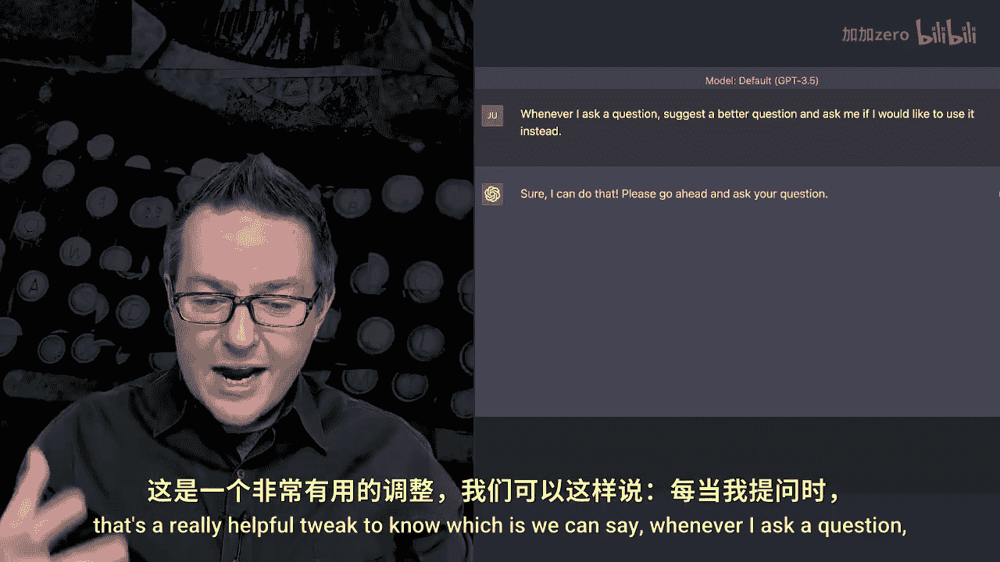
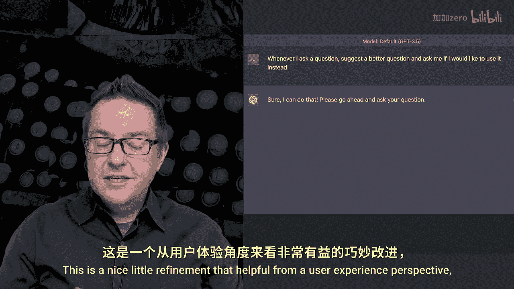
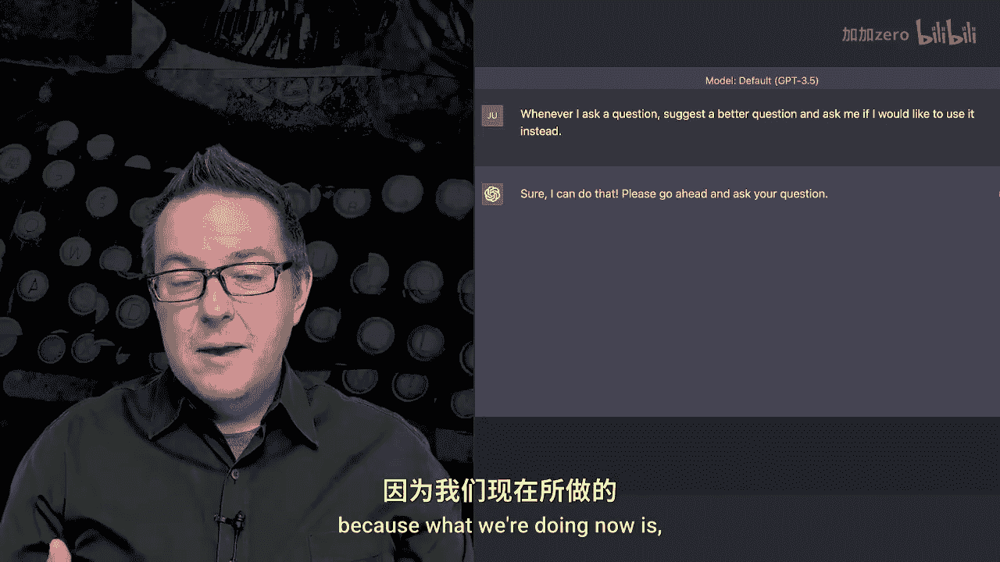
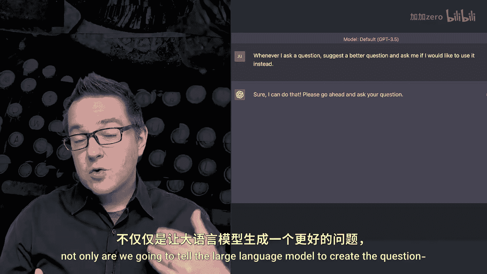
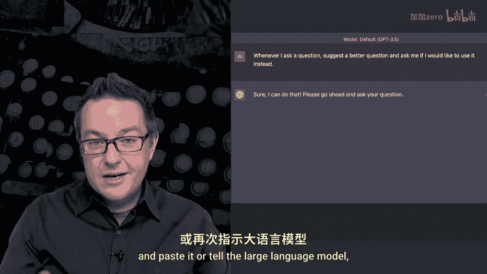
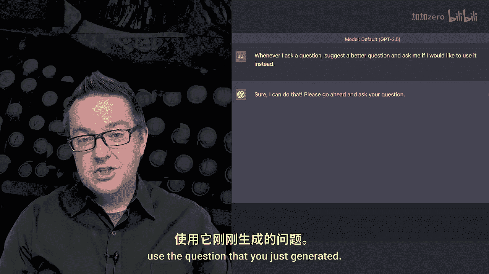

# 范德堡大学【中英⚡ChatGPT与Excel｜ChatGPT + Excel： AI-Enhanced Data Analysis & Insight】 p40 P40 01_问题优化模式 -BV1PdVizZE1d_p40-

A really simple way to improve our interactions with a large language model like ChaTBT。

Is to use the question refinement pattern。So this is a really。

 really simple idea and hopefully it'll inspire other ideas from you of patterns that you could use。

 but the basic idea behind this is that we watch CGBT or another large language model whenever we ask a question to try to improve our question。

So。The fundamental sort of intent or idea behind this is that we may not have as much information or underlying thought behind our question as chattGPT has from its training data so it may be able to infer patterns and other questions or words or things that are useful when asking questions on this particular topic or when trying to request something to be done on a particular topic so if you think about it。

 you know these large language models are trained on patterns and language so if we give it maybe a more general question and ask it to refine it。

 it can use its knowledge of what other things are asked about in the context of the question we've given it or what other words are typically associated with that type of question that might help improve our question make it more specific or provide additional context for it。

 other things so sort of intuitively what we're trying to do is we're using as sort of a general。

questionAnd we're tapping into the large language models understanding of patterns and language around that topic of that question in order to create an improved version of it。

Now the sort of pattern behind this is really， really quite simple all we mean to do is say whenever I ask a question or you can give it some scope to this just for the next question or for the next three questions or whatever you want to do。

 you say something like whenever I ask a question， suggest a better question and ask me if I would like to use it instead so this is just a really simple idea we want to always try to have the best questions best prompts to interact with the large language model。

 so we'll simply tell it whatever I do ask or suggest a refinement。

Now I'm going to show you kind of a little tweak to this。

That's a really helpful tweak to know， which is we can say whenever I ask a question。

 suggest a better question and ask me if I would like to use it instead。

 so this is kind of a nice little refinement that's sort of helpful from a user experience perspective。

 because what we're doing now is not only are we going to tell the large language model to create the question that's better。

 but rather than requiring us to go and cut and paste it or tell the large language model。

 use the question that you just generated， we just have it say do you want to use this question instead。

And if we say yes， it uses that question， if we say no， it should use our original question。

 so it's kind of a nice little tweak to this pattern that can make it even easier to use Now。

 every time we ask a question， the large language model will go and try to improve it。

So let's look at an example of this， so I'm going to start off with a generic question which is should I go to Vanderbilt University？

Now， if we look at this question， we can see it's really kind of ambiguous and vague and if somebody was asking you this question。

 should I go to Vanderbilt University or as a faculty and member if somebody was asking me should I go to Vanderbilt University not only is this a big decision for the person but there's really not enough information at this point for me to make a decision So a better question is going to help give me more information about the criteria that you're using to decide do these types of you what are the pros and cons。

 how do you weigh them and decide if it's the right fit and that's exactly what we see Chat GPT doing Chat GPT says sure here's a suggested question。

 what factor should I consider when deciding whether or not to attend Vanderbilt University and how do they align with my personal goals and priorities and then it says would you like to use this question instead。

This is a really nice pattern because once we've sort of turned it on。

We can begin asking questions and automatically getting better versions of our question and one of the things that's nice about this is it also helps us to reflect on what we're asking for。

And if we see a question come back like this like what factors should I consider when deciding whether or not to attend Vanderbilt University and how do they align with my personal goals and priorities。

 either we'll see that and see that's a really useful question and that's the how I really would have phrased it if I'd thought about it better or more。

 but sometimes what we'll also see is that the path that's taking down taking this down is not the one we want to go and we'll realize there's lots of paths。

 lots of ways of answering the question， and we need to give some additional context。

So not only is this useful in many cases of getting a better question。

 but sometimes it's helpful to us to see that a question could be interpreted in many different ways。

 there's many different pieces of information that may be needed to make an effective decision and so by seeing one version of a refined question well identify missing pieces of information so for example。

 if I really care about computer science at Vanderbilt， I might think， oh。

 well I should have mentioned that I'm planning on majoring in computer science。

Or if the town that I'm going to be in when I go to you college is really important then I might want to say something about you know Nashville and living in Nashville。

 you know， we want to make sure that you think through the question really effectively and this is a pattern that can help us really hone in on producing better questions。

 learning from the refinements to the questions and also using the questions。

 the refinements to understand what's missing in the context that we might want to introduce in order to get a better output。

