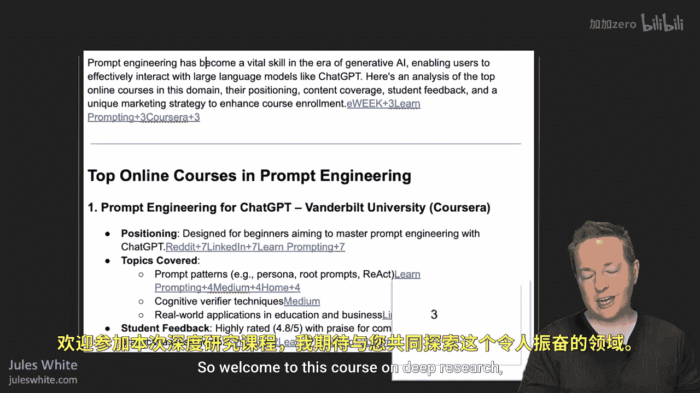

# 范德堡大学【中英⚡生成式AI战略领导者 专项课程｜Generative AI Strategic Leader Specialization】 p01 P1 01_什么是深度研究 -BV1b6YyzzEP9_p1-

I want you to imagine that any time you had a question any type you had an analysis。

 you could go and hire a team of PhDs to work on that analysis to go and find all of the research on it。

 All of the news， all the competitive market data that you might need to combine it all and to write a really coherent excellent report on that topic。

 How valuable would that be to you， Well that's exactly what deep research does。

 It's really something transformative in the way that we go about using generative AI。

 And it makes prompt something much more powerful， we're going go and explore what exactly is different about deep research。

 What is happening behind the scenes， and then how do we think about using this capability。

 You know what do you do with it， when suddenly you can go and hire a team of PhDs to go and work on any topic you want and write you a 10 or 15 page report。

 That's sort of this transformative capability But sometimes it's kind of like a blank canvas。

 Where do I even start， how do I leverage and deploy this AI labor。 And because that's what it is。😊。

AI labor that you are hiring to go and do a job for you Now let's take a look at a simple task to start to get a sense of what this looks like。

So I'm going to go， and I'm going to hire this team of PhDs to do some market research on prompt engineering classes。

 Now I'm going to do this because I'm invested in this and I teach classes on prompt engineering。

 Now I understand what are the top classes out there and what do they look like。

 What's my competition， What are they doing， So I went out into deep research， And I asked it。

 do a competitive market analysis of the top online courses on prompt engineering。

 What are the top courses on this topic， How does each position itself。

 What are the topics that they are covering， what are the students saying about them。

 produce a unique marketing strategy that an instructor of one of these courses could use independently of the platform to boost enrollment。

😊，That's a complex task， that's like I'm going to go and hire this team at PhDs to do something really valuable for me。

But there's something really important that's happening is to do this Well requires more than the instantaneous feedback that we get from a prompt。

 You really have to do some research。 You have to read up on what's out there in order to do a good job of this。

 I don't want the market analysis from when the model was trained。

 I want the market analysis that it can find based on what's out there today。

Now what happens when I go and I put this prompt into deep research？

Something really important happens， and this is driven by how it works。

 The very first thing that happens is it goes and it follows up to me with questions。

 no matter what I ask it， it's going to follow up with clarifying questions。 Now in this case。

 it says are you interested in courses from specific platforms like Coursera Udemied X should the focus be on beginner intermediate。

 etc cetera， do you want only paid courses， are you looking for courses taught in English only And then once I have this info。

 I'm going to go and do the research for you。And so what it's doing is it's going in doing clarification。

 And the reason for this is when I enter the answers to this， which I'm going to do next。

 I'm just going to go and say， well go look for all major platforms。 Look about， you know。

 the things that have maximum enrollment。 Let's look at。😊，You know， both types of courses。

 let's look primarily in English because that's what my courses are in。

 although they have been translated into other languages。

When I hit enter and I give it the clarification， it's going to run like 10 or 15 minutes behind the scenes。

 because my prompt is going to spawn an AI to essentially have an inter monologue with itself。

 It's going to start asking itself questions。 It's going to start going and pulling in information from outside the world。

 And then it's going to have to analyze this。 and this is going to take time。

 So once I start this a huge amount of labor。 a huge amount of AI labor is going to be spawn to go and work on this task。

 my team of AI PhDs is going to begin working on it。 And if I've gotten the task wrong。

 then it's going to run for a long time and give me an answer that I don't want。

 So what it's doing is it's clarifying in order to make sure that when it goes and starts doing the work。

 it does a good job。 So it says great， I'm going to start this up。

 I'll go and search for all this and write it up in a report。

 And then we see something amazing happening。😊，And this is it says starting research Now。

 one of the differentiating things of deep research is that is agentic。 Now， what does that mean。

 It means it has agency。 It means that it can go out and make take actions and the action that it's going to take on your behalf is is it going to search for external information on the web that it can find that's public that it can then pull in in order to use as sources to write the report that it's going to create。

 Now in this case， that's exactly what I want it to do。

 I want it to go and find competitive courses to tell me about them to do the market research and so it's basically going to be an AI agent that agent part that has agency meaning it has the ability to take action and it's going to go and take the action of searching for information。

 pulling it in， looking at what it finds and then based on what it finds。

 deciding what it searches for next and it's going to keep doing this over and over1015 minutes until it feels like it's collected enough information。

😊，Do a good job of answering the question。 Now， as it goes， we get to watch it。

 This amazing thing happens。 Now， the user interface may change by the time you're watching these videos。

 but the core principles are going to be the same。😊。

It's going to be taking action and typically this is going to be reported to us in some form of activity of what it's doing。

 So it tells us I've started up， we see that it's getting ready to do something that has this nice activity。

 and then we start seeing the activity fill up with what it's designed to do and it'll kind of tell you here's sort of my thought process of what I'm trying to accomplish and the actions I'm taking on your behalf So we can watch what it's doing and kind of see where it's going and we can also potentially see that it's heading down the wrong path and stop it if we need to。

 but we see right here， I'm gathering info on high enrollment English language prompt engineering courses from major platforms like courseurra Odemi。

 including details and instructor course structure， student feedback and pricing。😊。

And so it's doing exactly what we said。 it's going and acting as an agent。

 pulling in and finding the information that's going to be needed for the report。 Now。

 this is incredible。 This is our team of AI PhDs， the AI labor that we have hired and deployed to go out and do the work to find everything。

😊，Now as it pulls information in， it's going to start showing us in sources what it's finding。

 so it's finding things on Coursera， for example， which makes sense。

 it's finding things on other places， it's going in contemplating how does this all align with certain principles it has。

It's going in and then listing out all the citations。

 so as it finds things that it thinks are valuable。

 it then lists them as citations or sources that it's going to provide in the final report。

So what it's doing is before it ever writes a report。It's going out in doing an extensive search。

 but it's not a one shot search。 Sometimes we get something like this with the standard chatGPT interface where we'll go and put in a prompt。

 it'll do a quick web search to pull in maybe the top results and then answer the question。

But this is doing something much deeper it's going in and it's pulling in results and it's looking at them and it's reading them and it's reasoning about them and then it's thinking about what's missing。

 What else should I investigate and based on that you know what else it's going in adapting and taking additional actions and this is a real differentiator if it goes in it finds something it gives it some interesting nugget。

 it can go and follow up on it on an additional search and it can start reading about that other related topic and this is critical because it allows it to do a much deeper。

 more thorough job of research， just like if you're reading a research paper or survey paper or you're reading a news article。

And it cites something important or it talks about a new topic that you didn't know about right off the bat。

 Well then you can go and follow up on it and you can keep pulling in the different threads of that paper or that news article or that white paper or whatever it is。

 it becomes a spider web of information。 it becomes you learning about new topics that you need to go and follow up on and it's doing the same thing。

 it is an agent that is going and adapting based on what it finds and then pulling in new things。

 following up on threads of information that it needs to go and explore deeper。When it gets done。

 what you get is an incredible report out of it that is written based on all of those sources Now I want to point out some key things that are different。

One is it's sort of out of the box， you know， configured to do a really good job of writing a very coherent report。

You're not necessarily now， of course， you can tune it。

 but you're not necessarily going default to that big bulleted list of items that it's coming back with emojis and everything else。

 Now you can get it to do that。 but out of the box。

 it's really much more tuned to write like a cohesive white paper， a cohesive research paper。

 a cohesive market analysis not to write a bunch of social media emoji and happy faces。

 And this is something really powerful is with the task。😊。

Can be something that leads to really high quality writing like you would expect a team of AI PhDs to do。

Now， as it goes and writes that report， one of the really powerful things it's going to do is it's going to pull in the sources that it finds。

 and it's going to properly cite them unlike what you may have heard or seen in other tools where they hallucinate all the sources。

 none of these sources are going to be hallucinated these are going to be real sources that it found it's going to provide links to them or citations to them。

 And then in the report， you're going to be able to go and follow up and read everything So one of the amazing things it's doing is it's not only writing the report。

 but it's giving you the roadmap to the sources and the work that it did so you can a go and check it where you can be go and inform yourself and learn more about all these topics but using a cohesive narrative to help you explore them and understand them。

😊，Super powerful。 And this is all based on it going and searching。 Now。

 I can't show you this whole report because thiss pretty darn big。

 but to give you a sense of how much output you're getting。

 And this is something that really differentiates it is it's going to write a lot of output。

 It can give you a 10 or 15 page report。 And in order to do that。

 it has to have a lot of sources to cite to make sure it doesn't hallucinate。😊。

But once you put it all together， and if we go in， for example。Take all of this， and it was very。

 very long and we go and take it and we put it into a Google Doc。 This thing ends up being 19 pages。

That is a transformative sort of capability within this tool because now I don't have to go and prompt over and over for different pieces of text and then stitch them all myself into this document。

 I simply go and tell it， here's what I want to report on and it does all the work of doing the research of writing the report。

 but it can write really longform stuff that's completely cohesive and not require me to go back and forth prompting like six or 10 times to collect all of this information and it might take even more。

Now， to do a quick comparison， I went I ran the same thing with GPT 40 and Chat GPT。

And what I got was something that was dramatically shorter。

 much more list oriented as opposed to actual sort of like PhD level pros。

 And you put this thing into a Google Doc。 And despite the fact that it's very list oriented。

 which takes up a lot of space。It's still only three pages。

So we have a dramatic difference in the way that we can go in higher and deploy this AI labor。

whereasas we might have to go and babysit it over and over to go and you know prompt， prompt。

 prompt prompt to try to build up this research report and do the report and hope that the citations are right and hope it searches on enough topics and that we see the right topics and we do a lot of the handholding。

 What we're getting now is an AI agent。 It's AI labor that we're deploying to go and do the research and then write a research report for us。

 So what we're gonna to explore is this amazing capability。

 What do we do now that we have a team of AI PhDs。 this AI labor that we can deploy to go and work autonomously for us on a topic Now I'm just going to go ahead and say outright if I had to go and write this report it would probably take me personally a minimum of a day to write it and in 10 or 15 minutes I got it And now I can read this report and go in and getting reports and information and analyses and research done for me becomes as fast as I can think of questions I can go and deploy these AI agents while I go on。

Coffee。 And by the time I come back， I've got something to inform my decision making。

 to inform my strategy and thinking。 My goal of this is not to have it go off and like decide for me。

 My goal is for it to have do a lot of research， bring it back to me and help me think about it。

 And then after I've seen it and I've come up with an idea I' I might go and say。

 now go and look at the counterarment against this。

 We're gonna look at all the different ways that we can use this。

 We're gonna look at what are the unique strengths and capabilities it has that are going be really hard to match with any team of human beings that are where you want to focus your efforts with it。

 So welcome to this course on deep research and I look forward to exploring this amazing topic with you。

😊。

