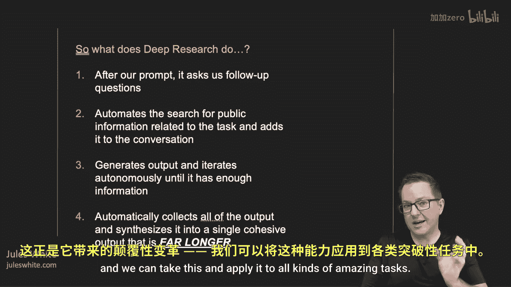

# 范德堡大学【中英⚡生成式AI战略领导者 专项课程｜Generative AI Strategic Leader Specialization】 p03 P3 06_深度研究在做什么 -BV1b6YyzzEP9_p3-

What is happening with this crazy， deep research stuff。

 Like what's really going on behind the scenes， What is the intuitive model that we can use to think about。

 what it's doing and why it's so effective。 So I want to kind of explore first。

 how do we have a great conversation with generative AI to solve a problem。

 there's a bunch of things that we have to do。😊，One is to do a really good job with generative AI。

 we typically want to provide a lot of concrete information not just like what it was trained on。

 but we want to give it a lot of documents， a lot of websites to read。

 a lot of concrete information that it can then go about citing and using to ground its answers to reasoning effectively all of that。

 So we want when we're having a great conversation and this is not what deeper resources is just when we're going into chat with like chatGBT we want to get a lot of really high quality documents or human insight provided back to it。

😊，We want it to have a lot of understanding of exactly what we want， how we want the task solved。

 like what are your preferences and desires， What is it that you're going to do。

Then we're going to go and we're going to get output on that task and then we're typically we're going to iterate and refine throughout the conversation to go and make it better to provide clarification。

 to inject additional information to get additional outputs that we need because there's typically a limit to how much information we can get at once and as we're going。

 we're going to have to try to figure out as it's producing outputs。

 how are we going to stitch them together into the thing that we need at the end of the day Now let's focus our ideas on to documents and reports So imagine we want like a 10 page report Well what are we going to have to do。

 we're going to have a long conversation we're going have to give it a lot of information to give us really high quality outputs。

😊，We're going to have to go and as it produces each output。

 probably like a half page or a page at a time， we're going to have to copy that output into the report。

 help make sure that it's all cohesive and that all of it fits together。

And it takes a lot of time and work。Now。Let's say that we want to write a 10 page report like we did。

 that's a competitive market analysis of Vanderbilt's work on Genrative AI。Well。

 what are we going to have to do， what we're going to have to do？A lot of things。

 which is we're gonna have to go and find all of the information about all the courses， right。

 for to do a really good job of this。 We have to get lots of information on all the courses into it。

 Now， it can do a web search and it might be able to take a top couple of top results。

 But to do a really detailed， you know， job， We're probably going have to prompt it many different size and say。

 well， what's on Coursera， What's on edx， What's on Uudacity， What's on LinkedIn learning。

 What's on this， What's on that。 We're going to have to keep pushing it to go and find additional information。

 And it's going to take a lot of work。 or we're gonna to have to go and find it and bring it into the conversation。

😊，Telling it what to do is probably not that hard， and we built up the skills for doing that with prompt engineering and understanding how to express the task。

Going and getting any individual output like one page or three quarters is not that hard。

Then iterating over and over to you know produce all this， that's not that hard。

 it takes a medium level of effort probably because we're going to have to have a conversation and keep going。

And there's value to that。And then at the end though we're going to have to do all of this like copying and pasting and trying to fuse it all together into that report and making sense of it and formatting it。

 and there's a lot of manual work there。Now， what does deep research do that's so awesome？Well。

 one is it does a good job from the very beginning of trying to make sure it understands exactly what we want because it's going to go off and do a lot of work for us for like 10 or 15 minutes。

 so it wants to make sure it gets the task right， so it's going to ask us follow up questions always about what we're looking for to clarify and try to make sure that it understands the right task。

Two， it takes this really time consuming process of searching for the public information that should be brought into the conversation and it automates it。

 It alleviates you of the burden of having to go and find that information or prompt over and over with web search enabled to pull the information into the conversation。

It's going to generate output and iterate autonomously with itself。Now， this is one of the magical。

 amazing things that it does is it basically has in a loop， a conversation with itself。

 It goes and searches for some information on the web。

 It finds that information like let's say Coursera courses， it brings it in and it says okay， Now。

 based on what I found， What should I go and look for next， What am I missing。

 What do I also need to explore。 and it has a conversation with itself in a loop。

 It's amazing It self dialo。 Its self dialo that allows it to go and decide what to do next and what to find next and what to bring into the conversation next and allows it to go and run for 10 or 15 minutes on its own thinking to itself。

 having its own self dialo going in changing what it's looking for based on what it finds。

 And this is some of the true magic of what's happening。

 because it's automating a ton of really important work。😊，And then at the end。

 it goes and it generates one cohesive， very long output， rather than getting like a page。

 you're going to get like 10， 15 pages out of it。And it's going to be completely cohesive without you having to copy and paste between different things。

 And this is really the kind of underlying thing that's happening。Is it's automating this process。

 It's doing that long self dialogue， and then it' taking that very long conversation and it's fusing it into a totally cohesive。

 well written report based on what it found。This is the game changing thing that it's doing。

 and we can take this and apply it to all kinds of amazing tasks。

