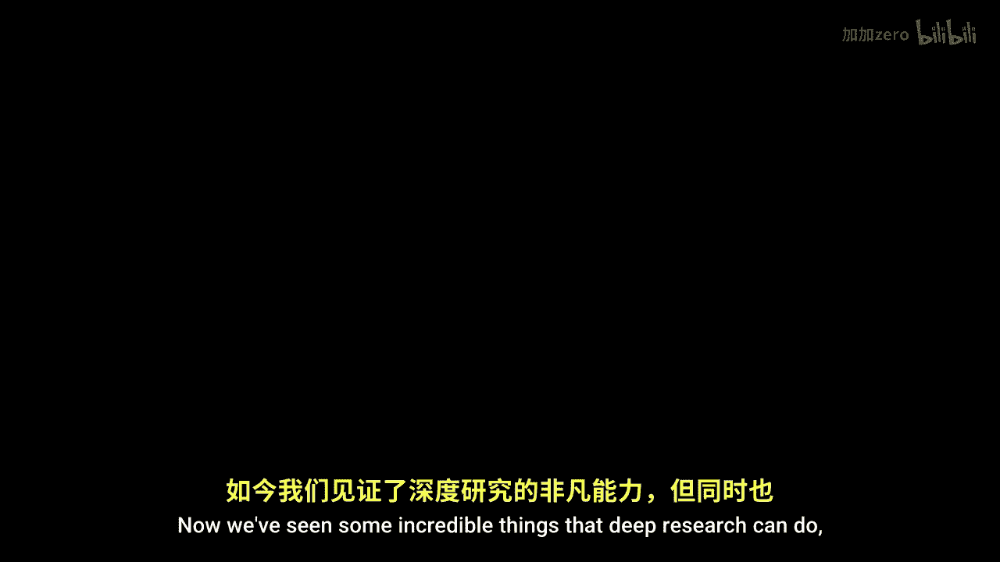
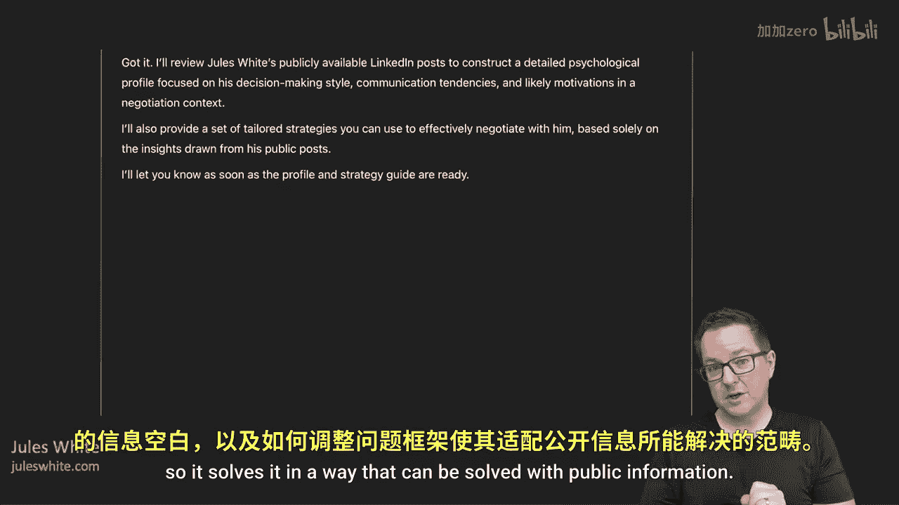

# 范德堡大学【中英⚡生成式AI战略领导者 专项课程｜Generative AI Strategic Leader Specialization】 p04 P4 09_理解深度研究的局限：它无法对信息进行推理 -BV1b6YyzzEP9_p4-

Now we've seen some incredible things that deep research can do。

But we also have to understand a fundamental limit of what it can do and we have to make sure that we think carefully about this limit when we're interacting with deep research and that key limit is it cannot do the work。

 it cannot have incredible insight on things that it doesn't have access to。

 it doesn't have the information it needs to make the right decision to understand the context or the situation。

 if it's not information that it can find publicly on the Internet or you don't upload a supporting document。

 it will not know about it。And this is critical because many times we need to go and do things that require blending information that's public and information that's private。

Now， to help you understand sort of the limits， I think it's easiest to go and do this with something that always have private information and its people。

And I want us to do this on something that we can fact check， right。

 Let's go and look at what does it really know about us。

 How much public information is there about you and from that public information。

Can it really tell you everything it needs to， you know， know or that you need to know。

 And the answer is no， it can't， right， because we all have private lives。

 We all have rich life experience that it doesn't know about。

 But the same thing is true for all of our organizations。

 They have rich culture and history and things that happened last quarter and personal dynamics between people and strategic priorities that aren't captured on the Internet or easily expressable。

 All these things。Are not captured in a way that it can find。

And so this is why the human is always going to play an integral role in this is when you're working with it is you're going to have to provide a lot of this context。

 but you're also going to have to realize there's lots of things that it does not know and therefore it can't support you on and you have to be careful in the decisions that it's making or the recommendations it's making to account for that。

So here is the example I'm going to do on myself to kind of delineate what it knows and what it doesn't know。

Build a detailed psychological profile of this person and help me understand their thinking。

 De their underlying motivations， approaches， personality characteristics， etc cetera。

 Give me a framework for reasoning about their decision making and goals。 I want 10 pages。

 and I give it a link to my LinkedIn profile。 fascinatingcinating activity to do on yourself。 Also。

 it's a really great activity because it quickly can surface what it knows about you and what it doesn't know about you based on what you project publicly。

😊，Comes back and asks me why am I building the psychological profile and for fun， I said， hey。

 I want to negotiate against this person， I want to understand their thought process and here's the constraints I want you to only use information based on his LinkedIn post and output include a general overview of who he is and include negotiation strategies tailored to his psychology。

Now I think this is interesting because I want its perspective on how to negotiate against me。

 one because I'm just kind of fascinated about what it says。

 but also because I want to see how much it really knows about me for my public postings on LinkedIn and I think that there's going to be a lot that it's gonna to know。

Now， one thing I want to iterate again， when I'm building up this prompt。

 I'm also sort of giving it some sections of things that I'm wanting constraints。

 One of the things I'm telling it is what information to rely on For example。

 I'm telling it to only rely on information essentially in LinkedIn and so one of the things you can think about controlling is what information you tell it you want it to use or not use。

 For example， you know that there may be public information that you don't agree with and you don't want it to use that because you think it's going to send it down the wrong path or you want it to think differently about the problem and use some different community of thought on approaching the problem and so you can use constraints onm telling it what information to pull in this is a very sort of foundational constraint you can use。

Secondly， I'm going to tell you on the output what I want to make sure is in the output and I've also delineated this with a specific section with dashes in my prompt。

 so I've got these two sections and it's going to go off and run。And it goes in and says。

 I'm going to build a detailed psychological profile now。

The goal of this is not for me to show you my psychological profile。

 it's for you to understand and pick something where it doesn't know everything and it will never be able to find it so that you can understand the boundaries that these。

 you know around what it's going to know and sort of understand that this is a key issue。

It will only reason with what it can find publicly。

 This will create limits on what it can do for you in an organization。

 but it will also mean that if you want to bridge those gaps to its limits。

 you want to overcome those limits， you're going to have to fill in the gap by providing it that information。

 And if you can't provide it in sufficient detail or the level of detail you provide is going to govern how well it can do with the things that it can't find publicly。

 now。I have an exercise coming up where you can go and run this on yourself or a version of this or on some other task that you come up with。

 where it's not going to be able to find all the information publicly。

 I think it's really fun to have it do a psychological profile of me And it did a pretty d good job on a lot of aspects。

 but at the end of the day right it doesn't know so much about me and who I am as a person and that limits what it can say and what it can you project about me and the decisions it can come up with。

 It had a lot of great stuff， but it's messy a lot。

 So use this as a simple exercise to help learn what it knows and what it doesn't know and make sure that you're always thinking about how do I fill the gap for any information that it doesn't know or how do I tailor the problem So it solves it in a way that can be solved with public information。

😊。

