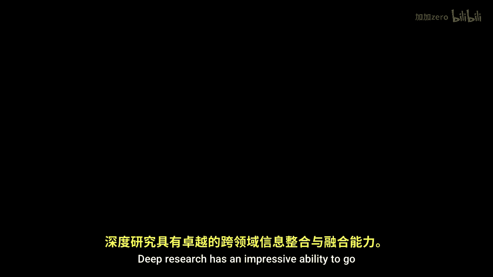
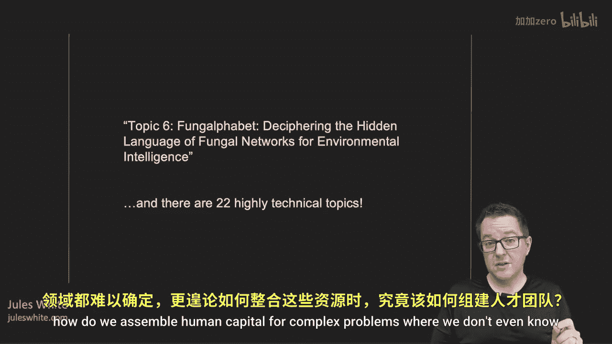

# 范德堡大学【中英⚡生成式AI战略领导者 专项课程｜Generative AI Strategic Leader Specialization】 p05 P5 10_融合超人类跨领域专长：以人类为例 -BV1b6YyzzEP9_p5-

Deep research has an impressive ability to go and fuse information across many different domains。

 although an individual human expert may be better in one domain。

 one place where these things shine and tools like deep research really。

 really impactful is when we have problems that span lots and lots of really technical or complex domains in order to solve the problem it requires fusing information and concepts across all these different domains to solve the problem。

Now what does a problem like that look like Well one of the fascinating examples is human capital so when we have a lot of people。

 a lot of resources in a large organization and we have a problem we need to solve or something we need to do。

 who should we get involved？The larger the organization， the more complex the problem。

 the harder it is to figure out who has the right skills and how do they all fit together and how do we bring this all together into a valuable team that can go and do something。

Now， the bigger the problem， the harder this is。 if we have a really simple problem that we're solving all day long all the time with the same people。

 you don't need this。 But if you're dealing with a really complex， hard to tackle problem。

 something where you need to go and find the right expertise， this can be incredibly valuable。

 Now it also is valuable for all types of other problems where we need to bring together， you know。

 interdisciplinary expertise for many， many her different insights and fuse it all together into some really thoughtful sort of research or product。

😊，Now we're gonna go and look at this in the context of university research so the multi universityrsity research initiative is a US government initiative to fund different types of basic science and research for universities now one of the problems is is like when this thing comes out it has like 20 plus really technical topics Now Vanderbilt gets this how do they go and find faculty teams who have the right combinations of research that could be fused together to go and work on each of these topics So how do you find the right people to go and generate proposals to go after this research funding and try to tackle these hard scientific problems Well it's difficult because these are super complicated things right and no single individual and campus really knows everybody and knows enough about what everyone does to be able to go and really effectively for every single topic that this is looking for proposals on。

😊，Be able to figure out good teams to go after it。So we're going to take this problem to deep research。

 let's get it to assemble the Vanderbilt human capital to go after all of these different calls for proposals on different research topicspics。

Look at the new Muri， I want you to propose interdisciplinaryplayer research collaborations of Vanderbilt faculty to work on each topic for each topic。

 think of key research areas and terms related to the area。

 then look for Vanderbilt faculty that are well known for some aspect of this。

Who are faculty from other disciplines that could collaborate with them in unexpected ways to create exciting proposals？

Who has won this type of award before on campus that the team could set up a call with to get guidance or could be added to the team。

 I need a Vanderbilt faculty team and possible idea that fuses their research for each topic。

I don't think that there is a single human being on campus or team of people on campus that can do this well。

Incredibly difficult problem look at all the Vbilt faculty， researchers on campus。

 figure out how their research could be stitched together to create teams to go after each of these highly technical scientific topics。

And on top of it， try to figure out who else has received money from this type of award before that could advise them and also look for crazy connections。

 look for those interdisciplinary unexpected connections that could boost to the team in some unique way。

 So it's really requiring this fusion of so many disciplines。

 understanding of so many topics in order to assemble the human capital to go and solve and tackle these different research problems。

Now you might ask yourself， I've talked a lot about this idea of it being PhD level stuff that it can write up。

And I kind of want to give you a sense that， yeah， it actually is。

 it has sort of PhD level insight on many of these things。

So let's look at what this program is about Well， if you read the actual you know solicitation。

 it says this program addresses high risk basic research and attempts to understand or achieve something that has never been done before it has regularly produced significant scientific breakthroughs these are research topics that are very complex。

 not common knowledge， not common like sense that we know the answer to。

 and it's going to have to reason about who are the Vanderbilt faculty members who have the expertise to potentially go and create a scientific breakthrough on the topic that's PhD level stuff in terms of understanding of what it needs to be able to do。

😊，And。If you want to look at a sample topic， well， let's look at this one， topic 6， fungal alphabet。

 deciphering the hidden language of fungal networks for environmental intelligence。

 and this is like one of 22 of these topics。Now， think about that。

If you had to go and assemble a team to do this， it would be extraordinarily difficult。

 like just a team to go and figure out who are all the faculty members that can do this， right。

Think of the overhead and complexity of trying to crack that nut。

 And you know what's going to happen is probably by the time the team is done assembling all the teams。

 It's too late because the call for proposals has closed the deadline has passed and we weren't able to solve the problem。

 So this is a great example of something where we don't have the time to assemble human capital。

 but more than likely we can't even assemble the human capital to tackle the problem of deciding who should go after this。

 So we can't even find the human experts that can solve this problem for us because the knowledge needed span so many different domains and is so sophisticated in a technical。

 It's going to be very， very hard to find a group of individuals and to assemble them in time to tackle the problem。

 great example of where this works。 So this is a fantastic example of when you want to use it。

 things that span many different domains require significant amounts of technical understanding across those domains a great use cases when you need to。

😊，Assemble human capital into teams based on the expertise and experience of the team members。Now。

Going back to this idea that if it can't find the information。

 it's not going to be able to solve the problem， when we did this。

 it did an extraordinarily good job of assembling Vanderbilt faculty teams from my perspective。

One of the things it didn't do perfectly was it relied on our website to decide who are the faculty members of Vanderbilt and our websites aren't always up to date。

 and sometimes faculty members leave and it takes a few months to go and update the website。

 sometimes it takes longer， I hate to say it， but it takes at least a few months often perus to update and say that no faculty member has gone to another university。

So it actually went and assembled teams， there were great teams except that some of those faculty members had gone to other places。

 so this is just going back to this key point right。

 it's going to give you an answer that's based on the information it has available to it。😊。

Now in this case， it probably would have been even better if I went and somehow assembled the information about who the actual Vanderbilt faculty members are。

 and I told it to crossche whatever it comes up with with a list of actually Vanderbilt faculty members。

 but I didn't do that， but it goes to show you when you're doing this note that if it doesn't have accurate upd information。

 for example， about your human capital about what you do about your constraints about the problem it's working on。

 it won't give you perfect results， however， extraordinarily effective， excellent use case。

 how do we assemble human capital for complex problems where we don't even know all the expertise is needed and how we might put it together。

