# 范德堡大学【中英⚡生成式AI战略领导者 专项课程｜Generative AI Strategic Leader Specialization】 p06 P6 01_示例动机：融合埃塞俄比亚与墨西哥食物制定膳食计划 -BV1b6YyzzEP9_p6-

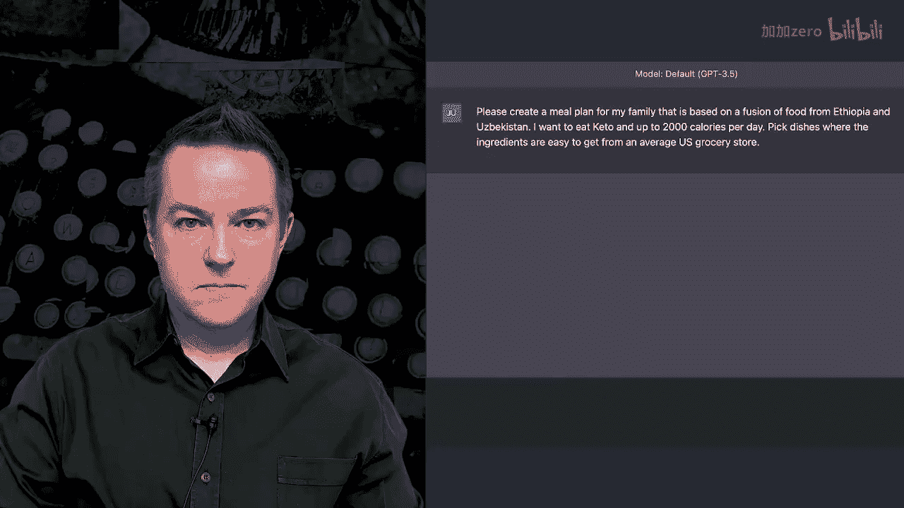

I want you to think of chat GPT and these large language models as tools that you can use to give your ideas form。

 to give your thoughts， you know realization， to be able to explore lots of different concepts and be able to refine them over interactions with the tool。

 I don't want you to think of these tools is something that you use to just bright essays or answer questions。

 that's really missing the capabilities of the tools。

 These are tools that really allow you to do fascinating things So now I'm going to try to give you an example of this to hopefully motivate you that these tools have immense capabilities and that those capabilities can allow you to do things that would be very difficult to do otherwise。

😊。

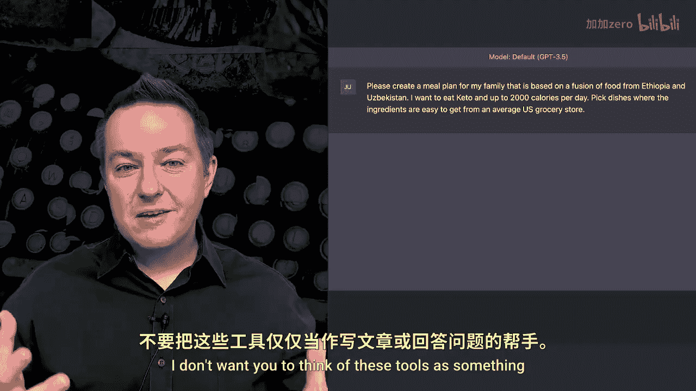

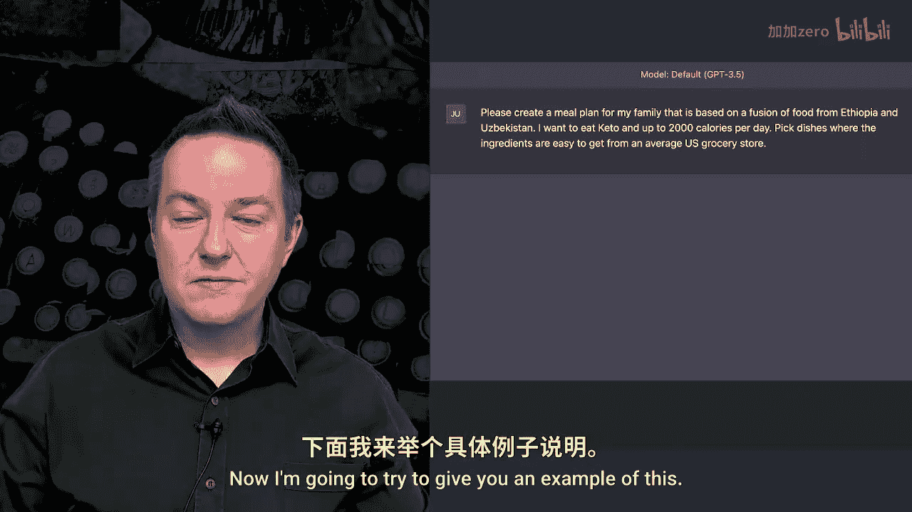

So what is a task that I thought of that would be you know something that we could all relate to and I thought about my family and I thought about this crazy idea。

 we have some great， we have this great restaurant from Uzbekistan that's in Nashville。

 we have a great restaurant from Ethiopia we've actually got lots of great Ethiopian restaurants and I thought to myself。

 you know what would it look like to create a meal plan that was based on a fusion of cuisine from Uzbekistan and Ethiopia。

😊。

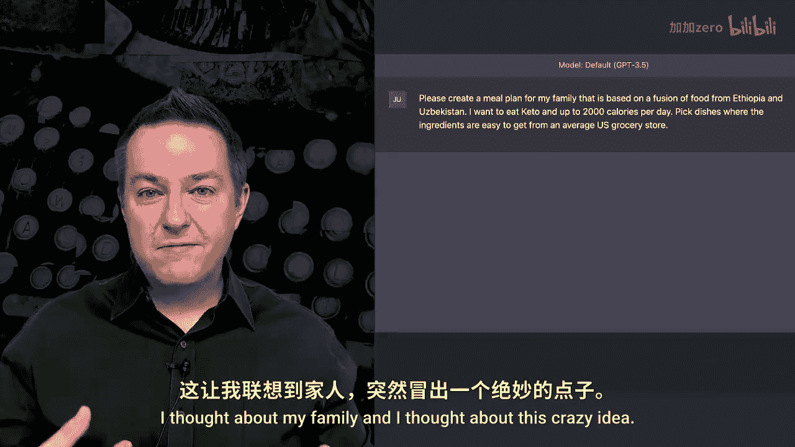

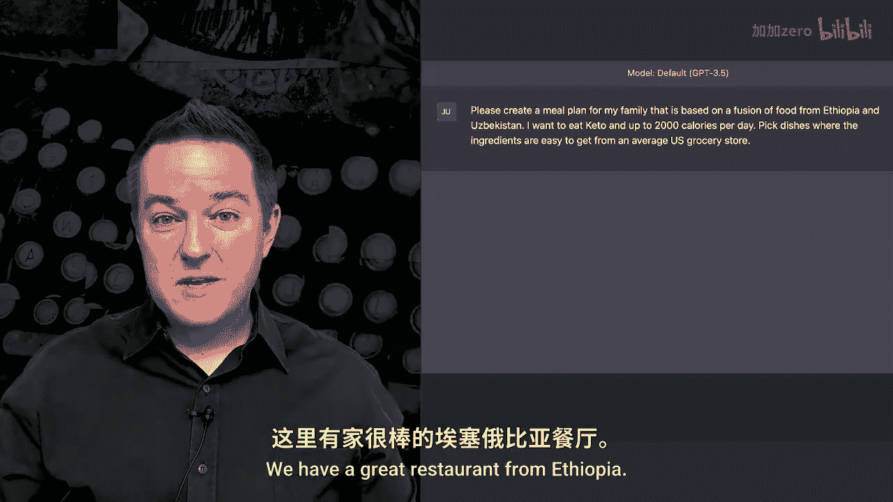

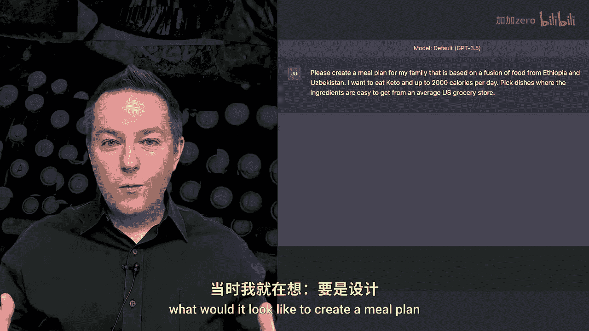

You know， what would that look like and in the past I've eaten keto。

 so could we try to make it kind of keto because I still kind of like to limit my carbs？

And you know at the end of the day， realistically， I'm going to have to buy all the ingredients for this and if they're not easily accessible at the grocery store down the street for me。

 I'm probably not going to cook the meals so。

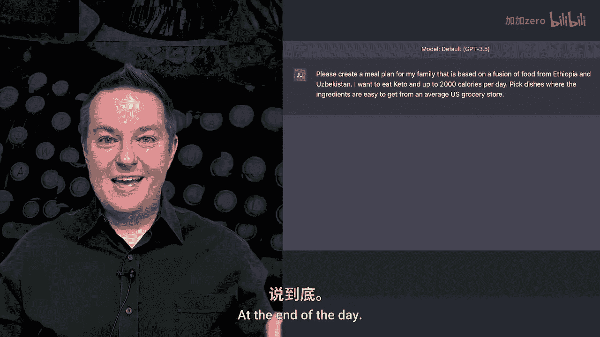

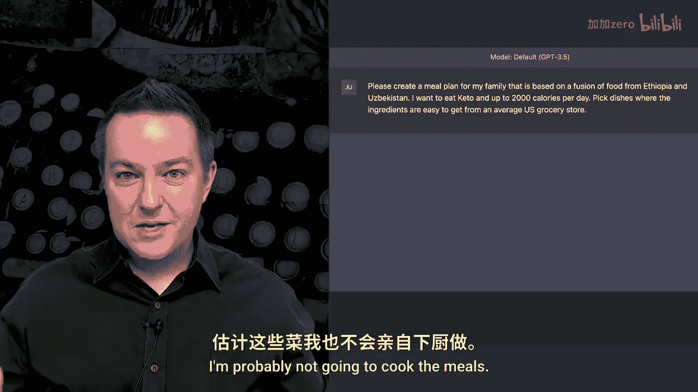

I thought， well， let's go to chat GPT and see if it can help us with this problem。

 if it can help us prototype what this meal plan might look like so I went to chat GT and I said。

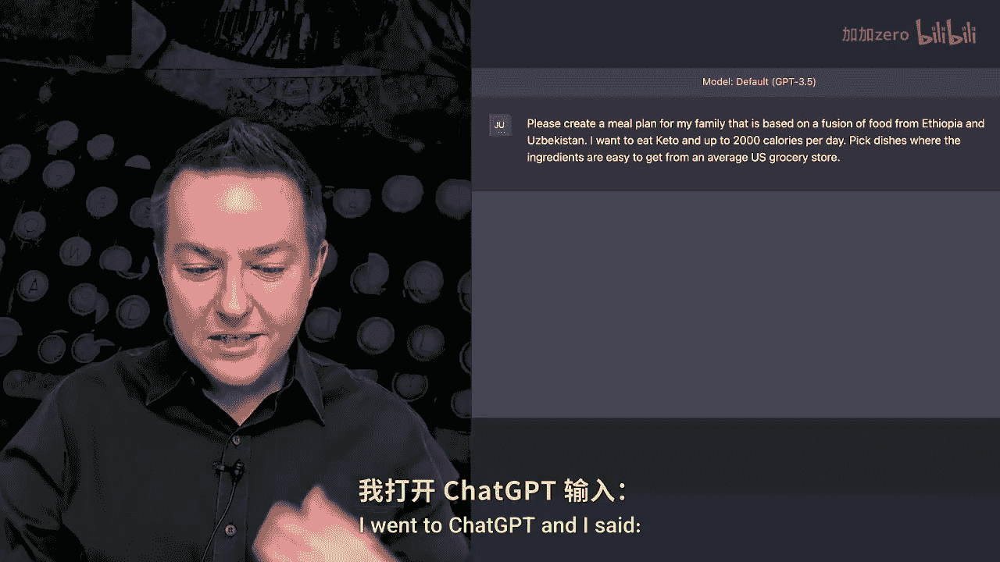

Please create a meal plan for my family that is based on a fusion of food from Ethiopia and Uzbekistan。

 I want to eat keto and up to 2，000 calories per day。

 Pick dishes where the ingredients are easy to get from an average US grocery store。😊。

Now this is a hard problem， right， I don't think that there's a human on the planet that could easily answer this question。

 and if they are， I probably could not find them。 it would probably cost me too much to hire them and they certainly couldn't do this as fast as I'm about to get it done for me。

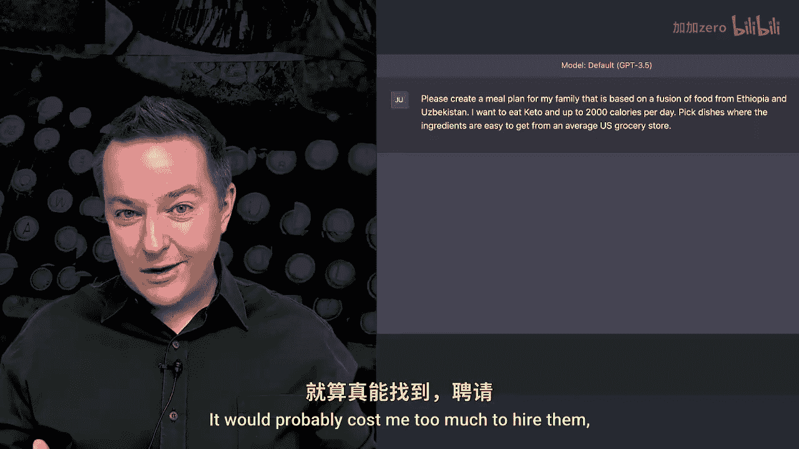

So I asked Cha GT to do this for me and Cha GT says here is a sample meal plan that combines flavors from Ethiopia and Uzbekistan while also being keto friendly and within a 2。

000 calorie per day limit。Breakfast scrambled eggs with sauteed onions， tomatoes。

 and Ethiopian Burber spice。Now notice what it does， it puts in parentheses。

 it says made with chili powder， paprika， garlic powder， ginger， cumin， and coriander。Now。

 what it's signaling is Bur bearar spice is something you can get at the average US grocery store。

 All of these spices are easy to obtain from a normal US grocery store。

 so not only is it answering my question， it's giving me an Ethiopian breakfast dish。

 it's giving me information that I'm going to be able to get these spices。

 Now I don't know enough about Ethiopian cuisine to know if this is a really accurate dish。

 it may not be it may be sort of inspired by it and very American high。

 but I'm still for me and what I'm trying to do， this is pretty impressive。😊。

Then goes on to say lunch， Uzbek style lamb kebs with grilled vegetables， bell peppers， zucchini。

 eggplant and a side of cucumber and tomato salad dress with olive oil and lemon juice。 Now。

 you notice all of this is pretty keto friendly， too。 Now。

 some people could take issue with the onions。😊，But it's a really good first start of giving this crazy idea I have form。

 Now， it may have errors in it。 It may not be perfect。

But I could go and work with this and refine it and start improving it。

 and that's one of the things I want you to think about throughout this course is don't think of this as a one off。

 I give it a question and I look at the answer and I say it's good or bad No。

 so I went back to it and I thought， well， one of the things that I'm really missing from this is。

I don't know how much to eat， so I said can you give me an approximate serving size for myself for each dish that is within my 2000 calorie limit？

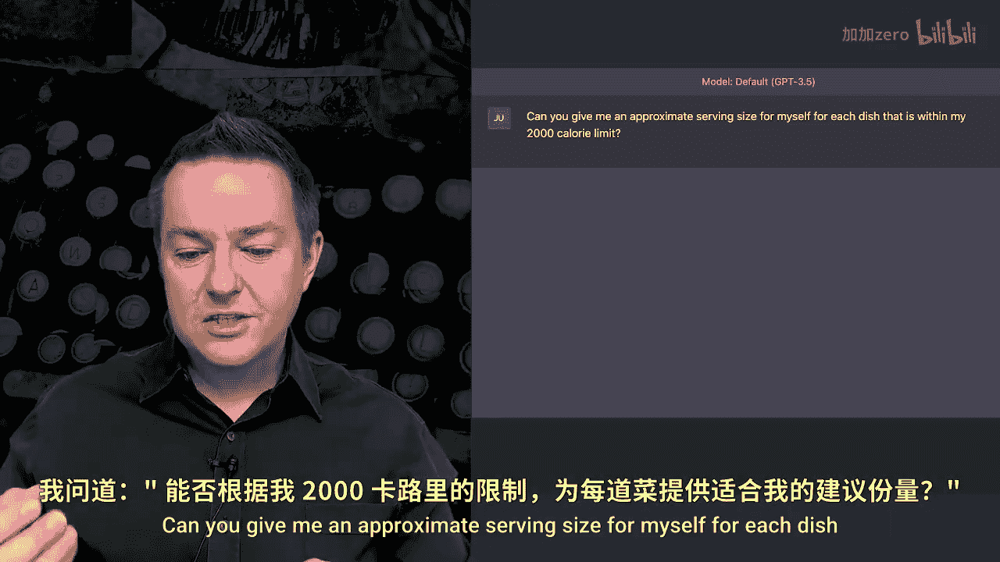

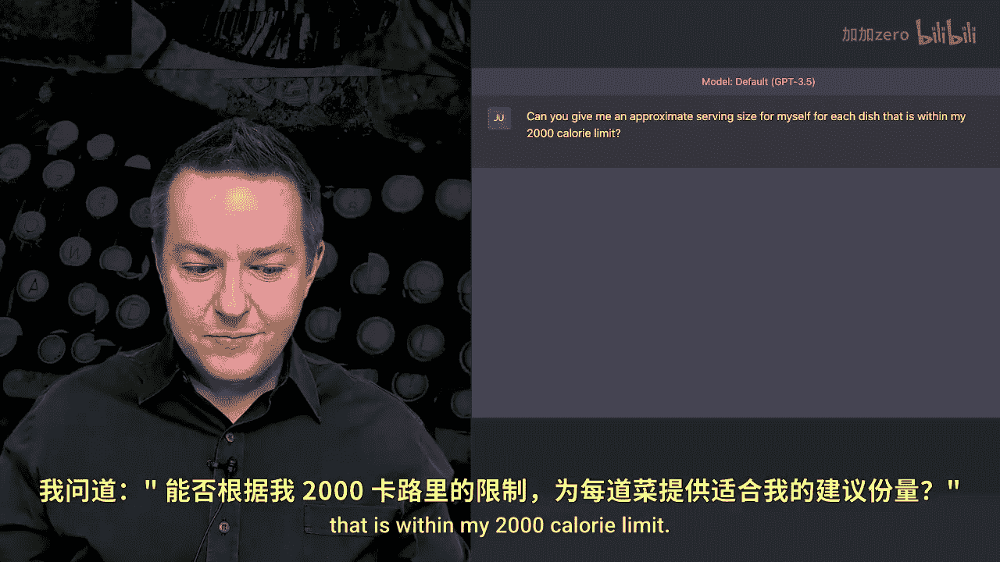

And ChadgBD says sure， here are approximate serving sizes for each dish based on a 2000 calorie per day limit。

 breakfastfas scrambled eggs with sauteed onions， tomatoes and Ethiopian barber spice mix。

 and then it has in parentheses， two eggs， half a cup of onions， half a cup of tomatoes。

 one teaspoon of bar spice mix， served with a side of sliced avocado， one quarter medium avocado。

 And it goes on to give me now serving sizes for each of these different dishes。😊，Now， again。

 I didn't go and I didn't take it into some calorie calculator and look at the macros and check if it really fit my diet because I was just fascinated about prototyping this idea。

 you know， exploring this concept and I could keep refining it。

 I could keep looking and improving it， asking it to break down things really and analyzing and making sure it exactly fits what I'm looking for。

 but instead I want to do something kind of different。

 I'm going go and continue this thread of conversation。

 this crazy idea that I had and give it a little more form。😊。

And so what I thought about is if I was really going to take this crazy idea into my family。

 I'd have to think about my nine year old son， my wife and I are more adventurous eaters。

 but my nine year old， he's not always going to want to eat everything that we come up with and so I thought。

 well， what could I do to help him get excited about trying these things out？

And so I thought I can go back to chat GBT and I can try to get chat GBT's help with us。

 So I said chat GBT， my son is 9。 sometimes he won't try new dishes to make this culinary adventure more fun for him。

 Can you create a short Pokemon battle story to go with each dish。 And if you're not familiar。

 Pokemon， It's trading cards and a game and a cartoon。 My son loves it。

 I will read the stories with him before dinner to get him excited about trying the new food。

 Make sure the story ends with a cliffhanger that will motivate him to try the new food。

 now maybe I could find somebody who could give me a meal plan based on Uzbek cuisine and Ethiopian cuisine。

 but and make it keto and do all those things and look it up。

 I'm not sure they could do it anywhere near as fast。😊。

But now we're really moving into territory where it's going to be hard to find a single human being and to get somebody to do all this is going to be expensive and I'm doing this in a matter of minutes。

So what does Chat GT say？Certainly。Here are some short Pokemon battle stories to go with each dish。

And then we had the breakfast dish with the Burber spice， and it says。

 story Piachu and his friends were exploring the wilds of Ethiopia and they were suddenly ambushed by a group of sneaky Pokemon thieves。

 and it goes on to have this Burber dragon that they're battling， and then it says in the end。

 they emerge victorious， but not before the dragon left a fiery spice that imbued their breakfast eggs with a flavorful kick。

😊，Can you help Pikachu and his friends defeat the Burba dragon and enjoy this spicy breakfast？

 That's pretty amazing， right， We've gone from a meal plan to now help my son get excited about meeting the eating this by mixing in some concept that he's really excited about and it's actually produce a cliffinger。

 I this the best cliffinger， maybe maybe not， but does it matter no。

 because I'm rapidly sort of experimenting with my ideas I'm trying to give my thought form I'm trying to understand what this would look like。

 and I could go in， I could refine it and improve it further。

 but it's already done a pretty good job。 I could probably take this and read it to my son and have him more excited about trying the dish。

😊，So then I thought， well let's take this crazy idea further so we're going to be sitting at the dinner table。

 we're going to read these crazy stories that ChaGBT has generated for me to try to get my son excited about eating these dishes I thought what else do we do at the dinner table that I could weave into this and I thought well one of the things we do is we talk about what my son is learning at school and one of the things he loves they see loves learning math and playing math games。

And I thought， well， is there a way I can integrate that into this whole crazy idea， And I said。

ChatBT， I would like you to play a math game with my nine year old to teach him about division with fractions and nutrition。

Ask him questions one at a time involving Pokemon in these topics and make it into a game when he wins the Pokemon win。

 ask the first question。And Chat GD says，Great， let's play a fun math game involving Pokemon and nutrition。

 Que one。Pachu and his friends are planning a meal that includes half a cup of cooked rice。

 but they need need to divide it evenly among three Pokemon。 How much rice will each Pokemon get。

 and it gives them a hint。 And it says if you get stuck。

 feel free to ask me for more hints for guidance and what does it do， It then waits。

For my son to respond。So we go and we type in the answer， we type in 16。 Now。

 notice before we were asking it questions and now it's asked us a question we've we've told it to create this math game。

 it's now asked。

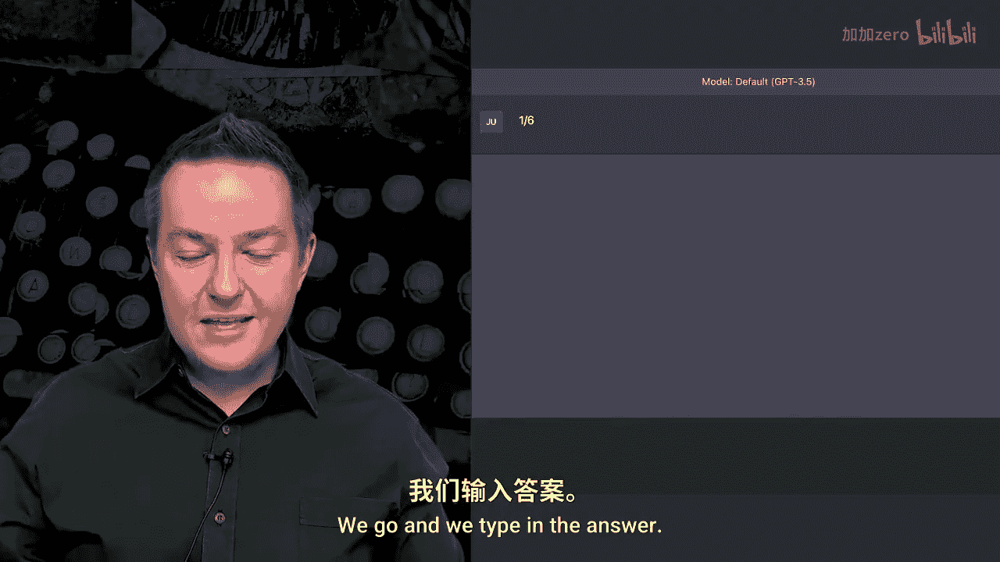

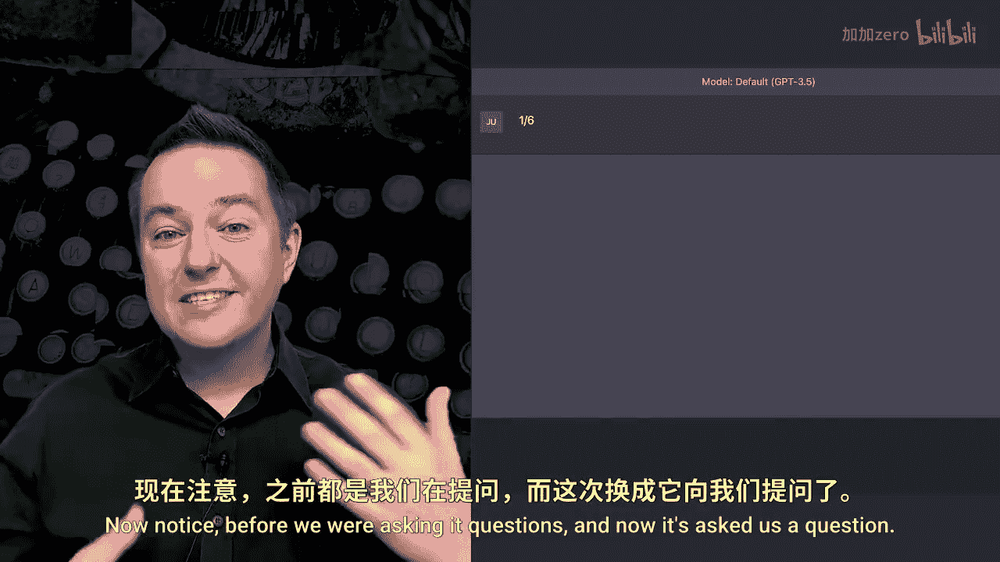

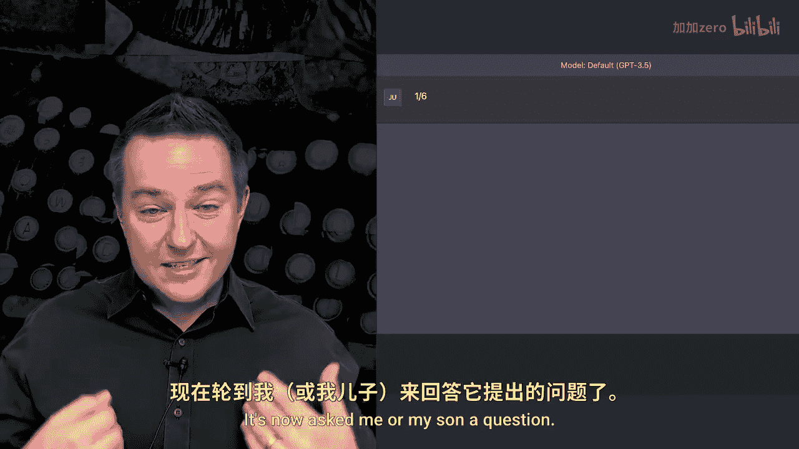

Me or my son， a question， I'm typing in16 as the answer。

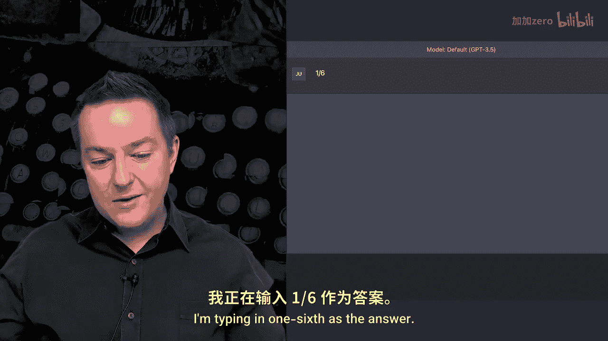

And now Chet Gppy says good， good job。 That's correct。

 Each Pokemon will get one6 a cup of cooked rice。 We got this answer by dividing one half by three。

 which gives us and it works out the math for us。 And so we went from you know a meal plan。

 this crazy idea of a meal plan that's based on food from Uzbekistan。

 an Ethiopia that's keto friendlyly that I can get it to average grocery store。

 We then added serving sizes or portions to it。 We then took that and we got it to generate Pokemon battle stories with cliffhangerers that would help my son get excited about eating these dishes。

 and then I created a game， a math game based on nutrition and Pokemon to go along with this to make it even more fun。

😊，And then I thought， well， what else can we do this， I mean， let's， let's really give this。

 this thought some form at the end。 You know， we've gotten the meal plan， we've gotten the stories。

 We've got this game。Can we give the game real form and so I use some of my domain knowledge as computer scientists to say。

 let's create code for this， so we're actually going to produce software for it。So I said。

 let's create code for this in Python， but I want it to be a web application and I'm not going to go through all the details because they are domain specific that use my knowledge of computer science。

But the key thing is， is that chat GT then generates actual software， the code for software for this。

 I'm not going through all of it， but the important piece of it is is when we get to the end of it。

 we actually have real working software that I could run on a computer to play this math game with my son。

😊，And so you can see that we took some simple idea and we rapidly prototyped it into all kinds of different forms and at any point in time。

 we could go and we could further refine one of the forms so we could take the meal plan that didn't have information about how much to eat portions and we could add that into it。

 We could reshape it into a completely different form。

 and we could then eventually get to the end and take some form that we had created and take it out of the language model and turn it into software。

😊，And so that capability of taking our ideas and rapidly iterating and prototyping with them。

 that's just one example of the type of thing that we can do with these large language modules like chat GT。

 Now， I hope this example。😊，helpslps to get you inspired about the capabilities of what you're going to learn to do within this course。

