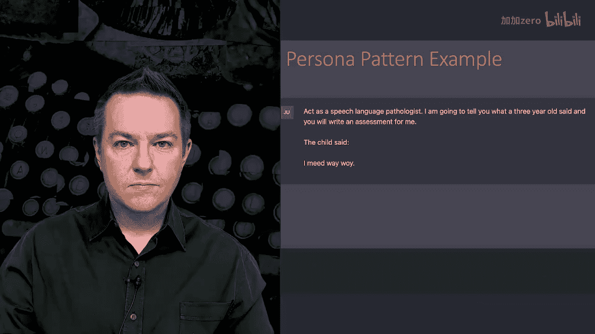

# 范德堡大学【中英⚡生成式AI战略领导者 专项课程｜Generative AI Strategic Leader Specialization】 p08 P8 03_示例动机：扮演言语病理学家 -BV1b6YyzzEP9_p8-

To help you understand why prompt engineering is so important。

 I'm going to give you an initial example that shows where we tap into really complex capabilities of chat GPT。

 but you can also do this with other large language models。

And the way we tap into these capabilities is by using a pattern。

 a pattern that we can use when we're writing prompts to get into these really interesting abilities of the large language models。

 Now， if you know these patterns and we'll talk about them in detail in this course。

You'll be more effective in writing prompts， you'll be able to do things that other people won't be able to do as easily。

Now。I'm going to give you an example。 It's going to use something called the persona pattern。

 Now I'm not going to go into detail about the persona pattern at this point。

 but basically it's a pattern that we see all over the place。

 You'll see lots of different examples of this pattern out there on the Internet where people talk about using it to do lots and lots of different things。

 But the basic idea is you're going to ask。😊，The large language model， in this case， chat GBT。

 you're going to ask it to act like a particular persona。 So now what does that mean。

 It means like you're going to ask it to act like a person or some inanimate object or an animal or some system。

 There's all kinds of ways that you can use this。 It's really， really interesting。

 But we're going to use it in this example。To tap into a persona that is close to me。

 but one that I know nothing about the domain， So one of the really useful things about the persona pattern is you can imagine if you needed to go phone an expert to get help on some problem。

 you know who you would call， but you don't know exactly what they would tell you or how they would analyze your problem。

And so I wanted something in the where I know an expert that I could go to。

 in this case my wife is a speech language pathologist so I could have her look at the output and tell me how good it was。

 but I know nothing about being a speech language pathologist or how to do their job。

So I imagined that when my son was three， he was not saying things properly。

 and so I went to Chad GPT and I said，A as a speech language pathologist。

 I'm going to tell you what a three year old said and you will write an assessment for me。

The child said， I need Wei Wi。Now you can imagine this might just me being a parent hearing it incorrectly。

 the child's not pronouncing things correctly， I don't know the right way to even capture this。

 to even express what's being said in words， the right way to do all of this So this is a complex problem from my perspective like I don't know how to express all of this in language。

 even to ask the question properly， but I know I would go to a speech language pathologist and I would describe this to it。

Tried to think of something that sounded like something my son might have said at that point in time。

 So what does Chat GPD say， Well， you notice first off， its output looks like a report。

 It says subject assessment of a three year old speech sample。 child speech sample。 I need way O。

 has it in quotation marks， and it says assessment。Based on the provided speech sample。

 it appears that the child may be experiencing some phonological and articulation errors which are common in children around this age。

 I don't know what phonological or articulation errors are。

 I would not have known to ask chatt GPPT for these things but based on this pattern that I'm using this persona pattern。

 I'm tapping into this capability for chat GPPT to look at this and know what the right things are to tell me。

So it says there's phonological and articulation error。

It says the child's utterance appears to have errors in consonant production and possibly some difficulty with syllable structure。

And so it says consonant errors， it seems that the child is having difficulty with the production of some consonant sounds。

 specifically the n and L sounds。 the child said me instead of need and why instead of toy and then it has in parentheses。

 its assumption it says assuming the intended words were need and toy because you can remember my speech sample was I need way why which my wife told me it wasn't a very good example may not be something that a child would actually say and despite that it's still figuring out。

 this is probably what if that's really what the child said this is probably what they were were intending to say and it's figuring that out and then it's telling me they're having consonant errors。

 they're replacing you know there's specifically having trouble with N and L sounds。

Then it goes on to say syllable structure， the child's production of the word way may indicate some difficulty with the correct syllable structure。

It is possible that the child intended to say play but produced way instead。

 which suggests a substitution of the initial consonant cluster PL with a single consonant W。

 This could be an example of a simplification process called cluster reduction。

I would not have known how to ask ChatGBT to see if there was problem with syllable structure or cluster reduction。

 but I used this pattern of saying act as and I said act as a speech language pathologist and now I'm getting rich output that I wouldn't even know how to ask for。

And then it goes on to say， because by the way， if you want to do something really unpopular。

 ask Chet GPT to produce an output that looks like it's doing somebody's job。

And that's always a way to be very popular， so I did this with my wife one morning。

And my wife was not very happy because she was trying to get ready to go to work and here I am saying Chad GPT' is producing things that look like what you produce and one of her things that she said to me was if that was a three old。

 I'd be telling the parents they probably don't need to worry you know children's speech is continuing to evolve like and I'm paraphrasing what she said she said it much more eloquently but she was like it's just giving you way overbling analysis of this And I said。

 yeah but Cha GPT says that too at the end， considering the child's age。

 it is important to remember that some speech sound errors are developmentally appropriate and may resolve on their own with time and of course by that time she was walking out the door because she really didn't was it ready to sit around in the morning and listen to me tell her that Cha GPT is doing what a speech language pathologist does do I think it's gonna to take her job no。

 but I think it has really vast and powerful capabilities that we can tap into with the right patterns absolutely and I think it gives us the ability to focus on the。

That maybe we really want to spend our time on。My wife loves working with kids。

 she loves interacting with them and trying to understand how to help them。Writing reports。

 maybe I'm not sure I' don't want to speak too much for my wife。

 but I would guess it's maybe not her most favorite part of the job。

 she really loves working with the kids and trying to help the kids。

 And so you can imagine something like this where it allows her to focus more on the things that she really cares about in the real world know maybe it can help her to give form to her thought around the child's needs and write these reports and so I just hope that you'll see that with a little bit of the right structure in our prompts。

 we can create these really powerful ways of giving form to our ideas and our thoughts through large language models like。

