# 范德堡大学【中英⚡生成式AI战略领导者 专项课程｜Generative AI Strategic Leader Specialization】 p13 P13 03_人人都能用提示词编程 -BV1b6YyzzEP9_p13-

Prompts allow you to do more than just ask questions to chat GT or tell it to do things。

 You can actually write programs。 Now， if you're not a programmer， don't worry。

 because everybody can actually program using chat GPT。

 and I don't just mean in writing a bunch of software that you're gonna to run on your computer but actually giving chat GPT rules to follow complex instructions that you want it to listen to and use to generate the output。

 Now I'm going to give you some examples of this。 hopefully give you some intuition on what I mean by programming and help you to think about how you can write better prompts。

 Now， one way to think about this is I'm going to talk about it in terms of programming。

 but you can also think about it in terms of rules that you would give some type of personal assistant。

 So let's take a look at an example here。😊。

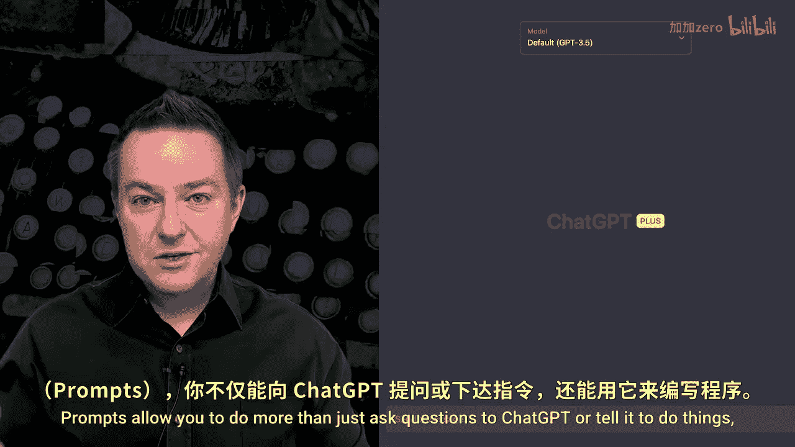

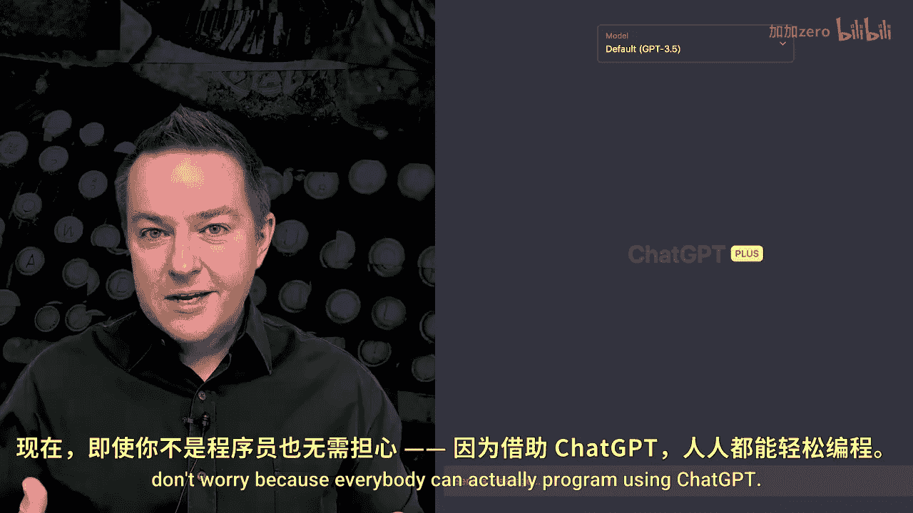

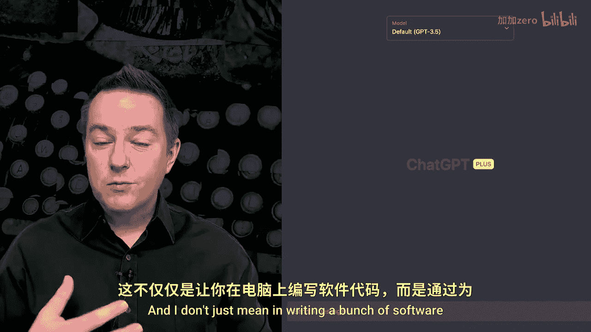

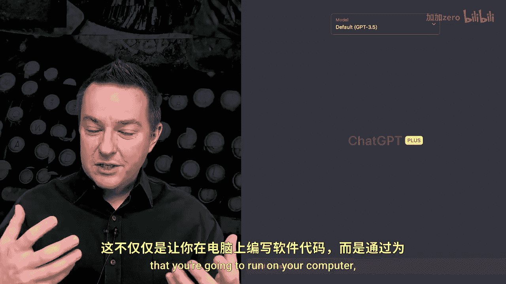

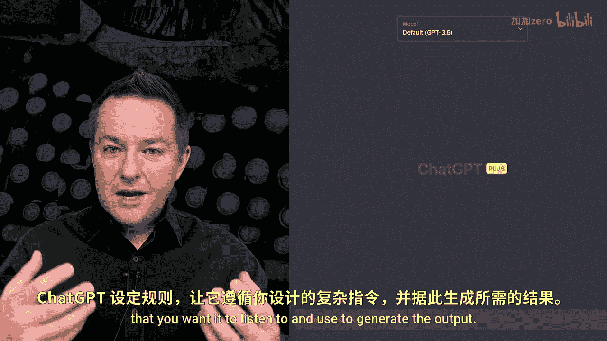

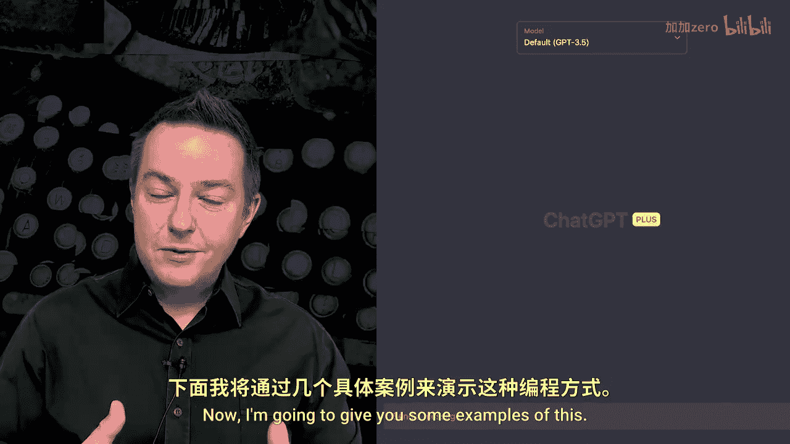

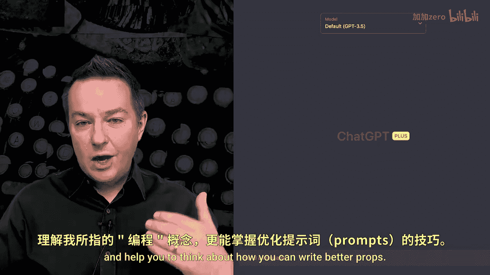

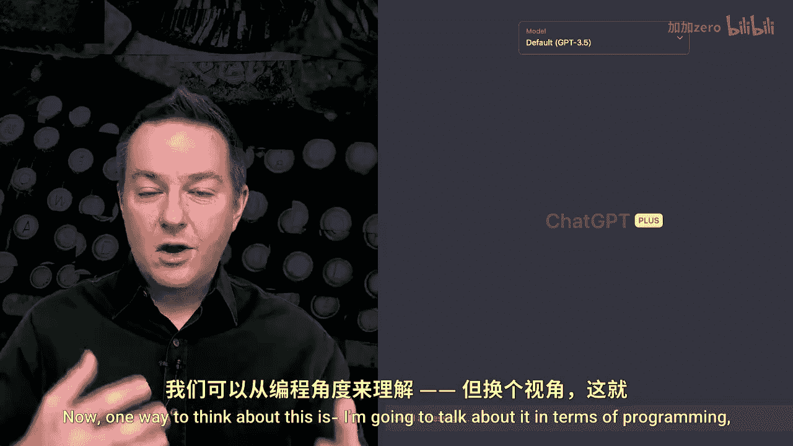

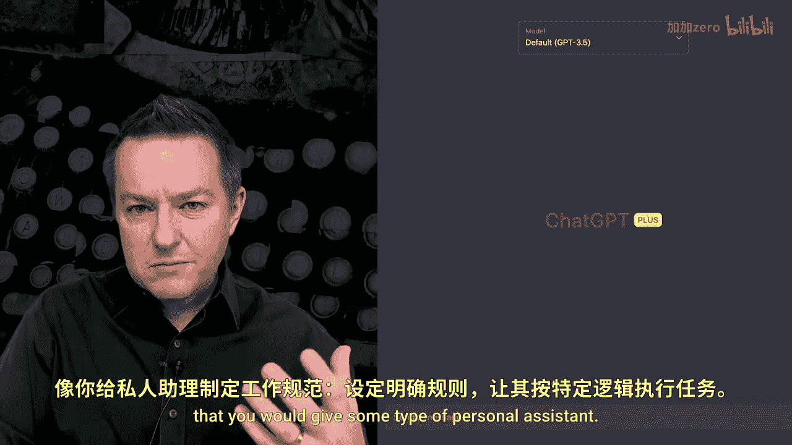

So I'm going to ask chat GT。

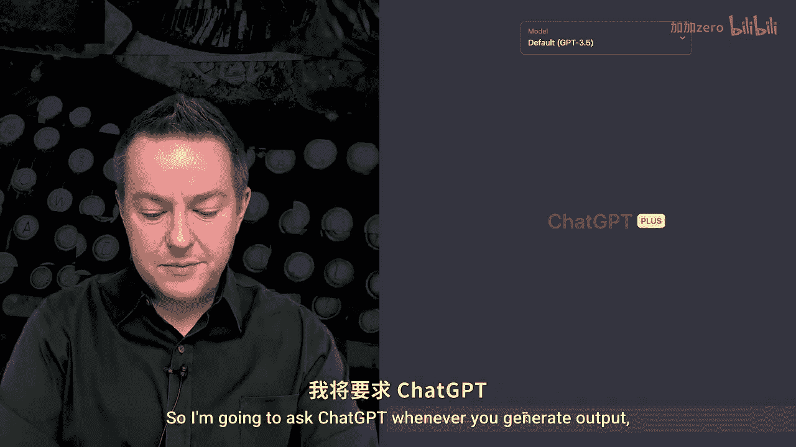

Whenever you generate output， turn it into a comma。

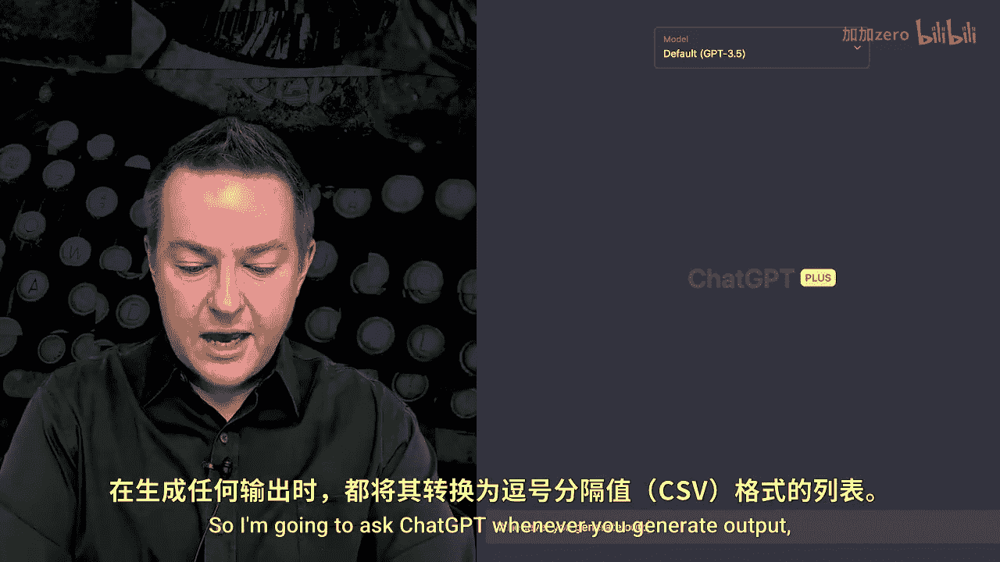

Separated。

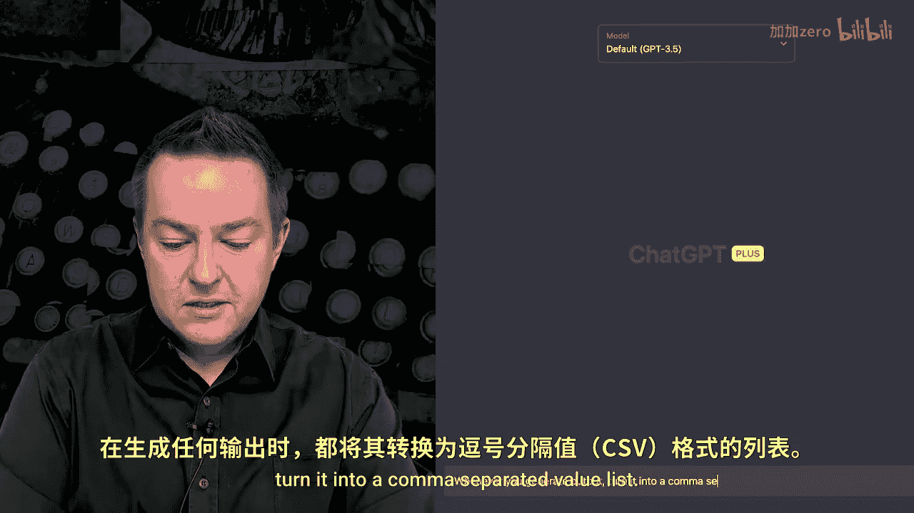

Value list。Now this is just something that you might want to do。

 you want to want to format your data， so if you've ever worked in Excel。

 comma separated values are basically a list of items separated by comms。

 It's a really simple concept。

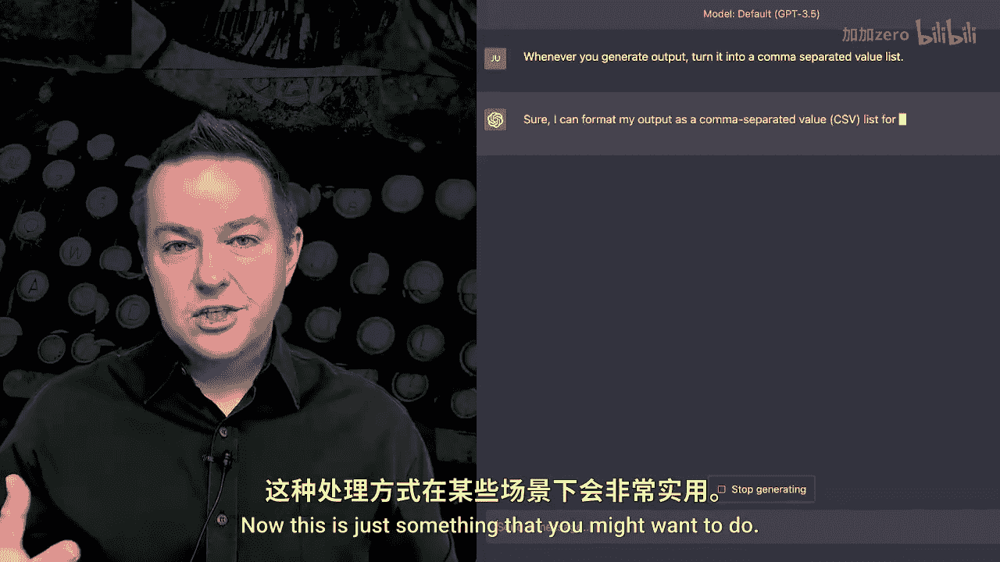

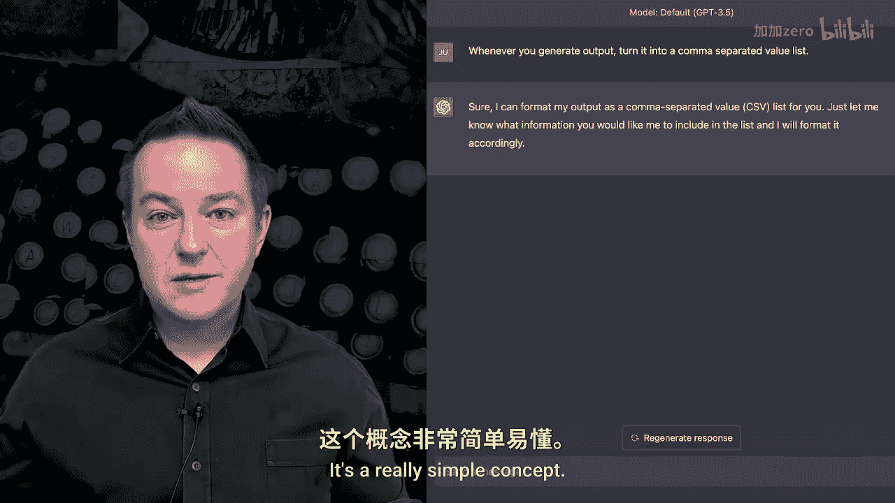

Now， sometimes you can think of tables as having a comma separated value list。

 You can think of the first column in the table， is the first value。

 then you have a comma for the that differentiates and separates the second column。

 And then another column is separated with a comma。

 So you can basically have like a three column table。

 you can have the first value and then a comma and then second value and then a comma and then a third value。

 And if you've ever worked with。Different spreadsheet programs you've probably done this。

 So now chat GPD says sure I can do that。 I can output my format。

 so I'm going to write in my name is Jules White， and I am teaching a course on prompt。Engineering。

And so what we can see is it creates a commerce separated value list。

 We're essentially creating a table。 There are two columns name and course。

 and it decides that the first column is going to be name is going to be me。

 And then the second column is going to be prompt engineering， which is my course。 Now。

 notice it decided， which is kind of interesting。 It decided what the columns were going to be。

 I didn't tell it。 But if I wanted to go back， I could maybe give it some more instructions。

 I could say from now on， the columns of。😊，The comma separated value and comma separated value is CS SV。

 And， in the future examples， I'm going to start abbreviating this CSV。

 But I'm writing it out for now。 The columns of the comma separated value。listist should be name。

 and I'm going to go ahead and capitalize these to provide some emphasis。Name， course。And role。

 so what is the role of the person in the course？And now I'm going to say， again。

 my name is Jules White， and I am teaching a course on prompt engineering。And so now we see it。

 it's reformatted， it's now got name， Jules White course， Pro engineering and role teacher。

And so we've actually written a program。If you think about it。

 what we've told chat GT to do is every time we actually write something。

 chat GPT needs to format it in a particular structure that we've given it。

 We've wrote a program that tells it what to do。 So it's more than just asking a question。

 We're actually telling it how to interpret our our input。

Now we could go and write more for our program， for example， we could say in addition。

To whatever I type in。Generate additional examples。

That fit the format of the CSV that I have asked you to produce。

And so now what we see is it's gone and it's taken my original format， name course and role。

 and it's now filled out additional examples， and I could say something like my name is Jules White and I am。

Teaching a course on prompt engineering。And you notice now our program's gotten more complex。

 and not only is it creating the CSV based on what I typed in。

 but it's also following my instructions and it's going through and generating additional examples that fit into this。

So when you're creating prompts， you can do much more than just ask it a question and get an answer。

 you can actually program the interactions。 Now the key to this is is that we're having a conversation and if you look back at the very beginning。

 I provided at the initial sort of instructions， which whenever you generate output。

 turn it into a comma separated value list。😊，And it started doing that。

 and then I began refining my program。 I then say from now on at this point。

 I'm adding something to it。 I want the columns of the comma separated value list to be name course and role and then it does that and then I say now in addition to that I want you to generate examples and it does that and so we've actually written a program and now whenever we go in and type in new input So again。

 you notice I'm providing the same input basically my name is Jules White and I'm teaching a course on prompt engineering。

 but the program that that Chat GBT is using to produce the output is changing I've changed the rules over and over now you can imagine talking to a personal assistant and you can say。

 okay I want you to do X and they do it and then you realize oh wait they didn't there's something else I want and you give them an additional rule to follow and then you tell them okay I want you to do X and they go and do it and they do better but you realize that it's not quite what I want。

 and so you go give them an additional rule to follow。When you're doing that。

 you're basically building up a program for them。 You're building up a set of instructions that they need to follow whenever you give them this particular task。

 And that's what we're doing with Chat Gt。 We are programming。

 And so we're using the same input over and over。 My name is Joles White。

 and I'm teaching a course on prompt engineering。 We're using it here。

 But each time the output that we're getting。😊，Is getting different and more complex because we're asking ChatGPT to do different things。

 we're giving it more instructions for the program and the final result is now we've got structured output。

 it's got additional examples， all of this has come from what we've asked chattGPT to go and do。

