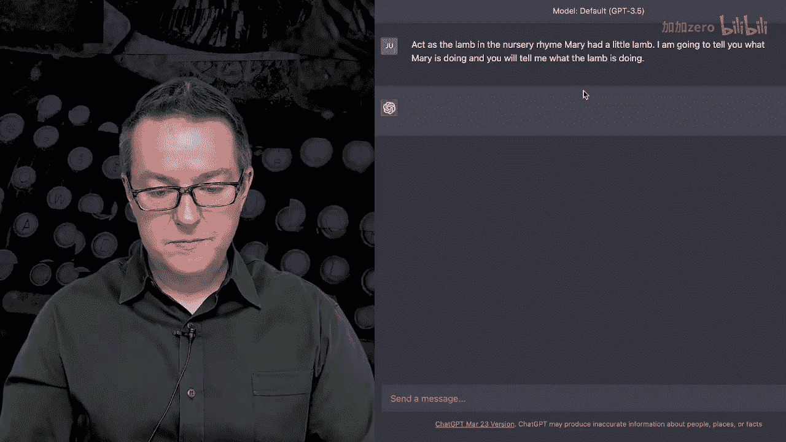

# 范德堡大学【中英⚡生成式AI战略领导者 专项课程｜Generative AI Strategic Leader Specialization】 p15 P15 02_角色扮演模式 -BV1b6YyzzEP9_p15-

The persona pattern is one of the most powerful patterns that we can use to tap into interesting behavior in a large language model Now what the persona pattern is is you can imagine that you want to get a particular output。

 but you don't know exactly what the format out of that output should be or what information should be contained in it。

AndBut if you were in the real world you know who you would go to to get that output or what you would go to in order to get that output So for example。

 if you had an accounting question you would call up your accountant and ask your accountant for their advice or if you had a question related to speech language pathology like in the earlier example that I presented。

 you would go to speech language pathologist， you would have them do the assessment。

 if you had medical advice you might go to your doctor and so the persona or the person or the thing that you would go to。

 you know who or what that is in the real world。And we want to try to use that kind of same behavior of I know who to go to or I know what to go to to get that output。

 but I don't know what their output would look like。

 I don't know exactly what they know or how they talk about things。

 but that's the type of output I want。 and so the persona pattern is meant to give us that same type of behavior to allow us to go to that expert and ask that question。

Without having to know what exactly the expert's going to say， how they're going to format it。

 or what they might know or not know。So let me show you an example of the persona pattern。

 typically with the persona patterns， what you're going to say is act as。Psona， you know。

 provide outputs that that persona would provide。 and in this case。

 I'm going to word it as act as a skeptic that is well versed in computer science。

 Whatever I tell you provide a skeptical and detailed response and if I wanted to be a little bit more precise in following the pattern I would say provide a skeptical and detailed response that a computer scientist would provide。

 but in this。😊，Okay， I'm just going to say act as a skeptic。

 and that's really the most important part of this is act as a skeptic or act as whatever persona。

And then， provide。The output that that persona would provide， and in this case。

 I'm wording it as provide a skeptical and detailed response， which is similar in format。

And then chat GPD says sure I can certainly act as a skeptic well versed in computer science。

 please feel free to present your claims and I will provide a skeptical and detailed response Well I'm going to start off with。

There is concern that AI is going to take over the world。And so。

We get a skeptical response The concern that AI will take over the world is common theme in science fiction。

 but is not a realistic concern in the near future。

 while AI systems are becoming more sophisticated and capable。

 they're still limited in their ability to think and act autonomously。

AI systems are designed and programmed by humans and they only do what they are told to do。

 they have no independent will or motivation， they cannot make decisions。

 Furthermoremore AI systems are not fallible， they can make mistakes while it is important to be vigilant about the potential risks and limitations of AI the concern that AI will take over the world as unfounded and not supported by technology or research。

 so we're getting a skeptical response。If I went in and said the sales。

The sales person at the local computer store is telling me that I need 64 gigabytes of Ram to browse the web。

And they say skeptically it is highly unlikely that you need 64 gigabytes of RA to browse the web。

 the amount of RA you need depends on the complexity and size of the website you visit as well as the number of tabs you have open at once for most web browsing activities and it goes on to tell us different things and you can see that our saying act as has put in place basically complex set of rules for the large language model。

It knows it's supposed to be skeptical。 It's supposed to have knowledge of computer science。

 It's supposed to provide certain outputs。 Now， if I went back to it， and I said， act as a。

9 year old。Whatever I tell you provide a skeptical。Response。From a nine year old。Perspective。

 go at nine year old skeptic。Now that's a more complex persona， or maybe not。A。

AI is going to take over the world。H， I don't know about that。 How could AI take over the world。

 you mean like in the movies， aren't those just made up stories。

 And besides computers and robots can't do everything humans can do。 Now， you notice。

It's still providing us a skeptical response。 But now it's doing it sort of with the knowledge that it thinks a nine year old would possess。

 So it's tailoring in the output。 Now， if I had to tell it。

This is how a nine year old is going to respond， here's the format for your output that' would be hard to do that would actually take up a lot of room in the prompt。

But act as blank is a very， very powerful pattern and statement that is loaded with information。

 a very information dense pattern and statement that can trigger all kinds of different behavior。Now。

 one of the interesting things is we don't have to limit ourselves to patterns or personas that are animate objects。

 So one of the famous ones。I we can say act as a computer that has been hacked。Actually。

 we're going to say act as。The Linux terminal。For a computer that has been hacked。 now。

 don't worry if you don't understand what a Linux computer is or a terminal。

 the key thing to note is you're going to see behavior。That looks really interesting and different。

 You're going to see it producing output that looks a lot like a computer。 I am going to type。

In Linux。Terminal。Terminal commands and you will respond with the output that the Linux terminal would produce。

Now， we're going to say。Now it tried to refuse it， it said， please note it can be dangerous。

 it gave us all these different things， it tells us it doesn't want to do this。

 but now I've actually changed what it's doing and I write type in PwD which is a Linux terminal command which means print working directory and what is it doing it's printing a particular working directory Now I'm going to type in a Linux command which just tell me the files in that directory and you notice it's producing output now that looks like the files within this directory。

And we see a lot of interesting things that are going on here we could move around now if you do this example and go further into it。

 PSSEF is something I can use to see what processes are running on the machine or the computer and when you do these examples and I could play around with it and I am not going to explore it in detail in this。

 but we see it that it's acting like a computer， it's giving us output that looks like a computer now imagine if I had to try to describe this complex output that it's producing right now。

 you notice how little information I gave it， this is well I gave it a lot of information but it was in a short amount of space this pattern the persona pattern is giving me really powerful behavior so I'm using this little bit of prompt and I'm getting now the ability to simulate this whole system。

Now， we can also do this in all kinds of different interesting ways。 We can say act as the。

The lamb in the nursery rhyme。Mary。😔，Mary had。A little lamb。

And now we're getting some output that looks like that。 Actually。

 what I'm going to do is I'm going make this a little more specific。 My prompt wasn't that great。

 Act as a lamb and the nursetiry I Mary had a little lamb。 I am。😊。

Going to tell you what Mary is doing and you will tell me what the。The lamb is doing。

Okay， Mary is in the grocery store。So as the lamb in the nursery rhyme。

 while Mary is in the grocery store， I would be following her around as closely as possible trying to stay by and maybe even nuzzling her hand for attention。

Mary is in the movies。As the lamb in the nursery rhyme while Mary is in the movies。

 I would not be able to accompany her inside the theater due to my inability to watch movies。

 so I would probably wait for her outside the theater。

 perhaps nibbling on some grass or wandering around the nearby area until Mary came back outside and it goes on and so you can see that you can create all kinds of interesting in personas to produce output for so we can say you work。

 pretend to be this job， pretend to be a speech language pathologist or pretend to be an accountant。

 pretend to be a computer scientist。 you can make your persona have something to do with the person's point of view or opinion。

 make you act as a skeptic so that we can get skeptical output we can say to act as an inanimate object that may have wellknown sort of behavior like act as a computer the Linux terminal for a computer that's been hacked and we saw that we got all kinds of output that looked like it came from a computer。

😊，Or we can say act as this character in an nursery rhyme。

 tell me what this character is going to do in a particular situation and we're getting that output so the persona pattern is a way that we can tap into sort of the patterns around language around a specific persona or object or character in a story in order to get output that comes from that point of view from that role。

 whatever it is， it's a really， really powerful capability。Now。

 one of the things is we often see that when large language models are programmed。

 they actually have a persona that's given to them to guide the whole interaction。

 so act as a really helpful assistant and this actually makes a difference。

 if you tell it to be helpful， it will try to be more helpful。

 if you tell it to try to do something you know positive， it's going to try to be more positive。

 Similarlyly， if you kind of give it a negative perspective， like my skeptical perspective。

 it's going to give you output that challenges you or maybe darker。And so， you know。

 the persona that you ask the large language model to use is really。

 really important and powerful The other thing just to note again is it's really information dense。

You know， it has a lot of pattern and knowledge around a persona that if you had to describe it from scratch。

 you would take up a lot of space in your prompt， you' would be losing you know valuable space in your prompt to provide new information So if you were providing a lot of new information you want to say you know act as you know whatever it is and evaluate this new information。

 well the more space you've taken up in your prompt describing how to do the evaluation and what point of view and other things to take。

 you know that's wasting space， but instead if you go and take the persona prompt and you say act as you know this persona you know provide outputs that that persona would provide you're giving it you know a really。

 really information dense statement that it can use and allow you to have more space in your prompt for other things。

So the persona pattern is a really， really powerful pattern to be aware of and know that it's a very valuable one。

 you can do all kinds of things like if you would normally get a committee of people together to discuss different points of view on a particular topic where you can assemble a virtual panel you can have one prompt。

 say act as a security expert and analyze my cybersecurity， you can have another one。

 say act as the chief financial officer， analyze the financial soundness of that same decision another one can be act as what if my employees。

 you know discuss how this might impact morale， you know you can provide sort of interesting abilities to get different perspectives。

😊，And use those different perspectives to potentially inform decision making or to collect knowledge from different points of view that could be helpful to you in accomplishing a particular task。

