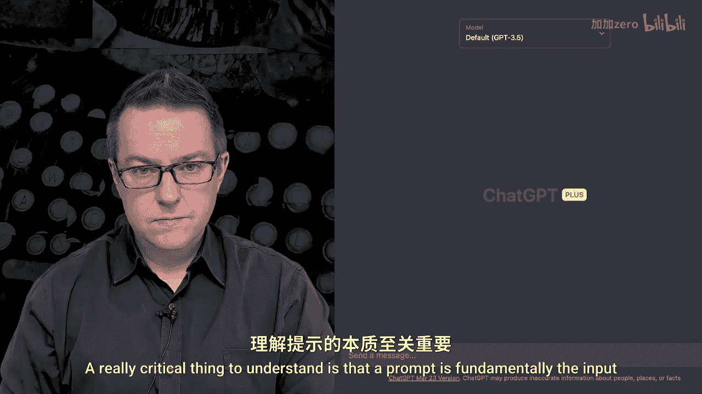
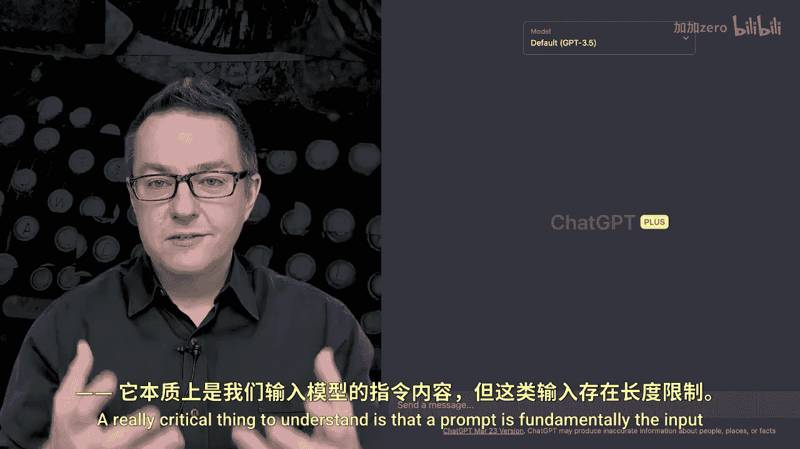
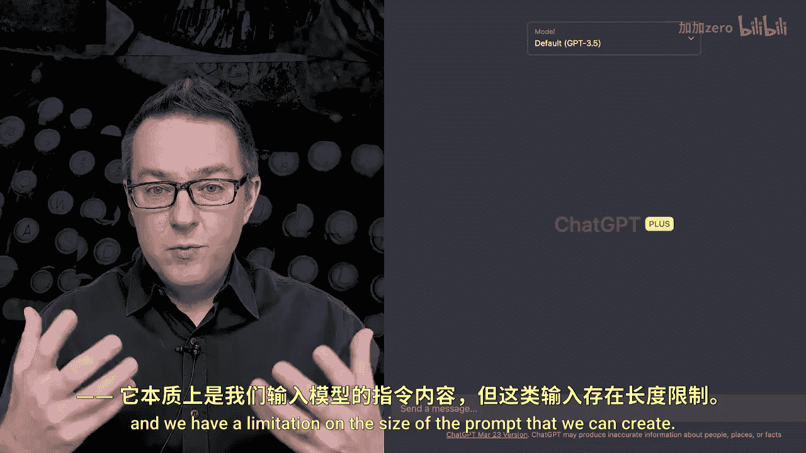
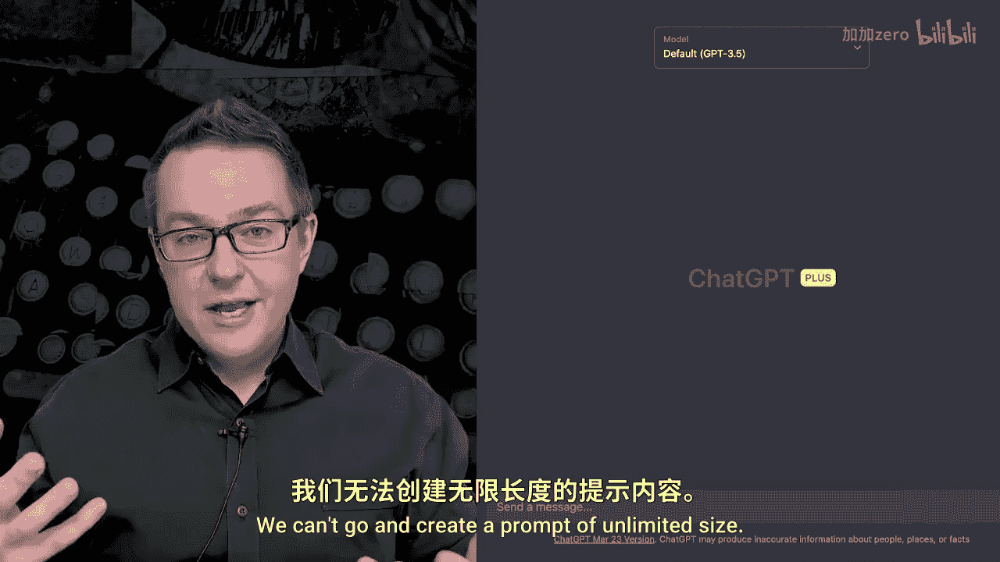
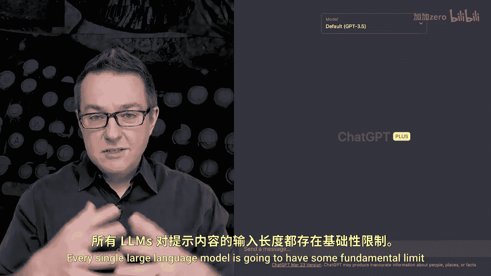
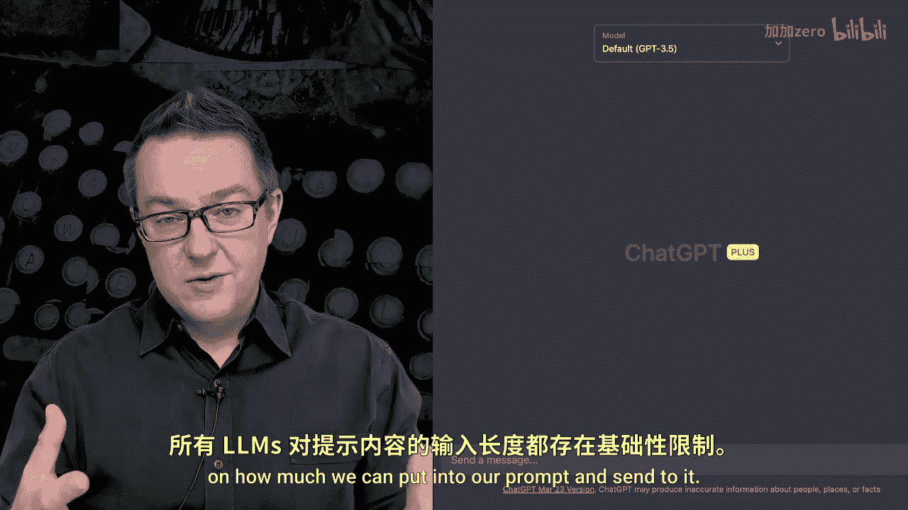
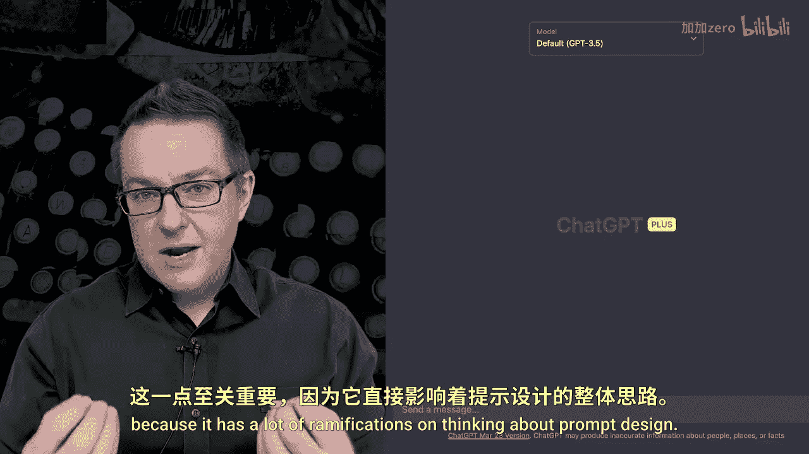
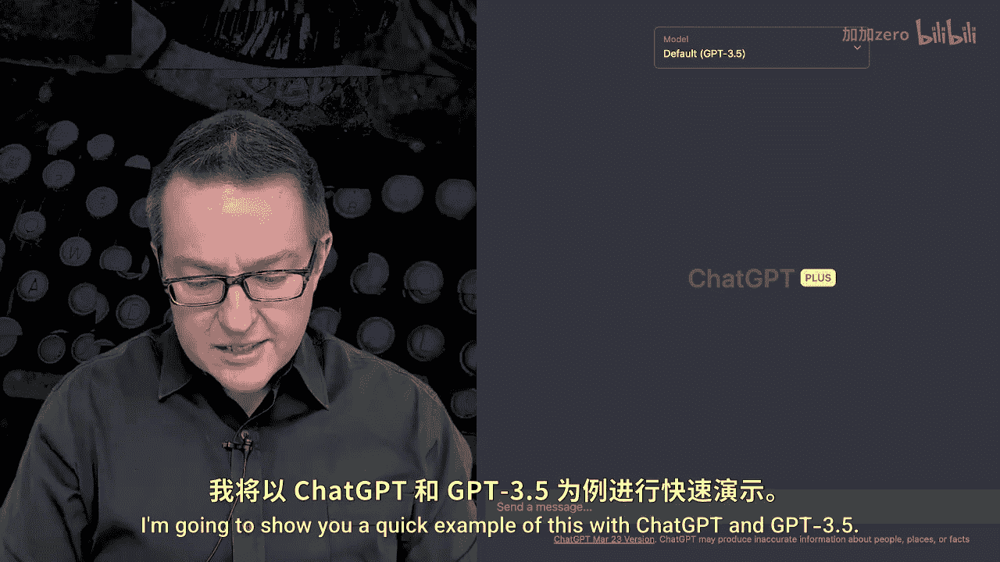

# 范德堡大学【中英⚡生成式AI战略领导者 专项课程｜Generative AI Strategic Leader Specialization】 p17 P17 02_提示词长度限制 -BV1b6YyzzEP9_p17-

A really critical thing to understand。Is that a prompt is fundamentally the input that we have into the model。

 and we have a limitation on the size of the prompt that we can create so we can't go and create a prompt of unlimited size。

 Every single large language model is going to have some fundamental limit on how much we can put into our prompt and send to it。

And so this is an important thing to note because it has a lot of ramifications on thinking about prompt design。

So I'm going to show you a quick example of this with chat GT and GP3。5。

 so I'm going to paste in the Wikipedia article that's related to the French Revolution。

 so I've pasted in a huge amount of text from the French Revolution that's described in Wikipedia and what is chat GT say it says well the message you submitted was too long。

 please reload the conversation and submit something shorter。

Now this shows you an important point， we can't just give it unlimited information。Now。

 if we go back and we think about some of the things we talked about some of the dimensions of prompt。

 one of the ways that we can use a prompt is to introduce new information that chat GBT or another large language model wasn't trained on So if we want to go and introduce new information to it。

 we have to be aware that there's a limit to the amount of information we're going to be able to give to it at once so we may have all kinds of new information that we'd like to give to chatGPT。

 but we can't just dump it all in at once and's say now start reasoning on this that's not the way it works。

So one of the goals that we have as users is to try to select and use only the information that we need in order to perform the task that we're asking chatGPT to perform So we can't just go and dump everything under the sun in there and say hey。

 chat GPT figure it out we can go in and dump in a lot and depending on the model。

 we may be able to do more or less， but we have to be you know to some degree we have to be editors。

 we're content editors we are editing the context of information and we have a budget。

 we can't just you know go and dump unlimited amounts and you can think of it basically as like you're trying to create a paper and you have a page limit for your paper or you have a word limit for an article that you're writing you can't just go in and dump things you arbitrarily So what do we do Well one we have to think about what is the most important information to actually provide So let's say。

 for example。That we really care about October 5， 1789， well， if that's the case。

 that's what we want to paste in for chat GBT to reason about and then we could go and we could say you know。

What happened on October 5th？And then it would go and tell us what happened on October 5。

 but now if we ask it a question that is outside of the scope of October 5 and something it wasn't trained on now in this case it was probably trained on the information regarding the French Revolution because obviously that was before 2021 but if we had new information we wanted to incorporate we have to think about how do we put that information into our budget so what are some ways that we can do that how can we take large amounts of information and try to get it into our budget Well one we can be selective about what we include。

 we can basically outside of chatt GBT go and run some type of query or filter so we can go and select what pieces of information are going to be relevant to the task and there's lots of ways of doing this and I'm not going to go into all of them we can have a filter we can say this type of information is not relevant remove it before we provide it to chatt GBT。

Another thing that we can do is we can actually go and have that information summarized in a way that we think will preserve what's needed to reason about it。

 so for example， we might say， well， you know maybe we can't paste in all of the information related to it。

 but we could say， you know， we're going to take this and summarize each paragraph。

 summarize this information in one sentence。And then we would get some type of summary and now this is slightly shorter than the original。

 so we have a now a one sentence summary of what happened we could try to give it a word budget so one way we can do it is we could actually take all the different pieces of information。

And we can ask chat GBT or another large language model to summarize that information for us。

 and then we can take that summary and reuse it later。 and we can put together several summaries。

 for example， Now， this only works， if we make sure that the way that we summarize or if we sure that the way that we filter。

😊，Preserves the information that's needed for whatever task we're going to ask for so we might go through。

 we could also go and say， you know， we said summarize this information in one sentence and we instead we could say you know summarize this information in one sentence and I'm just going to。

Preserving information about numbers of。Of people。And then we would get a summary that preserves the information about numbers now if you look at the original summary。

 we see up here it didn't keep the number of people and if that was something important that we needed to reason about。

 then we would have lost that and so if we had summarized in that way and then used that information to do some reasoning that required the number of people。

 obviously we've lost what we need down here we've asked it to summarize。

 but we've asked it to summarize in order to keep certain information or in order to accomplish a particular task。

 so we did it by saying basically。Summarize this information in one sentence。

 preserving information about numbers of people we could have also gone and asked chat GBT， you know。

 preserving information needed to reason about the population or to reason about how many people were in the resistance or in the National Guard we could have given context。

 So one of the things we have to be cognizant of it is this budget on the size of our prompt。

Is going to be a fundamental limitation that we are always trying to work around Now。

 as large language models get bigger， they will probably reach a size where for many practical tasks。

 particularly when we are directly manually interacting with a large language model。

 that size doesn't really matter because we can just copy and paste， you know。

 50 pages of text into the model and ask it to provide this information out of there or perform a task based on it。

But if you can think about how much information we're dealing with on a daily basis。

 there are probably going to be different types of tasks where there's going be so much information we can't dump it all in at once。

And when we get into those types of situations， we have to think about either querying and getting a subset of information like only the documents or only the parts of documents that are relevant2。

 we have to think about filtering you know how do we remove information that's extraneous3。

 we have to think about how do we summarize or compress that information before we give it to the large language model and one of the ways that we can do that as we've just seen is we can actually give chunks of information to the large language model and then ask it to essentially summarize or compress it for us in order to later use it for reasoning we can also go and we can say summarize or compress this information in order to accomplish a particular task or in order to preserve these aspects of the information and that can help us to create summaries or essentially condensed versions of the information that preserve the important pieces So this can be a powerful technique when we go and。

😊，Again， needing to reason on larger and larger amounts of information。

