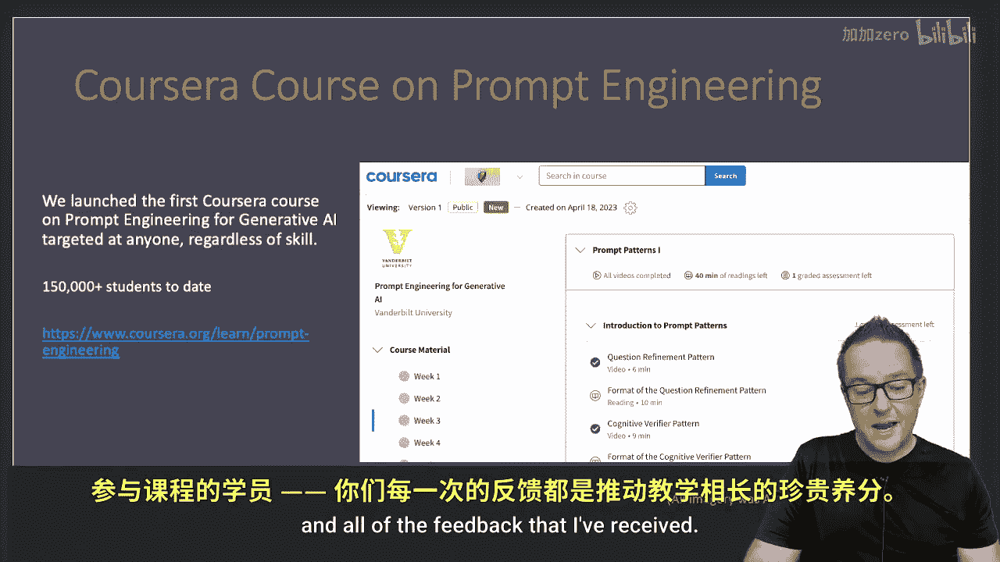
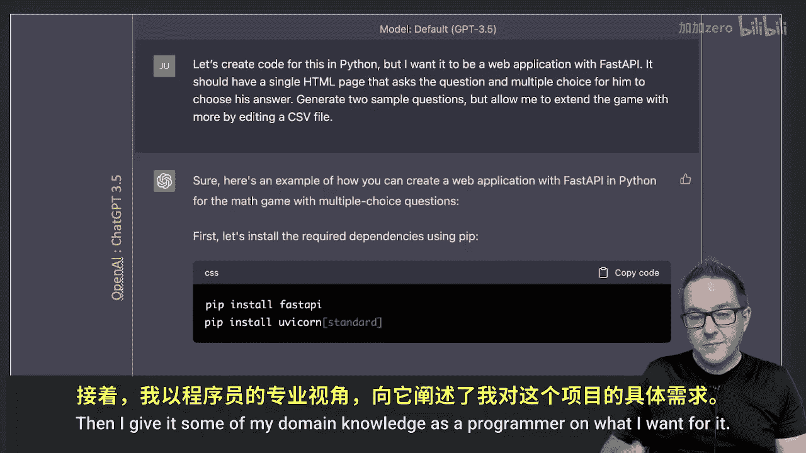
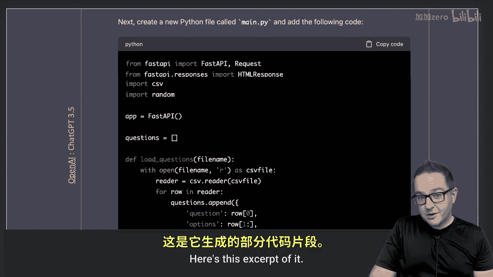
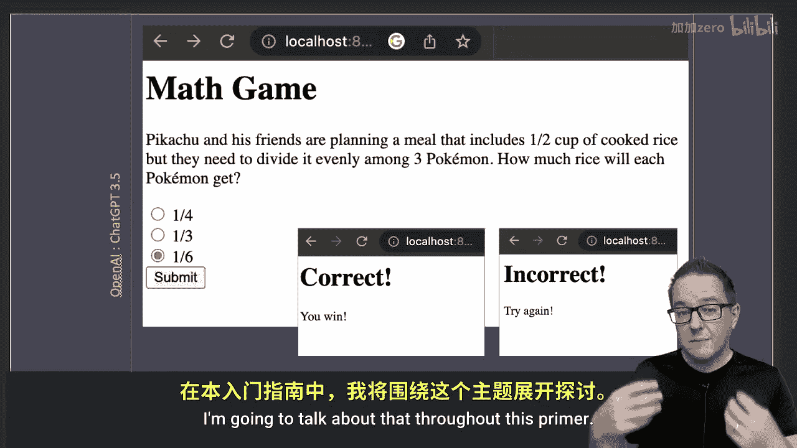

# 范德堡大学【中英⚡生成式AI战略领导者 专项课程｜Generative AI Strategic Leader Specialization】 p44 P44 01_生成式AI的突破性新能力 -BV1b6YyzzEP9_p44-

Welcome to my primer on generative AI。 I'm Jules White。

 I'm a professor in computer science at Vanderbilt University。

 and I'm also the director of the Vanderbilt Initiative on the Future of Learning and Genrative AI and this is our initiative at Vanderbilt to help make sure that Vanderbilt is a world leader and innovator in the use of generative AI and so I'm going to talk to you about how we approach generative AI within Vanderbilt and how you should be thinking about generative AI and what you should know about it。

 what you should think about in terms of training your workforce and also in terms of the capabilities and why it's so important Now this is a technology that in October of 2022。

 if you had asked me is something like Chat GBBT going to exist in your lifetime I would have told you flat out no way never going to happen。

 don't believe it never and boy was I wrong and what I want to show you is the depth of capability that's there and why this is so exciting to me。

Now， as a computer scientist， I often feel like I'm looking up into a telescope saying I promise in five years we'll make it to that planet over there。

 and then one day I was looking at my telescope and I looked over my shoulder and a UFO had landed behind me。

 and that's what ChatGBT is it's like this incredible new alien technology that now as we're kicking it。

 it's beaming trees around the earth and solving all kinds of incredible problems that I never thought a computer would be able to solve。

 And so what I'm excited to do is to show you and help you explore all of these capabilities and sort of understand it in a different way from what you may have seen in the news。

😊，Now， one of the things I want to take a moment to mention is I teach a course on prompt engineering for Cha GBBT on Coursera and there's over 150。

000 people that at the time of this filming have taken the course and a lot of what you're going to see is their ideas。

 their innovation that it's filtered back to me， and I'm going to be talking about what I'm seeing them doing and how they're innovating out in the workplace。

So I want to give a special thank you to everybody who's taken that class and all of the feedback that I've received。

Now， whenever we start talking about generative AI。

 we need to start putting a mental model in place of what it really is。

 We hear AI use all over the place generative AI， generative AI is a type of AI and really a lot of the excitement that we're seeing is about generative AI。

 So I want to encourage you when you start talking about AI instead talk about generative AI because generative AI is one of the most exciting things that I've ever seen and it's what's really creating a lot of the excitement Now when we start talking about generative AI。

 a lot of people really don't have a mental model of what it is， how it works， what to do with it。😊。

So I want to give you that mental model。Imagine text messaging and we all know how it works。

 you go and type in a message and you send it off and another human being， probably your friend。

 is going to type in a response to you and send it back。

And generative AI works really similar to text messaging。

 or at least a lot of the interfaces that we use for it。 You go in and you type in a message。

 you send it off。But generative AI rather than your friend texts you back。

Or you send a message off and generative AI rather than your friend creates a photo and sends it back to you or creates a video or creates a recording。

 it's just like text messaging except that we're not talking to another human being anymore。

 we're talking to generative AI。Now。Whenever we start talking about generative AI。

 it's important to have some basic terminology， one of the really important terms that you need to know is a prompt。

 a prompt is the message that you type into that generative AI text messaging or chat application。

 it's the message that you're sending off to the AI that it's going to respond to and when it send you a message back。

 that message that it's sending you back is the output。

Now we see a bunch of examples of potential prompts on the screen here。

 like write a poem about the French Revolution， and if you've got the right type of friend。

 they could write a poem about the French Revolution。Now。

 these prompts aren't particularly good prompts and we'll talk about that more later。

 but these are all things that you could go and type in and send off。Now。

 whenever I start looking in the news about generative AI recently and for the since it's come out。

 I feel really sort of disheartened because it's really missing the point and I want to encourage you to rethink what is possible with generative AI and how it's going to impact us。

Now， when I look at the news， what I see is I asked ChatGBT this question that was potentially bad or worded poorly。

 and I got this bad answer out， and therefore ChatGBT is useless and that's completely the wrong way of thinking about generative AI in these tools。

You want to think about iterating and refining and creating content through a conversation and you want to think about not just going and asking one question。

 getting an answer and throwing it away if it's not perfect instead you want to think about getting it back and then providing feedback on what could be improved and continuing to refine it just like if you had an assistant and you brought them to work and on their first day of work they hand in in some work to you and it wasn't perfect。

 you're not going to fire them in tell's terrible and say that person's an idiot and get rid of no。

 you're going to work with them and train them and help explain more about what your task was because you could have communicated with them wrong too。

So let's take a look at what it means to refine content through a conversation。

So I'm going to give ChetGBT a task that I don't think I could find somebody here in Nashville and maybe in the United States they could do it as well or as fast。

And I'm going to start off with， let's create a meal plan we all have to eat， right？

So please create a meal plan for my family that is based on a fusion of food from Ethiopia and Newzbekistan。

 I want to eat keto in up to 2，000 calories per day。

 pick dishes where the ingredients are easy to get from an average US grocery store。

That's a really hard task， I don't know who I would find to do that task for me and it's got a lot of complexities to it like average US grocery store ingredients。

 what does that mean and like who has the knowledge of that and trying to find somebody to accomplish this task would be really hard。

So what does Cha DBT say？It sayss here's a sample meal plan that combines flavors from Ethiopia and Hozbekistan。

 also being keto friendly and within a 2，000 calorie per day limit， and that's nearly instantaneous。

And then it says breakfast， scrambled egg with sauteed， onions， tomatoes。

 and Ethiopian bar spice mix， and then notice what it does。In parentheses。

 it says made with chili powder， paprika， garlic powder， ginger， cumin， and coriander。

 it's signaling to us these are ingredients you can get from an average US grocery store。

 This isn't something that you can't make， it's something that is makeable with average US grocery store ingredients and these all are。

Now this is a draft， it's creating draft input， draft output for us that we can go and work with and refine。

Now， if this was in the news， the next thing I would see would behu。

 this will never replace a nutritionist， it's a terrible tool。 you said 2000 calories per day。

 it didn't even give you serving sizes， it's completely useless and that's completely the wrong way of thinking about these tools。

Now the analogy I give for this is imagine as somebody handed Michelangelo a new hammer。

 and Michelangelo walks up to the piece of stone， he waxs the stone and then he looks at the stone and he says。

 ugh， it doesn't look like the Piar or some other beautiful sculpture and he throws the hammer down and discuss and he says it's a terrible tool I'll never use it again and that's what's happening every day when we go and look at the news and they have these ridiculous articles。

No， what does Michelangelo do， he takes the hammer and he hits the stone and he hits it again and he hits it again。

 and he continues to refine and iterate on the stone with the tool until he gets a beautiful output。

And he also understands that his skill with the tool is equally， if not more important。

 and that he has to know how to use the tool， he has to refine his skill with the tool and he has to educate himself。

And he doesn't just go and say， well， the tool didn't get it right on the first time so the tool's stupid and I'm never going to use it。

 no， that's not what he does， he iterates and refines and works with it and he also understands that he's an equal participant in this。

So。Let's say we really care about the serving size well what do we do， we just follow up。

 we ask in the same conversation， can you give me an approximate serving size for myself for each dish that was within my 2。

000 calorie per day limit？And what does Chat GBT say？It says sure。

 here are approximate serving sizes for each dish based on the 2000 calorie per day limit。

 and now it says breakfast， two eggs， half a cup of onions， half a cup of tomatoes。

 one teaspoon of spice mix。Now I know if there was in the news， the next thing would behuh。You know。

 you said keto and that thing says half a cup of onions， the macronutrients are all wrong on that。

 way too many carbs。And if we really care about carbohydrates or macronutrients or whatever it is。

 we can go and keep refining it and shaping the content with follow up questions to try to explore it and make it better。

But I'm going to take it in a different direction to help you kind of understand the capability and depth of possibilities with this tool。

And that is because macronutrients aren't my real problem with this meal plan。

 like I'm going to have macronutrient variation all the time just because I don't have enough willpower。

My real challenge with this meal plan is that I have a nine year old and he's an adventurous eater。

 but the real challenge is getting him to try the dish in the first place。So I thought about it。

 can I use chatGBT to help me solve this problem？So I said，My son is nine。

 sometimes he won't try new dishes to make this culinary adventure more fun for him。

 can you create a short Pokemon battle story to go with each dish？

I'll read the stories with him before dinner to get him excited about trying the new food。

 make sure the story ends with a cliffhaner that will motivate him to try the food。

That's a really complex task， good luck finding somebody that can go and generate that meal plan and then write convincing Pokemon battle stories with Clhaners for a nine year old and what does Chat GBT say？

Certainly， story， Pikachu and his friends were exploring the wilds of Ethiopia when they were suddenly ambushed by a group of sneaky Pokemon thieves。

 as they raced through the dch jungle， they stumbled upon a hidden cave filled with treasure。

 And then it goes on to say， in the end， they emerge victorious。

 But not before the dragon left a fiery spice and imbued their breakfast eggs with a flavorful kick。

 Can you help Piachu and his friends to the Burber dragon and enjoy the spicy jerk breakfast。😊。

That's incredible Now before November of last year。

 we didn't have any computing capabilities that were generally available that somebody could go in and just dump in。

 create Pokemon battle stories to motivate a nine year old to eat a bunch of dishes that we just dreamed up。

 nothing that we had could even come close to that and if I had had to go as a software engineer and tried to program it。

 I couldn't have done it。And in a paragraph of text， we've gone from this meal plan， we refined it。

 we've added serving sizes， and now we've got battle stories to go with it。What else can we do with？

ChatGBT and generative AI。I thought about what we do with my son at the dinner table and we love to talk with him about what he's learning at school and he loves math and he loves to play math games on the iPad and I thought。

 wouldnn't it be cool if I could get CheGBT to play a math game with him and that way when we're sitting at the table he can read the Pokemon battle story and then he can play this cool math game and itll make it this really exciting experience for him。

😊，So I said， I'd like you to play a math game with my nine year old to teach him about division with fractions and nutrition。

Ask him questions one at a time involving Pokemon and these topics and make it into a game when he wins the Pokemon win asks the first question。

And this is beginning to use a technique called prompt engineering to make all of this work seamlessly。

Now， the key thing of this is I'm just having a conversation and this is just a follow up message in the conversation that's refining it and taking it in a different direction。

And what does Cha G say？Great， let's play a fun math game involving Pokemon nutritiontrition Que one。

 Pikachu and his friends are planning a meal that includes half a cup of cooked rice。

 but they need to divide it evenly among three Pokemon how much rice will each Pokemon get？

And then what does it do， what does Chad GBT do？It waits。

It waits for him to answer because it knows that it's playing a game and then it needs to wait for him to provide input Now we normally think about asking questions to generative AI or telling it what to do but it can also ask us questions and solicit information from us and wait for us to give that information back to it and then respond and it also understands the concept of a game and turn taking and the rules of the game and what it needs to do at this point in time and that's really deep reasoning。

And then what happens when he goes in and types in the correct answer， which is when6？

Sas good job that's correct it works out the math from it for him and then it says question two。

 Ash wants to make a smoothie and he goes on to the next question and it would keep going and asking him questions over and over and over again on this topic and create a whole game that he could go and interact with and notice all we did to create this was we basically gave it some paragraphs of text in a conversation we continued to refine this idea and follow up on it and evolve it。

But I thought as a computer scientist， it's great that he could play a game in chat GBT。

 but what if I want to take that out and create some real working software that he could play on an iPad。

 can I do that？And so I tell it， let's create code for this in Python。

 and then I give it some of my domain knowledge as a programmer on what I want for it。

 and ChadCBT goes and it generates the code and here's this excerpt of it。

 and then this is the software running in a browser that he could play on an iPad or he could play on a laptop。

Now notice what I did， I went and I basically took content。

And I iteratively refined it through a conversation。

And all I'm going and doing is putting in paragraphs of text in very， very quickly。

I'm evolving and creating different drafts of content。

 which as a human I can go in and use or refine and edit， but I'm driving this whole process。

 It's my creativity。 It's my thought that's driving this process。

 but it's accelerating my productivity and my capabilities and what I can do。

 And if you think back to our computing capabilities last year。

 There is really nothing on the planet that could even touch what we just saw。

 Certainly nothing on the planet that was generally available。😊。

Generative AI is absolutely going to transform what we can do in the workplace。

 and it's going to transform what humans can do， and I'm going to talk about that throughout this primer。

