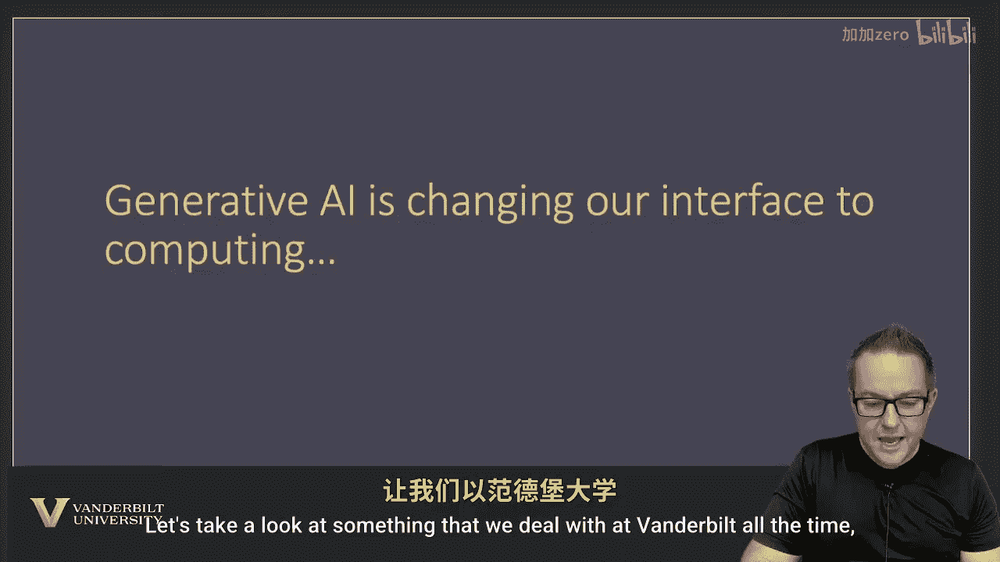
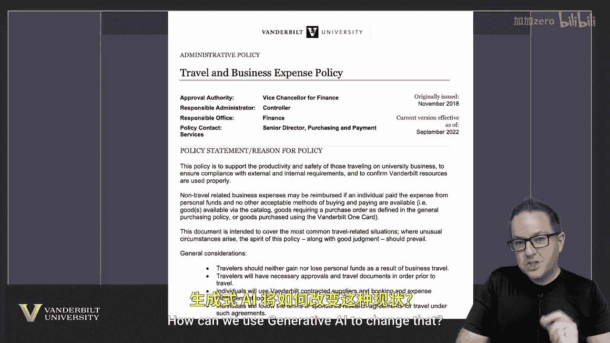
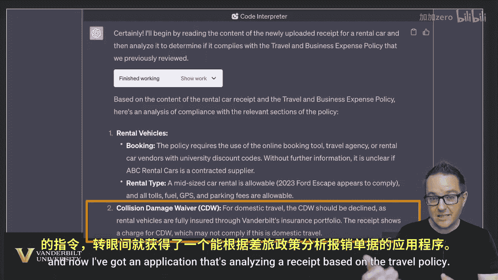
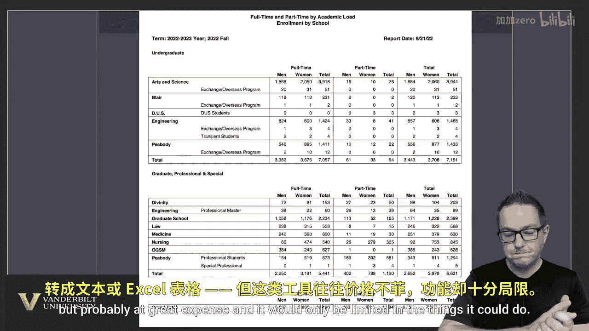
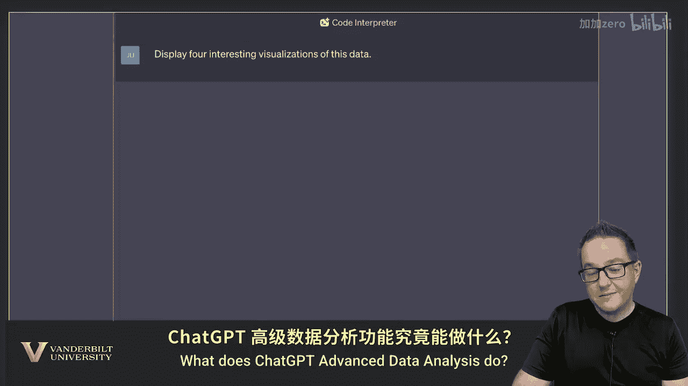
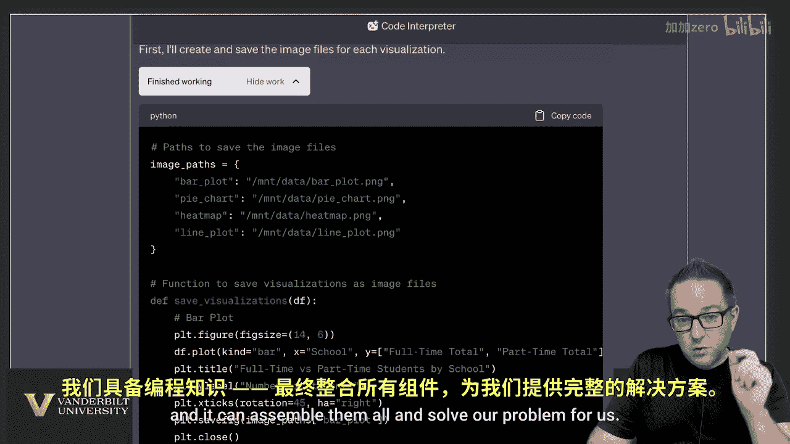

# 范德堡大学【中英⚡生成式AI战略领导者 专项课程｜Generative AI Strategic Leader Specialization】 p45 P45 02_生成式AI正在重塑计算领域 -BV1b6YyzzEP9_p45-

Now we've seen chatt GBBT generate a bunch of Pokemon stories and meal plans and generated software。

 and that's pretty exciting， but I want to take a step back and show you the larger trend that's taking place that's really going to impact the workplace and impact every single organization and when people ask me well which domains are going to be most impacted my answer is any domain that involves a computer now why is that？

And that's because our fundamental interface to computing is about to change and is in the process of changing right now。

Now we've spent years working with the GuUI where you can go and all you can do is whatever buttons your programmer has created in that and you're limited by what has been pre-programmed。

 or if you were like me， you were a software engineer and you could go write source code and program anything you wanted。

 but at really high cost in terms of time and effort and then you had to maintain it and it took a lot of work。

And there was nothing sat in between that gave you the flexibility of programming with the ease of use of GuUI。

 and generative AI is about to change that。It's going to supplant the GoUI and programming as our dominant interface to computing and it's going to revolutionize what people are capable of。

 so let me show you some examples of this。So let's take a look at something that we deal with at Vanderbilt all the time。

 and probably you deal with it in your organization too， expense reporting。

Now this is the Vanderbilt Travel in it business expense policy it's about 20 pages long and I have to admit I don't think I've ever read it and I bet a lot of the people in your organization and maybe you have never read your travel and business expense policy either it's not exactly what you want to sit down and read。

How can we use generative AI to change that Well， it turns out I actually have read the Vanderbilt Travel and business expense policy。

 but not directly， I've read it through chattGBT and through a tool called ChatGBT Adv data analysis。

So。How do we do that when we upload the policy to chatGBT advancedance data analysis and we say please read the provided document so you can answer questions about it。

And I give it the PDF。Now notice what I'm not doing， I'm not programming anything。

 I'm not even bother taking this out of the PDF and turning it into text of some kind。

 I'm not doing an internet search， I'm just giving it the PDF of the policy。

Now I'm going to ask a question that looks like the questions that I actually ask in the real world。

 I'm going to say let's assume I'm in a foreign country traveling in a taxi and it breaks down on the way to an important meeting can I get reimbursed if I pay someone to drive me on the back of their motorcycle to the meeting and assume they're a private citizen that actually looks like the types of questions I ask my business unit manager and I'm going to show you what chattGPT says。

It says based on the information provided in the document and I just want to call your attention to that because we hear all the time chat chatGBT hallucinates。

 it wasn't trained after 2021 it doesn't have access to my information Well this document came after 2021 This is the latest version from when I filmed this of the Vanderbilt travel and business expense policy and chattGBT didn't have this thing I've actually gone and uploaded so it'sing it based on my data or Vanderbilt's data。

And it says the university requires travelers to select the most reasonable and economical form of transportation。

That is true， that's a direct statement out of that document。

Nonconventional transportation options are not explicitly mentioned in this policy。

 so it's also telling me what's not in the policy， which can be really valuable。

Vananderbilt does not have a separate policy on ride sharing。

 and that is a direct statement inside of the policy， they say that。And it says finally。

 given these points， it seems plausible that in an emergency situation where no other reasonable and economical form of transportation is available。

 the cost of transportation by private citizens' motorcycle might be considered an allowable expense however the university's policy does not explicitly state this and re may be subject to review that's absolutely a Vanderbilt careful answer to my question of can I get reimbursed for this crazy thing that I just did？

And it's a very， very carefully thought through answer。

 it's pulled out appropriate portions of the text from the policy。

 and then it's put together a very reason to response。

 nothing that we had in computing could do that that effectively before November of last year if you wanted to do something like this that would take an immense amount of effort to try to create some tool that could answer that question。

😊，But let's take it further and start to look at how this is going to transform computing。

What if I have a receipt and I want to know if it complies with the policy？

So I'm going to upload a rental car receipt in PDF form。

 and I'm going to say please analyze the attached receipt and let me know if it complies。

 Now this is a totally different thing。 This is， can you understand the policy and actionably apply it。

 This is different from summarizing the information related to the question， This is take the policy。

 Turn it into actionable information or knowledge and apply it to a receipt and what does chatGBT advanced data analysis do。

😊，It says collision damage waiver for domestic travel。

 the CDW should be decline as rental vehicles are fully insured through Vanderbilt's insurance portfolio。

 the receipt shows a charge for CDW which may not comply if this is domestic travel。

That's transformative Now if I had had to do that。Before chatGBT advanced data analysis。

 how would I have done it if before generative AI， how would I have solved this problem I would have gone and programmed that。

 I would have programmed some huge rules engine， It wouldn' have been just been me。

 it would have been a team of people working and programming and trying to create that application that applies all the different rules and you probably have such things in your organization that tried to go through and automate some of this and it's hard and difficult to do and how did I create that application。

 I didn't program it， I just gave it the document and I gave it the right prompt。

And then I gave it a second document and a second prompt。

 and now I've got an application that's analyzing the receipt based on the travel policy that's fundamentally transformative capability。

Let me give you another example of a transformative capability in terms of how we access computing and how accessible computing is going to be to everyone else now we've always had programmers over here who could go do whatever they wanted。

 they just had to program it and put it in the time and effort。

 but everybody else didn't have access to that same flexibility in computing and capability。

So this is the Vanderbilt Inional and enrollment report about who's taking classes in the different schools within Vanderbilt and it's a PDF。

And if I was doing research or work with this PDF before these tools came out。

 before these generative AI tools， I probably would had to go and cut and paste from this PDF into something like Excel。

 and then I would had to go and try to calculate or draw diagrams or something to analyze whatever it is。

 but it would have been a ton of manual labor and effort。As a programmer。

 maybe I could have automated this progress or process by going and writing some custom software。

 or maybe I could have found some one- off unicorn tool that could take that PDF in these complex tables and produce it into text or Excel sheets。

 but it probably at great expense， and it would only be limited in the things it could do。

What can we do with generative AI？Well I'm going to upload that instructional enrollment report to ChatGBT Advanced data analysis and'm going say please extract each page of this PDF as a separate text file。

And it goes through， extracts all the pages as individual text files。

 and now I can go and click on each link and download it。 Now to before to do that。

 I would have had to save some specialized tool to go and extract all the pages and convert them。

 I would have had to click a bunch of buttons and done it manually。 That's kind of neat。 It's useful。

 What else can I do with it。😊，I can take it and I can say turn a particular page of it into an Excel file。

 and then here's the link that I can go and click on it to download all the data that was on that page converted into Excel。

😊，That's a transformative capability if I'd had to go and do that manually would have taken me forever if I had to go and program something to do that based on arbitrary tables。

 I would have it probably highly customize and figure out how to do it and here it is it's just targeted it into Excel for me and now I could take it and I can do a bunch of calculation or visualization in Excel with it。

😊，But why would I do that when I'm using this new interface to computing that gives me all kinds of radical new capabilities。

 So without even leaving the tool just in the same conversation， I just follow up。😊。

And I say display four interesting visualizations of the data Now notice what I'm not telling it。

 I'm not telling it what to visualize， what axes， what colors。

 what columns from the data I want it to pull in I'm just telling it give me four interesting things because I want to go and explore this data because as a human being I want to spend more time thinking about the data I want to spend more time analyzing and trying to figure out how to communicate my message and less time copying and pasting out of PDF into an Excel file or doing some other task like that I want to really accelerate my thinking so what is chatGBT advanced data analysis too generates four visualizations from me and here they are。

And now I can go and look at these visualizations， decide what I want to do。

 decide what this means for me， and that's really powerful， I didn't have to program to do this。

 I didn't have to cut and paste them into Excel， I didn't have to go and know how to navigate with an Excel or some other tool in order to create these visualizations。

 I just tell it what I want and it generates it。😊。

But I thought about it and I was like， you know， if I was really generating this visualization because it's not just to generate a bunch of visualizations。

 it's probably because I'm going to give a presentation。

And wouldn't it be great if it could turn those visualizations into PowerPoint slides for me？

So I'm going to go back into chat and GT advanced data analysis and I'm just going to upload a PowerPoint slide template。

 and I'm going to tell it， save each visualization as an image。

 then insert each of these images as separate slides into the attached PowerPoint。

 and I give it some more information， some more prompt engineering to get those images in the right place on the slide and then also to add a text box next to the image where it describes what's in the visualization。

😊，And it goes through and it generates my PowerPoint file and then I can click the download link and get my PowerPoint file and here's the PowerPoint file and notice this is the same PowerPoint template that I'm using for this presentation。

 it's gone through and it's inserted each of those visualizations as a separate slide into my PowerPoint presentation。

 and it's also put that text box next to the visualization describing what it shows。😊。

And now I can spend my time thinking about my presentation， my message。

 what I'm analyzing what's important in less time on these mundane tasks。

But that's a really transformative capability and that's going to have huge impact on the workplace and that's going to go way beyond PowerPoint files in Excel。

 it's going to transform all kinds of different computing tasks anything we do in computing is going to be transform。

Now why is that， it's because what you just saw is way more transformative than you realize。

 and I want to talk about why。Now when I went through and I started working with this tool。

 it was doing something radically new。Now imagine you're in your backyard and you've got to shovel and you're about to dig a hole and right before you go to dig。

 your shovel looks down and sees that there's a rock in the way of where you're going dig and your shovel jumps out of your hands。

 builds itself a pickaxe， breaks up the rock and then jumps back into your hands and you keep digging and that's exactly what this tool just did it went and built itself another tool to solve a problem that it needed to solve for you and then it jumpeds back into your hands and created that PowerPoint presentation for you。

This is a tool generative AI can go and create other tools to help it accomplish tasks。So。

When I said go and create the PowerPoint presentation and put each of these images into it as a separate slide。

 this little gray box that we see right here popped up that says finished working。😊。

And that is generative AI building itself a tool。It's building itself a tool on the fly to help you solve your problem。

 and then it's using its own tool。Solving a part of the problem and then coming back and continuing on in the process。

 it's in anticipating that rock in the way of your shovel， it's building itself a pickaxe。

 it's breaking up that rock and then it's getting back in your hands to help you。

And the tool that it built is software。What we see right here is what happens when you expand that little finished workbox and what we see is a Python program that on the flyly it has written that allows it to generate a PowerPoint presentation and generate the images for those data visualizations It's creating software on the fly on your behalf to help you solve a problem。

😊，Now we think about these tools and we think about GoUis as the way that we interact with computing。

 but it's about to change we're going be able to go beyond programming。

 go beyond the GoUI to something that makes a lot more sense that makes computing much more accessible and also radically speeds up how quickly we can innovate and do things because we can create a tool that when we tell it here's the problem I want to solve。

 it can go and start building all the pieces of software that are needed to solve that problem without us having to know how to program and it can assemble them all and solve our problem for us and that's going to radically transform what we do with computing。

So the real innovation that's happening is that generative AI is in the process of replacing the GoI and is in the process of replacing programming as our dominant interface to computing We're still going to have tons of programmers。

 We're going to have computer scientists and huge demand for them。 We're still going to have Gois。

 but we're going to have a new interface， which is generative AI that's going to rapidly take over a lot of the tasks and dramatically expand our capabilities and what we can do with computing and what an average user can do without having to have specialized knowledge in computer science。

😊。