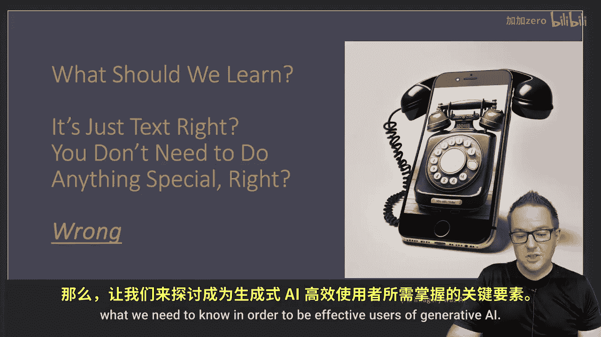
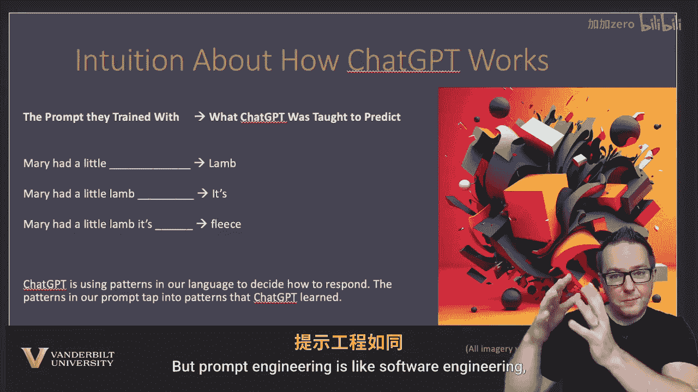
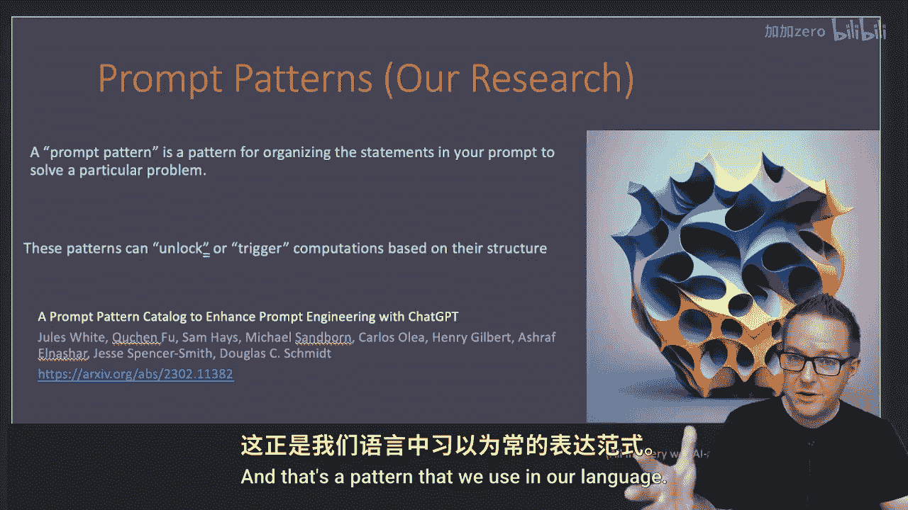
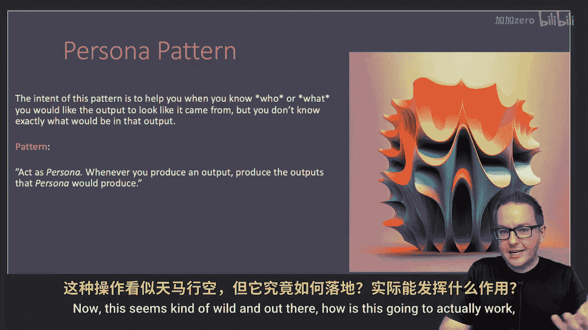
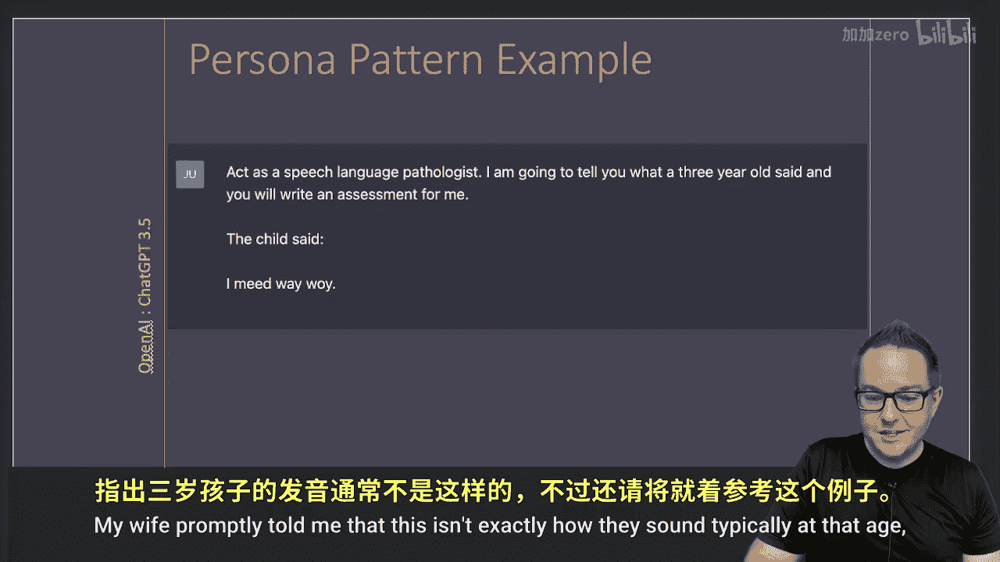
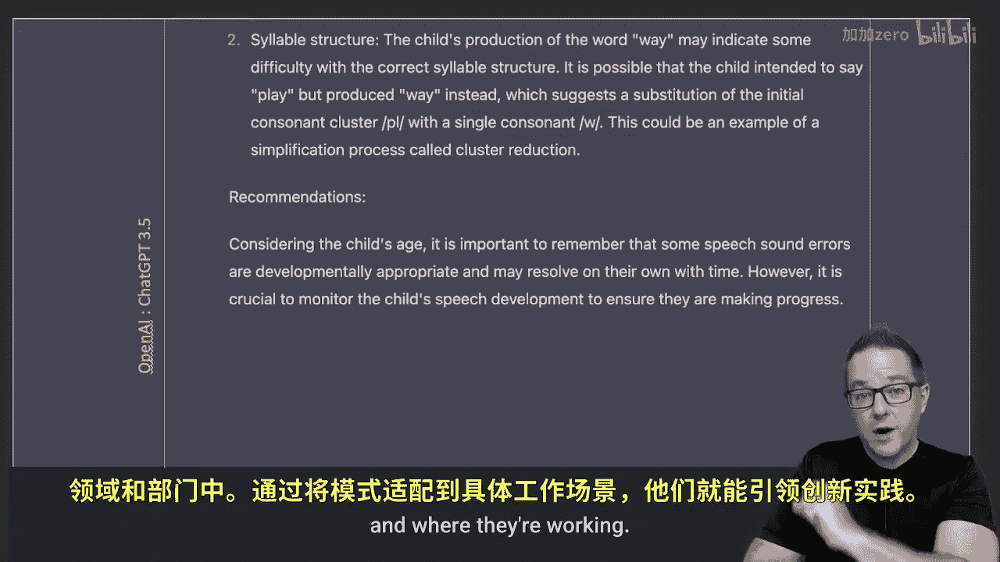

# 范德堡大学【中英⚡生成式AI战略领导者 专项课程｜Generative AI Strategic Leader Specialization】 p46 P46 03_提示工程-提示模式培训 -BV1b6YyzzEP9_p46-

So what do we need to learn and what does our workforce need to learn in order to be effective with this new interface to computing。

 how do we use generative AI appropriately and effectively， It's all just a bunch of text right Well。

 unfortunately， our mental model of a text box is an internet search and that's the wrong model for thinking about generative AI now why is it the wrong model。

Well in Internet search you go in and you type in what you want and it gives you set of facts back and that's not what generative AI is for。

 that's not the right use case for this technology and people are still stuck thinking about it as something that generates facts and then pointing out all the flaws in its facts No that's not how it's going to transform our world and the workplace。

Now the other problem is is that we think when we see this text box。

 that we can type in anything we want and if the answer that comes back isn't great。

 it's not our fault， it's generative AI's fault that somehow we should be able to express anything we want in there as poorly as we want and it should be perfect whatever it produces。

 and that's wrong too。Neither of those models is right。

 we have to learn how to go and use it effectively。

 and so let's take a look at what we need to know in order to be effective users of generative AI。

Now to start off， I want to give you some intuition for how these large language models were trained。

 these models like chattGBT， So when you hear a large language model。

 what they're talking about is these models where you go and can essentially prompt them to get some output。

 chattGBT being a large language model Now there are lots of nuances beyond what I'm about to show you。

 but this is sort of some fundamental intuition you can have that'll help you in understanding this whole space。

So the way that these models were trained is they were taught to predict the next word in a sentence。

So they would have gone and they would have shown it something like Mary had a little。

 and then they would have tried to get it predict lamb because they're trying to get it to predict the nursery rhnd。

 Mary had a little lamb， it fleece as wide as snow。

And so they would have gone and shown it the first few words or large amount of words。

 and then they would have tried to get it predict the next word。

 similarly they would have said Mary had a little lamb and they would have tried to get it predict its。

 they would have then said Mary had a little lamb its and they would have tried to get it to predict fleece。

 and they did this over and over on huge amounts of text from the internet。And over time。

 these models learn patterns in human language and how they predict what word should come next。 Now。

 if you think about what we've talked about， basically what we're seeing on the left hand side is the prompt。

And on the right handan side is the output， so it's basically learning how patterns in the language in the prompt。

Impact what comes next and prompt engineering， part of prompt engineering is the discipline of understanding how do you word things in order to get the output on the other side that you want and how to solve different problems by wording your request differently。

 how to structure your request effectively， how to overcome issues you're dealing with。

 but it's also broader than that， It's also about how do you take these things and validate them。

 how do you make sure that they stay correct and accurate over time， How do you version these things。

 How do you build architectures of it all， All these things are part of prompt engineering。

 it's much broader than just the wording， Although the wording is possible， is part of it as well。

 But prompt engineering is like software engineering and encompasses a lot of different things。

 from architecture to best practices to the individual wording of different prompts。

 And so it's a large field， and it's going be evolving and really important and business over time。

Now， what we study at Vanderbilt and we're talking about is prompt patterns。

 and that's basically documenting patterns in the language that can be used to solve different problems。

 and then providing these patterns is building blocks to people so that they can learn them and then build off of them and go and innovate within their individual departments or disciplines。

Now， when I say prompt pattern， this sounds like this crazy thing。

 like some you know really out there thing， but if you think about it。

 we know patterns in our language that we use all the time。 If you've got to write a formal letter。

 a formal letter， you'll say dear， so and so comma and that dearer is to indicate that this is a formal thing and the person is indicated so you know who it's addressed to in the comma to say。

 okay， now this is what comes next and that's a pattern that we use in our language and there are things like that that are easy to learn that they can help people become very。

 very powerful with these tools。

So I'm going to start off with an example of a pattern that we documented that you see and use all over the internet。

 and it's a really， really powerful first pattern to know。

 and hopefully you'll go and experiment with chatGBT or a Claude or one of these other generative AI tools afterwards because this is one that's really。

 really valuable。😊，And it's called the persona pattern。So the idea behind this is in the real world。

 if you have a problem and you need solved， you know who to go to to get the answer or to get the solution or you know what organization to go to or what department to go to in order to get the solution organization。

 but you don't know what they're going to say to you or how they're going to arrive at their answer。

You just know if I have this problem solved， this is where I go for the solution Now the persona pattern is all about doing this within a large language model。

 it's about replicating that real world experience。

And what we do is we go and we tell the large language model， act as some persona。

 act as a nutritionist， act as a chief information security officer。

 act as a computer science professor， act as the IRS， and then whenever you produce an output。

 produce the outputs that persona would produce， basically what we're telling it as。

Go and act like that persona and do what they would do。Now it seems kind of wild and out there。

 how is this going to actually work， what can it really do？

Well let me give you an example， my wife is a speech language pathologist。

 she works for the school system， and she tests kids typically three or four before they go to kindergarten to determine if they need special educational supports。

Now this is a persona that I can fact check。And so， but I at the same time。

 I don't know anything about it。 So I go in and I say act as a speech language pathologist。

I'm going to tell you what a three year old said and youll write an assessment for me。The child said。

 I need Wei wi， and I tried to think about what my son sounded like when he was three and tried to capture that in words。

 my wife promptly told me that this isn't exactly how they sound typically at that age。

 but bear with me。

Now， what does ChaTPT say？In response to this， it says assessmentment based on the provided speech sample。

 it appears that the child may be experiencing some phonological and articulation errors which are common in children around this age。

Consonant errors。 It seems that the child is having difficulty with the production of some consonant sounds。

 specifically the N and L sounds， the child said me instead of need and why instead of toy。

 assuming the intended words werene and toy。This indicates a child may be experiencing difficulty with the production and differentiation of these consonant sounds。

Syllable structure， the child's production of the word way may indicate some difficulty with the correct syllable structure。

 it is possible the child intended to say play， but produced way instead。

 which suggests a substitution of the initial consonant cluster PL with a single consonant W。

 this could be an example of a simplification process called cluster reduction。That's wild。

 noticeice what I didn't ask it for。 I didn't ask it for phonological errors or articulation errors or syllable structure or consonant cluster reduction because I wouldn't even known how to ask for those things so is doing and allowing us to access computing in a completely different wayNormally if I had to program that I'd have to go and tell it an explicit detail every single thing it needs to do and exactly how but in this case I'm just telling it who to act like or what organization to act like or what department or inanimate object to act like and then it's going in reasoning and providing outputs that look like they came from that Now I fact to check this with my wife and also with some other speech therapists and the feedback I got was hey look we're not going to diagnose the child based on when speech sample but what it's saying is accurate relative to that speech sample you gave it。

That's wild that it can go and reason at that level of capability simply by saying。

 act as some persona。These patterns， these prompt patterns are building blocks that you can teach people in your organization to help them go and innovate。

 they can then take these patterns and adapt them and use them to be able to do things that are really powerful like thinking about a particular issue from a different perspective。

 act as a chief information security officer and tell me why I shouldn't do what I'm about to do and it probably give you some insightful feedback on why you maybe shouldn't click that link in the phishing email。

 but it's a really transformative new way of doing of computing that we really begin have to begin teaching people we have to teach the workforce and we have to do it in a structured way that's not just look at a thousand different prompts people came up with。

 but instead we start giving them building blocks like the beginning of a formal letter should look like this。

 we can teach them prompt patterns like the persona pattern that they can then take off take and imply and all other individual disciplines and departments and they can lead the。

By adapting the pattern to their context and where they're working。

