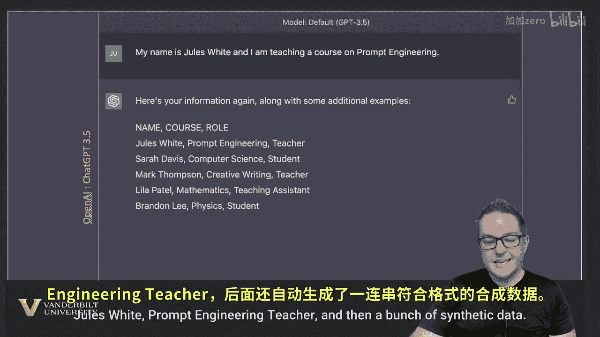
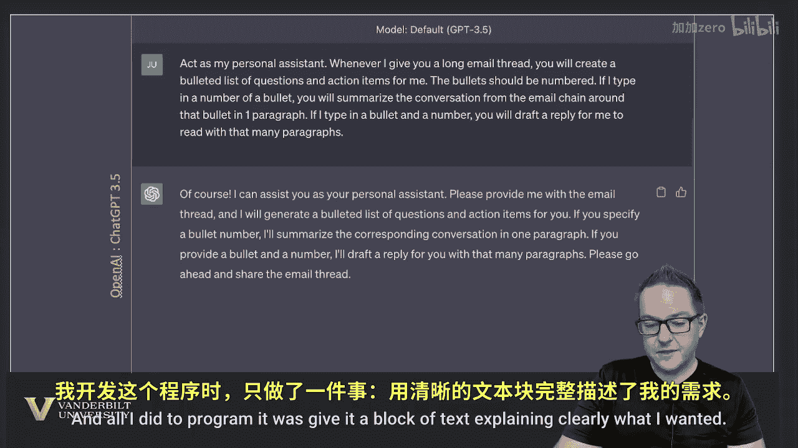
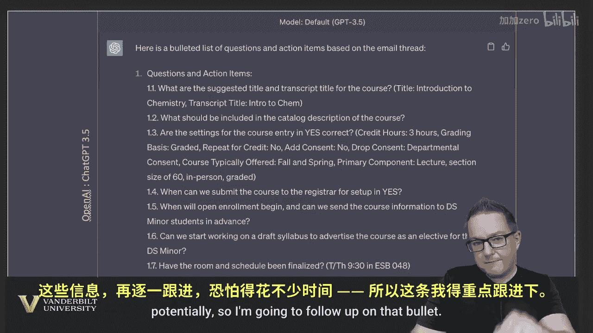
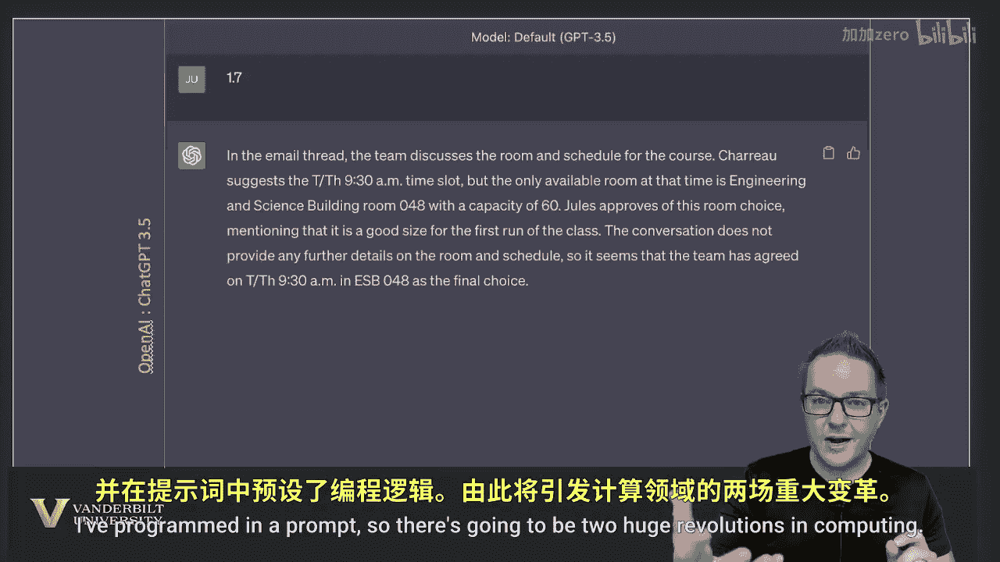
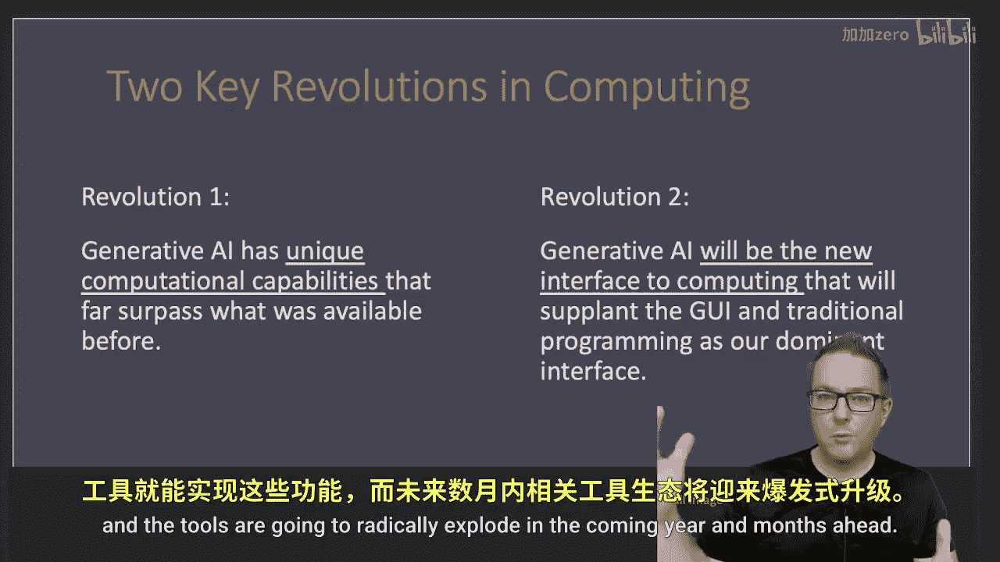

# 范德堡大学【中英⚡生成式AI战略领导者 专项课程｜Generative AI Strategic Leader Specialization】 p47 P47 05_人人都能用提示词编程 -BV1b6YyzzEP9_p47-

Now I've emphasized that this is going to change the way that we interact with computing。

 that generative AI is going to make us able to control computing using a better interface。

 in my opinion， than the GuUI or programming that it's going to give us something unique， new。

 much more flexible， and much more intuitive in many cases。

But I want to give you a sense of how it's also going to change the types of things that we can do。

 we think of programming as something that involves going and putting in source code like you know creating source code and programming in Python or some programming language。

And even in the examples that I've shown you。I've shown the tool going in generating code。

 but we actually don't even have to have code anymore to begin programming。

 and I want to show you what I mean by this， everyone can program with prompts and I want to show you what this means。

So I'm going to go and I'm going to create a basic program and here's my program。

 I'm going to say whenever you generate output， turn it into a comma separated value list。

 so a comma separated value list is basically a format for describing tabular data like you would put into Excel。

 it's just basically a series of columns separated by commas， so like name， comma role， comma。

 whatever you want， Jules White， comma teacher that type of thing。😊。

So I'm going to say write a program which is basically whenever you generate output。

 turn it into a comma separated value list now notice this is just text。

Now I'm going to go and run my program， I follow up in the next prompt in the conversation and I say。

 my name is Jules White and I'm teaching a course on prompt engineering。

And that's the input to my program and what does generative AI do or in this case chat DBT it says great。

 here's a CSV list with that information name comma course。

 Jules White comma prompt engineering that is CSV I've basically written a program that converts whatever I put in the next prompt into a CSV that I could copy and paste into a file save and import into Excel Now notice when I didn't do I didn't write a bunch of programming language instructions。

 I didn't go into great detail on how to do this and in fact， if I had to program。

 this would probably take a lot of work to do the natural language processing and it figured out automatically how to map into the columns but notice I didn't even tell it what the columns were。

 I didn't tell it name and course I mentioned them when we were talking but I didn't put it into my prompt。

😊，It just figured it out that it needed to generate something that worked。

 and this is one of the ways that generative AI is really different with computing is it tries to come up with a solution that works。

 It doesn't require every last detail to be specified。

 It's constantly trying to generate something that will work。

And so it makes it more accessible and user friendly。So it generated name come a course。

 it then appropriately semantically mapped and notice that capability is a really complex sophisticated capability that would have been really hard to do any other way before these tools came out。

Now let's say I don't want just name and role， let's say I want more than that。😡。

I can simply go and modify my program and I follow up in the conversation and I say from now on。

 the columns of the comma separated value list should be name， come a course， come a roll。

 so I'm modifying my program just by telling it hey， here's the new rule。😊，And then I go back。

And I give it exactly the same input in the next prompt my name is Joles White and I'm teaching a course on prompt engineering。

And it says here is your information format as a CSV list and now it says name come a course。

 come a role， Jules White come a prompt engineering come a teacher and notice what it's done。

 it's modified by program and then it's run the new program that I specified on the same input This is exactly the same input I gave last time but now I'm getting a different output I have a different program that's running and it's giving me different output so we can actually go and start programming through prompts and having complex logic just in prompts themselves。

😊，So let's say， for example， I want to modifyify it further。 I just follow up and I say。

 in addition to whatever I type in， generate additional examples that fit the format of the CSV that I've asked you to produce。

 Now， notice that's a really， really hard task And before these tools came out。

 that would be extremely difficult to generate additional fake data that fit the format that we've just specified。

 So not only now are we programming。 but we're also tapping into some of the most sophisticated computing capabilities that we've ever had and we're doing it on the fly with some text。

 So all I've done is modified my program by giving it this new instruction。😊。

And then I run it again on my original input， which is my name is Jules White and I'm teaching a course on prompt engineering。

 and now it produces new CSV that follows the new program， which is name come a course， come a role。

 Jules White Pro engineering teacher， and then a bunch of synthetic data。

And that is completely transformative in terms of capability。 Now， let's make it。

More concrete。 Now， CSV， don't get me wrong。 Like extracting structured CSV from all kinds of data is a hugely important problem that will have really important impacts in all kinds of domains。

 everything from taking focus groups and turning the conversations and focus groups into CSV that can then be actionable and have concrete product insights。

To taking you what people are saying and how they're reviewing products and turn it into concrete information about which product are they reviewing and what's their feeling。

 what are the features they mentioned， all kinds of different capabilities。Or free text。

 you imagine giving people surveys and they enter in all this free text information and now youve got to laboriously look at it where you can actually turn that free text directly into CSV or some other structured format like Jason。

 for your business to then automate and do things with it。

But I'm gonna give you something more close to home。

 probably for all of us and that's that weekend problem we face when we decided to just check out and not answer our email over the weekend and I don't know if you're like me but what happens is is I come in on Monday morning and I start looking at my email and there is some gigantic email thread where everybody else didn't check out over the weekend and they all had a very long conversation that I now need to read and try to figure out who said what and when and what am I supposed to do。

 what are my action items， what are the questions for me， what do I do about this。

So I'm going to use prompt engineering and I'm going to write my own program to solve this problem。

So here's what I say。Act as my personal assistant When I give you a long email thread。

 you will create a bulleted list of questions and action items for me。 The bullet should be numbered。

 if I type in a number of a bullet， you will summarize the conversation from the email chain around that bullet in one paragraph if I type in a bullet and a number。

 you will draft a reply for me to read with that many paragraphs So I'm creating a whole little application for myself and it's even got a menu system。

 I can type in an identifier of a bullet and it'll summarize it and if I type in the identifier of a bullet and I give it a number of paragraphs。

 it'll just draft a reply for me。 This is like my email accelerator right。😊。

And all I did to program it was give it a block of text explaining clearly what I wanted。

Now I'm going to go and cut and paste a very long email chain when we were scheduling my generative AI class and I'm co-teaching with four other faculty members。

 so there's five of us on this email chain， plus a number of other people in the university and we were trying to figure out what room and time and what all the information for this course。

 very long email thread， lots and lots of discussions。

 lots of people weigh in in on different aspects。 How do I go and decipher this Well I'm going to copy and paste that long email thread in right after。

😊，And I puttinging those instructions and note this is one of those important things Everybody tells you oh it was trained on 2021。

 it can't do anything after that， of course it can you just have to give it the information and a prompt so I'm giving it my email chain and a prompt and then what does it do？

It says， here is a bulleted list of questions and action items based on the email thread。

Questions and action items what are the suggested title and transcript for the course and then it has the title you know possible examples of what I'm looking at can we start working on a draft syllabus and then look at this 1。

7 at the end it says have the room and schedule been finalized Tuesday， Thursday 930 and ESB 048。

And that's actually real information that it's dissected from the conversation。

And that would have taken me a long time to go and find all of that， follow up on it potentially。

 so I'm going to follow up on that bullet。 I'm going to find out and have it summarize。

What happened， so I'm using my menu system that I wrote into it， I type 1。7。

 and I told it if I type in the identifier of a bullet。

 you summarize the conversation related to that bullet。

And it comes back and it says in the email thread， the team discusses the room and schedule for the course。

 Shiro suggests the Tuesday， Thursday 9，30 am time slot that the only available room at that time is engineering and ScienceBuild room 048 with a capacity of 60 Jules approves of this room cho mentioned it is a good size for the first run of the class。

The conversation does not provide any further details on the room and schedule so it seems the team has agreed。

 That's wild right because not only is it telling who said what。

 but it's also saying only two people weighed in on what room and time and nothing else was said so it seems that everybody's agreed so it even is intuiting and understanding that because nobody else said no。

 nobody else said yes， it's probably the right room。

 but it's also pointing that out that's a really sophisticated complex task and how did I get there all I did was I gave it some text。

 a block of text explaining my program Ive programmed in a prompt。

So there's going to be two huge revolutions in computing。

 one is that generative AI has all these unique computational capabilities。

when it looked and it intu and understood that hey。

 nothing else in this email chain talks about or agrees to that room。

 so it seems that the team has agreed， that's a really complex capability or when we took that unstructured text where we saidMy name is Joles White I'm teaching of course on prompt engineering and it turned it into CSV and it correctly semantically mapped it to the right columns。

 those are unique new capabilities。And the second important thing is it's going to be a new interface to computing because I can go and control computing with natural language in completely new ways。

 I can go and generate source code for programs and run it。

 but I can also just within a prompt write an entire application and begin doing things that are useful and valuable to me like summarizing my email and we're doing all of this off of very simple tools right now and the tools are going to radically explode in the coming year and months ahead。

😊。

