# 范德堡大学【中英⚡生成式AI战略领导者 专项课程｜Generative AI Strategic Leader Specialization】 p48 P48 06_增强智能的ACHIEVE框架 -BV1b6YyzzEP9_p48-

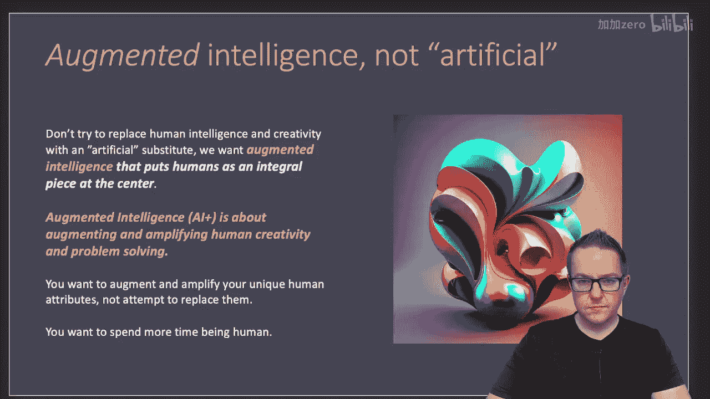

I'm passionate and excited about a particular vision of where we're going with generative AI。

 and it's not artificial intelligence that tries to replace and supplant people。

 but it's about augmented intelligence where we amplify and augment human creativity and problem solving skills where we basically give people new capabilities。

 it's like an exoskeleton for the mind that can amplify that human spark within you。

 enable you to create and do more interesting things than ever before。

 but not something that's going to take away who you are。

 but allow us to spend more time thinking critically。

 creating new and exciting things that we couldn't create before。

 have more time to interact with each other and be human。

That's what I think the real potential of this is and not going and replacing people。

 and I think it's really important that we approach generative AI from that standpoint。

 so I'm going to give you a framework。To think about how to appropriately use generative AI and the framework that I use is called achieve。

 So this is a framework that I created to help think about what is the right way to use it to achieve this vision of augmented intelligence as opposed to something that's going to take away from us with this by trying to replace this with this artificial substitute and we've seen how artificial things of all kinds don't really substitute for the real thing。

So achieve is about a couple of things， it's about how we use and think about ways of leveraging these new capabilities。

 one to aid in human coordination， and I'm going to show what each of these things means in a minute。

To cut out tedious tasks so we can spend more time thinking。

 reasoning and interacting with other human beings and less time on these things that honestly。

 probably people don't really enjoy。To help provide a safety net so that it can help us catch mistakes。

 it could be as simple as catching a mistake and spelling to something more complex like we'll see in a minute。

And then the IEV， I give it three letters because it's so important and this is the one that I think really。

 really matters when you're using these tools and approaching them。

 it's all about inspiring better problem solving and creativity within the human。

 you want the human thinking when they're using the tools。

 You want them getting excited and you want it sparking their imagination。

 you want to being an integral part of this thing， not something that's like sitting back and letting it do all the work and then finally we want to enable great ideas to scale faster by doing all kinds of things。

 everything from like the Pokemon meal plan that I then turn into software and games like on the fly and a conversation。

 we want to enable scaling up and doing crazy things like that and these tools will allow us to do all of these things。

 scale up great ideas really quickly。😊，So I'm going to give you an example。

 and I want you to imagine we're going to design a workshop and we're going to host this workshop and it's going to be a faculty workshop at a university where we're bringing in a bunch of participants and we have to solve and deal with a bunch of different issues from how do we communicate with the participants to how do we plan the workshop to dealing with unexpected issues and like childcare to how do we follow up with them and communicate with after afterwards and be engaging？

😊，So we were going to see a lot of real world problems that we see and we're going to use generative AI within the achieve framework to go and solve and make an impact。

So let's start with aiding human coordination。Now we don't think of these tools as something that can help human beings。

 but they can be really helpful in helping us coordinate with each other。

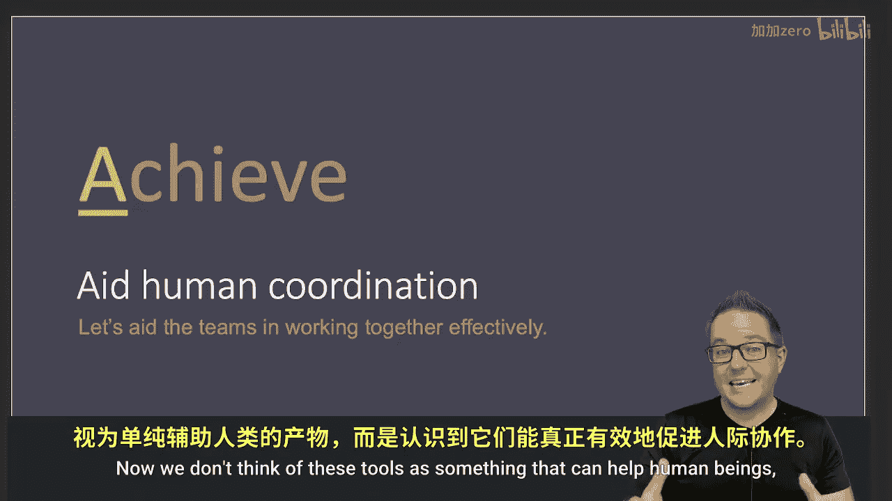

So I've gone and I've recorded the first meeting where we were planning this workshop and I've captured notes from it。

 maybe this is a virtual meeting where you just recorded the raw transcript or maybe you took notes and type them in。

😡，And now I'm going to tell it， act as my personal assistant， read the following meeting transcript。

 and provide me a summary of the key points of discussion。😊。

It goes through and reads it and that summary could be really valuable in itself。

 meetingn summaries are great。

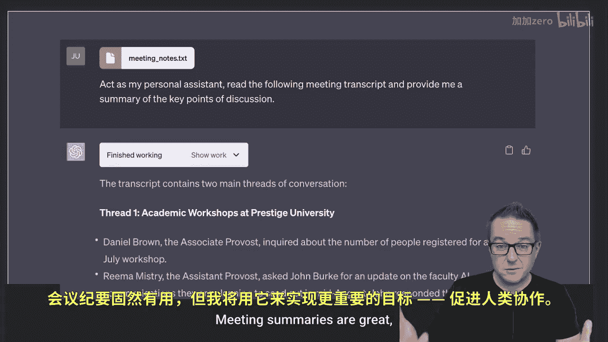

But I'm going to do something more important with it for human coordination I'm going to tell it list any ambiguities in the plan that the team should address how often as human beings do we build plans。

 but then they're ambiguous and we don't coordinate well because one person interprets something a different way than another person and then that leads to issues that's a really important thing to be able to do and you can imagine sitting at the end of a meeting just putting in the meeting notes and saying。

 hey， what's ambiguous about this， let's talk about it or taking in a specification or plan that was written in advance and getting feedback on what might be ambiguous。

😊，Now let's say it's wrong Well what is the harm in that nothing。

 In fact it's good because as a team we will then talk about here's what it said is ambiguous do we think it is or not and why。

 and then we've basically gotten more insight onto what we're doing and we can make sure that we are not missing something which're getting a second pair of eyes on our human coordination and it says for example。

 the exact number of registrations for the July workshop is not provided in the transcript this information is critical for planning and logistics and then it says there's no clear deadline for when John should provide his draft for review which could lead to delays or miscommunication so it's going out and actually reading the notes and the plan and then coming up with really concrete things that aren't clear from the plan。

😊。

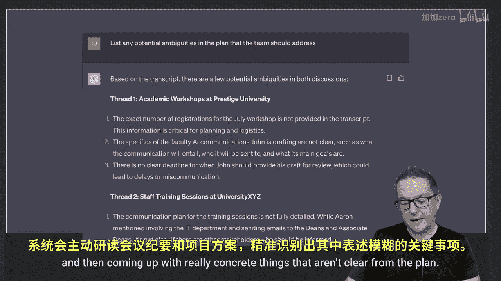

Now what else can we do with it？Well we can think about who should follow up on it so we can say。

 for example， who should follow up on each of the listed ambiguities。

 And if we have a transcript where it's， you know actually recorded who said what， it can tell us。

 for example， the number of July workshop registrations， which it said was an ambiguity， Sam Gray。

 who was directly asked about this， should provide the information to Daniel Brown。😊。

if we look at the deadline for the draft review， Riema Myster who initially requested the update should set a clear deadline for John Burke。

 and so it's beginning to help us as a team coordinate better and think through ambiguities and way of solving the problem。

Let's talk about the C， the cutting out TDS tasks。This is a you know。

 we spend so much time every day on things that aren't maybe the best use of our， you know。

 critical reasoning and creativity skills as human beings and honestly a lot of times they're the tasks that make jobs hard to deal with and you know make people want to leave。

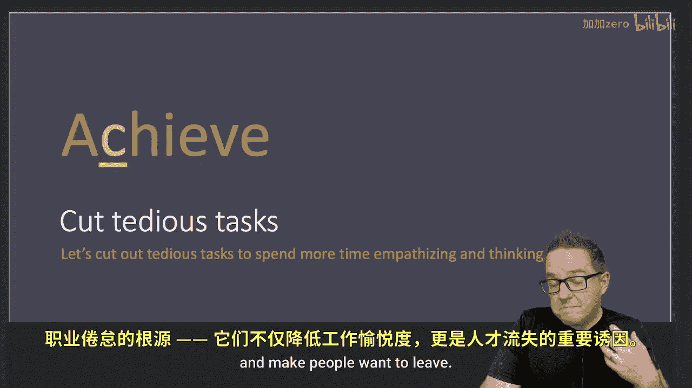

So how do we use it to cut out TDS tasks？Well， in the planning of this workshop。

 we've created a survey and we've allowed people to in free text。

 write how are they using chattGBT today and anything they want？Now。

 as the person who's going to teach this workshop， I could go and manually try to cut and paste that information into different segments of the audience and try to figure out who's using it different ways and do all that analysis。

 but that's a lot of work。😊，So I'm going to upload the survey responses。

I'm going to say this is the list of people that registered for our workshop on prompt Engineer and Chat GBT describe the data in this file。

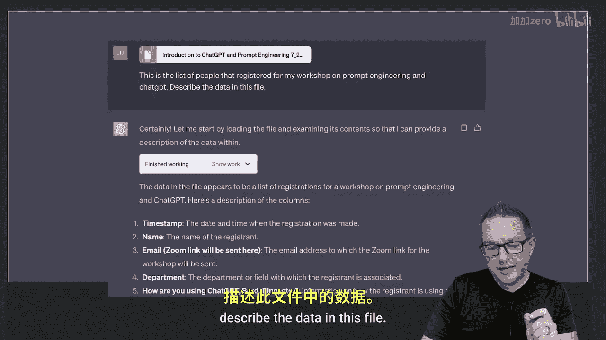

And then I'm going to follow up and I'm going to say the registration had。

 how are you using chattGBT bard being， eta as a question。

 can you turn this into a list of usage and then group the responses underneath your types？

And so I'm asking it to look at that free text response。And categorizeizer。

 group people together and group their responses under these different categories。

 and so it comes back with categories like not using it yet， not using it at all。

 and it groups all the different responses under different categories automatically now I could have copied and paste it and come up with all these categories and done it manually but I want to spend my time thinking about my audience and thinking about how best to communicate with them。

😊，And then I can go and I can think about well， let me think of other ways of grouping and I can quickly have it regroup everything so that I can look at it in different ways and this is one of the real powers of the tool is I can quickly go and look at different groupings and before it would take so much time。

 so much tedious cutting and pasting and reorganizing that I wouldn't have explored many different ways of segmenting my audience and understanding them but now I can just say give me three more possible groupings and it says okay well here's a grouping by specific task。

 not using it， written in writing and communication。

 coding and development research and teaching and I can then follow up and look at those and look at the individual responses and have it shape all of that but the key is it gives me more time as a human to think about how I'm going to interact with these other human beings it's taking away that tedious task so I have more time for the thing that really matters。

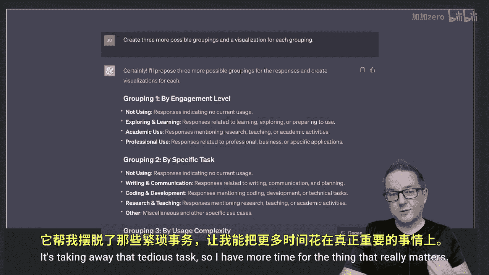

Let's talk about help providing a safety net。This is something really powerful that we can do is。

 you know we have to worry about as humans making mistakes all the time。

 and we'd like to try to make it less likely that we would or that we can catch them。

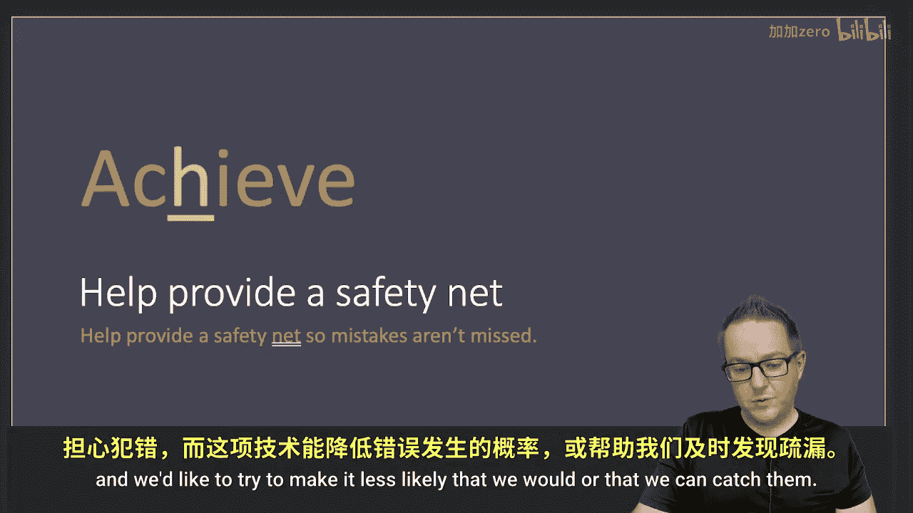

So one of the things that I'm thinking about is， you know I'm going to go and present this material and I've presented it to a different audience previously。

 maybe I presented it to a bunch of computer science professors and so they're going to have different terms that they're going to be familiar with。

 and I don't want to start my presentation and realize I'm using all these terms that I haven't defined and make the mistake of losing my audience in the first 10 slides。

So I upload my 120 slides to ChatGBT advanced data analysis and I say read my first 10 slides and tell me any technical terms that I use that I haven't defined and an audience of manufacturing business executives might not be familiar with and it comes back with for that particular audience here are possible terms。

 it's providing me a safety net in terms of my presentation so now maybe I won't lose my audience because it's giving me second sight on what is in there that maybe I haven't defined that maybe I need to talk about and explain in more detail because my audience has changed。

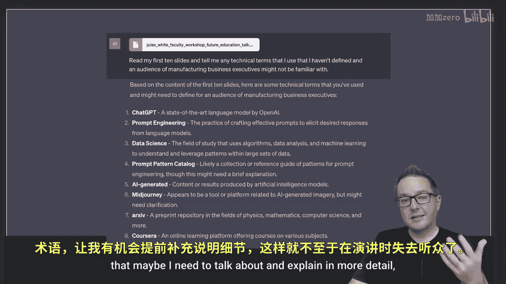

Or let's look at something that we can do in terms of coordination and a safety net and this is a huge problem when we're building software。

 but it's also a problem in other domains。And that is we're working on a problem。

 we have two teams that go and work independently on different parts of the problem。

 but when the teams come together they realize they've made conflicting decisions in software the this means that we can't integrate our two pieces of the problem or two pieces of the software don't work together and now we've just wasted all this time and effort and money where in the case of this workshop。

 maybe we have two teams working on one on logistics and one on the overall planning and they've made conflicting decisions and that could be a problem so let's try to solve that problem。

So I say I'm going to upload the second team's meeting notes and I say a second team working on logistics for the workshop just met。

These are their meeting notes， please point out any potential conflicts and decisions made by this team and the other team。

And it comes back and it says venue size and layout The logistics team suggests using the university's main auditorium for the sessions。

 which conflicts with the initial plan to conduct the sessions in a smaller setting presumably in conference room B or IT requirements the logistics team lists of necessary equipment includes a high resolution projector multiple wireless microphones a good sound system and several laptops this contradicts the initial teams's IT requirements which were likely based on smaller room setup So now it's helping us catch not only mistakes in our individual things like presentations。

 but also coordination potential mistakes that could be really impactful and so helping us you know do a better job as humans and I love it when my mistakes are caught before they become a problem like before I'm giving the presentation or before we realize we've scheduled the wrong room。

😊。

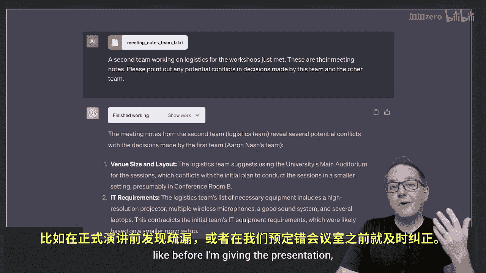

Now let's talk about the IEV， this is the most important piece from my perspective。

 and it's all about inspiring better problem solving and creativity with humans。

Now we hear all the time about how AI is biased。But we as humans are incredibly biased and we actually produced the bias data that led to the training of AI。

 but what's interesting is it can help us overcome some of our own biases if we use it correctly。

 so we have biases， for example， in problem solving like we know one way of solving a problem so we automatically try to solve every problem that way。

 we have bias in confirmation， we have confirmation bias on data， we're going to look at it。

 we're going to try to see what we want to see in it。

And so one of the uses of generative AI is to help us think outside the box to be more creative and inspire new ways and new solutions。

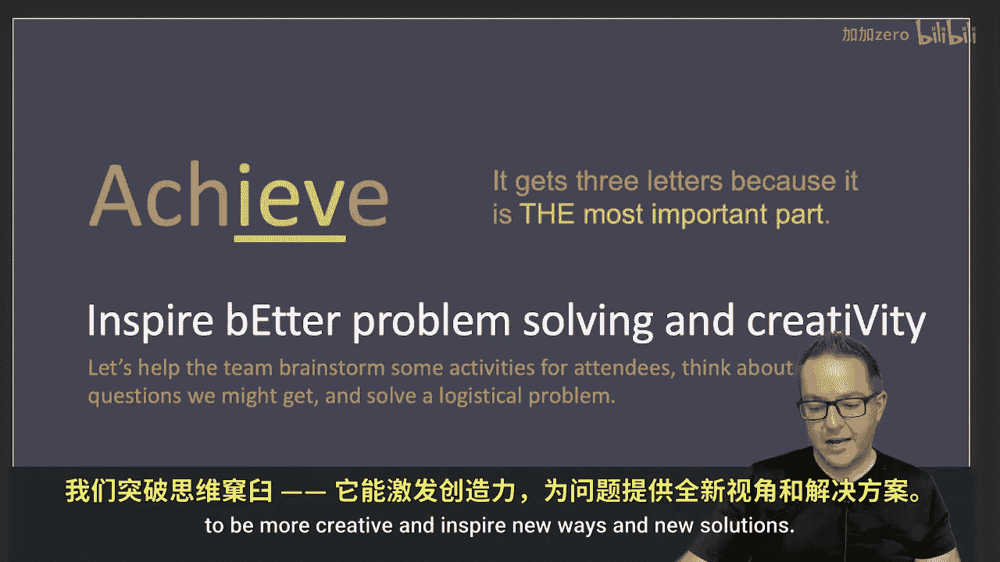

So。We've got an interesting problem with our workshop and that's that we need to provide childcare and we've looked at using our audience segmentation from our free text forms and we've realized it's all fourth graders and it turns out they're all interested in Pokemon well can we build some interesting content that goes along with what their parents are learning but is appropriately targeted to this younger audience？

So we say， please provide three different 90 minute lesson plans for teaching large language model concepts to fourth graders using Pokemon examples and hands on exercises。

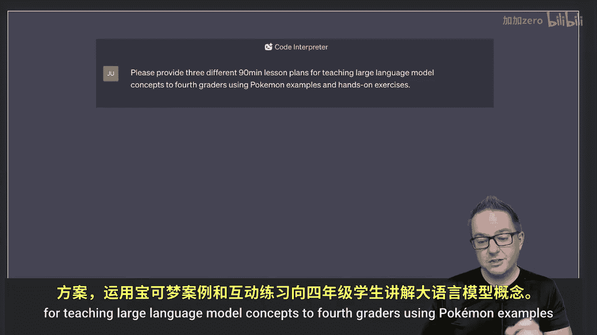

And it comes back with different lesson plans like what is a large language model and how it works。

 you know imagine a game where you describe a Pokemon and I have to guess which one you're thinking of the better your description。

 the easier it is for me to guess， highlight how a large language model is similar。

 it tries to guess the next word based on the words that it's already seen。

So what what it's doing is it's in giving us ideas that we can go and inspire。

 We're not going to just take them。 We're going to use them as draft output that we as humans respond to。

 We edit， We improve on it。 And in fact， that's one of the most important things that you。

 as a user of this need to know is that。😊，You have to engage with it。

 you have to take it as draft and you have to improve and iterate and work on it。

 you have to inject your thinking and creativity into the process otherwise you're going to be automated out you know reallyally if all you're doing is copying and pasting quiz questions in and getting the answers to cheat you're not going to be employable long term but if you're somebody that goes in and engages with the tool and creative and interesting ways。

 if you view the output as draft and you're going edit and refine it and improve on it。

 that is the philosophy that you need to have with the tool and that's the philosophy we need to encourage with people is don't take it for face value。

 take it and really look at it， really understand if there are flaws。

 really do your work to improve it and then get really creative and insightful and use it to solve bigger and better problems。

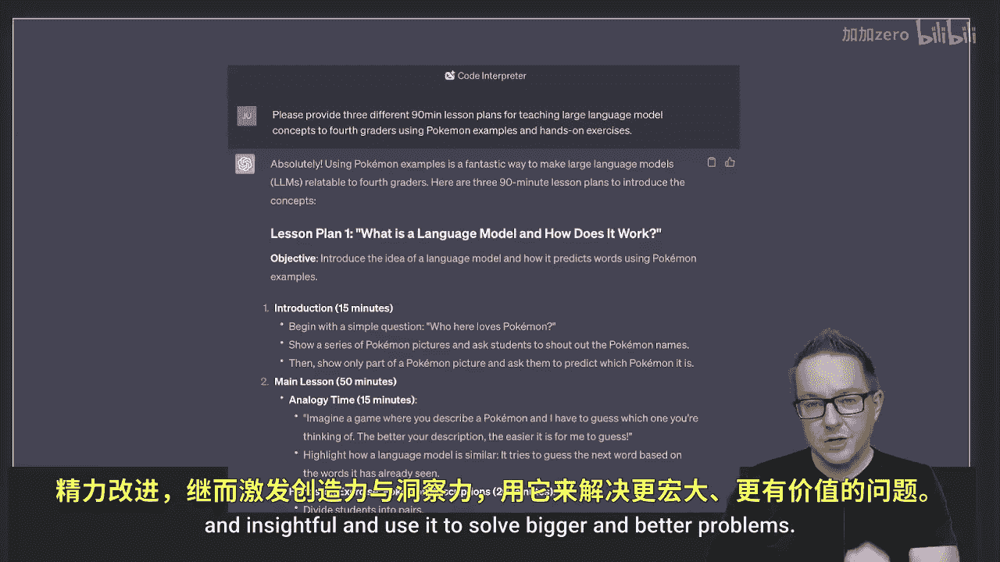

Now， let me give you another example of this。I've got these 120 slides and I'm going to upload them and I'm just going to ask it to summarize them。

But then I'm going to do something that's really valuable after this summary comes in。

I'm going to go and say act is a skeptic of everything I say in this presentation。

 find flaws and my assumptions， assertions and other key points。

 and then generate 10 hard questions for me。😊，And what does it do， it comes back with。

 here's the assumptions you're making in your slides。

 you have the assumption that chattGBT and similar tools will bring incredible increases in productivity。

Question， isn't it possible that these tools might also introduce new challenges and inefficiencies such as the need for additional oversight or the risk of misuse。

 and that's a great question and I should address it and by going in and using the tool it's inspiring me to think more critically to get outside the box of my perspective on this particular content and start improving and thinking。

And it's not replacing me， it's making me think， and then I respond and I think about how to address that question。

 that's a fundamentally new capability。

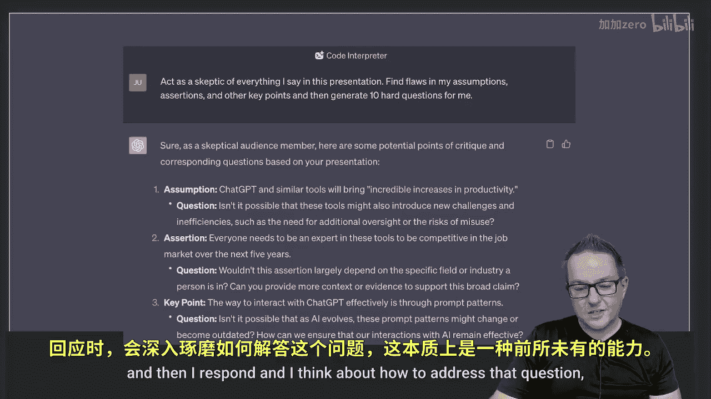

Now let's look at the E， enabling great ideas to scale faster。

Now we've seen a lot of examples of wild new capabilities and things we can do。

 but I want to talk to you about this one。

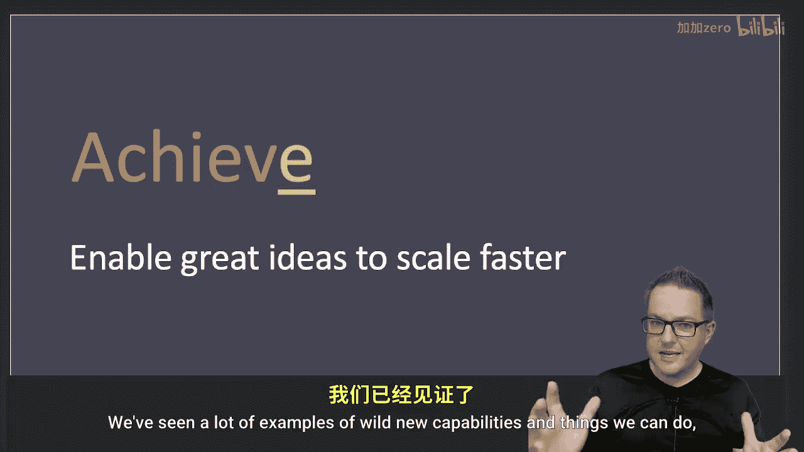

So I'm imagining at the end of this workshop， I want to go and I want to send personalized emails to every single person to get them excited about chatGBT or generative AI or Claude or whatever it is that I want。

😊，And I need some way of engaging that audience。 So I come up with this idea。

 It would be awesome if in every one of my emails。😊，There was a custom prompt。

That was specific to that person's department and what they do that showcase something that you could potentially do with chatGBT。

But for me to go and try to scale that idea up would be really hard。

 right to think of prompts for every single department and have the domain knowledge to make them even close to relevant is not going to be easy。

And how do I do that as an individual person Well using a tool like this。

 I can scale that idea up So I say I'm going to create customized post workshopshop emails for every attendee and I'm just following up in the conversation。

 I want you to create a list of interesting chat GPT prompts and ways of combining large language models with each discipline or department and basically I'm telling it generate。

😊，Prompts that people could then take out of those emails。

 copy and paste into chattGBT and see it doing something interesting and relevant to them to help get them excited to go and engaged。

 but also notice what's happening we're asking chattGBT to come up with ideas for how other people could talk to itself。

It's how would people go and talk to chat GBT， it's proposing ways that you could talk to it。

 that's a wild new capability that's transformative。

And it comes back and it has a whole bunch of different ideas and I'm going to zoom in on two of them。

So here's the marketing prompt that somebody from marketing could cut and paste。

 design a comprehensive marketing campaign for launching an ecofriendly product incorporating digital and traditional channels。

 and now they could copy and paste that out of the email and see it doing things that are relevant to their domain or alumni relations outline a yearlong engagement strategy to reconnect with alumni。

 including events communications and collaboration opportunities they could copy and paste that out of the email Now if I had to go and think of all those ideas from scratch and write them all down I couldn't scale this idea Now the important thing was the idea of the template that I had in my idea of how I would do this and then I'm using that template to scale up and it's all about that ability to go and scale things up。

😊。

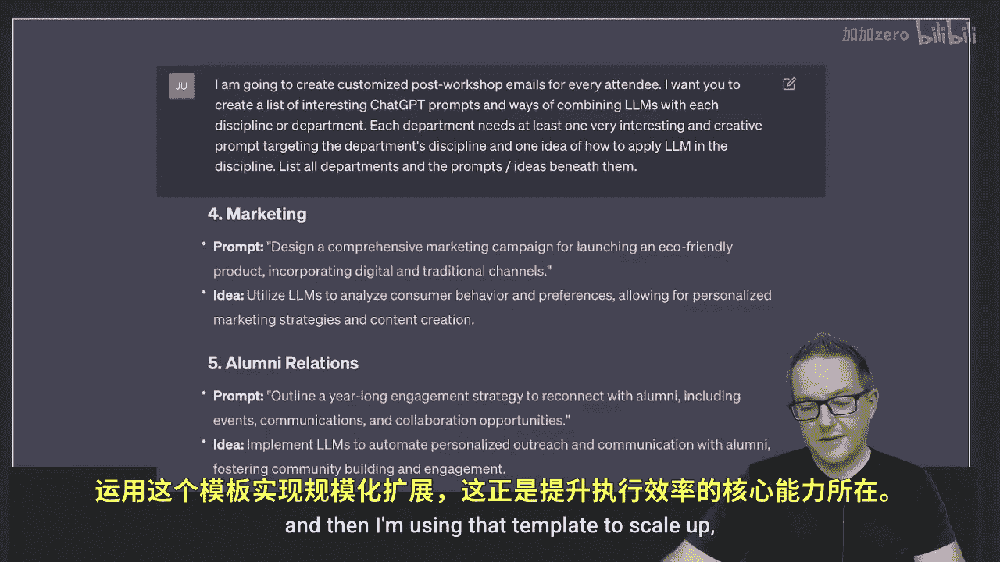

It's all about augmented intelligence， not about replacing people。

 not about this artificial substitute， it's about that exoskeleton for the mind and using it through the achieve framework to augment and amplify our creativity and problem solving skills so we can put that exoskeleton on and do amazing。

 amazing things。

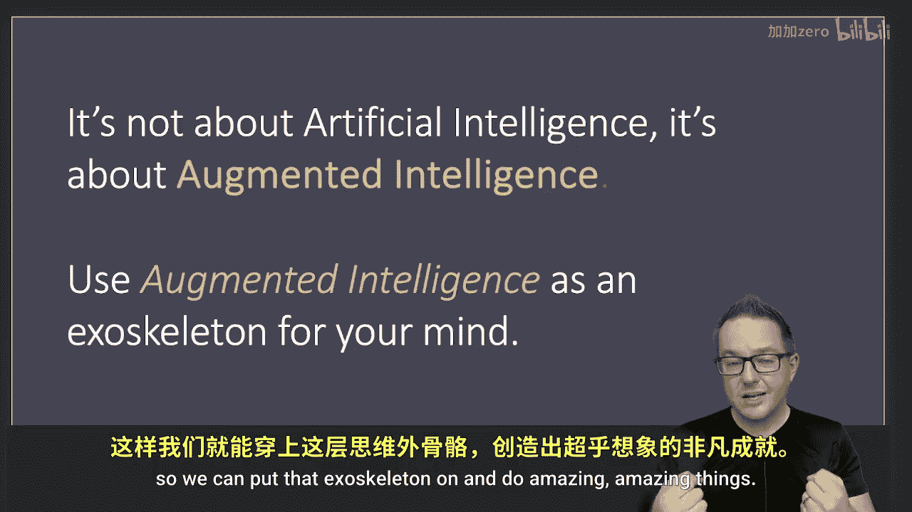

So。What's coming next？Is the tools。Now we've done all of this so far。

With basically cutting and pasting in and out of a chat interface。

 but the future is going to be in these tools that integrate generative AI into the tools we use in the workplace every day。

And they're going to transform what we can create， how fast we can create。

 how big of problems we can solve， how creative we can be。

 it's going to give a totally new medium for expression and how we access computing is going to fundamentally change。

And the future of computing is generative AI as our interface to it of being able to radically change what we can do and how we can control these things。

 So when you're thinking about。😊，How do we engage with this。

 you have to think about it from this augmented intelligence perspective。

 think about the achieve framework and how can you go and apply that framework in your discipline and your domain to do things that benefit people that give them that exoskeleton for the mind that not that replace them in some artificial way。

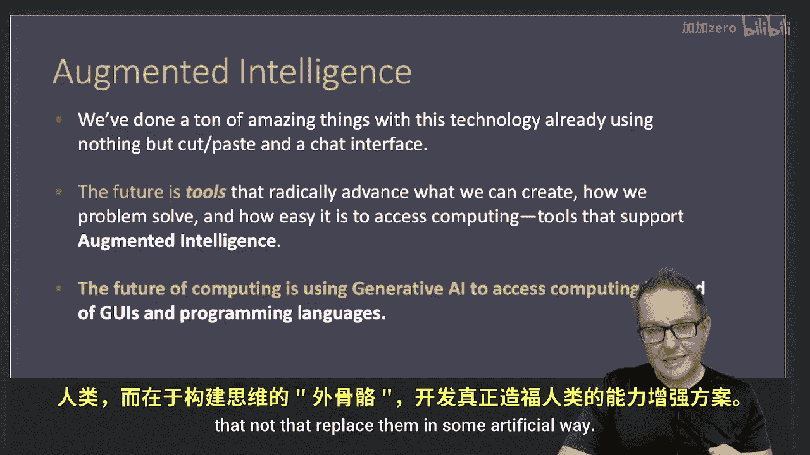