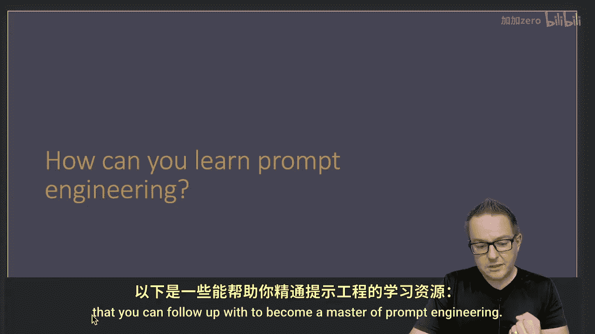
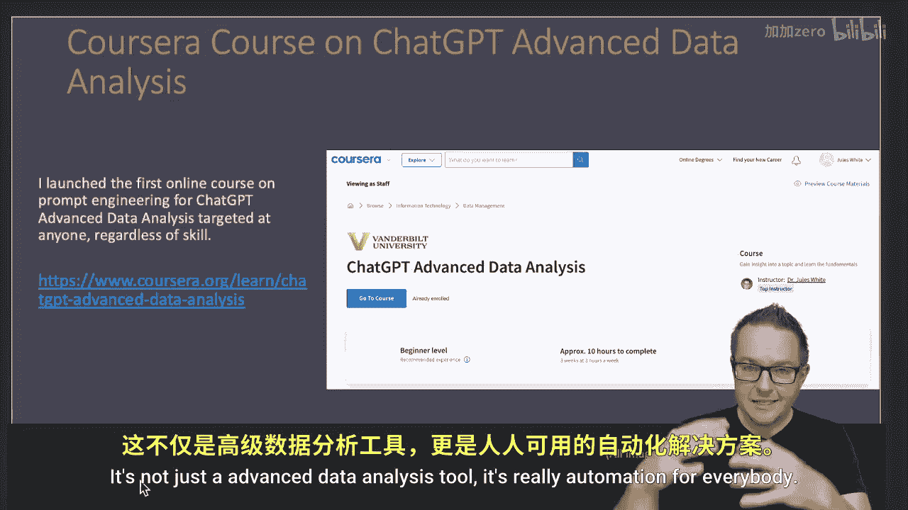
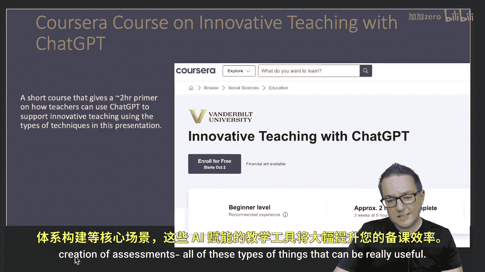
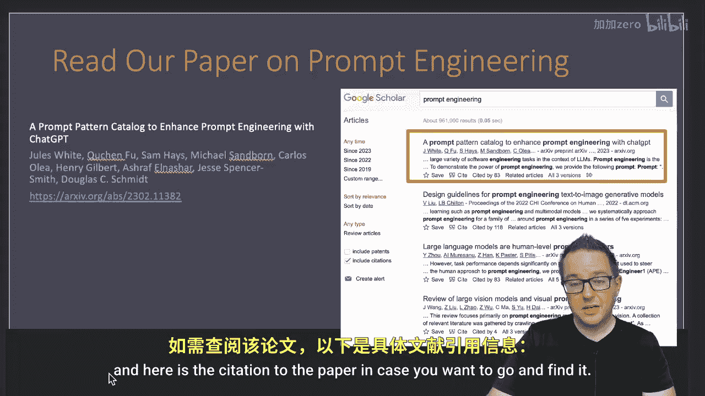

# 范德堡大学【中英⚡生成式AI战略领导者 专项课程｜Generative AI Strategic Leader Specialization】 p49 P49 07_总结发言与未来展望 -BV1b6YyzzEP9_p49-

So how can you go learn how to be a master of all of this new generative AI capability Well the way you do it is through learning prompt engineering and I'm going to give you some resources that you can follow up with to become a master of prompt engineering。

First， I have a course on prompt engineering on Coursera， it has about over 150。

000 people that have taken it to date， and there's also a great community there that's coming up with phenomenal ideas and innovations in all disciplines。

 from finance to banking to law， to marketing to art， you imagine it。

 people are out there doing it and innovating with it。

Second is if you've seen a lot of the interesting things that I've done with documents and automation。

 there's a course that I have on ChatGBT advanced data analysis and although this tool sounds like it's something that doesn't apply to most people it applies to everybody because really with this tool is a tool for automation it's a tool for how you take your documents and begin automating different types of analyses like the creation of that PowerPoint slide or PowerPoint deck where the creation of those visualizations or how I began asking questions about in the travel policy。

 all of those things are done through chatGBT advanced data analysis and it's not just a advanced data analysis tool。

 it's really automation for everybody。

And then if you're a teacher or you're somebody who's delivering educational experiences and you want to see more concrete examples of how you go and innovate with teaching and creation of learning materials。

 I have a course on innovative teaching with chattGBT and this is all about doing things like lesson planning。

 creation of examples， creation of assessments， all of these types of things that can be really useful。

And then finally， if you want to read about the prompt patterns that I've talked about and a bunch of patterns that are really helpful。

 regardless of what domain you're in， where you can go in and learn how to take these building blocks and then go and innovate with them within your discipline。

 and encourage you to read our paper on prompt a prompt pattern catalog。

 enhance prompt engineering with ChaTBT。Right now if you go to Google Scholar and you search Promp Engine will typically be one of the number one result。

 but over time that may change and here is the citation to the paper in case you want to go and find it it's freely available on archive。

Thank you so much for participating in this primer on generative AI。

 I hope you'll be as excited about this space as I am。

 It's going to fundamentally change how we interact with computing but also this vision of augmented intelligence is what gets me so excited I want to put on that exoskeleton for the mind I want to go and do crazy new creative things and scale up my ideas using the achieve framework and I want to do it in a way that amplifies and augments me as a human I want to go and explore things that help us to amplify those individual human sparks and each individual person to spend more time interacting with the people that we care about in the other human beings around us。

 I don't want to be replaced with artificial intelligence and I don't want to replace other people I want to think about how do we augment who we are and we take advantage of those uniquely human capabilities。

 those unique creative capabilities and we。😊，Really build this into a vision that is based on augmentation of intelligence。

 not supplanting our intelligence with something that's an artificial substitute。

