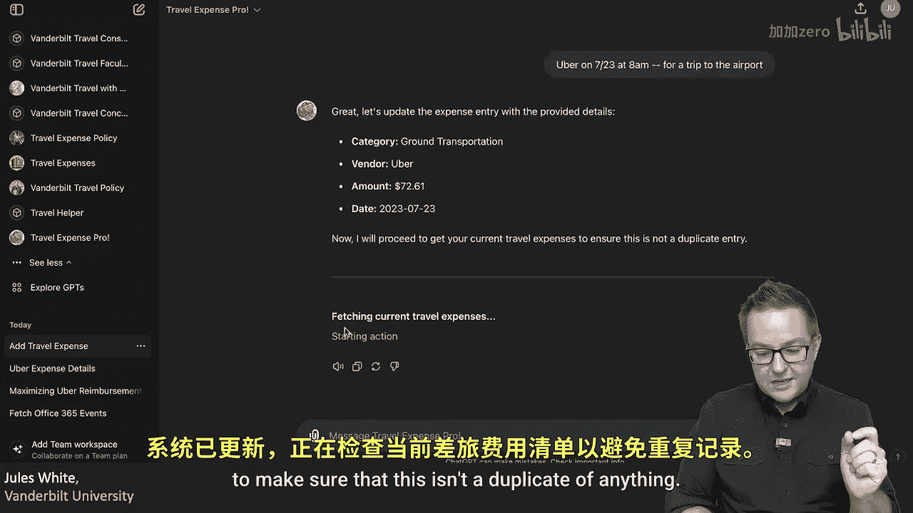
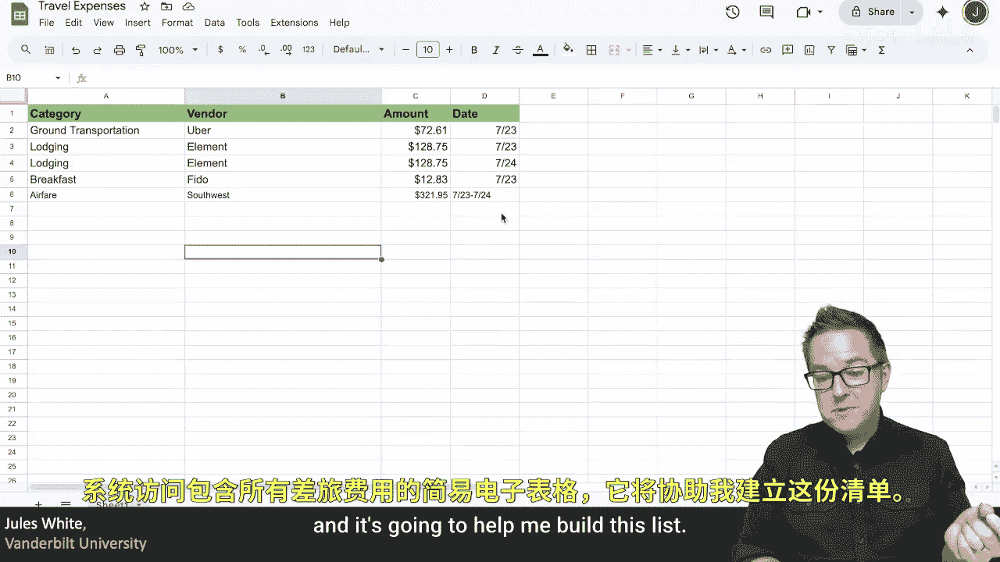
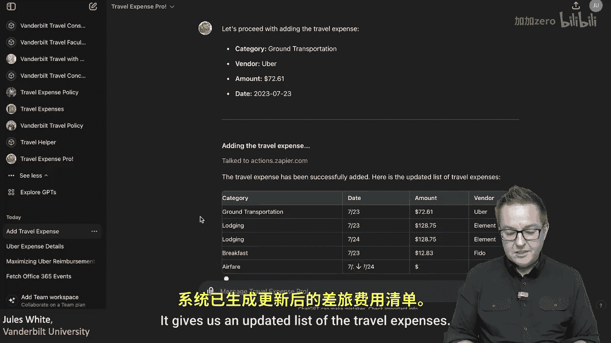
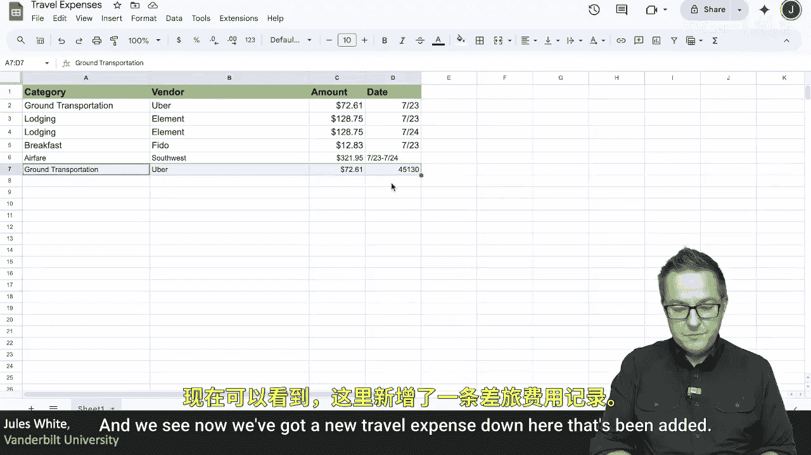
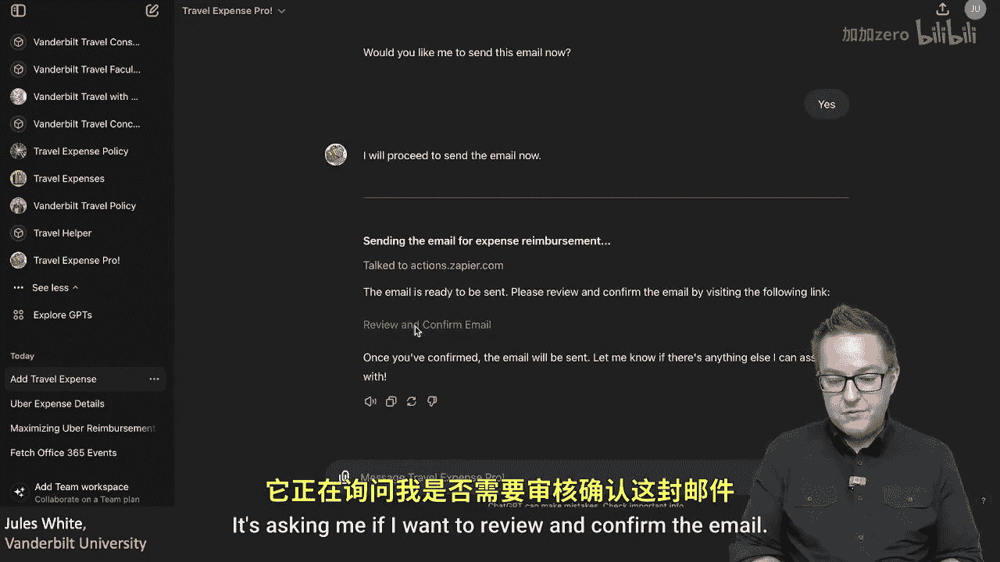
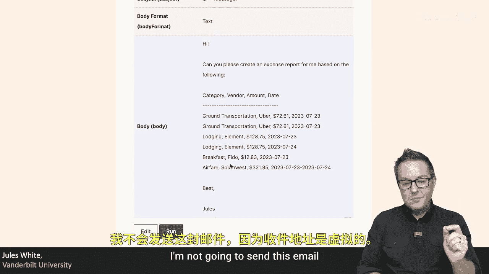
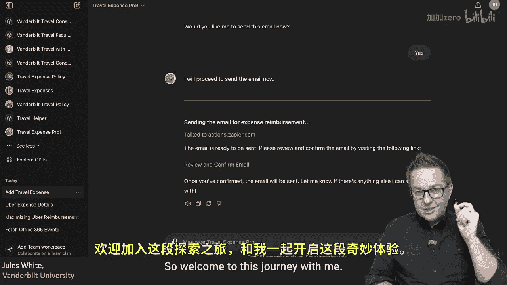

# 范德堡大学【中英⚡生成式AI战略领导者 专项课程｜Generative AI Strategic Leader Specialization】 p50 P50 01_智能AI代理能做些什么 -BV1b6YyzzEP9_p50-

Aenttic AI， what is it and why is it so exciting why is it that I get it up in the morning and I'm just like absolutely amazed at what's possible now and I'm also really amazed at what it can do for me in my life and the way that I can personally engage with a AI Now one of the interesting things is a lot of this stuff gets talked about and really complicated ways but you right now can go and build agents to help you with life and that's what I'm gonna show you in this course is how to build these amazing things that can just do so many simple tasks that take so much work and effort so I'm going give you a quick example in demo of what you're going to learn to build in this course and be able to do you're not only going be able to build this but you're gonna understand exactly how it works why it's amazing and how to go and build new ones to do cool things for you。

So I'm going start off by， I'm going go and give this thing a receipt for a travel expense。

 So I've got a bunch of of travel expense receipts that I've collected。

 and I need to go through and get its help going and cataloging them。

 So how do I go about doing that。 Well， I'm going give it the expense。 And I'm gonna say， please add。

😊，At this expense and notice I haven't you know I'm not subscribing to a travel expense program。

 I'm using a G。 So it's looking at it， looking at the receipt。

 it's going out to Zapier which is gonna be one of the keys to what we're gonna do is we're gonna do automation through Zapier to work with our email or documents all kinds of cool things in this case we're gonna to be working with a spreadsheet of expenses and we're gonna go and do some travel expense reporting。

 So I'm going confirm and let it go ahead and run this action。

 So it's starting off and saying I'm gonna to check Zapier to see what actions are available that I can go and take。

 It's now gonna to go and talk to a travel expense expert。

 This is another agent that is an expert in travel expenses and it's going go talk to that agent and see if the expense is complete。

 The other agent comes back and says okay well this part's correct The vendor is unknown could be acceptable more details provided and the date is missing So let's go and tell if that is missing information It was Uber on7。

23 at 8 a。And I'll go ahead and add a business justification， I'll just say， you know。

 for a trip to the airport。So it says okay let's take that information that you've given me as a check it now it updates it and it said okay now I'm going to check your current list of travel expenses to make sure that this isn't a duplicate of anything so it's going to reach out to my travel expenses and I'm going to show you what that looks like that's over here I've created a simple spreadsheet that I've given it access to with all of my travel expenses and it's going to help me build this list。

Now， if we go back to it and we go over here， we'll see it saying， okay。

 let's update the expense entry with the provided details。And it gives the details。

 it fetches my current travel expenses and it says since this expense is already recorded。

 would you still like to add it so it's gone and it's identified that whoops maybe you're already adding a duplicate expense do you still want to do it and I'm just going go ahead and tell it yeahep。

 please go ahead。So now it's going to create a new travel expense for me in a second。

So let's see what it does。Okay， it's got the travel expense details， it's adding the travel expense。

 it's going out to Zapier， it's confirming that we want to do this and I'm going to say yes。

 I want to do that。Stalking this apppi year， which is going to help us with all this automation and working with all of our different accounts。

 Google， other places。Now it says it's been added， it gives us an updated list of the travel expenses。

And now we see the new travel expense for Uber。 Let's go check it out over here。

 And we see now we've got a new travel expense down here that's been added。

 So we've got the new travel expense added and we've got it listed over here as well。 Now。

 it's asking me， would you like to send an email to your amazing admin for expense reimbursement。

 I'm going to say yes， please。😊。

嗯。So now let's get help， drafting that email， drafting the reimbursement email， and this is again。

 actually reaching out to another agent that is an expert in drafting emails。

Particularly for reimbursement。Ask me to confirm I'm going to say yes。And now what's going to happen。

 well it's talking to that other agent right now through Zapier， which is pretty amazing。

 we've got multiple agents working on our behalf already。And now let's see what happens。wo。

 my super admin。Can you please create an expense report for me based on the following。

 it's got all of my expenses with the dates and the information， best Jus。

 and it asked me if I'd like to send it， Yes， I would like to send that email and get reimbursed。

Okay， it's going to go off， it's going to start sending the email。Just give it a moment here。

We'll confirm it。I love this so much。 It makes me so much so happy， so much joy。 I give it anything。

 I give it an image of a receipt that's partial and incomplete， fixes it。 I give it like text。

 I speak into it， and I tell it whatever it is。 Now it's doing something important It's asking me if I want to review and confirm the email so I go and review it it's created the email for me。

 I can now and go and review it and if I want to do that and go ahead and send it I could I'm not gonna send this email because this is on a real email address that it's going to but you can see this is the amazing stuff that I'm going to teach you how to do。

 and it's based on agent AI principles which sound really complicated。

 they get talked about in the most complicated way possible and the truth is that you can understand all these principles very simply and I will take you through them step by step and by the end of it you will be able to build this travel expense assistant and you will have the knowledge to go and build the next assistant that's going to transform your life be it for cooking。

😊。

Helping you with your email， whatever it is， you're going to be able to build it because we're going to go and break down all this complicated agent AI stuff into really simple things that you can do with open AI GPTs and Zaper and a fundamental understanding of the concepts。

 which are not crazy complicated， they're just fun， natural language exciting stuff。

So welcome to this journey with me， we're going to go and build some amazing things together。

