# 范德堡大学【中英⚡生成式AI战略领导者 专项课程｜Generative AI Strategic Leader Specialization】 p51 P51 02_引言 -BV1b6YyzzEP9_p51-

So what is agent AI Well， I want to take a look at this with you and help you give an intuitive sense of what this is all about and why it's sort of fascinating。

Now what a AI is is basically AI that can go and act with agency， you think of it as autonomy。

 it can go and try to problem solve and react to different situations。

 and you've probably already seen it in your interaction with generative AI。

 but you probably weren't thinking of it that way Now a AI is really putting this into practice in creating generative AI or other systems that can go and interact with the real world。

 take actions， see the result of those actions and then respond based on that。

So we're going to go and simulate this whole process。

 well it's not fully simulating it because we're going to kind of build an agent system that's going to have a manual component to it。

 meaning that as a human being， I'm going to help the agent accomplish actions and respond to situations and so we're going to build an agent system that has a human in the loop where the human is helping create that agency that it needs。

 it's helping carry out the actions and that's one of the key things that we start seeing when we have these agent systems is they do things for us sort of autonomously。

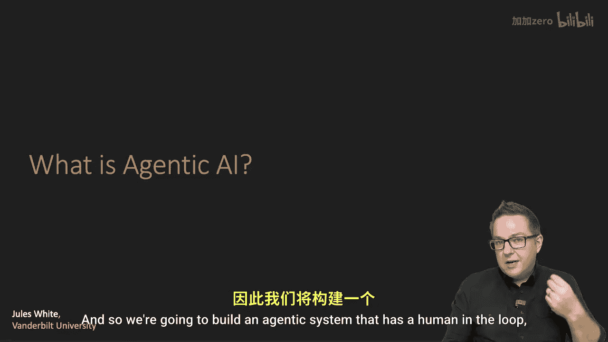

So here's my prompt to get this started。You're going help me cook whatever I need since you can't directly lift pots or pans or get to the fridge。

 you will tell me the steps and I will perform them， we will go one step at a time。

 ask me for what I want to cook and this is a prompt that's essentially kicking off an agent system where I'm going to follow the instructions that it tells me to follow and then whenever it tells me there's some action that needs to take place。

 I'm going to take that action and then I'm going to tell it what happened and it says， okay great。

 let's get started what we you like to cook today。

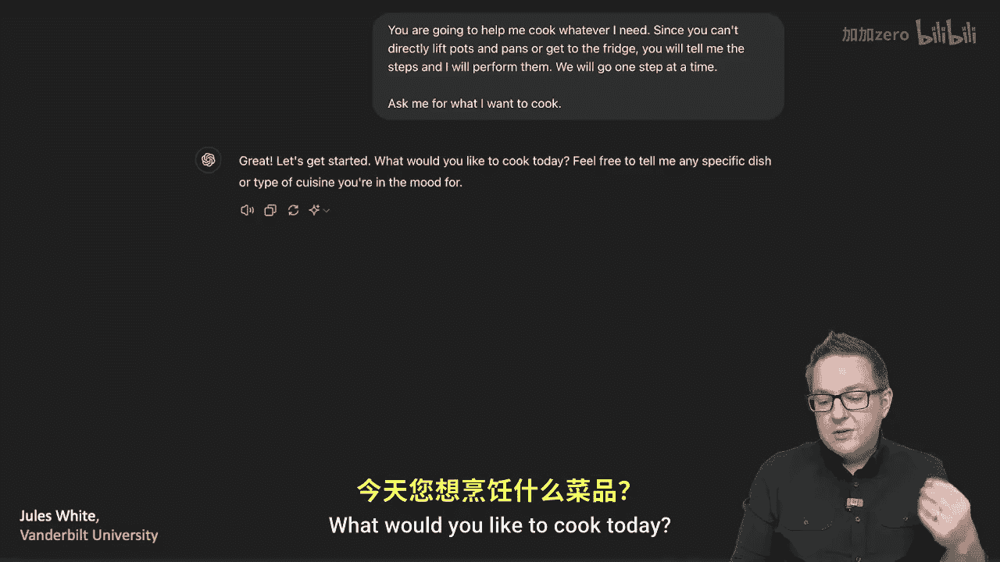

And I'm going to start off with something fairly simple I'd like to cook a dish that combines the flavors of Ethiopia Uzbekistan while being keto friendly up and under to1000 calories and it says that sounds like a fun and unique challenge how about we make a keto- friendlyrily Ethiopian Uzbek fusion dish featuring a flavorful marinated meat served with a side of spiced vegetables Here's a plan。

And it's starting to build out， here's how I'm going to go and accomplish this， and it says， okay。

 here are the ingredients you will need。

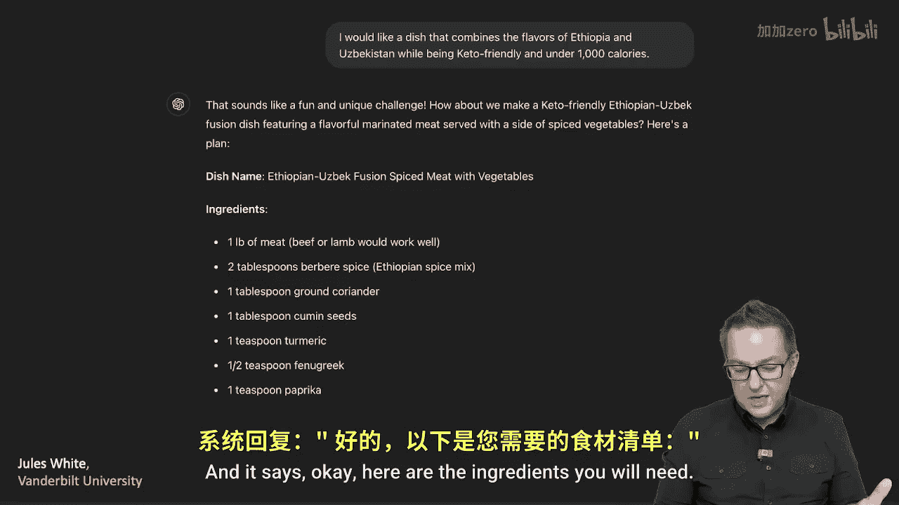

It lists all the ingredients and then I want to draw your attention down to this instructions at the bottom。

 this is where it's telling me what to do here is the task to go and perform。

And it says marinating the meat， mix the barber spice， ground coriander， cuminces， tmeric。

 finu Greekek， paprika， et cea， coat the meat with the spice， ensure it's covered。

 let me know when you have the ingredients ready and if you have any questions。

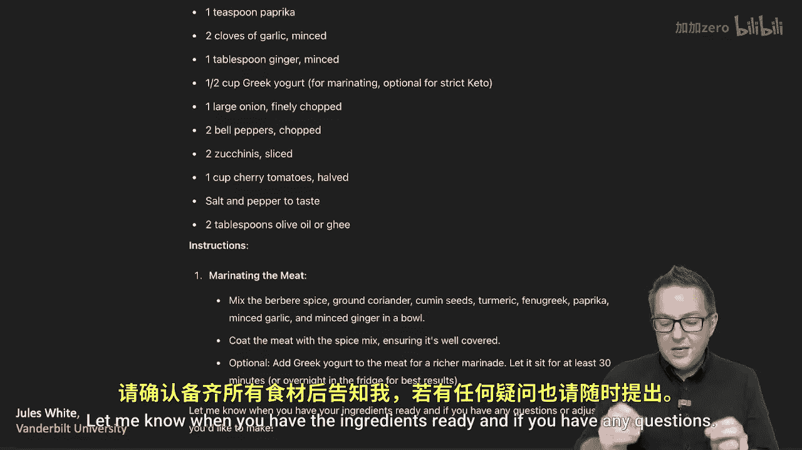

So it's telling me go and do this and tell me when it's done， and so I come back to it and I say。

 okay， meat is marinated， I did that。

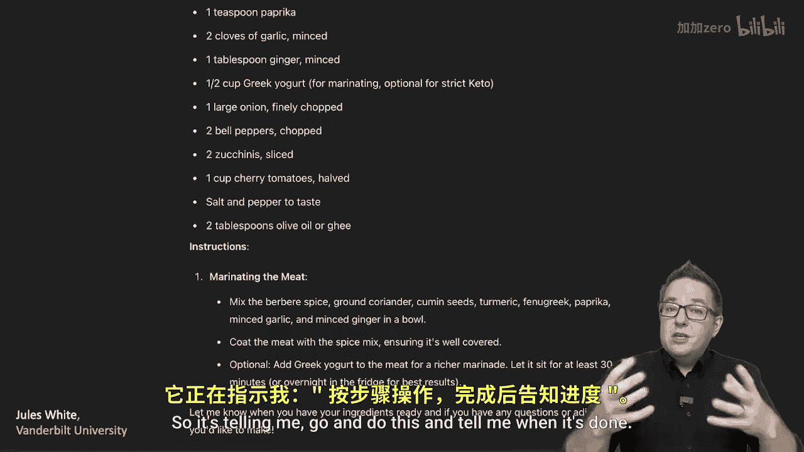

And now what does it do， it responds and it says， okay， great， let's move on to the next step。

 cooking the meat， heatat one tablespoon of olive oil or ge and a skillet over medium heat once the oil is hot and theinated add the marinated meat to the skillet cook for about five to seven minute minutes now it's giving me instructions it's really telling me a task to go and perform I'm going to go cook the meat as the task。

 but it's breaking that task down into sub steps that I'm going to go and perform but you notice what's happening。

It's telling me what to go and do， it's giving me the instructions to perform。

 it has the choice and what gets done and when， and I'm carrying out its instructions。

 that is it having agency， it's choice over what's happening。And then it says。

 let me know when the meat is cooked and resting and we can proceed。

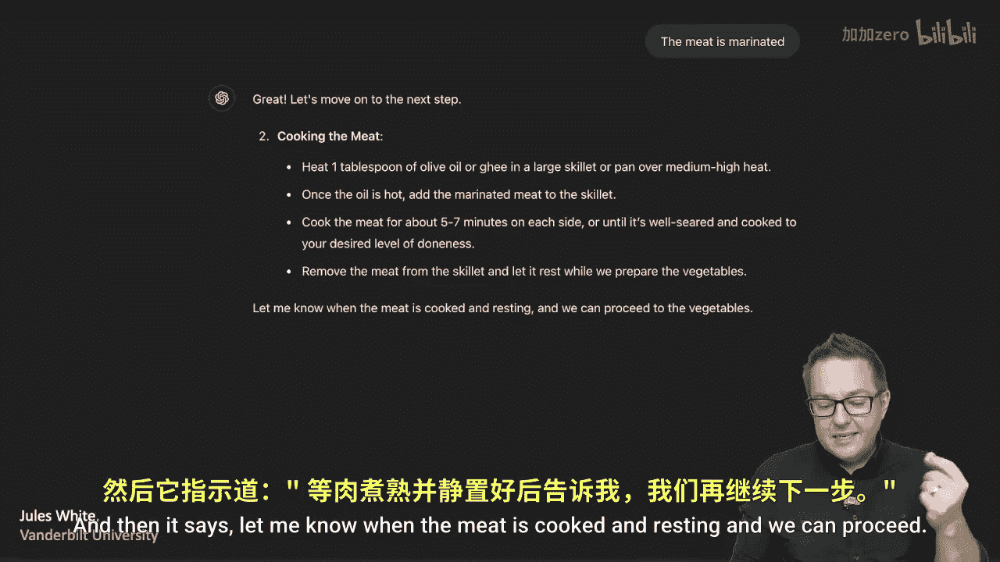

And so I come back and I want to point out the agent aspect of this。

 the fact that it can react and have agency and choose what to do and respond to all kinds of things including something like oh no。

 it's starting to burn， so I tell it like， hey， here's what's happening with the meat。

 it's starting to burn。

And I don't tell it what to do。 And it says， oh， if the meat is starting to burn。

 reduce the heat to medium or medium low immediately。

 you can also add a splash of water or broth to the pan deze it and prevent further burning。

 So it is responding and adapting。 Now I'm simulating all of this。 We're not automating it yet。

 What we're doing is we're seeing and building up intuition about what agentic AI is about。

 And this is it happening except that rather than fully automating it。😊，As a human being。

 I'm going and performing in its actions， so it it's a collaboration between myself and the generative AI to get this dish cooked。

So it tells me what to do， how to handle the potential burning meat， and then it says。

 let me know when the meat is done and resting and we'll move on。

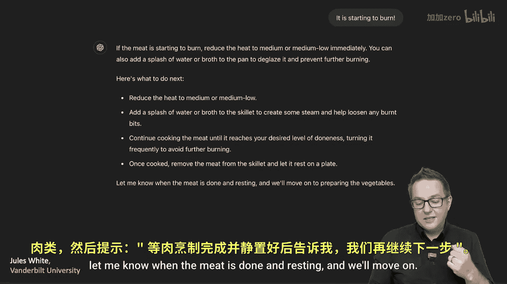

And say， I go back and I say okay， the meat is done， so I'm giving it feedback on its actions。

 I've completed the action you requested， it's ready， it comes back and says， okay。

 let's move on to preparing the vegetables and again， let me know when the vegetables are ready。

 so it's giving me a task I'm going to performing the task and then I'm coming back and saying okay。

 task is done。

And then it comes up with the next task。

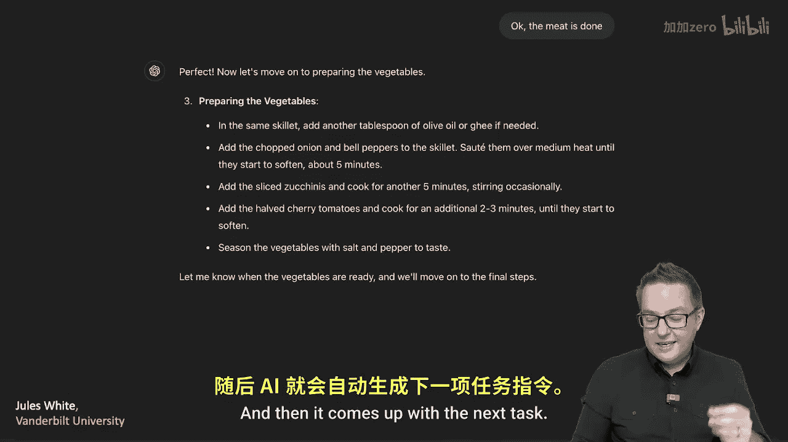

And it。Says now in this case， it asked me if I forgot about this， I gave it a little curveball。

 it said， let me know when the vegetables are ready， and I said， oh， no vegetables。

 but I have durian fruit， So this is a little bit of a curve ball for it。

 How will it respond to no there's no vegetables， You asked me for vegetables。

 I don't have any you but I do have durian fruit， you have to deal with it， How does it respond。

 How does the agent handle that。

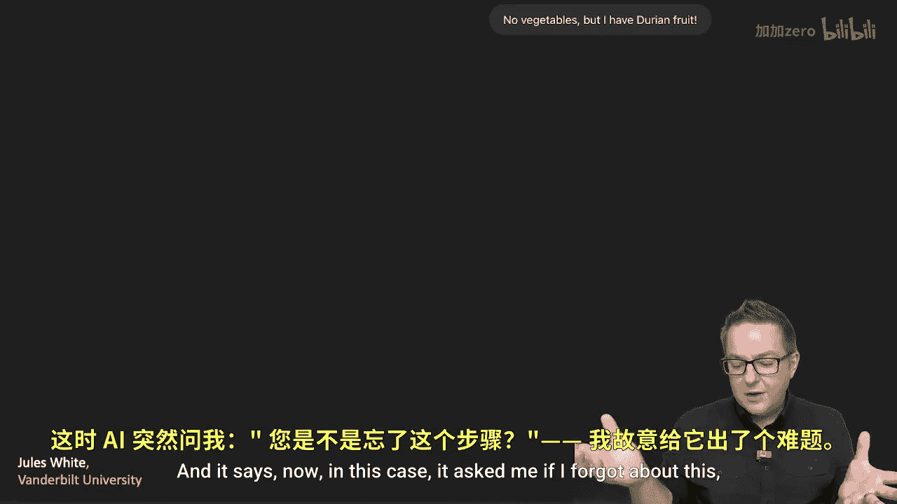

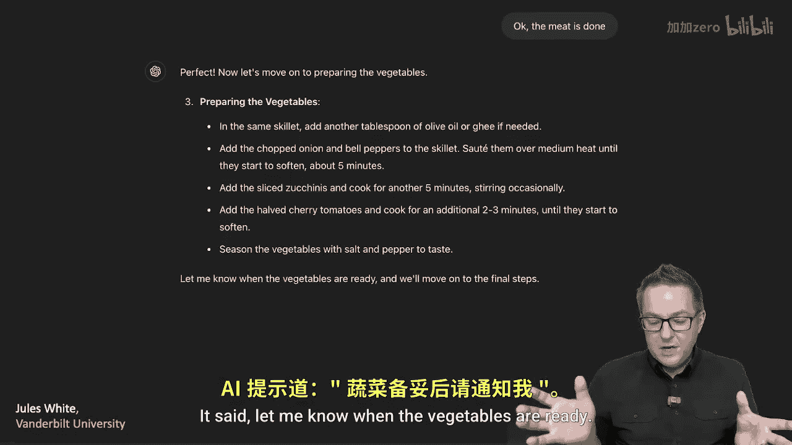

And it comes back and it says okay well it's quite different from vegetables but I'm going to adapt and so now it tells me how to prepare the durian fruit because it says well I want to path forward。

 I want to try to reach this goal of having created the dish I don't have access to the resources that I thought so I'll have to adapt and come up with some other way of solving this so it adapts says okay now here's how you're going to prepare the durian fruit。

 I have no idea if this works this is not a dish I'm cooking in my house。

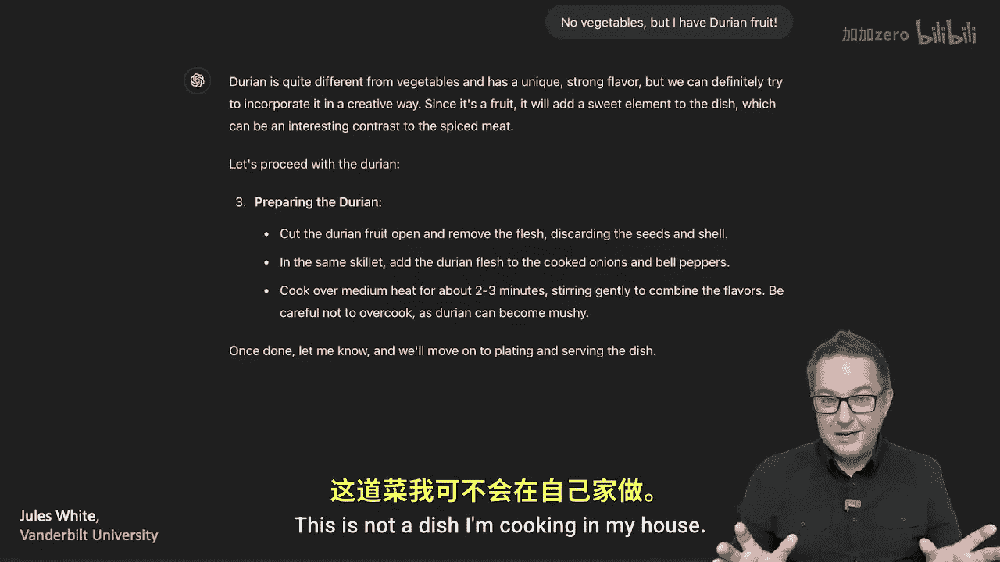

And I tell it it's done， it comes back and it says， great， now here's how you go and plate the dish。

Now what happened here？Well， we flip the script right instead of going into the generative AI and telling it do this。

 do this， plan this， do this， I said， here's what I want you to accomplish。

 here is the process you're going to use to accomplish this The process is you're going go one step at a time you're going to tell me what to do I'm going to carry out the action for you and then I'm going to tell you when it's done basically and then you can go and respond and do the next thing。

 And what we see is is that as we go and change our responses， for example。

 when we threw this curve ball over the durian fruit。

 it responds and adapts and that's a critical thing with the gen AI is it's not fixed。

 we think of all our computer systems that we've built for years。

 and they're very rigid and fixed Like if you take a computer system and you say no vegetables durian fruit。

 it falls apart， has no idea what to do and this is where the magic of a gen AI search to come in is it sees okay I don't。

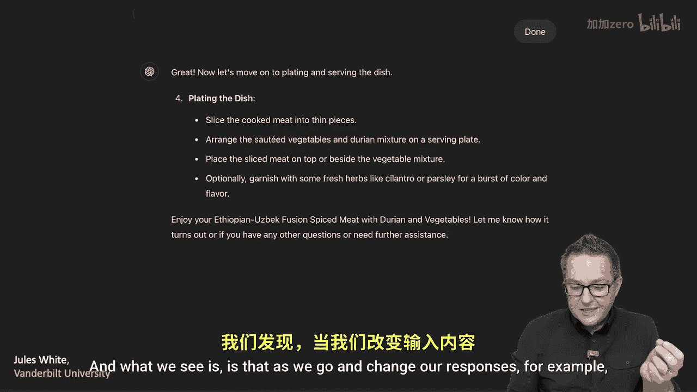

Vegetables， I've got durian fruit， I will do my best， so I'm going to try to figure this out。

And that's what we're looking for is that ability to see things and respond to them and then choose the next action based on what happened。

 or like when the meat was getting ready to burn adapting the plan and say no okay here's what you're going to do instead you're going turn down the heat and that's okay now tell me when you're where you're done with that step and so it's dynamically altering the steps based on the feedback that it's receiving me and that is the key to agent AI that we're going to be working with is its ability to ask for an action to be performed because it's never going to be directly performing it。

 it's going to be specifying what it wants done and then either a human being is going to go and do it or an existing software or computer system that we know how to build is going to go and take that specification and carry it out that's the key Now does it matter if it's a human being or computer system that's doing this not fully the key difference that we're going to see is that if it's a human being。

We are much more error tolerant， like if it goes and it gives us the tasks that it once performed in many different formats。

 we can handle that and adapt because we're human beings。

But computer systems aren't so good at doing that so when it begins interfacing。

 when a AI begins interfacing with all the tools and computer systems that we use on a daily basis。

 if it decides to say hey yo go create this recipe and it says that to a spreadsheet the spreadsheets gonna to say I have no idea what you're talking about because it doesn't work with yo create this recipe。

 it works in columns and numbers and values and so it's in a much more rigid format so part of the magic of a AI is figuring out how do we bridge this gap between how it sort of intuitively and fluidly specifies what it once done and this rigid world of computer systems that we built where everything has to be exact and perfect and boy we know that a generative AI loves to explain itself and gives us all kinds of remarks and details and comments and all those types of things a really para when we start working with real computer systems now it's fine in this example like I have。

Where I'm acting as the automation， I'm going and listening to what it's saying and then responding to it because I'm a human being and I can adapt as it can adapt。

 I can adapt to it giving comments， I can adapt to it explaining itself I can adapt when it's short and sweet about what it wants and a lot of what we're gonna to have to do is the prompt engineering。

Around how do we interface our existing computer systems with these things that are very talkative and adaptive and all of these other things they do and aren't as rigid as we're used to so I look forward to exploring this more with you。

