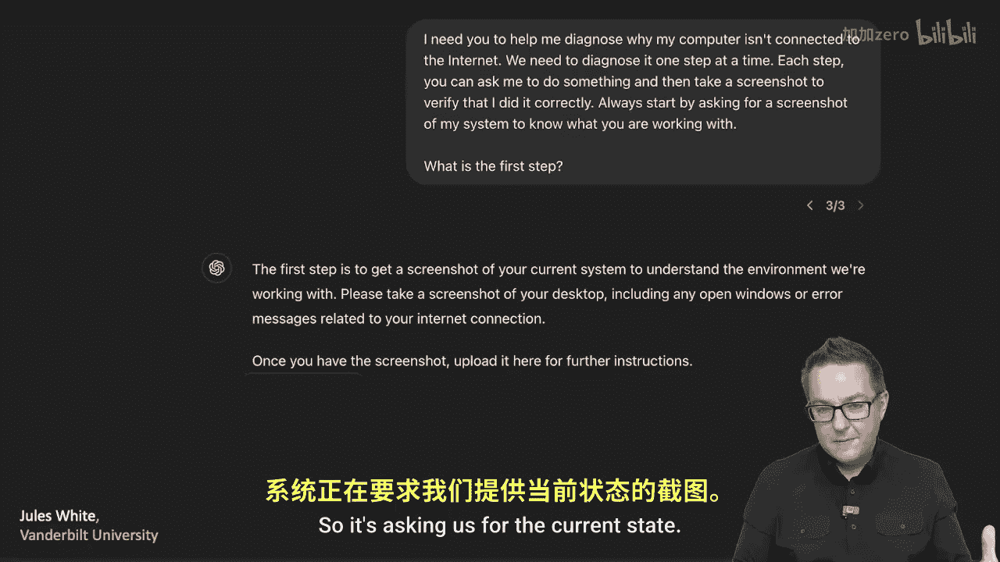
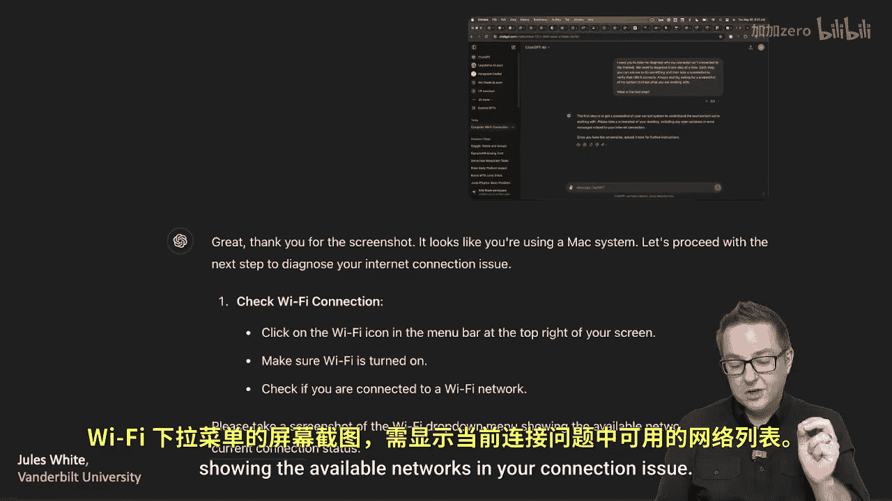
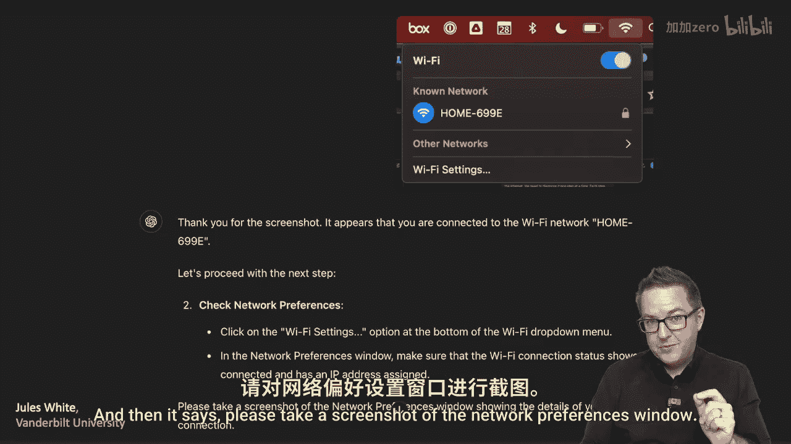
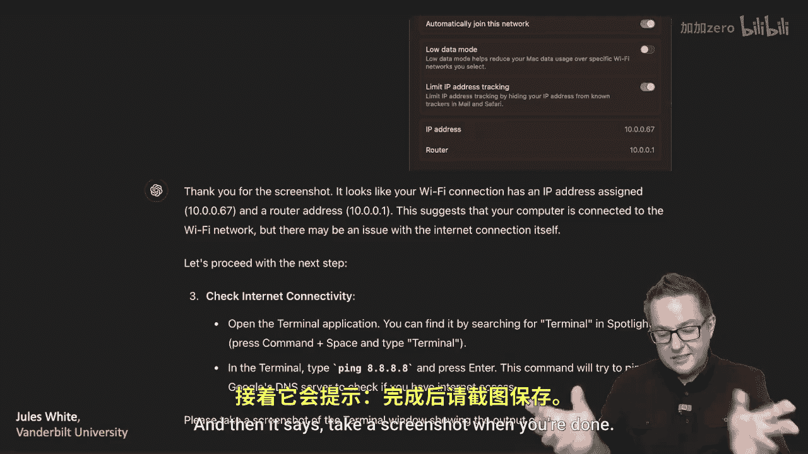
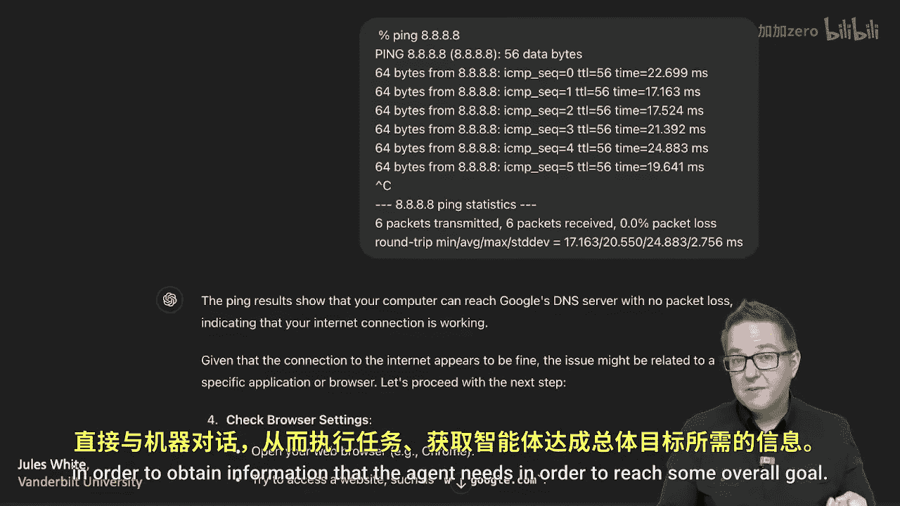

# 范德堡大学【中英⚡生成式AI战略领导者 专项课程｜Generative AI Strategic Leader Specialization】 p53 P53 04_多模态翻转交互 -BV1b6YyzzEP9_p53-

Now something amazing about these models and these patterns is they don't have to just stick with language these systems can interpret so many different types of information。

 it doesn't just have to be human language and this is a key thing that we have to understand is we can go give it all kinds of information so when we use the flipped interaction pattern where we have it go and ask us questions or ask a database questions or tell us what to do or tell the computer system for what to do。

 it doesn't have to just get feedback in terms of language it doesn't just have to be our human language it can use all kinds of modalities of communication and we're going to take a look at an example of that and that example we're going to provide。

Is photographs， so here is my flipped interaction prompt。

I need you to help me diagnose why my computer isn't connected to the internet。

We need to diagnose it one step at a time Each step you can ask me to do something and then take a screenshot to verify that I did it correctly always start by asking for a screenshot of my system to know what you're working with what is the first step So again I'm using this interaction pattern where I'm describing that I wanted to go step by step solving the problem I'm getting it to ask me for the first step and I'm telling it this time the feedback is primarily going to be screenshots of what took place so you're going to tell me to do something I'm going to do that thing on my computer and then I'm going show you a screenshot of what happened。

Okay。So it says the first step is due of a screenshot of your current system to understand the environment we're working with。

 so it's asking us for the current state。

So I go and I take this picture of my laptop， this screenshot of my laptop。

 I upload it as my response， I'm not uploading text anymore。

 I'm uploading a screenshot of my computer absolutely insane that I can do this now。So it' great。

 thank you for the screenshot， it looks like you're using a Mac。

Let's proceed with the next step to diagnose your internet connection now notice what it did right。

 it looked at this screenshot and said， hey， that looks like Mac。

So it knows about my computer from the look。Of what it sees in the screenshot。

 it's not just me saying I have a Mac， this version or this information it's looking at and of collecting rich information from that screenshot and then adapting based on what it sees in the screenshot。

Okay， check your WiF connection， click on the WiF icon in the menu bar at the top right of your screen。

 make sure Wifi is turned on， check if you're connected to a Wifi network， and then it says。

 please take a screenshot of the Wifi dropdown menu showing the available networks in your connection issue。

So I go and do what it says， now I didn't have an actual internet connection issue。

 but I just wanted to get it to walk through and see if it could diagnose it because I'm claiming that I have one。

And so I wanted to see if it can get to the point where it actually understands that， no。

 I don't actually have an issue。And so I go and I click on that， I take a screenshot of it。

 I give it back to it and it says thank you for the screenshot。

 it appears that you're connected to the WiF network Home 699 E you notice it's actually identified the WiF network that I'm on from the screenshot it doesn't require me to tell it。

 it simply collects the information that it needs from the feedback that I'm giving it。Okay。

 let's proceed with the next step， check network preferences。

 click on the Wifi settings option at the bottom of the Wifi drop down menu in the network preferences window make sure that the WiF connection status shows is connected and has an IP address assigned。

And then it says please take a screenshot of the network preferences window， so again。

 telling me an action to take， telling me to give it back a screenshot。

I go and take a screenshot of that that you wanted to see and it says。

 okay thank you for the screenshot， it looks like your Wifi connection has an IP address assigned to it and a router address this suggests that your computer is connected to the Wifi network so it's established。

 it's starting to diagnose the issue step by step first it's establishing that I'm connected to the Wifi network。

And that that looks okay， now it's going to go and say， okay， well， what's next。

 if that's not the issue， what is the next step？And now it says， okay， well。

 we need to check internet connectivity。Open the terminal application so now we're getting more sophisticated you can find it by searching for terminal and spotlight。

 it gives me the command to run， and then it says in the terminal type ping 8。8。8。

8 and press enter Now notice what it's done it now needs to get a command run on the system and so it's translated that high levelvel task of check internet connectivity into a command。

 a language that the computer understands。So it is doing that translation step。

 it's not only identifying what needs to be done， but it's identifying how to translate that specifically into the language that it can use to communicate with the computer to find out the information it needs。

And then it says take a screenshot when you're done Now I didn't take a screenshot of it。

 I actually just copied and pasted it back into the prompt I should have probably done it as a screenshot。

 but I want to see how it would respond if I suddenly throw it a curve ball by not giving it a screenshot anymore but actually giving it the text and this is the raw text that was output by running that command you notice this is all this is something that makes sense to me as a programmer if you are in IT it may make sense to you if you are not into this stuff。

 you're going to look at this and you're gonna say it looks like a foreign language and it is it's a language that many people understand how to speak but if you don't know this language you don't know how to speak it。

It looks very foreign， but it understands how to then translate this back into meaning and it says the Ping results show that your computer can reach Google's DNS server with no packet loss indicating that your internet connection is working。

 so it's translating here is the raw information in that language that I see and it's translating it into meaning in terms of the problem that it's solving and then it goes on and it tells me the next step to run and it would keep going trying to help me diagnose the supposed internet connectivity problem with my computer that don't actually have but you see how it's adapting。

 it can adapt to many different types of responses。

That flipped interaction where we say here's the pattern go to one step at a time。

 I'm going to give you the result， every time it takes what it gets back， it responds， it adapts。

 it translates， it can interface with different systems now we're still using manual interfacefacing we're having a human provide the interface。

 but rather than interface to the world of cooking。

 we're now interfacing to the world of machines and to world of computers which is eventually where we're going to go with these agent systems as we are going to allow them to directly talk to those machines in order to carry out tasks in order to obtain information that the agent needs in order to reach some overall goal。

