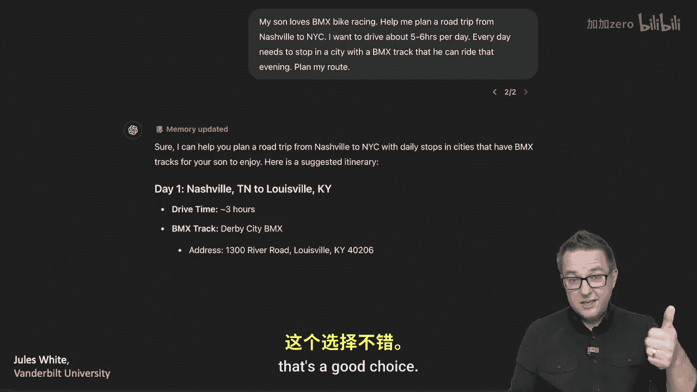
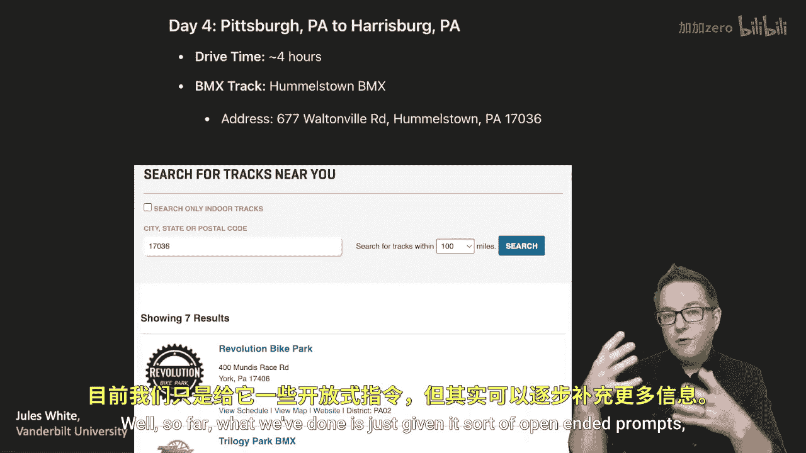
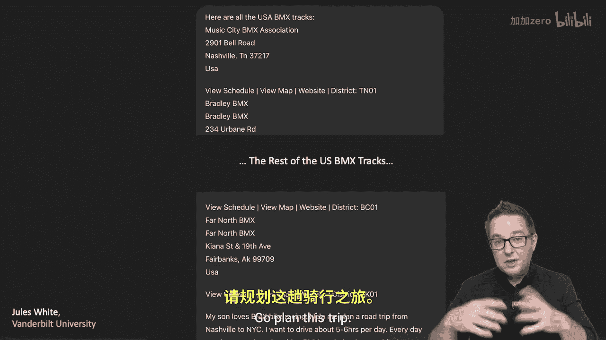
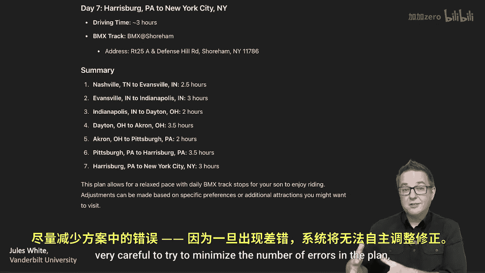

# 范德堡大学【中英⚡生成式AI战略领导者 专项课程｜Generative AI Strategic Leader Specialization】 p54 P54 05_提前规划 -BV1b6YyzzEP9_p54-

Now， agents don't just have to go and do everything one step at a time。

They can actually go and build rich plans and this is one of the capabilities that really underlies all this is their ability to take a goal that you're trying to achieve some high levell task and decompose it into a series of subtask or goals in order to form a plan to accomplish it and that is a fundamental capability Now one way that we can have agents work is we can have them go and interactively one task at a time。

 go and take steps and perform actions and respond and that's a really powerful way to do it。

Another way that we can do it is the complete opposite we can have it build out the whole plan in advance and then go and send it off to be executed now we haven't gotten to the point of automating things yet so let's do the planning where a human being is going to go and execute the whole plan so here's my goal plan a four day trip to Nheville that involves going to several different neighborhoods。

And it goes and it breaks down my task it says okay， I need four days worth of activities。

 they need to go to different neighborhoods， and it goes day one。

 downtown Nashville breakfast at Pancake Pantry。Not sure this is accurate on neighborhoods depending on how you classify downtown Nashville。

 I think of downtown Nashville is not including the Pancake pantry。

 I think of that as Hillsborough Village， but you know it did its best and that's another thing is it's not always going to be perfect and when we go step by step。

 it has more ability to adapt and correct debt， for example。

 it could have said go to pancake pantry that so that's not downtown according to my definition of downtown it could said oh well you've got a different definition of downtown than me and it could have adapted its plan。

And when we go and we generate the whole plan like that。

 it's in one go it doesn't have the ability necessarily to adapt between steps。

 this is a key difference and when we think about planning， if we do it step by step。

Full adaptation between it。But there's some complexity there because it may forget steps or it may lose track of what it was trying to do or something like that On the other hand。

 we can go and we can have it so it never livess just track of what it's going to do it can build out the full plan in advance and then it just gets sent off to execute multiple steps and it doesn't have to remember what it said or anything like that it just bakes it in advance but if there's a flaw in the plan it doesn't get to adapt the plan while it's being executed and that's a key difference do we want it in the loop while the plan is executing in between every step getting to decide what happens next or do we want it to be fully baked and the plan executes completely separately from the agent and we lose the ability to respond if there's a mistake between steps but we may gain things in terms of efficiency cost。

 speed it may be more repeatable and predictable so if we put an agent in between just like any other large language model response it may like tweak what it does from。

One time to the next， we may not want that， and so we're always going to be balancing these two ways of going to accomplishing tasks。

 either it's directly in the loop between every step where it builds out a fully baked plan in advance and we go and execute that whole plan very repeatable but if there's mistakes or problems。

 we can't adapt easily， or maybe we want to be somewhere in the middle。

So here's the rest of our four day plan for Nashville， now I'm going to go back and I'm going to say。

 okay。My son loves BMX bikeike racing， help me plan a road trip from Nashville to New York City。

 I want to drive about five to six hours per day， every day needs to stop in a city with a BMX track that he can ride that evening。

 plan my route。And it goes through and it says Nashville to Louisville， Kentucky。

 that's a good choice， there's a great BMX track there， it's not too far。

Then we go to a few more days in and we get to Humeltontown BMX。

And I could not find any information about the existence of a BMX track named Humel'stown BMX。

 maybe it exists， maybe it doesn't， but I sure don't seem to think see that it exists。

 it looks you know like something fictitious and this is a challenge when we begin thinking about plans。

Is that if we build fully fixed， fully fleshed out plans in advance。

 we always run the risk of hallucination。That is it dreams up something in the plan that looks good but isn't real and there's all kinds of ways that it can hallucinate things In this case it's hallucinating a stop because it's like。

 well I need to stop。 it knows that there's a Humeltown in Pennsylvania so it says well。

 I'll stop there and I'll just dream up a BmX track to be there because we haven't constrained it enough there's no way to easily do this Now luckily I'm fact- checking before I drive on this road trip and so I can capture that but that's going to be an issue that we're going deal with。

Now， how do we overcome issues like this？Well， so far。

 what we've done is just given it sort of open ended prompts。

But we can start to add in information like upfront。

 we can give it information that we want it to work with。

 constraints that we want it to work with to try to bound what it does and what it reasons about and this is really。

 really important when we start thinking about agents， information， giving the agent。

Access to the information it needs to accomplish the task is critically important。Now in some cases。

 it can go and fetch the information for itself if we explicitly tell it to do that and when to do it。

But if we don't give it the ability to go and fetch information。

 we need to give it all the information to accomplish a task and not just assume that it'll have access to everything。

So in this example， I went back and I took that prompt and I copied and pasted the list of every BMX track in Canada in the United States and I dumped it into that original flipped interaction prompt。

 and then I give it the exact same prompt basically my son loves BMX B Raking， the BMX bike racing。

 go play this trip。

And it comes back and now it's actually correct it's found real tracks and we have real information to work with and all of these stops appear correct to me。

 I went and did some fact checking I was able to find all of these different tracks we also are roughly within the hourly limit that we set now maybe it's a little too conservative on how far we drive each day maybe I should go and tell it well you need to drive farther and it could adapt the plan but you see and now we're getting a plan fully baked。

I'm not going be driving along and saying yo， there's not this BMX track here like tell me where to go instead and driving somewhere else because that doesn't make sense for planning a road trip right I'm going to go and execute its plan。

 but I'm not going to have it in the loop and so that's a different sort of style of interaction and we have to figure out when we start building these systems of like how many steps。

Do we want to have it string together and then we go and execute on its behalf and bring back the result from。

 or do we ever want to bring the result back？All of these things are important and they will determine how repeatable the process is。

 the more we insert the agent into the middle of the process。

 the less repeatable it's going to be the probably slower it's going to be probably the more expensive it's going to be。

 the more we lean towards a fully baked plan， the more repeatable the plan is probably going to be because there's not any adaptation between。

 but at the same time we're going to have to be very。

 very careful to try to minimize the number of errors in the plan because if an error happens。

 it doesn't get to help us and adapt。

