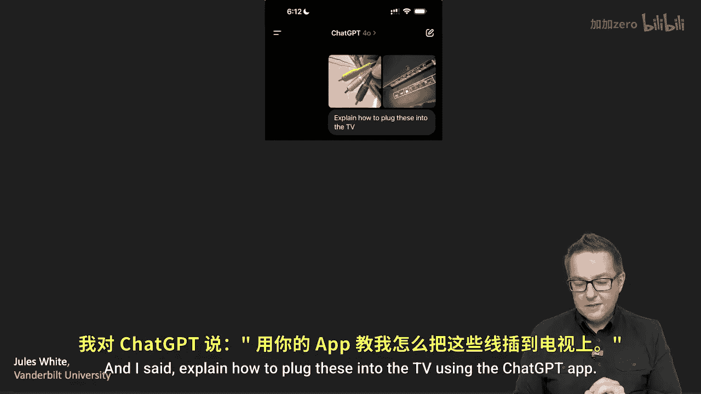
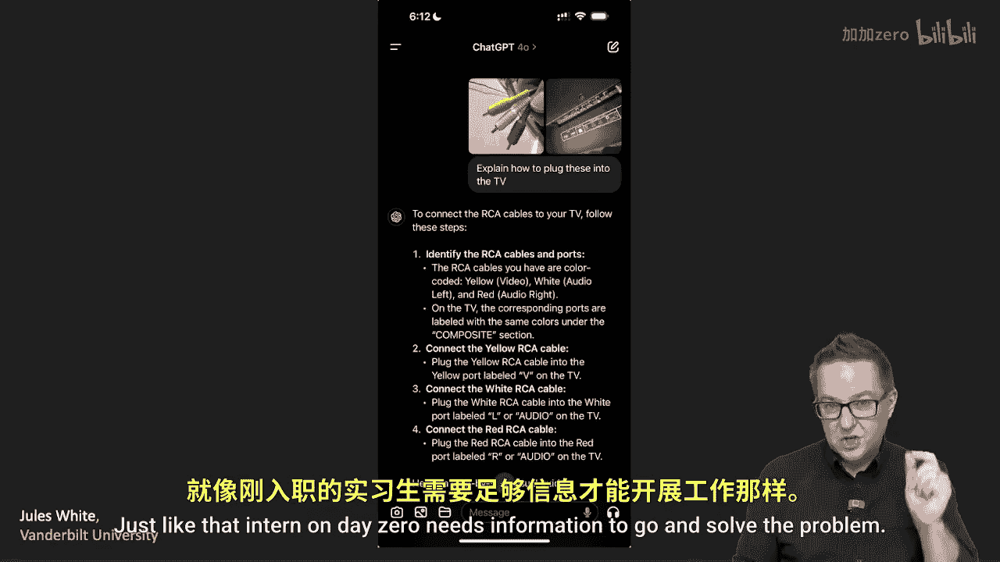
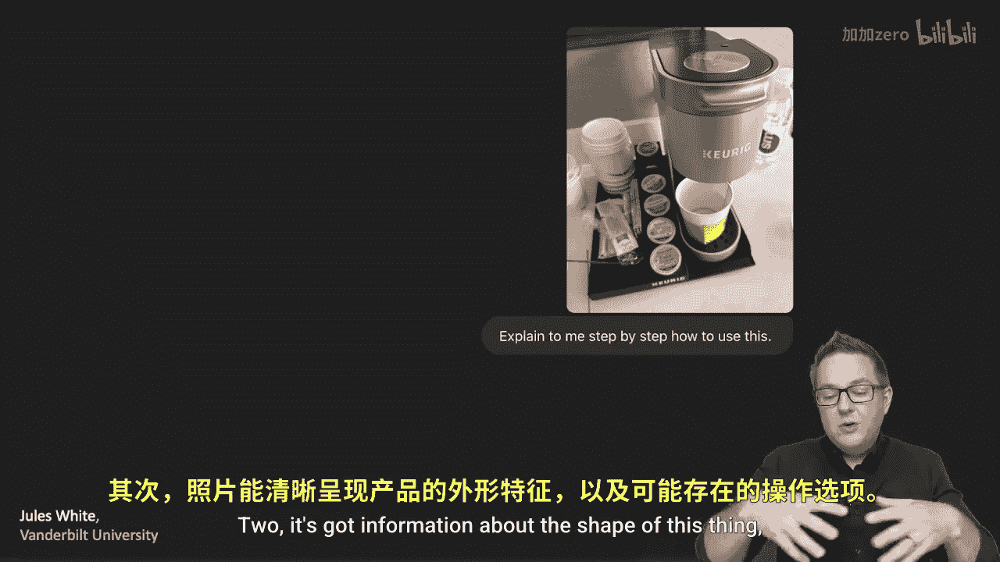
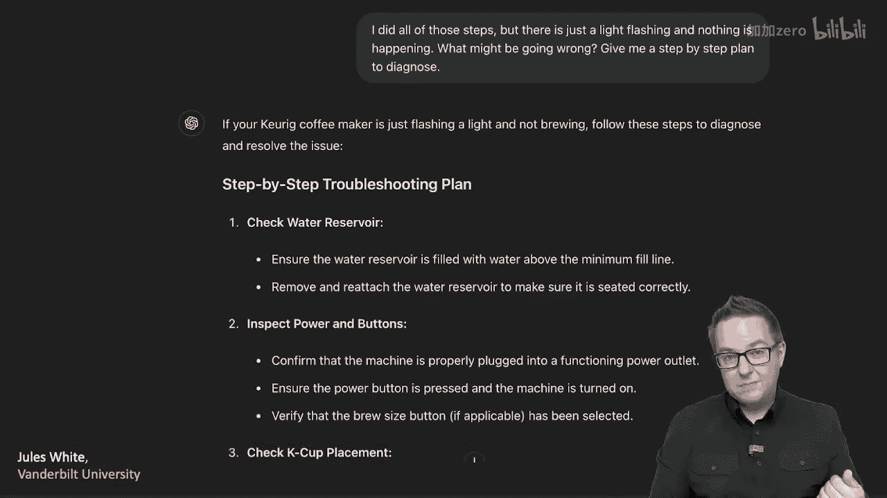

# 范德堡大学【中英⚡生成式AI战略领导者 专项课程｜Generative AI Strategic Leader Specialization】 p55 P55 06_为智能AI代理提供世界信息 -BV1b6YyzzEP9_p55-

One of the things that people overestimate when they start working with generative AI is how much generative AI knows。

 because it's so convincing and they often assume knowledge that it doesn't actually have。

 they assume that it knows all kinds of surrounding information about what they're doing。

 and also we tend to underestimate how much context is actually needed in order to perform a task well。

I want you to go back and think about it when you're building a gen AI is think about if you tried to get an intern to do something for you。

 it's day one， they've shown up， they've been at your workplace like one minute。

 they know nothing about your culture， they know nothing about the layout of your office。

 they know nothing about your systems in particular。

 they just have lots of general knowledge about the world， but not about your stuff。

 not about how you do things， not about your computer systems， not about your goals in life。

 not about what gas station you stopped at when you were driving to work and what your favorite food is。

 and what you like and don't like in travel planning， all these things are missing。

 there's so much information that is fundamentally missing。

And it's really critical that we fill that information in whenever we go and get a gen AI to perform a task。

 so I want to just kind of give you a sense of like the wealth of information that we need to provide in order to perform a task So the other day my son came in and he had found this old Nintendo Wi that we had in the closet and he said。

 " hey， I want to hook this up to the TV。And we pull this thing out of the box and lo and behold。

 it doesn't have an HDMI hookup。And I thought， what on earth am I going to do。

 I don't even know if my TV can accept these types of inputs。

And now I go and I try to get to my TV and it's mounted on the wall and I feel behind it and I feel more than one of those inputs。

 there's more than three of them， so now I've got a problem because I feel five there's only three cables and I'm trying to reach behind blindly and figure out what to do so finally I broke down and I reached out I took my phone in I took a picture behind it and now I've got information about the TV。

Now I then decided， okay， let's see if I can get chatGBT to go and solve this problem with planning。

 and I said， explain how to plug these into the TV using the chattGBT app。

And then it came back and it said， okay， here's where they go。

 so it built a plan for me to go and connect cable by cable into the TV。Now the key behind this was。

That I gave it information about the world， I didn't just say AT。

 I didn't say my TV because my TV is not specific enough unless it knows my TV and has information。

 detailed information about it。And if I even if I said my TV and a model。

 I'd still have to know that it even had information about what the panel looked like and the layout of all of those pull you know inputs there's so much information that's needed to accomplish that task I also have to show what I'm working with in terms of wires and the exact colors and how many and there's so much information that's required in order to perform the task now in this case I'm given it really specific information about the world around it and that's the thing is it needs to know the information about the world。

 the system it's working with the problem it solving it needs a wealth of information to do a good job just like that inn on day zero needs information to go and solve the problem now。

Let's think about this coffee maker， explain to me step by step how to use this Now if I just said a crig。

 it may be able to solve it if I say explain to me how to use this coffee maker。

 well a coffee maker is not enough if I don't give it the photo。

But the photo is really rich information， one it says cururig across the front of it， two。

 it's got information about the shape of this thing， what may be the options to use it。

 and it goes in it breaks it down and it says here's what you do you plug it in。

 you power it on it's planning it's taking in information about the state of the world and then it's deciding what to do and whenever we begin building these systems we have to think very carefully about are we giving the system enough information to perform the task does the agent really know all the details and complexities and nuances。

In order to get to where we want it to go。And we also have to think about when things don't go right。

 how do we update its knowledge of the state of the world or something changes。

 how do we update its knowledge of the state of the world and all of this has to go into it because as it's going in executing a plan or telling us to executing a plan something in the world may change it may force its plan to adapt and if we're not feeding it in information continuously to make sure that it's aware of what's happening around it。

 it will go and make incorrect decisions so if you tell it to go you create a travel reservation and then simultaneously you know your wife goes and creates a travel reservation independently and you don't update it it may go and create a duplicate and that's not what you want and so you have to think about it like that intern。

You have to not only tell it enough information to go and solve the task。

 but you have to keep it up to date with all the information that it needs。

 and that means continuously updating it throughout the process so that it knows what it needs to do。

 but also it needs to know what happened that may affect what it's currently planning to do。

