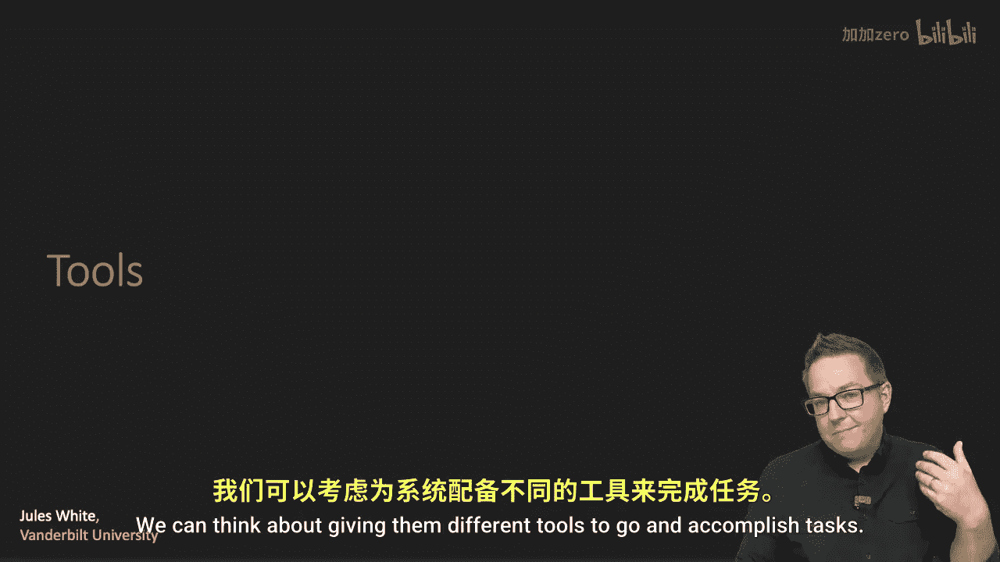
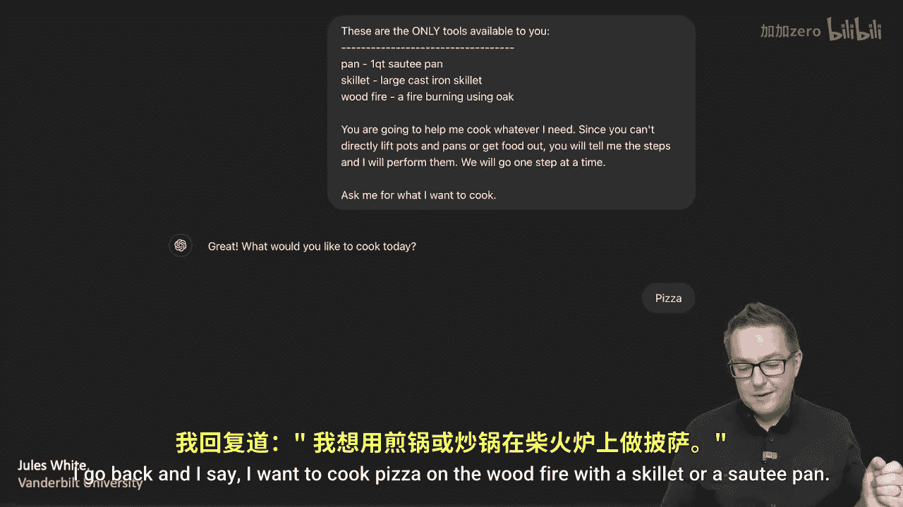
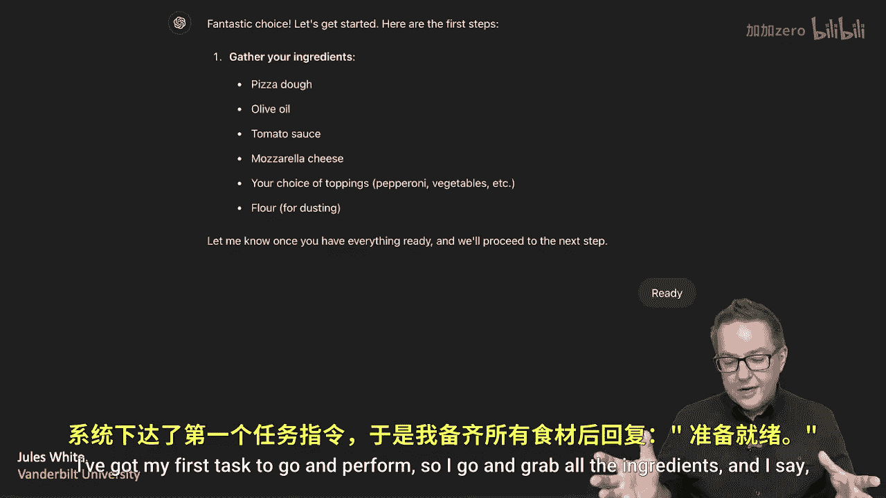
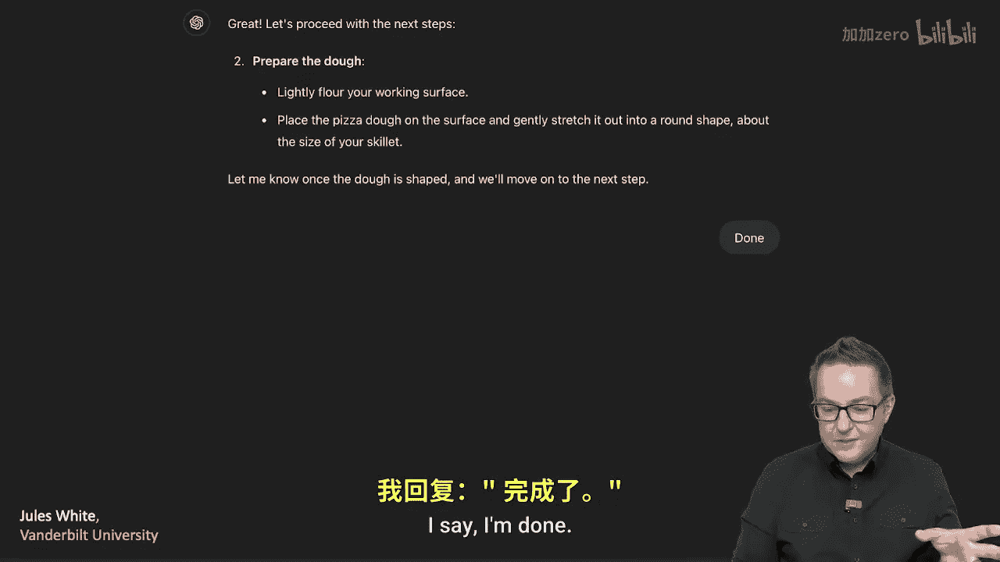
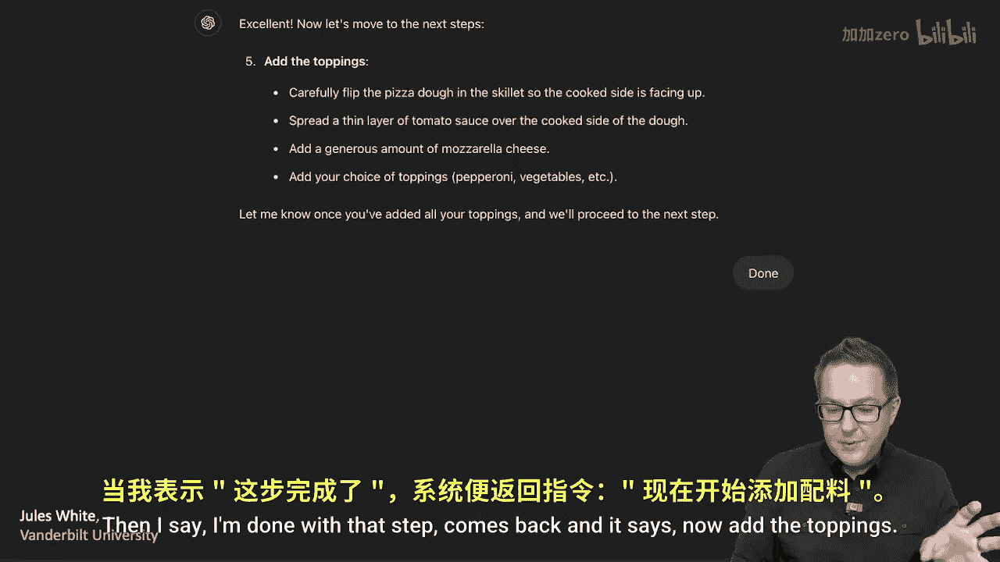
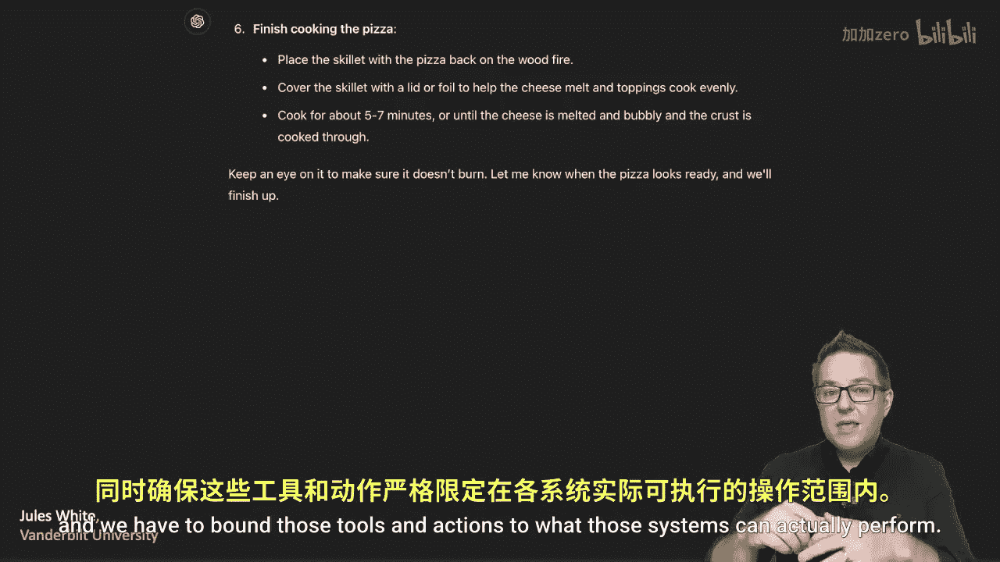
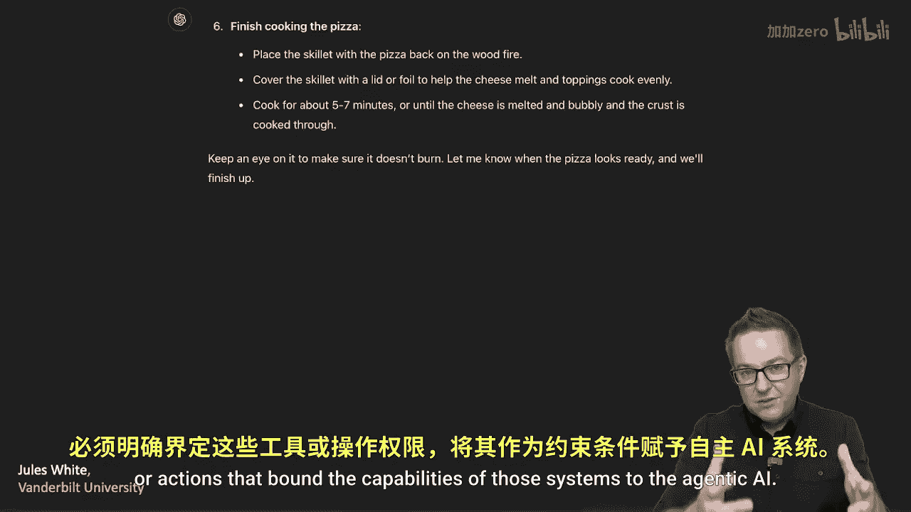
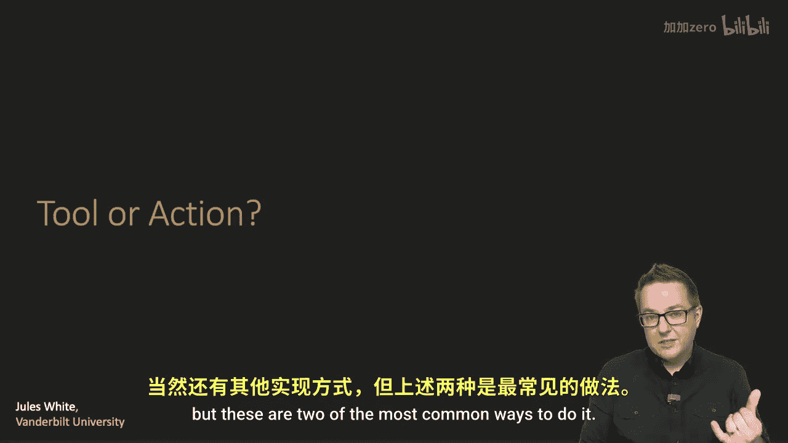

# 范德堡大学【中英⚡生成式AI战略领导者 专项课程｜Generative AI Strategic Leader Specialization】 p56 P56 07_为智能体配备工具 -BV1b6YyzzEP9_p56-

So how do these agent systems go and interact with the world？Well。

 we typically have them interact with the world through tools or actions that they can take through those tools and so what we're going to talk about now is this concept of a tool or an action that an agent can go and use to try to accomplish a task because most of the time we don't want it to just dream up whatever it wants to do in order to accomplish the task for example。

 if it tells us that we're going to plan a trip and it tells us that well you need to go and plan a trip that involves flying and we don't want to fly。

 that doesn't make any sense so we want to tell it like what are the allowed methods of transportation or if we tell it that it can go and collect information from us about what's happening as we're trying to figure out that internet connection on our machine if we tell it it's allowed to use a screenshot as a way of collecting information。

That's when a method that it could do it if we don't want to take screenshots。

 we might say well your only tool is to ask me， your only action is to ask me what happened for me to report back and so we can think about giving them different tools to go accomplish tasks Now I'm going to go back to this cooking example。

And we're going to equip our agent AI with some tools， so here's what we're going to say。

These are the only tools available to you。Pan， you have a one quart saute pan， a skillet。

 a large cast iron skillet， a wood fire， and I say a fire burning using oak。

 you're going to help me cook whatever I need since you can't directly lift pots and pans or get food out。

 you will tell me the steps and I will perform them。We will go one step at a time。

 ask me for what I want to cook。So now what I'm doing is I'm giving it here are the tools that you have available at your disposal to cook this。

 it's not the universe of cooking you utensils and devices。

 you can't go and say well I want an insta pot and I want a microwave No， you've got a wood fire。

 a skillkeet and a pan， that's it and so now it has to figure out how does it solve the problem with the tools available to it。

So。These are the tools in the prompt and you very commonly see something like this done。

 more sophisticated ways， more programmatic ways。 often these tools are described using languages that are more you know innate to computers。

 but this is basically a rough approximation of this。

 and what we'll see is it can clue in on this and do it。 This is where we're telling it。

 these are the tools available to you。 We could also said these are the actions available to you like put pan on fire。

 things like that。 So it's a different way of approaching it。

 but we're going to take a look with the tool approach。All right， so it says。

 what do you want to cook today？And I go back and I say， okay。

 I want to cook pizza on the wood fire with a skillet or a sauteian。

And it says， okay。It's a fantastic choice， gather your ingredients so I've got my first task to go and perform。

 so I go and grab all the ingredients and I say okay， I'm ready and it comes back and it says， okay。

 prepare the dough， so it tells me what to do to prepare the dough and again asking me when I'm done and I say。

 okay I'm done。

And then it comes back and says， okay， prepare the wood fire and tells me how to get the fire prepared。

 notice it's using a tool that I have access to that I've told that it can use。

And then it tells me how to put the cast iron skillet on it， tell me once the skillet's preheated。

 I say， okay， it's done。Comes back and it says， okay， now it's continue， cook the dough。

So carefully brush a thin layer of olive oil on the preheated skillet。And again。

 it's solving the problem with the tools I gave it。

 I've constrained its universe of options and actions and things it can do down to this set of tools that I need to accomplish the problem because what's common in the real world is we don't get to just do whatever we want。

 we have limited resources， limited tools or things that we have to solve the problem with and a AI has to be able to do the same thing it can't go and say okay you want to do X with a computer。

 therefore I will reach into the world's fastest supercomputer and do that no you don't have access to it。

 you don't get to do that。So we have to be able to put constraints on what tools it can use to solve the problem and that's how we're doing it here in the prompt。

And then I say， okay， I'm done with that step， comes back and it says okay。

 now add the toppings again， we're still using roughly the tools that we've got， keeps going。

 place the skillet on the wood fire， gives me some different information。

 it's roughly constrained to all the tools that I basically told it to use。

 and it's solving the problem。

So this is how we go about， begin to think about。Getting our agent to solve the problem。

 but not to just solve it arbitrarily， but to solve it in a way that is bounded in terms of like when we think about our computer systems。

 they have limited actions that they can perform。 they are constrained， they are rigid。

 and we have to start taking agent AI and we have to start putting bounds on how it interacts with those systems。

By giving it a concept of a tool or an action that could be performed with those systems and we have to bound those tools and actions to what those systems can actually perform。

 it can do all kinds of things， it can dream up all kinds of ways of solving the problem。

 it could go and tell a human all kinds of crazy ways of solving the problem and a human could go and probably perform many of many。

 many of those ways of solving the problem without being told explicitly to be bounded in some way。

 but the moment we began putting these agent AI systems in contact with something like our clusterler relationship management system。

 our CRM system or in control over our email or in control over whatever other system it is。

Those systems are going to be very limited in what they can do and the actions they can take。

 and so we're going to have to express those tools or actions that you know bound the capabilities of those systems to the agent AI Now do we call this a tool or an action？

There's no hard and fast rule to this， I would say many times action is the better way to think about it。

 like that I'm going to go and say these are the explicit actions that you can take。

Particularly when we start talking about interfacing with the computer systems。

 like computer systems that often make sense to talk in terms of actions because there's such finite number of things that you can ask the system to do。

 and so it's easier to spell it out as a series of actions。

If you're talking about interfacing with something as open endeded as a human being。

 thinking about expressing it in terms of tools often makes more sense because human beings can perform many different actions with a tool。

And they can flexibly adapt and so if the agent AI says go and perform this action with this tool。

 a human will know how to do that or if it says use this tool to do this。

 a human can go and fill in the blanks but when we're interfacing with our rigid computer systems。

 they can't do that and so often we have to describe each individual action or operation or instruction。

 think about like CPUs and now they have a limited number of instructions they can perform and we have to start thinking about define it more explicitly in terms of actions so which one do you use。

 it depends on the context depends on what you're trying to do but you can sort of think about expressing it both ways and there's also other ways that you could do it as well but these are two of the most common ways to do it。

