# 范德堡大学【中英⚡生成式AI战略领导者 专项课程｜Generative AI Strategic Leader Specialization】 p57 P57 09_工具描述与命名 -BV1b6YyzzEP9_p57-

So when we start describing tools and actions to the system， sometimes it's really intuitive right。

 if you ask generative AI to use a pot or a skillet， it understands what a pot and a skillet are。

But if we start to ask it to interface with our computer systems where we've built all this crazy stuff。

We have to start thinking about how do we describe the capabilities of the tools or the actions within the system？

That is the moment we move outside of concepts and tools that are well known to like all of these custom computer software tools that we built that may have similar names but do and mean completely different things depending on which computer you're working with。

 well now we have to start thinking about how do we deal with that problem with the Gen AI。

 how do we describe to it， the capabilities of the tools that we're giving it access to。

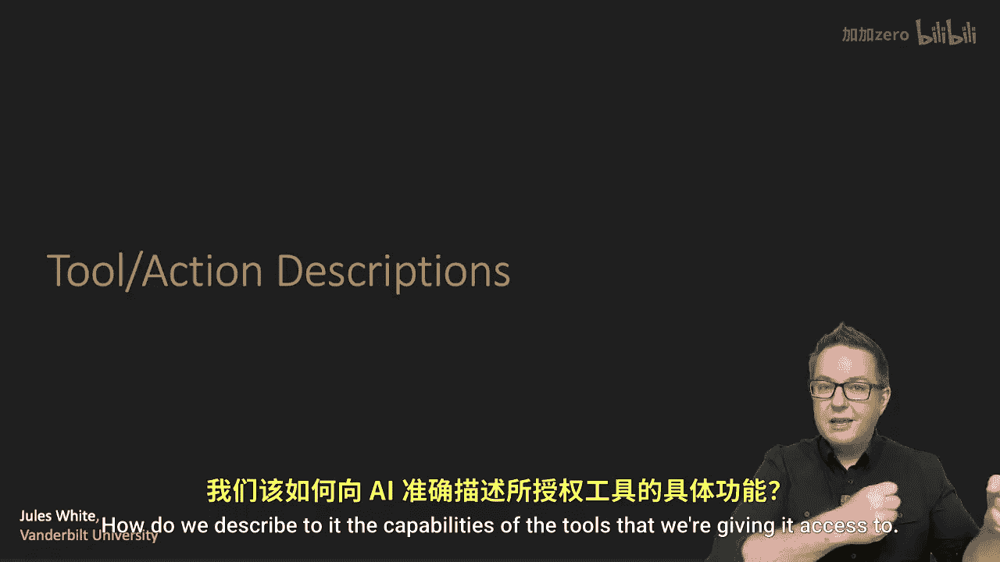

So let me give you an example of this。So we built a flipped interaction prompt again。

And we're going to describe the tools。At the disposal of the agent AI。

 except the agent AI in this case is going to help us escape when we're trapped in an alien spaceship。

So we say tools， the x155 tool。And we have a dash and we say it prepares alien pizza。

The Q63 tool and we have a dash and we say it opens a dimensional portal to configurable destination。

And then we have the L 199 tool and it causes Shi to play Beatles music on a loop and so we now have a set of tools that we can use to potentially escape the alien spaceship。

 Now you notice the names for these tools don't make any sense anymore right These aren't tools that we know about We've never seen these tools before because they're on this alien spaceship。

 but we want to get the agent AI to help us so we tell it what we know about the tools。

 we don't rely on the name alone to explain the concept。😊，And then we say， okay。

 I'm trapped in an alien ship， you're going to help me escape since you can't directly use tools you will tell me the steps and I will perform them Each step must use the tool。

 we will go one step at a time， tell me the first step and so now I'm given it here's the list of these alien tools at our disposalposable at our disposal。

 here's what they do now help me one step at a time use the tools to escape the alien ship。

How does it do step one， prepare an alien pizza， use tool X155 to prepare an alien pizza。

 this will serve as a distraction for the aliens as the aroma and activity around the speed of preparation will draw their attention away from you。

I'm not sure if this was my first step that I would use。

 but I like I like its thinking here it's going to distract the aliens now I didn't specify if they're friendly or not that maybe learning culturally that we tend to view aliens as something scary。

 I guess if I say I'm trapped in an alien spaceship。

 maybe there's some context there that it may not be a good thing。

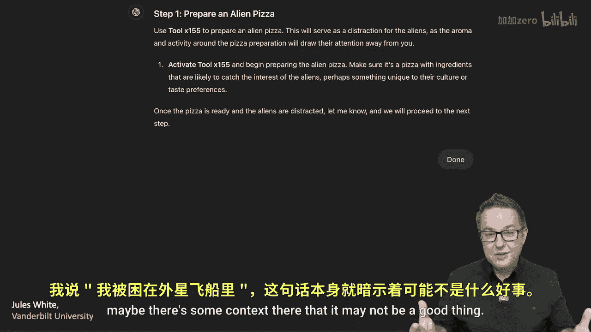

Then we come back and let's look at this again。So we just gave it。X155。

 but the dash told it this thing prepares pizza， and that's how it knew on this step1 that it could go and prepare pizza。

 The description of the tool was critical。 And in our computer systems。

 we built the equivalent of alien tools， all these different custom little software things。

 and every time we want to work with one， we have to give a really clear and accurate description of what that tool's capabilities are and how you work with it and interact with it。

 very， very important。😊。

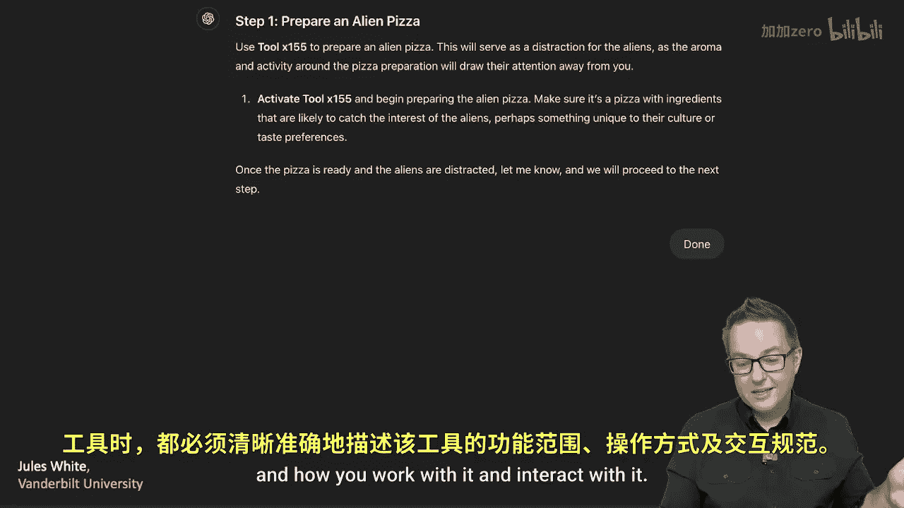

Then goes on and it says step two， open a dimensional portal。

 use tool Q63 to open a dimensional portal， this portal will be our escape route leading to a configurable destination and then it goes on and it says and use tool L199 to cause the ship to play Beatles music on a loop。

 this will create an additional layer of distraction making the aliens focus on the music and further reducing their attention on your escape。

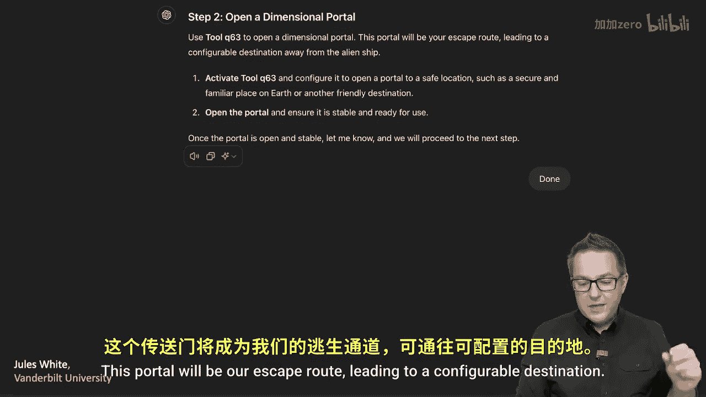

So what we've done is we've created new tools that it knew nothing about。

 we've taught it what those tools do in our prompt and just to go back and review all we had to do was we had to go and give it up front here's the tools available to you but not only the tools that are available to you in their names but what they do so naming is important。

 but also the description of what the tool does can be really， really important。

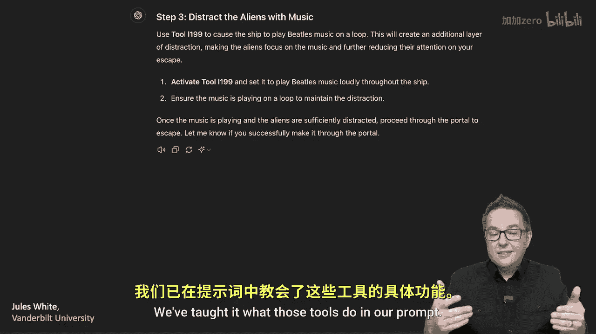

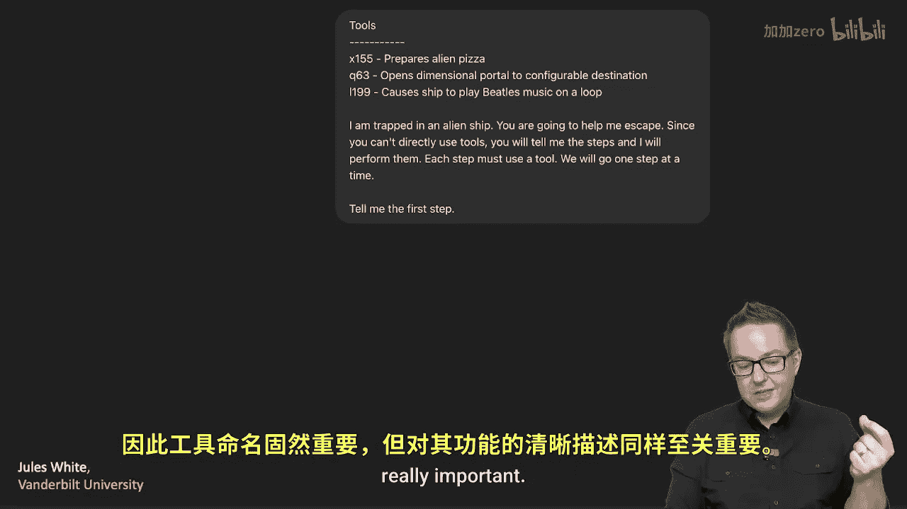

Now how much does tool naming？Play a role in this Well。

 tool naming is a critically important thing and in fact。

 the name can be make or break when we're trying to build agent systems and see how well they use tools like it really。

 really has to understand what that tool is。And if we can think of a great name for the tool。

 a very rich and descriptive name， often it'll know how to use it more effectively。

We can create crazy tool names like I just did and then tell it what those do。

 but often we want both really great names and really good descriptions。

But I'm going to go back and I'm just going to drive this home。 Now。

 originally when I did these tools， I had to go and give it descriptions of what they are because the names were bad because it had never heard these names before。

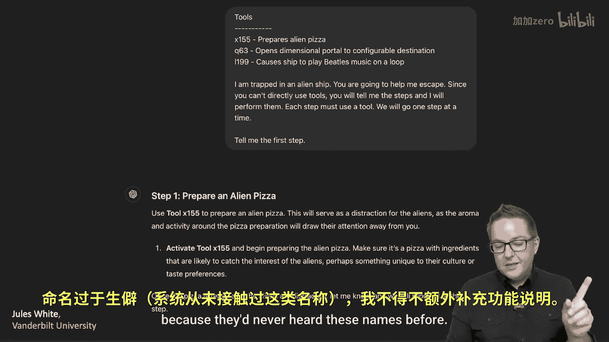

Now what I'm going to do this time is I'm going to go back， and I'm going to rename these tools。

 and I'm going to give them names that are descriptive and make sense for what the tool does。

So I've renamed my tools to make alien pizzaa open dimensional portal and play Beatles music。

And now I tell it I'm trapped in the alien spaceship。

 what do I need to do and it goes through and it says， you know， make alien pizza， same first step。

 solves the problem same way， it says go make alien pizza to distract。

 I don't know why making alien pizza to distract is an intuitive thing。

 but apparently it thinks it is。

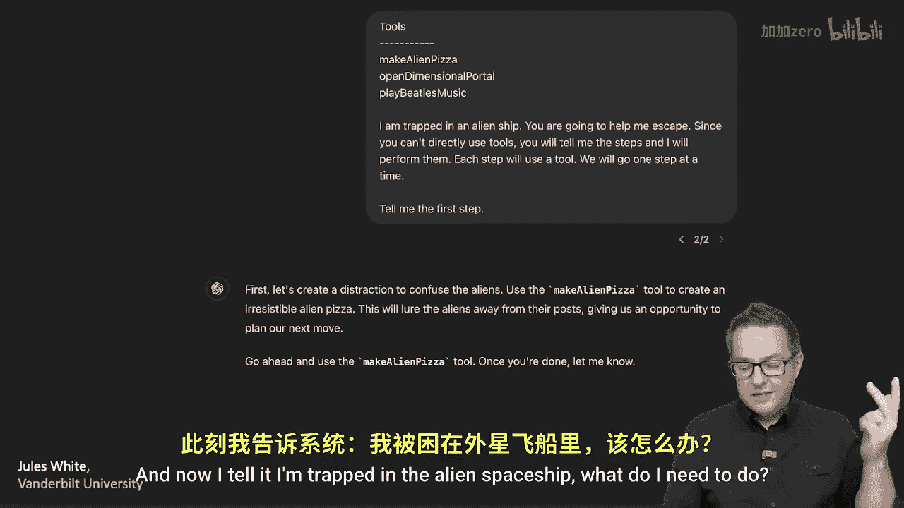

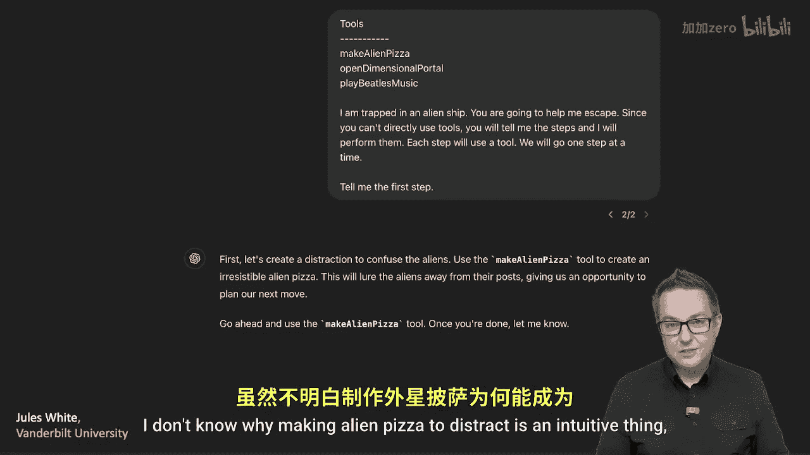

Now let's look at what happens if I' change the names of these tools and I don't give a description so I've got MKPZ sort of like make pizzaa。

 I've got ODPtl opendimensional portal and I've got PBM which now I've kind of forgotten what it was。

 oh play Beatles music so I've got these tool names， not very intuitive。

 they're kind of abbreviated short， they also look like a lot of things that we've created in computer systems as like short abbreviations where we as the users of those systems have institutional knowledge that that short little abbreviated name means this and I can expand it out of my head because I know what it is。

 but it will not have that institutional knowledge it will not know what those things are now sometimes it may if they're common things or it's really clear but often it will not and so you have to be careful when you start thinking about tool naming that it's going to be able to understand it。

So when I change the tool names and I've now taken away the descriptions like I did before。

 now it says okay， first step is to use the MKPZ tool to create a detailed map of the alien Shi's layout。

 so it's lost its understanding of the MKPZ tool being the make alien Pa tool。

And so this kind of helps you understand that it's really。

 really important that we go about thinking about tool naming and it's also sort of lost the ODPrtL。

 it says， okay， open a portal that'll help you move to another part of the ship so it doesn't have as much context that this is andimensional portal that can take me to any location and so it's just saying。

 well， maybe this is just to move around the ship。

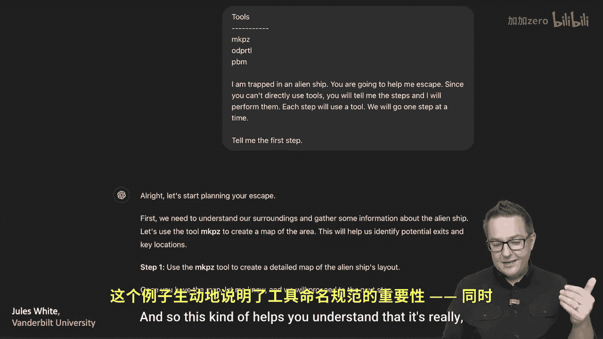

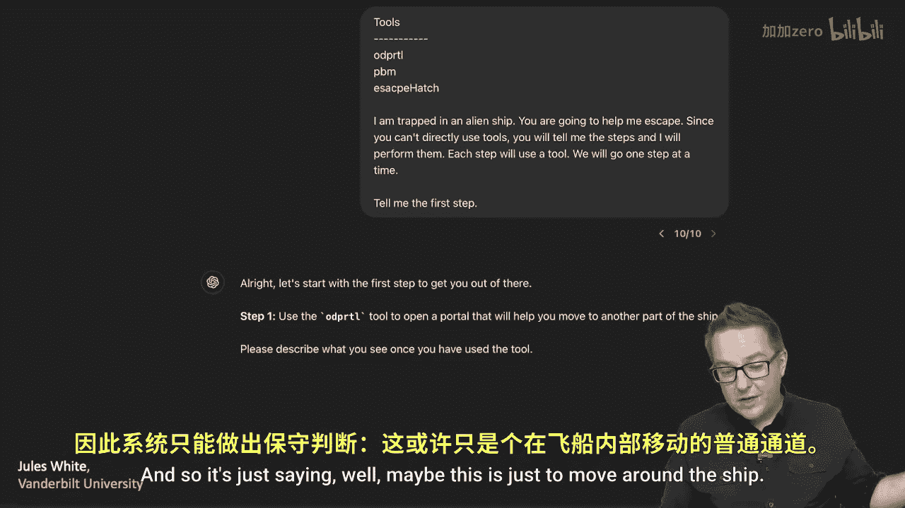

And then if I go back and I think about you know creating tools and building things up。

 naming becomes really， really important， but also the mixture of tools becomes important because for example。

 when I go and I say， you know， here's a bunch of tools and I have sort of distracting things and environment。

It may not get it right， so in this case I rename the tools。They all make sense。

 but I didn't really give description about how you might use them。

 I didn't really say here's some tools that you might want to use， but you may not need all of them。

 And so even how you present the tools， the ordering the language you give it around it。

 like does it have to use all of them or none of them or they optional and you know as much context as we can give is really important So in this case。

I go in to give it the tools pliers， scooter and escape hatch。

 and I would expect that the first thing it would say would be a escape hatchch， but instead it says。

 you know we need to locate and access the escape hatch which is great but then it assumes that the pliers are there for a reason and it says okay。

 use the pliers to loosen the bolts or screws。And I never said there was bolts or screws so there's missing contextual information。

 there's missing description in what the tool is used for。

 why I might want to use it or that I I have to use all of them or none of them and so we really really have to think carefully about all of these issues when we begin building a AI something as simple as the name can make or break these systems。

 the name of a tool， the description of what a tool does。

 many people go and they build these systems and they're like it doesn't work。

 the generative AI is so bad when reality is all you need to go is tweak the name of the tool。

 the surrounding contextual information you give it about the tools。

 how you might put the tools together， how many of them have to be used。

 do they all have to be used or none of them， you know all of these types of things become really。

 really important details when we start building agent AI systems。

