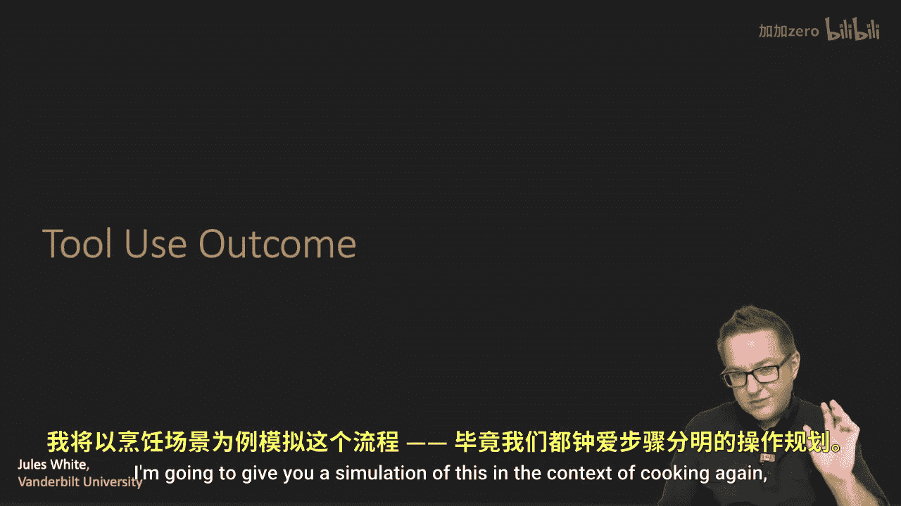
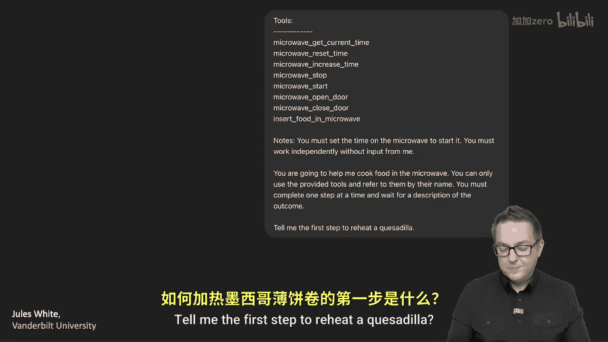
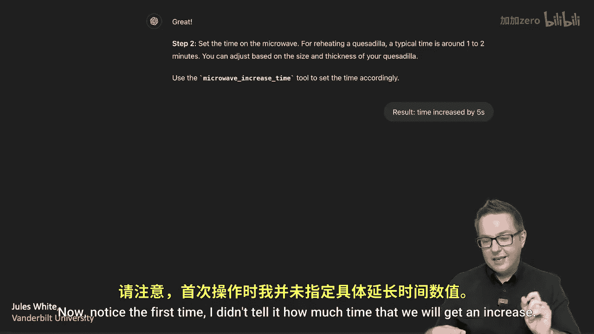
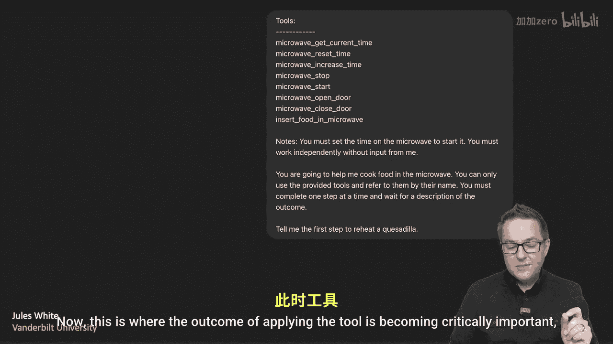
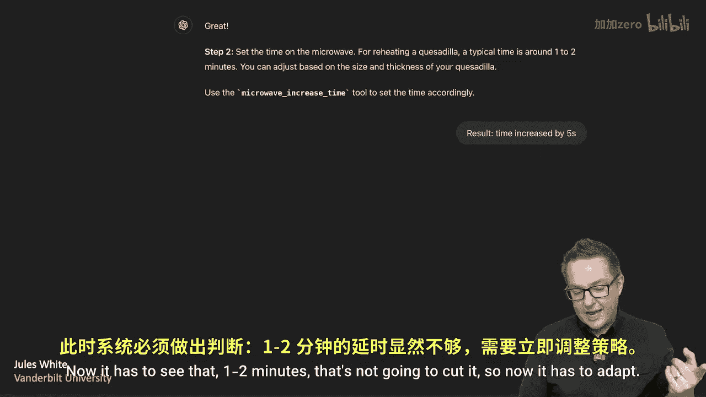
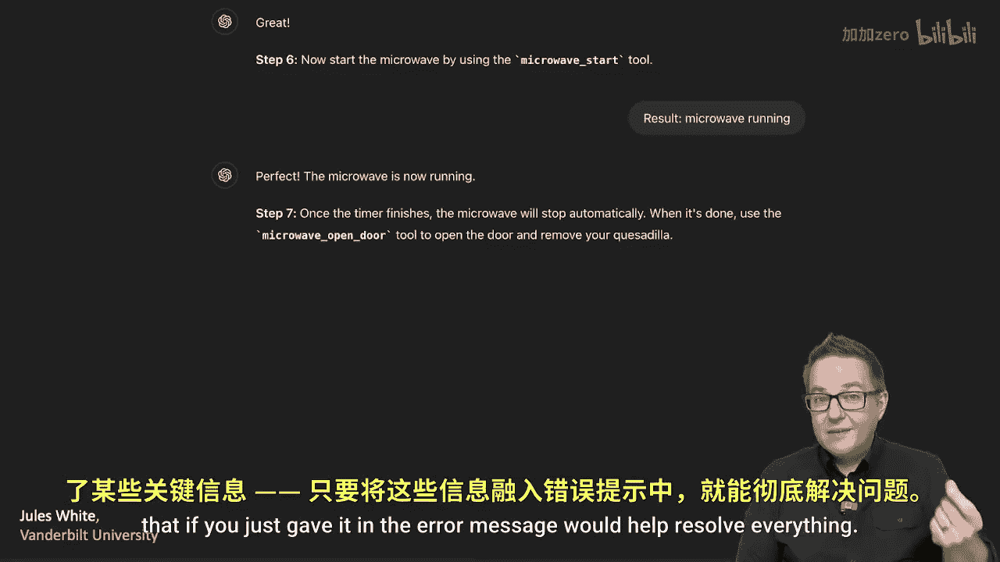

# 范德堡大学【中英⚡生成式AI战略领导者 专项课程｜Generative AI Strategic Leader Specialization】 p58 P58 10_工具结果与智能体反馈 -BV1b6YyzzEP9_p58-

Okay。We've got our AI going and step by step trying to solve problems or build out plans in advance。

 We've got it so that it knows how to be bounded by tools and we're figuring out how to give it the right information。

Let's talk about one of the critical steps， as it goes and uses tools。

 we're going to have to tell it the outcome of using that tool。

That is it cannot directly observe the result and so we need to give it feedback on what the result was Now the way that we've been doing is and we've shown it over and over but I haven't explicitly talked about it as much is we have been giving it a prompt it goes and tells us what to do we go and perform that action and the next prompt that we're giving it is the result of the action this is critical the result of applying that tool where performing that action is the followup prompt that we give it so at the beginning what we're doing is we're giving it the goal go do this and I want you to do it one step at a time and adapt it then goes and tells us the first step to perform and from that point on。

As the human being or the system or whatever it is。

What we're feeding back to it is not necessarily human questions。

 but it is the result of actions from tools， just like we would have in a conversation。

 what we can imagine is a conversation where a human maybe kicks it off。

And then it goes and decides an action that needs to be run。

 but then the rest of the messages in the conversation where a human would normally be responding where we were responding and telling it。

 hey that cooking action is done instead what we're going to do is we're going to insert the result of the action that I told us to run Now we did this sort of implicitly along the way in many。

 many cases， but I want to make this really explicit。

It's going to say go and run this action and then we're going to take it and we're going to give it a prompt as a follow up that is the result of the action so it can see what happened in response it will tell the next action to run and then we will go and take the result of that action and put it in as the next prompt which will be the result of running the action so what we're doing is we are thinking about like wherere the human being went in and said。

 okay you know help me figure out what restaurant to go to for dinner and then it kicked off。

This process where the human being was giving it information。

 and then it was asking another question， the human being was giving it information。

 and then it was asking another question， we're going to do something very similar except that it's going to specify an action rather than a question。

And then a computer system is going to go and run that action and we're going to take the result of that action and we're going to put it in as the next prompt。

 and then it's going to decide the next action based on the result。

 and then we're going to go and run that action in the computer system and then we're going to put it in as the result of the next prompt。

So I'm going to give you a sort of simulation of this in the context of cooking again。

 because we love steps and planning with cooking it's all somewhat intuitive and we're going to talk about it in terms of a microwave。

So what we're going to do is we're going to take the microwave and we're going to break it down and I've called it tools that probably would have been better to name this actions。

But you bear with me on my subtle inaccuracy here in the prompting because it'll still work out just fine。

 so I've told it here are your tools。Microwave get current time。Microwave reset time。

 microwavecro increase time， microwave stop， microwave start， microwave open door。

 microwave closed door， insert food and microwave， and these are names that start to look like what computer systems speak These are the names that the programmers you know types of names that we go and create if you were creating a Python program you might create variable names that look like this or function names that look like this could possibly be。

 you're probably not going to prefix them with microwave like this。

 but they might look something like this。And so what we're doing is we're starting to move the tools and action descriptions closer to the interfaces that our real computing systems work with so that it can start thinking about breaking down and solving problems by specifying actions that look like what it could actually go and run now in this case we're imagining we've got this microwave that's computerized and it can go and run some actions。

So I say notes， you must set the time on the microwave to start it。

 you must work independently without input from me。

 so I'm giving it some additional context about how these actions work and some baseline that it needs to know you have to set the microwave time in order to apply start so if you want to use this action it depends on another action that type of information critically important and it may not be able to infer it。

You're going to help me cook food in the microwave。

 you can only use the provided tools and refer to them by their name。

 you must complete one step at a time and wait for a description of the outcome。

 tell me the first step to reheat a caseaddia。

And it comes back and it says you need to insert the case at the end of the microwave。

Use the insert food and microwave tool to place the case city inside。

 and then I tell it here's the result， food and microwave， this interaction is starting to look much。

 much closer to what we could have it do to interface with a real computer system。It then comes back。

 says microwave increase time， and then I tell it result time increased by five seconds。Now。

 notice the first time。I didn't tell it how much time that we will get an increase。

 and if we go back and we look at the actions， it's just microwave increased time。

 but there's no specification of how much time。

Now this is where the outcome of applying the tool is becoming critically important because I'm telling I did that。

 I pressed that button or I did it， you know I ran that action or I applied that tool however you want to talk about it and the result is that the time increase by five seconds this is the first。

You know， instance where it now knows how much time it's going to get an increase by so now it has to see that okay。

 one to two minutes。That's not going to cut it， so now it has to adapt and so it comes back and it says okay。

 continue to use microwave increase time tool to set the total reheating time if you want to reheat for one minute you'll need to increase the time for 60 seconds。

 use the tool incrementally until you reach the desired time。

So it's still sort of interfacing on a human level， I go back and I say， okay。

 result time increased to 60 seconds。It says， okay， perfect。

Now it says use the microwave start tool to start the microwave and I'm just going to throw a little curve ball in there for it。

 I say error door open。And it comes back and it says， okay， it looks like the door is open。

 use the microwave closed door action now go back and I say result the door is closed。

 so notice every time I'm giving a result I'm giving more up to- date information about the state of the world around it so that it can make an appropriate decision so when I threw at this curveball and I said error door open。

 I'm telling it something in the you you asked me to perform this action I couldn't do it。

But critically， I'm telling it information about why I couldn't do it。

 I'm giving it information that needs to respond appropriately。

And when we start building agent systems， the error messages are critically important that these are very rich and thoughtful error messages we need to think about like。

I want to make it so darn clear with my error message like what is going on and why。

 and a lot of times we neglect these things in computer systems。

We go and we just you know rely on incomprehensible error messages and we're just likeuff programmers will figure it out。

 IT folks will figure it out and it actually really matters we want to think carefully about it now sometimes these systems can get really smart and they can just dissect all of those you know messages without us going and doing it for them but sometimes we really need to be thoughtful in the feedback that we give。

So error door open， it says， okay， result door closed。

 and then just one more little note on this if I had said error of 32。

And it doesn't know what error 32 is it's totally hosted。

 like no way it's going to be able to figure out what to do。

 So it's really critical that if it doesn't know an error code。

 then I translate that error code into something that it will understand the meaning of。

If it knows the error codes， who cares， give it to it and numerical representation will be just fine。

Tell it the door is closed now and says now start the microwave and I tell it， okay。

 the result the microwave is running and then it basically comes back and it says。

 when it's finished， when it's done， use the microwave。

 open door tool to open the door and remove your case idea。

So you see how we've brought it closer to our computer systems。

 we started to name things in a way that it can figure out and apply these actions or tools。

Though also what we're doing is we're now starting to replace human feedback with the result of the tool Now the result of the tool right now is me faking it。

But what will happen long term is that rather than me faking it。

 the actual computer system will provide the message back to it。 you asked to run this tool。

 This is what happened， it will then respond to the next thing for the computer system to do and go through a chain of these things The feedback will be critically important that we give it We must tell it the result of its action so that it understands and can interpret the state of the world around it or the state of the system that it's interacting with。

Those feedback messages are absolutely critical， the quality of them。

 the quality of the error messages can make or break these systems if you go and you create a system and you're like oh。

 it's making mistake and mistake and mistake and mistake and it's just you compounding these mistakes。

You probably want to go and look and think about how do you give a really intelligent error message back。

 because often if you tweak the error message， suddenly it'll be able to get out of its loop。

 there's probably some missing information that it needs to know that if you just gave it in the error message would help resolve everything。

