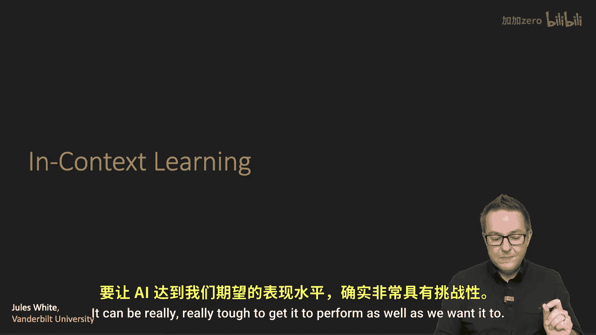
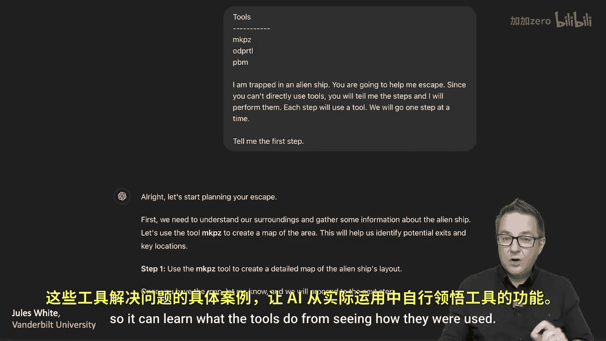
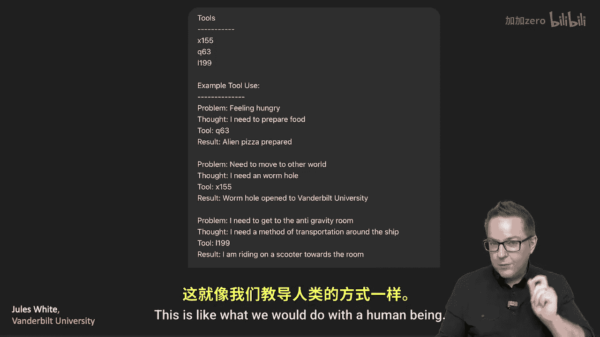
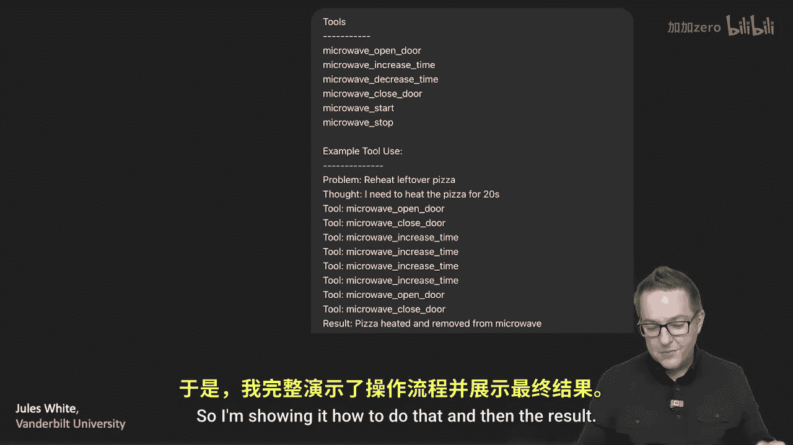
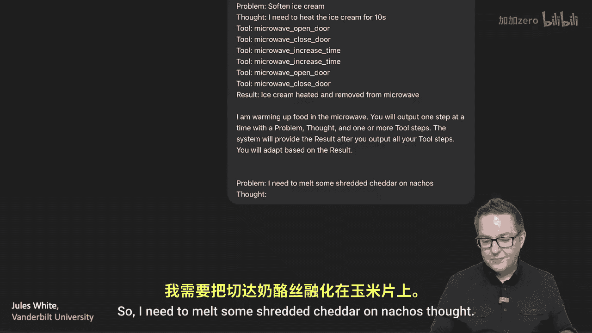
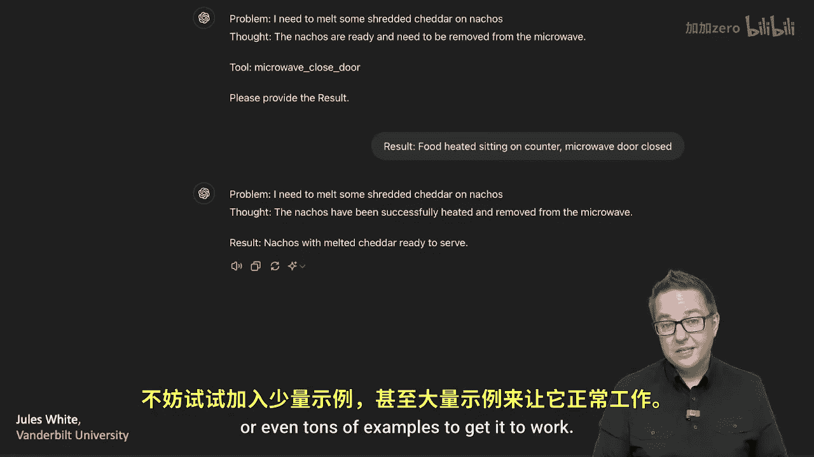

# 范德堡大学【中英⚡生成式AI战略领导者 专项课程｜Generative AI Strategic Leader Specialization】 p59 P59 11_情境学习与智能体 -BV1b6YyzzEP9_p59-

I want to take you back to that intern analogy again。

And I want to think about the different ways that we teach someone to perform a task or we instruct them to perform a task and one of the ways we do it is with explicit instructions and we've been doing that over and over。

 we're telling the agent AI， here's what you're going to go and do you're going to do it step by step。

 but one of the ways that we teach， for example， interns in the real world is we go and show them examples of the problem being solved correctly。

 so if we want them to write a report， we say here's the report。

 heres my thought process and how I put together this report， here's the final result。

 or we want them to go in diagnose an issue in software， if they're a developer。

 we say here was the feature I was trying to implement。

 here's how I walked through debugging it or building it or designing it。

 whatever that thought process was， here's the result。

And it turns out we can do the same thing with generative AI through in contextex learning。

 basically what this is is where we do the exact thing that we do with an intern where we teach through examples。

 but we can do it with generative AI and in context learning is incredibly powerful。And for many。

 many agent AI systems， it is difficult to get it to perform well without examples。

 without relying on in contextex learning， it can be really really tough to get it to perform as well as we want it to So I'm going to give you an example of this and the power of this。

So I want to take you back to that alien spaceship escape example I had so I had all these tools that had lost contact because I had changed the names and I had removed the descriptions and now I doesn't know how to problem solve with them because it doesn't know what they do now I could go and explicitly say this is what the tool does but I'm going to do something different。

Instead of telling it what the tool does。I'm going to show it examples of using the tools to solve problems so it can learn what the tools do from seeing how they were used。

So。Here are my tools， now I've changed the ordering and the naming slightly， so bear with me。X155。

 Q63， L199， totally incomprehensible names， no descriptions。

Now what I'm doing is I'm going to tap into in context learning， I'm using few shot examples。

 basically， I'm giving it examples of solving a problem。So I say example tool use。Problem， colon。

 feeling hungry。Thought colon， I need to prepare food。 tool Col， Q 6，3 result， alien pizza prepared。

 Now， you as a human being， can look at this and you can say， okay， the Q6。

3 tool has something to do with cooking pizza。Or cooking or making pigs materialize out of thin air。

Next example， problem need to move to other world。 Though I need a wormhole tool X155 result wormhole open to Vanderbilt University。

 and then I go on the next one problem。 I need to get to the antigraity room。

 Thought I need a method of transportation around the ship。 To L19，9 Re。

 I'm riding on a scooter towards the room。And so I haven't explicitly told it what the tools do。

 but I've told it if I have this problem， this is my thought process behind solving it。

Here's the tool I'm going to use and then I'm showing it the result of that tools's application。

And so I'm teaching it。How to solve problems and to think about solving problems。

And I'm showing it in that context how the tools are actually doing things。

 but I'm not telling it this tool does this。Very different。

 This is like what we would do with a human being。

So what do we get？Problem。I need to get off the ship to Earth， exclamation point。

Thought colon Now one of the things that in context learning does is it establishes a pattern that the large language model wants to follow。

And so if I show it an incomplete part of a pattern， it wants to finish the pattern。

 so these models were taught to you roughly predict the next word in a sentence。

At a very high level we can think about it that way， so if I show it an incomplete sentence。

 it wants to complete it。If I show it a partial pattern of solving a problem。

 it wants to finish solving the problem with one of the tools。

 and it wants to solve it in a way that is similar to what was done before。

 because it wants to stick its reasoning into that pattern， its output should fall into that pattern。

So when I pick up in the middle of the pattern and I say， problem。

 I need to get off the ship to Earth and just leave it with thought。

It now says problem， I need to get off the ship to Earth。

 thought I need a way to locate the nearest escape pod， tool X155， result。

 worm hole open to Vanderbilt University， so now I can escape the ship。

And if I then introduce new things， it's interesting because remember I didn't。Tell it， you know。

 I told it tools that were available to it， and I told it pattern on how to solve。

 And now what happens when I， for example， give it a new tool at its disposal。

 So I say result Warhole open to Vanderbilt University， new tool added inner wormhole。Now it says。

 problem， I need to get back to Earth from Vanderbilt University。

 which is kind of funny because now it thinks that Vanderbilt is not on earth。

 thought I need to use the wormhole tool to travel back to Earth， tool inner wormhole。And so。

It may not be completely accurate in his description of Vanderbilt University not being unearth。

 but it is recognizing now that this new tool that was introduced it can used to escape by going into the wormhole。

 but the more important thing is it followed the pattern。

It again restated what the current problem is， it explained its thought behind it and then explained the tool that it was going to use so it picked up on the pattern。

In many cases， this is going to be really important when we think about interfacing with our real computer systems。

Where the problem solving process， the steps that we use to solve the problem must follow well-defined patterns because these systems can't deal with arbitrary patterns。

 they can't deal with arbitrary language， so using in context learning helps us not only to teach it about things like the tools。

 but it also helps us to teach it patterns of the steps that we follow patterns behind the reasoning。

 like the thinking， and that's when we say thought， think step by step。

 all these things like that around we're showing it thought processes。

 decomposition of the problem and thoughts， you know based on the thought。

 what tool to use these types of things。We often are also teaching it not only how to problem solve。

 but how to problem solve in a pattern or sequence that will work with the systems that we need it to work with。

 very， very powerful concept， very， very important tool to use if you're working with an agent AI system and you're having trouble with the prompts behind it and you want to figure out。

What do I do to get it more constrained， more sort of like unified and predictable in its behavior？

Start by looking at in context learning and giving it examples of what you want it to do and often that can help but constrain it and if you think about it。

 if you went to an intern and you tried to explain to an intern how to write like Tolstoy。

 that's going to be a very long list of rules， but you could probably get that intern up to speed much faster by simply showing them a few pages of Tolstoy's work。

And so many problems，'re going to be easier to describe it in examples than it is going to be to describe it in rules or instructions that may not cover every edge case and may not be perfectly crisp and understandable。

Let's look at another example of this， I'm going to go back to the microwave example。

And in this case， what I want it to do is I wanted to learn the concept of time that I want it to infer that increased time is going to be by five seconds。

 and therefore it needs to use that microwave increased time tool over and over in order to get the time to what it wants。

Now before it told me， hey， just go and increase the time until you get to 60 seconds。

So I show it the tools again， similar tools to last time with the microwave now I show an example tool usage and I say problem reheat leftover pizza。

 thought I need to heat the pizza for 20 seconds and then I show it applying first I say open microwave door。

 closed door and then I show it increasing the time four times which is four times five is 20 seconds。

 so I'm showing it how to do that and then the result。

And then I do another one， I'm going to soften ice cream， and this one is going to be 10 seconds。

 so it's two applications。Now I say I'm warming up food in the microwave。

 you will output one step at a time with a problem thought and one or more toolstep。

 this system will provide the result after you output all of your toolstep。

I need to melt some shredded cheddar on nacho， so I've put in that problem thought tool format again。

 but this time I'm expecting multiple tool outputs。

So I need to melt some shredded cheddar on nacho's thought and it comes back and it saysto microwave open door。

 tool microwave closed doors's picking up on the pattern that okay I need to open the door。

 put the food in， close the door and then it says 30 seconds and it translates that into six microwave increased time tool calls so now what we've moved is even closer to being able to interface with a real computing system does that set of tool calls and then says please provide the result。

 I say heated food food heated sitting in microwave now it problem solves a little bit open door I tell it result food heated sitting in microwave door open it queries again and it says okay now you've it's gone and gotten the food out so close the door。

So I've now got the nachos ready to serve。So。In context learning is critically important many times for agent AI。

 particularly we want it to interact with。Computer systems that are brittle， fragile。

 very you know you know they have very limited formats。 they are not like a human being。

 they do not want to accept weird things that they have never seen before a human will gladly interpret and figure it out computer systems do not do this And when the moment that we' needed that rigid pattern we typically also often need in context learning to start showing it the patterns that are acceptable to those computer systems and start teaching it how to interact with them in structures that are acceptable。

 how to query a database， how to go and interact with you know an exchange server to send an email。

 how to do X， we go and we give it examples of sort of fake examples of using that thing correctly in order to solve the problem or we get blog some way。

 we capture real traces of solving that problem in that language and we show it to it and say this is how you do it。

Critically important use in context learning when you're going and trying to build these agents up and you're trying to think well how do I get it to work。

 why is it not working， it keeps failing， it keeps trying to interact with the computer system and computer keeps like having a absolute fit over what's being sent。

 think about going and adding few shot examples or even tons of examples to get it to work。

