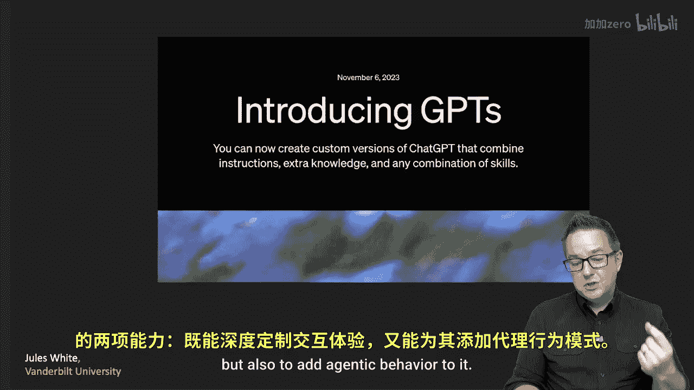
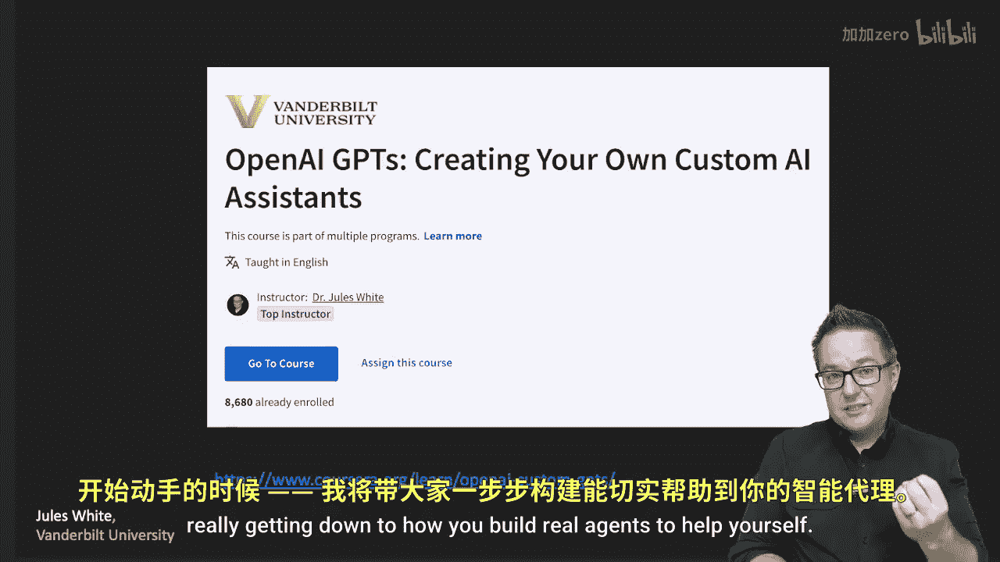

# 范德堡大学【中英⚡生成式AI战略领导者 专项课程｜Generative AI Strategic Leader Specialization】 p60 P60 01_OpenAI GPTs 是面向所有人的智能AI代理平台 -BV1b6YyzzEP9_p60-

Aenttic AI is one of the most exciting things that I've worked with in my career as a computer scientists I mean。

 generative AI was transformative and a AI really takes it to the next level and normally at this point you go into a course and what you hear is basically now go be a programmer and you can take advantage of a AI but the truth is you don't have to do that anybody can go and build incredible agent AI or agents they can do amazing things for them and that's what I'm going to show you next Now the pathway to get there is going to be through something that you may heard about that maybe you haven't paid a lot of attention to and that is a GP a custom GPT Now what is a custom GPT Well that's what you're gonna to learn about in the section。

And what you want to think of is a GT is an agent it is basically a version of chatGBT that is customized so it has agent capabilities and so what we're going to do is we're going to go and build you can think of it as a version of chatGBT we're going to essentially program a version of chatGBT。

 but we're going to program it in natural language to tell it what to do to describe all the tools that it can use and then we're going to connect those tools to real systems we're going to do some amazing things that then you can take and do just awesome automations for your work。

 for your life， for your business， whatever it is， but the core of it is going to be agent AI now。

I struggled in this course not to just jump directly into having you build something。

 but I think it's really important to understand the concepts as you go because what you'll see is that sometimes these systems just don't work right and if you understand the fundamental concepts。

 you will be so much more powerful so I'm going to take you through some of the stated art concepts in a AI but now I'm going explore the rest of the course in the context of GPTs basically these are open AI's ability to go and customize the chat GT experience but also in to add a behavior to it。

Now I feel a little bit sad as a programmer telling you this because the programming has always been my domain right I've always been able to build my self these types of things and people who are not programmers did not get to do that and now I'm going to let you in on the world that programmers have know roughly locked you out of Now we've had these nocode lowcode。

 all these other tools to try to make it easier but nothing has ever compared to having Gs knowledge of a AI and then putting them together with something amazing that we're going to see in a minute which is Zapo and the ability to go and have it actually perform real automations that will help you and support you and do it intuitively with natural language is a game changer for most people even as a programmer it is a fundamental game changer for me personally and now I'm going to walk you through how do we go and build GTs and we'll talk about how a AI is manifested in GTs。

AndThen how the principles we're learning apply and then we'll go and build some amazing things together。

 so stick with me， I know we've gone through a lot of theory。

 but this is where we're going to start really getting down to how you build real agents to help yourself。

