# 谷歌Jeff Dean最新演讲《机器学习领域令人激动的趋势｜Exciting Trends in Machine Learning》中英字幕 - P1 - GPT中英字幕课程资源 - BV1Tz421R7Rt

I'm going to talk to you about exciting trends of machine learning。

 It's going to be a very broad talk。 It's not going to go into detail in any particular area。

 but I think it's important to understand what is happening in this field and what is exciting and also what are the opportunities and also one of the things we should be sort of aware of as we build out this technology for everyone and I'm presenting the work of many。

 many people at Google so some of this is work I've been involved into the co-author。

 some of it is not it's just cool work I think you should learn about with that I'm going to now give you another glimpse at the slideout number2207201 and this is how you ask questions for this talk。

嗯。So with that， let's start with some observations。So in recent years。

 I think machine learning has really changed our expectations of what we think of computers as being able to do。

If you think back 10 or 15 years ago， you know， speech recognition kind of worked。

 but it wasn't you know really seamless， it you made lots of errors。

 computers didn't really understand images from the pixel level， what was in that image。

 language was kind of。There were a bunch of work in natural language processing。

 but it wasn't really a deep understanding of language concepts and multilingual data。

 But I think we've moved from that state to one where you actually expect computers to be able to sort of see and perceive the world around us in a much better way than they were able to。

10 years ago。 And that opens up all kinds of amazing opportunities in。😊，You know。

 pretty much every field of human endeavor because all of a sudden， you know。

 think about when animals evolved eyes， you know， we're sort of at that stage in computing。

 We now have computers that can see and sense。 And that's a completely different ball game。

And the other observation is increasing scale， larger scale use of compute compute resources。

 specialized computes I'll talk about， you know， larger and more interesting and richer data sets。

 larger scale machine learning models， scaling all of those things tends to deliver better results。

 And that's been true for the last 10 to 15 years and every time we scale things up。

 things get better。 All of a sudden new capabilities emerge or the accuracy of some problem reaches a threshold where before it was kind of unusable and now all of a sudden it becomes usable and that enables new kinds of things。

😊，And also the kinds of computations we want to run because of this new machine learning learning based paradigms is pretty different than traditional handwritten twistee C+ plus code that you know a lot of basic CPUs were designed to run effectively。

 and so we want different kinds of hardware in order to run these computations more efficiently。

 and we can actually， in some sense， focus on a narrower set of things we want computers to do and do them extremely well and extremely efficiently and then be able to have you know that increasing scale actually be even more possible。

😊，Okay。So I mentioned some of these things， but there's been a decade of amazing progress in what computers can do。

 So thinking about this， you have， you know going from the raw pixels of an image to， you know。

 maybe a categorical label of one of 10000 or 1000 different categories， you know。

 computers didn't used to be able to do that a decade ago。 And now they can A waveforms to。

 you know what was being said in that utterance of， you，5 seconds of audio。 That speech recognition。

 And we've made tremendous progress on that translation， hellello， how are you to Bjo Com dev。

 you know， being able to translate from one human language to another is an incredibly useful capability for computers to help us with。

😊，And we've even been able to go from， you know something like this's a niceification photo of a cheeto on top of a Jeeep。

 going from something like that to a description of that， not just a categorical label like leopard。

 but you a little short sentence that describes what is going on in that scene。

So that's pretty amazing。 Like weve made tremendous progress in this。 What's more amazing， though。

 is we've been able to reverse a lot of these arrows in the last few years。

 So going from a categorical label like leopard to you know the computer will generate you 50 or 100 different images of leopards or you know how cold is it outside to audio waveforms。

 that's just text to speech。 that's been around for a while， but it has improved a lot。

 The translation reversal is not that surprising， but is getting better and better。

 and then even going from a short description of an image you want。😊。

And getting an image or sometimes now even a short video clip of what you want or a short。

 you know an audio clip when you describe a sound in language。

 So these are capabilities that are now starting to emerge。

 and I think are pretty exciting about know what we can build with computers now as opposed to a decade ago。

嗯。So let's look at the level of improvement we've had in the last decade。

 So Stanford developed a benchmark called ImageNe， which many of you have heard of。

 which is basically going from you know you get some training data of this form like a bunch of color images and labels one of1000 labels And then you can train your system on about a million images like that。

 And then you're given a bunch of images you've never seen before and you have to predict you know what is the actual label for these new images that you've never seen before。

 And a lot of machine learning work is how do you generalize from observations you've made on data to new settings。

 new images you've never seen before。😊，And so。In 2011， the first year of the contest was run。

 the winning entry got 50。9% accuracy。And then the next time the contest was run in a very famous landmark paper。

 affectionately known as Alex Ne by Alex Kushchky， Elias Stzgar and Jeffrey Hinton。

 They made a giant leap forward in accuracy， you know，13% or so improvement in accuracy。

 which was just remarkable。 and they were the only one of about 28 entrants that year that used in neural network。

😊，嗯。But this was a major improvement。 And the next year。

Nearly all the entrance used in neural network， simply because this was such a revolutionary improvement and clearly a a really major approach to just learn from the actual raw data rather than trying to hand engineer features that are indicative of a leopard。

 That's a really you know， hard thing to do， What features would you hand design to decide this is a leopard as opposed to a giraffe or a car。

 But learning from data actually makes that possible。😊，So I think that's a pretty big improvement。

 but it's also。Easy to ignore the improvements happened since then。 Like。

 we've gone from 63% to now 91% accuracy on this task。

And so that is actually you know pretty amazing。 We know human accuracy on this task is actually a bit below that level because it's actually pretty hard。

 there's 100 categories， 40 different breeds of dogs。

 people don't actually know you know if they're staring in a photo of which breeder dog is that So that's pretty amazing。

 This was you know about a 10 year span。And it's revolutionized computer vision。

If you look at speech recognition。 So this is a popular open source benchmark for measuring speech recognition accuracy here。

 it's measuring word error rate。 You know， the percentage of words that are wrong。

 and you want lower numbers。 obviously， So we've gone from 13。25% down to2 and a half%。

 And this is a much shorter span。 This is only like five years。So， you know。

 basically kind of one word in you know，6 or7 is wrong to one word in 40 or so is wrong。

 and that that makes a huge difference in usability of these systems All of a sudden。

 you can rely on it。 you can start to dictate your emails and it mostly gets things right。

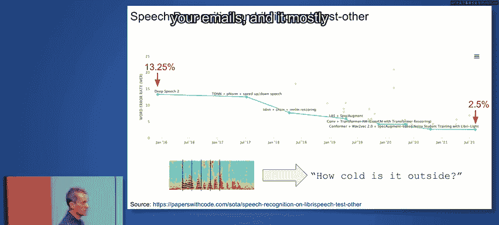

Pretty great。嗯。And so I mentioned that scaling things up actually improves the quality of these models。

 And so we actually want hardware that enables us to scale up more efficiently。 How can we， you know。

 for the same amount of dollars of compute hardware or the same amount of energy。

 get something that gives us an even higher quality model because it's more efficient。😊。

And so it's really thinking， transforming how we design computers。And their， you know。

 machine learning optimized hardware is much more efficient。

 And there's major improvements that have happened generation to generation。

 And this enables these larger scale models with lower economic and energy costs。

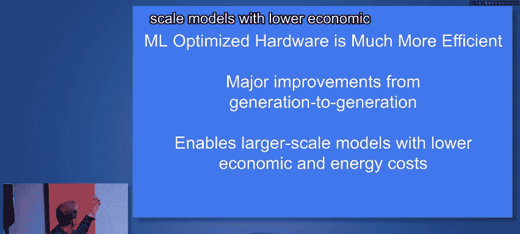

So there's two really nice properties of neural networks。

 the kind of machine learning models that everyone is using these days。

The first is reduced precision is okay。Like， if you carry out the computations in the machine learning model to one or two decimal digits of precision instead of 6。

You know， that's fine。 you know， a lot of times some of the optimization algorithms for these things actually introduce explicit noise in order to make the model learn better。

 and so you can think of reduced precision as just a way of， you know， in some sense。

 adding a bit of noise to the learning process and it actually sometimes works better。

And the other property is all the computations， all the algorithms you're hearing so much noise about。

 in some sense， are really just different transpositions of ways of assembling different linear algebra operations。

 So things like matrix multiplies， vector operations of various kinds。 So if you can make。

 and that's really what those algorithms are is repeated applications of lots of different linear algebra primitives。

😊，And so if you can make a computer that's really good。At reduced precision linear algebra。

That's what you want for learning these really high quality models at sort of reduced computational cost or energy cost。

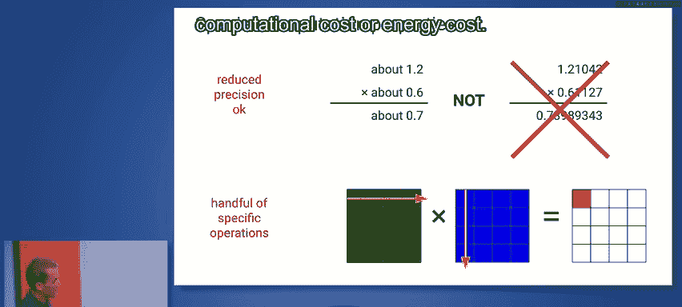

so we've been doing this for a while at Google。 we saw that there was a real need for in our systems to build a system。

 The initial version of what's called a tensor processing unit or TPU is really this architecture design for low precision linear algebra。

And the first one we built was for inference when you already have a trained machine learning model。

 but now you want to apply it in a product product setting。

 you now need to like apply all this compute in order to recognize what's in that image or to have someone utter something in an audio in their microphone and then be able to recognize what they're saying。

And so we built the first generation， which was really just a single card system that had one of these accelerators on a TPU V1。

 and that actually was about a 30 to 80X improvement over using a CPU at the time。

In terms of both energy efficiency and computational performance。Later generations of the TPU。

 we then focused on larger scale systems composed of multiple chips that were designed for both training and inference。

 and so this is the TPU V2 board before these chips。

 the TPUV3 board is sort of a close cousin of this one but we added water。

 so there's actually water going to the surface of the chips to help with cooling， the TPUV4 board。

 we added cool colors。啊。It is nice。 And those three later generations were designed to be assembled into larger systems that we call pods。

 And so the pods increased in scale over the generation。 So the first one， they have very。

 very simple but high bandwidth networks in the pods。

 So basically each chip in this first generation was connected to its four neighbors in a 2D mesh。

 So you have a 16 by 16 grid of chips， in some sense， in these in these res。😊。

And every chip is connected to its neighbor with basically a wire。

And so that means you don't have to do any routing in the network and so you can have very high speed bandwidth very low cost connections because you're only trying to go six inches to the next chip or something like that。

 The next generation you know what extended this to 1024 chips in eight racks and the next generation actually used 64 racks of 64 chips each it's actually multiple of these data center rows and gives you 1。

1 exaflops of lower precision floating point cavitation。With 4096 chips。

And then the more most recent generation， which we disclosed publicly last year at the end of last year is the V5 series。

 It has comes in two variants。 One is for sort of inference where you have a pod of 256 chips。

 And then the V 5 P has a lot more memory per chip much more bandwidth between chips。

 and much more memory much more bandwidth between chips and much more memory bandwidth。😊，And has。

 you know。Close to half a petafloop per chip of 16 B floating point performance。

 and double that for in performance。And so one of these pods is also bigger。

 So it's close to 9000 chips，4 x of flops of compute。Okay， so let's talk about language Now。

 We talked about image recognition and speech recognition advances。

 but language is actually one of the areas that I think people are seeing the most change in what computers can do。

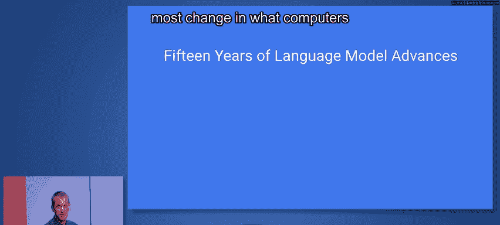

So。II've actually been excited about language models for a while， even before in neural networks。

 So I partnered with some people in our Google Translate team to。

 they basically had a really capable system that was。😊，Very high quality translations。

 but it was designed for a research contest where you only had to translate like 50 sentences in two weeks or something。

 And then you submit your entry。 And so it would do like a discce for you know。

200000 ngrams that it needed to look up for every sentence it would translate。 And so I said， oh。

 well， if you have really high quality translations。

 It'd be good to actually bring these into to real practice。

 And so we built a system that would serve an Ngram model。

 Basically it kept statistics of how often every five word sequence occurred in2 trillion tokens。

And that gives you about 300 billion unique5 Gs。 And then we just would store that in memory on a bunch of machines。

 Wed looked them up in parallel for the1 hundred0000 things you need to translate a sentence。

 And we came up with a an innovative new algorithm called Stup Backoff。

That kind of ignored the right mathematical thing to do and did something much simpler so that when you looked up a five gra and there was no data there。

 you would just look up the four gra that was its prefix， and use that if it was there。

 and if it wasn't there， you'd look up the three gra and so on and then actually work reasonably well compared to the fancier niceizer na smoothing。

 which is what you really want to do， but is actually kind of computationally hard。So， I mean。

 one lesson from this is simple techniques over large amounts of data are very effective。

 This has been a lesson throughout my career that you can actually do very simple things and the data speaks when you do that。

Then my colleague， Tamash Mielov， was interested in distributed representations。

 So instead of representing a word as a sort of a discrete thing。

 you want to represent it as a very high dimensional vector。

 So we're going represent different words with different， say，0 dimensional vectors。

And through a training process， we're going to try to move words that appear in similar contexts nearer each other。

 and we're going to try to push apart words that appear in different contexts。

 and if you sort of train over a very large amount of data with a relatively simple training objective that says。

 okay， if these things appear in similar context， push them closer and if they're different push them apart and you do that over trillions of tokens。

 then you end up with really nice properties where。In this hundred dimensional space， right。

10 dimensional space is a hard thing to wrap your head around。 But in that high dimensional space。

 things that are very similar end up near each other。 So if you have mountain and hill and cliff。

 they will all tend to be kind of near each other in that high dimensional space。So。

Points in space are interesting。But perhaps more interestingly。

 directions also are meaningful in this high mental space because there's a lot of different directions you can go in 100 dimensions。

😊，And it turns out that for example， if you look at where King is in this space and you want to get to queen。

 you go in a certain direction so you can compute that by subtracting the vector king from queen。

 and that's the direction to go。So it turns out that king minus queen。

That's the direction is roughly the same as the direction you would go to get from。

 from man to woman。And so directions are meaningful， and different directions mean different things。

 So going from the present tense of a verb to the past tense is a different direction。

 regardless of what the verb is。And so that says that there's a lot of power in these distributed representations。

 They， they're encoding a lot of different kinds of information in the1 dimensional vector that represents the word。

嗯。Then my colleagues， Ilia Oriel and Kck， developed a model called sequence to sequence learning。

 And so basically， this used a neural network where you would have an input sequence。

 Let's take the case of translation。 So you put in an English sentence。 one word at a time。

 And the system kind of builds a representation from its own current state plus the new word that it's now seeing and updates that state to have now a。

😊，In the same way you have the distributed representations for an individual's word。

 you now have a distributed representation for the sentence you've seen so far。

And you can update it with a recurrent neural network called a long short term memory。

And then when you hit an end of sentence marker， you now train the model to spit out correct the translation of that sentence。

 So you have a bunch of training data， which is like an English sentence and a French sentence that mean the same thing。

 and you train the model when it sees this English sentence。 It should spit out this French sentence。

 And you just repeat that process over large amounts of paired training data。 And sure enough。

 you can use a neural encoder over this input sequence to initialize the state。

 which kind of gets you into the， Ive now absorb the input sentence。

 and I now want to decode a word at a time。 the correct translated sentence。

And we're going to use that to initialize the state of the neural decoder。 You scale this up。

 and it works。 You get major improvements in translation accuracy。嗯。

Oriel and Quack then published a workshop paper showing that instead of translation。

 you could use context for a multi turn conversation。So basically。

 the sequence of interactions you've had with one person， you one party。

 and then a computer model responding， and then the other person or the person then utters another response and there's multiple turns。

 that is your context。Previous multiter interactions。

 and then you can train it to generate a good reply。In that， in the context of， you know。

 the multiple turns of things that happened before。 And it's the same model。 Basically。

 it's a sequence to sequence model。 but now the sequence is initialized with。

The context of all the the conversational turns that have happened。

And it's possible then to have effective multi turner interactions using a neural language model。

Which is pretty neat。Then a collection of other Google researchers plus an intern came up with a model called the transformformer。

 So remember， I said in this model， this is a recurrent model。 So you have some state。

 you take the next token and you do some processing to update the new state to have absorbed this token。

 and then you go on with that new state to absorb another token and update the state again。

So that's a very sequential process， right， because in order to absorb the the third word。

 you need to have done the processing for the second word。

 in order to have done that for the second word， you need to have done the processing for the first word。

That's not so great。 Like in computers， we like to do things in parallel， not in sequence if we。

 if we can get away with it。 And so what this model did was say we're going to just process a bunch of data in parallel。

 All the words in this input， and then we're going to attend to different pieces of it。

 rather than trying to have just a single state that we update sequentially going through the words。

😊，And what that said was don't try to force that state into a single distributed representation。

 just save all the representations of all the you know tokens or words that you've seen。

 and then attend to them like pay attention to the parts that make sense to focus on when you're doing this translating this part of the sentence or translating that part of the sentence。

 and you get higher accuracy with 10 to 100 x plus compute。So remember。

 I said all that stuff about computer hardware improving and specialized hardware。 you know。

 that's giving us， you know， large， significant improvements over time。

 But we're also seeing algorithmic improvements like this。

Also multiplying together with those improvements。 And so you're seeing now the ability to train through algorithmic advances。

 plus machine learning hardware， much larger scale models and you know。

 much more capable models because of that。😊，And so then a group of people decided to train scale up and train on conversational style data using a transformer model instead of a recurrent model。

 and that gave you know quite good results and in particular。

 a way of evaluating this so that it's both sensible in what it responds and also specific。

 You don't want your chatbot to be overly vague like， yeah， it's nice。

 you wanted to actually say something sensible in response to to what you interact with it because that makes it more engaging and useful。

Okay， so I talked about some of these， but there's been a progression of neural language models and also a progression of work in neural chatbots。

 you know， a neural conversational model Mea chat G from open AI barred。

 which we released about a year ago at Google and then a progression of neural language models。

 So the sequence to sequence work I talked about G2 from open AI， which was you know。

 some of these have parameters counts， which you can think of as a rough sense of the scale of the model。

 So one and a half billion parameters in 2019 the T5 work from Google from some colleagues of mine11 billion parameters。

 you know， very， very capable there the transformer work I should mention that underlies a lot of these like the T here and the T here that's all for transformer。

 So people have now really seen the advance in the transformer model and architecture that 10 to 100 x improvement in。

😊，And really move to using that as the basis of these large language models。GP3。

Gopher from some Deepmind colleagues， Palm from Google Research， Chchilla from Deepmind。

 Palm 2 from Google Research， and then G4 from open AI。 And then Gemini。

 which is the project I co lead with my colleague Oriel Viigns。

 We have a large collection of people in lots of different research offices working on building capable multimodal models。

 So one of the things we wanted to do was move from not just a language based model that understands text。

 But one that can deal with all the different modalities simultaneously。 so you can feed it。

 you know。Text plus an image or， you know， audio plus some text and ask it to do something。

 And it will be able to sort of。Fluently and coherently deal with whatever kinds of modalities you want to do。

 Give it。 So our goal when we started this project about a year ago was train the world's best multimodal models and use them all across Google。

And so there's a blog about Gemini， there's you know a website you can go to。

 and there's a tech report by the Gemini team， of which I'm a proud member。

So Gemini was really multimodal from the beginning。 So one of the things we did， I mentioned。

 we didn't want to deal with text。 We wanted to deal with with images and video and audio。

 And we turn that into a sequence of tokens that we then train a transformer based model on。

 And then we have a couple of different decoding paths。 One。

 we train to generate tokens and that are textual。 And then the other。

 we initialize a decoder with the state that the transformer has learned。

 And then we can sort of go from that state to a full you know set of pixels for an image。😊。

And we support interlaving these sequences of text。

 It's not like you give it an text input and an image input。

 you can sort of interleave them for video you might put in you know。

 a video frame and some text describing that and then another video frame and some text or the closed captions of the audio that's being said in the text and then have the transformer kind of use the fact that it's been exposed to all these modalities during training to now build common representations across all the different modalities you want to give it。

嗯。We have a few different sizes。 So the V1 generation of Gemini comes in three different sizes。

 So Ultra is the kind of the largest scale。 and most capable model we have。

 Pro is like a good size for running in a data center。

 And we use that in a lot of different product contexts。 So like our， our barred product。

 which has now been renamed Gemini。 confusingly。😊，Is running on the pro model or the Ul model we just announced last week。

 and then the nano model， you actually want a lot of these machine learning models to be able to run on device。

 so on a small phone or a laptop and the nano model is very efficient for doing that and fits quite reasonably you can quantize these things to make them even smaller。

And so on。So one of the things about our training infrastructure is we wanted to be able to have a very scalable fabric that can deal with。

 you know you specify a very high level description of the computation you want and then have a system that then maps that computation onto the available hardware already you have。

 And so I mentioned we have these pods and so for example。

 you might describe your computation as I have these two parts that I care about。

I don't care where you put them and not let the underlying pathways software system that we've built decide where to put them so it might decide to put this part on one pod and this part on another pod and then it knows where the chips are located and what the topology and bandwidth is between them。

 so when this chip needs to communicate with that one that will use this link。

 the very high speed network I mentioned， and when you need to have this part of the model will communicate over here。

 then it will go up to the data center network， which is you know much less bandwidth to send data from one place to another but it's kind of seamlessly happens and the machine learning researcher developer doesn't have to worry about it from that perspective other than just understanding there are different performance characteristics。

啊。So one of the things about training large scale models is as you scale up， you know。

 failures will happen。 You'll a machine will die。 One of the TPU chips will， you know。

 overheat and and start to malfunction in some way。 And so minimizing failures is really important。

 some of those。Failures you want to minimize can be almost human self-inflicted things。

 So for example， we had a sweeping way of upgrading kernels on our machines。

 which is a perfectly fine approach if those machines are kind of independent computations。

 But if they're all part of the same you know thousand machine computation。

 you actually would prefer to take the machines down。

 upgrade all thousand kernels simultaneously and then bring them back up rather than having rolling failures throughout。

 So we kind of optimize some of our repair and upgrade processes but you also once you've done that。

 you then want to minimize the time to recover because the faster you you can recover the sooner you can actually be making useful For progress。

 And so we have a metric we call goodput， which is the percentage of time that model training is actually making useful forward progress。

 as opposed to recovering from a checkpoint or waiting for some other part of the system to be started。

 and one of the things we。😊，We used as rapid recovery from other copies of the model state from memory in those other machines。

 rather than going to a distributed file system to recover from a checkpoint。 And that， you know。

 makes the recovery time know， a matter of a few5 to 10 seconds rather than several minutes。嗯。

In terms of training data， you know， we want this model to be multimodal。

 so we want to train it on a large collection of web documents， you know， various kinds of books。

 various kinds of code in lots of different programming languages plus images。

 audio and video data we have heuristics for filtering those data sets Some of them are kind of handwritten heuristics Some are modelbased classifiers of like do we think this is a high quality document in various ways。

 The final mixtures of the training data are determined through ablations on smaller models so we'll run smaller scale models with different mixes should we use 32% code or 27% code and then evaluate the performance on a wide range of metrics to better understand that We've done some things like increase the weight of domain relevant data towards the end of training。

 So we want to enrich it with a more multilingual data towards the end of training in order to make the multilingual capabilities improve。

😊，Yeah。I do think data quality is a really interesting and important research area。

 and I think we've seen that， you know， having really high quality data makes a huge difference in the performance of the model on tasks you care about。

 And so that means you know in some sense， that's as important or even more important in some cases than the actual。

 say， model architecture you're using。 and so you know。

 I think it's a pretty important area for future research you know。

 having the ability to learn curriculums automatically seems important。

 identifying high quality examples and low quality examples and so on。😊。

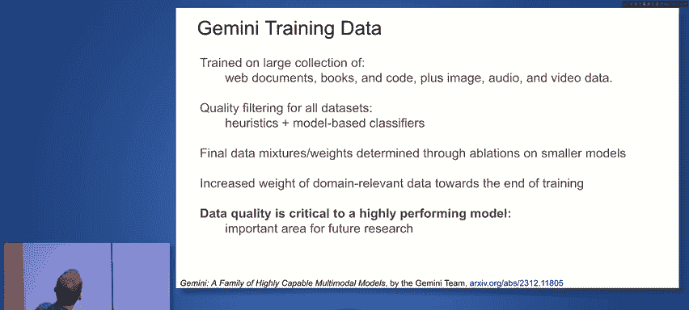

And then there's been a bunch of advances in not only training these models。

 but also how do you elicit the best qualities of the model。

 How do you actually ask questions in a way that causes the model to be able to answer questions in a more effective way。

 So， for example， asking models to show their work improves the accuracy of the model and also the interpretability。

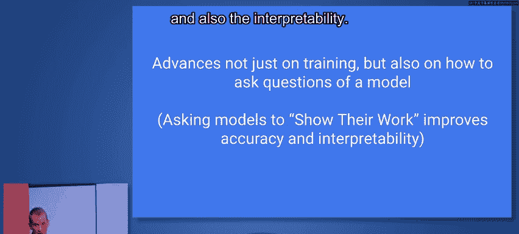

And so some of my colleagues came up with a technique called chainin of Though Promping。

So if you remember back to third grade math class， your。

 your teacher would always encourage you to show your work， right。

 And the reason they want to do that is both。To see your thought process in getting to the answer。

But also kind of encourage you to think about， you know。

 what are the next steps and how am I going break this complicated problem down into a smaller set of of steps。

And so if you ask a model， you know， you usually you give it an example of a kind of question you wanted to answer and then the actual answer for that question。

 And then you ask it a new question。 And then you ask it to answer that question。

And so here's an example of a question and then the way the model was taught to respond is just to figure the answer out and give it。

 And then there's a different question。 and the model output actually says the answer is 50。

 which is wrong。But if you instead ask the model and show demonstrate to it， you know。

 how do you show your work。And you say， okay， well， Sean started with five toys。

 If you got two toys each， then that is four more toys，5 plus four is 9。 So the answer is none。

That's that's the work your third grade math teacher would be really proud of。And more importantly。

 if you do that， the model actually。You know， elicits these sort of more incremental steps to get to the answer and it gets it right。

Because it's now had longer to think about the the steps to basically more time to think about through the steps of of getting to the right answer。

And so that's actually， and it's a pretty dramatic effect， right？

These two lines are the same underlying models at different scales。

And what you see these are two different sort of mathematical oriented benchmarks。

 the one on the right is sort of eighth grade math problems and this one is you a bunch of arithmetic problems。

 What you see is the quality of responses is pretty bad when you just give it standard prompting。

 but at some point the model scale becomes large enough that all of a sudden when you ask it with chain of thought prompting。

 your accuracy shoots up quite a lot。So that says there's a really interesting science of how you ask。

These models， questions in a way that actually， you know。

 both makes them more interpretable and also more likely to give you the right answer。Okay。

 so let's talk about multimodal reasoning in a gemmini model。 And I think an example is a nice one。

Its a good way to understand what this model can do。 So here's the prompt。 You know。

 here's the solution to a physics problem by a student。

 And then there's just a picture of the problem。 And the students's written out answer in kind of handwriting。

And then the rest of the prompt says， try to reason about the question step by step。 That's， again。

 kind of the chain of thought prompting style thing。

 Did the student get the correct answer if it's wrong。

 Please explain what's wrong and solve the problem and make sure to use latex for math and round off the final answer to two decimal places。

And so that's the input， this kind of like hokey image of handwriting and a skier going down a slope and all this kind of stuff。

 Con of energy， blah， blah， blah。 And then this is the output of the model。

 So the student didn't get the correct answer。 The student made a mistake in the calculation of potential energy at the start of the slope。

 potential energy at the start is given by MGH。 student use the length of the slope。

 I guess that's the hypotenuse instead of the height in the calculation。 correct solution is know。

 it means the blah， blah， blah。 Therefore， we can write this is this is actually a mytech。

 but we've rendered it for your reading convenience。😊，And subsequents the values， there it is。

 it worked the problem out to two decimal places。So think about what this means。 All of a sudden。

 we can give models like kind of multimodal input， you know， a complex， you know。

 picture of a whiteboard and a problem and ask it to do something。 and it can do it。 You know。

 it's not always going do it right， but， but it can and。This can be an amazing educational tool。

 So think about you know， a student trying to work things out on their own and they're taking pictures of their solution and。

 and you know， the system is kind of helping helping them figure out what they did wrong。

 we know that individualized tutoring has outcomes that are two standard deviations higher when you have a one on one human tutor for education than when you have a much broader scale classroom setting。

 So could we get close to that in terms of having individualized tutoring。

 I think I think that that possibility is within our collective grasp。😊，Okay， so evaluation。You know。

 that was kind of a qualitative example of gemminized capabilities。

 but it's also good to look at how it compares on a bunch of different characteristics。 Evalu。

 you know， really helps us identify the model strengths and weaknesses， helps understand， you know。

 is training going well So we're constantly evaluating these metrics as we're training the model helps us make decisions about what to change is our math performance。

 you know， lower than we would hope。 And so maybe we should enrich the training mixture with more math oriented data。

 But what will that do to multilingual performance。😊，There's a lot of complicated tradeoffs。

Some of which you make at the beginning of training。

 some of which you're kind of monitoring online and trying to make。

Principled or C of the path decisions， I guess， and helps you compare the capabilities to other models and systems。

啱。And so the highest level summary is， you know， we looked at 32 academic benchmarks and the Geini。

He did the state of the art performance in 30 of the 32。

And so if we look and delve into some of these in depth。

 there's a bunch of text oriented or general reasoning or math oriented benchmarks。

 And if you compare gemmini Ultra with G4， which is generally the prior state of the art in most of these problems What you see is the ones in blue is the state of the art。

 And so we we state of the art on 7 of the8。 the 90% on MLU is interesting because this is a very broad set of questions in 57 different subjects。

 you know， chemistry math， international law philosophy and the group that put together the benchmark。

Measured human expert level performance at 89。6% I've， maybe 89。8。

And so this actually exceeds human expert level performance in these 57 categories， which。

 which is quite nice。 We're happy with that。😊，And then there's a bunch of coding related ones down here and math oriented ones here。

Yeah， I mentioned the 90%。So if you look at image understanding benchmarks， you know。

 these are now getting into the multimodal aspect of this。 You know。

 we got state of the art results on8 of 8 benchmarks ranging from one of the nice things was this benchmark came out a week before we published our paper。

 and we'd never seen it before。😊，So our ValL team quickly added this benchmark to our ValE and discovered that we exceeded the state of the art results by a reasonable margin。

 which is nice， it's always nice when you have a benchmark you've never seen before and you do well on it because you're always worried about like leakage of test training data into the test set and so on。

If you look at video understanding， you know， again。

 the multimodal capabilities of this model really， really shine pretty well。

 state of the art on six of six benchmarks， including the important English cooking video captioning benchmark。

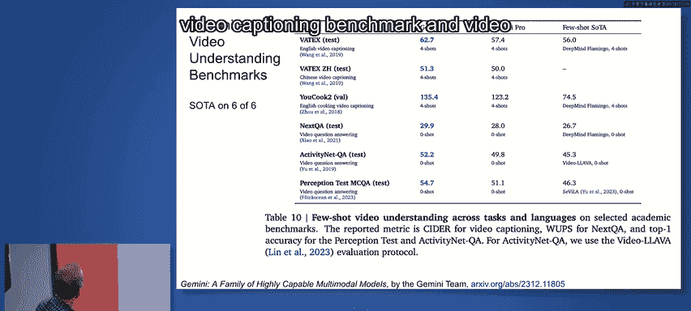

And video question answering and。And if you look at audio， you know， the word error rates of。

 of this on a bunch of four different public。speecheech recognition benchmarks。

 as well as a speech translation benchmark， state of the art M 5 of5。

 and multilingual capabilities are， are quite good。 Were state of the art on4 of the five。😊。

So yeah first， I hope you appreciate ourval team because this is a tremendous amount of work to evaluate these models and really understand the capabilities in this level of detail and that's pretty awesome and it does give us a nice firm idea that the Gemini model is pretty capable and we also have know measurements of pro and nano in the paper。

Okay， so these large transformer models can actually generate surprisingly coherent conversations。

 which is kind of the evolution of that sort of neural conversational model And then the transformer based versions of those。

 So if you look at bard I guess I have to update my slides。 So this will be Gemini do Google do com。

 So I was actually preparing a talk before we were using Gemini models。

 a few months ago in bard Gemini。 And I said， you know。

 reverse the letters of hot chips and tensor processing units for me。 So know。

 just to show what these models could do。 And it says sure the reverse strings are， you know。

 there they are。 Great。😊。

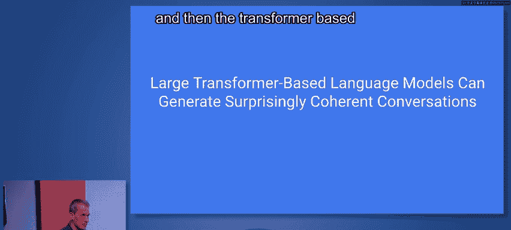

But then it went on to say， I can also do this for you in Python。Here's the code。You know。

 define reverse string as a function。 Here's the string， print reverse string of that。

 reverse string of that， use code with caution。 I always recommend that。

 And then it also goes on to explain it。codeode first defines a function called reverse string。

 takes a string as input， which is the first string。 function works by looping through the string。

 Code then prints rehearsing。And it's always going to be helpful。

 is there anything else I can help you with？嗯。So this is pretty amazing。

 right Like the fact that someone asked a question and it did what it was asked。

 But then it also said， by the way， here's this thing called programming and some Python code。

 And here's what here's how you would do this writes writing， you know， code to do this。

 I think that's pretty cool。 And then again， a real educational opportunity。😊。

Is there anything else you can help me with sure， tell me more about T Pus。 So， you know。

 the model has a fair amount of world knowledge。 It knows that TPs or you know。

 basically I've told you a lot of this。 They're specialized hardware processors developed by Google to accelerate machine learning that can help improve the efficiency and performance。

 Here are some of the benefits， faster training inference。 I hope again， I hope this helps。😊，啊。And。

 and， you know， I think one of the kind of fun things about these chatbots is they can have different kinds of personalities。

😊，Bard is sort of your helpful friend。We'll help you answer lots of questions。

So we actually put Gemini Pro in barred in slash Gemini last month and theres a public site called Lm cis that can evaluate different chat agents because there's now a lot of different chatbots in the world and the way they do that is they get users to write their own prompt they pick two random chatbots that they have configured in their system and then they send the query to both of them the prompt to both of them show and then show the output anonymized so you just say which is better the left or the right and then from that you can compute what's called an eO score so eO was I believe a Hungarian mathematician who is trying to develop ways to rank chess players and so when you have a tournament basically you get more eO points when you defeat one opponent and so you can in a tournament setting。

Comp and elo score， and roughly an elo score being higher by 100 means that the stronger competitor will win 64% of the time。

And 400 points is meant to be a 10 to one advantage。

And so the pro level model actually achieves the second highest eO score in this thing。

 and there's probably like 30 different models I'm showing you the top of the leader part。

 which is pretty nice， so this is like a free service， and these ones are not。

And so I tweeted about this and then this person who I'd never seen said it's actually it's really pretty good。

 check out this example and you know we have a way for people to share their interactions with Bard that they liked and they actually want to make public。

 And so he decided to do that。 so if you click on that。

 he was asking about please estimate the number of companies per million residents in each of the following countries。

 the US， England， South Korea， Taiwan and Singapore， Pre numbers in table form。😊。

And so Jim and I said absolutely， here's a table showing the number of blah， blah， blah， there it is。

 the number of companies per million， just as you did asked， as you can see。

 England has the highest number and it sort of interprets the results for you too。

 England has the highest number followed by the US South Korea to W and Singapore。

 It's important to note these are just estimates。 The actual number may vary depending on source and definition。

I hope this helps， let me know if you have any other questions。

And so he went on to say， you know， where'd you find the numbers for the companies？

 So I apologize for not providing the sources。 It's important to be transparent where information come from。

 So the company numbers I use came from a combination of different sources。

 So for the US they use the Dun Braddspe database England。 I use the Office of National Staistic。

 bla， b bh b Please note these sources have somewhat different definitions。

 So it actually understands the subtleties， right like there's different definitions of what constitutes the company and it。

Sort of knew where to go off and， and get all this different kind of sources of data。

 I didn't have that memorized， but it was able to make use of it。嗯。Ping。Okay， and another trend。

 I think， is important is that。Further refinement of these general models can make amazing domain specific models。

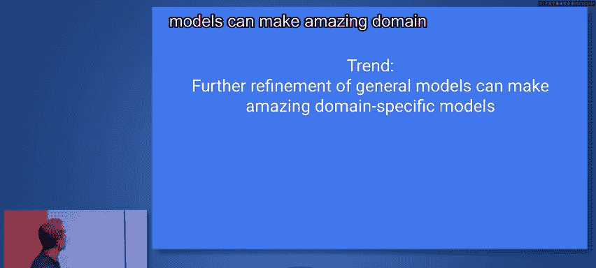

So some of my colleagues took some of our earlier work on the palm model and then the palm2 model。

 which was a general purpose model kind of like trained on general text and decided to enrich it and further trained it on medical data。

 So medical kind of questions and medical articles and what they found was the med palm model。

 The first one， actually exceeded the medical passing mark for the medical boards and that when you then six months later。

 they trained it on the palm 2 model to do mePm 2， they actually got expert level performance on the medical boards for this particular task。

 Now， this is not a full general purpose setting。 It's like a bunch of medical questions。

 but it does show the capabilities of having a really capable general model and then training it in a domain specific way for specific problems。

Okay， I'm going to go quickly through generative models producing images and video。

 You've probably seen this as a trend in the world。

 So we have a couple of different research projects， party and imagine。 And you know。

 one of the kind of cool things I mentioned you can give prompts that describe what you want in visual imagery and then have models that can generate these these images that are kind of constrained by the encoding representation of processing the sentence。

 and then conditioned on that， it will generate pixels for an image。

 So a steam train passes through a grand library oil painting in the style of Rembrandt。😊。

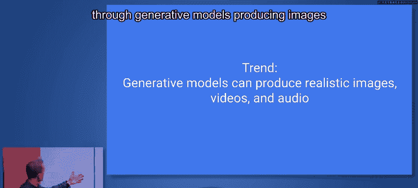

There you go。A giant cobra snake made from X， where X might be corn， pancakes， sushi or salad。

Which is your favorite。 I kind of like the， the ferocious lettuce looking。Snake。

But the corn one is pretty nice too you know a photo of a living room with the white couch in a fireplace an abstract painting is on the wall and bright light comes for the windows so if you happen to need a picture like that for a presentation or something like I did you can do that and it can be pretty detailed descriptions you know a high contrast photo of a panda riding a horse。

 Panda is wearing a wizard hat and reading a book， the horse is standing on a street against a gray concrete wall。

 colorful flowers and the word peace， you know blah， blah， blah， DLSR DLR photograph。

 daytime lighting。And there he got。There are many plausible interpretations of that。

 but at least you got one example of what you asked for。嗯。And this is now integrated into Bard。

 So the K through 12 government school agency in Illinois was really excited about being able to create images of their mascot hyperlink。

 the hedgehog。 So there's hyperlink， surfing， riding this AI wave。

 And this person was very excited about you know， the prompt was the human buying coffee at Cu of coffee and in London。

 Co of coffee is a very popular coffee chain。 And one of the things that these models have often struggled with is the fidelity of text。

😊，Actually， you know put in the text you asked for making it look like a real font and so on。

 And here you see it does a pretty good job。嗯。I won't talk through a lot of the details。

 but essentially you put in a prompt that gives you a representation of what that sentence in a distributed vectorbased setting is。

 and then conditioned on that， the model is trained to generate first a small scale image and then take another model that is designed to improve increase the resolution of an image conditioned on both that lower scale。

 lower resolution image plus the text embedding and then we apply that one more time with the larger image and condition on the text embedding to produce the full scale 024 by 1024 image。

啊。

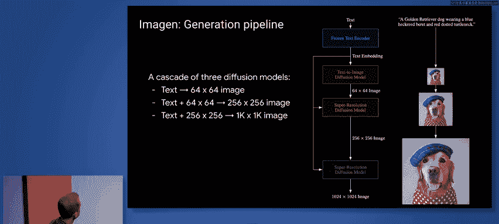

And you can really see the effects of scale。 So if we train four different models with 350 million to 20 billion parameters and then given them the same prompt。

 you know， a portrait photo of a kangaroo wearing an orange hoodie and blue sunglasses standing on the grass in front of the Sydney Opera house holding a sign in the chest that says welcome friends。

😊，What you see is。You know， it kind of got the kangaroo aspect at the smallerest scale。

 but not and the orange treat， I guess， but not much else。 There is a sign， but it's， you know。

 again。Its struggled with text， let's say as you scale up a bit more。

 the kangaroo got a little better。 it now knows a bit more that Sydney Opera House looks something like that。

 but it's kind of a little chunky and doesn't have a lot of details。Closer to welcome friends。

 but it might be veg me， he he。 I'm not sure。But then as you scale up。

 you now get a pretty nice image of the Sydney Opera house and your kangaroo and the orange Treaty with the right text。

So you see scale is an important aspect of this， and this is why you're seeing all these advances in you know the last decade is essentially scale and better training methods and algorithms really contribute to higher quality results。

 This graph just effectively says the same thing， but I think the kangaroo says it better。

I think it's also important to realize that there's a lot of machine learning kind of invisibly helping people in various ways and particularly on phones So you know。

 a lot of camera features in modern smartphones have gotten significantly better over the years through combinations of computational photography methods and machine learning methods together。

 know， so portrait mode where you make the background all blurry。

 So you look all fancy in the foreground is a nice nice technique for some of these portrait style photos nightight where you trying to take an image in very low light conditions。

 you can essentially take lots of readings from the sensor and integrate those in software to create know much higher lighting conditions than the actual conditions under which you did that that also helps you take better astrophot and portrait blur and color pop or nice features sometimes。

😊。

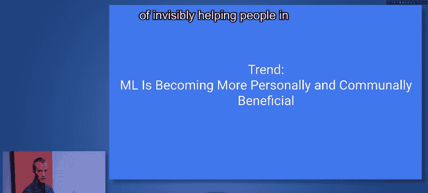

Time when you want them。Magic eraser。 So if you actually understand images。

And you point at like one of the telephone poles and says make and say make these go away。

 then the system can do that。 maybe your waterfall photo had these。

 you other tourists in front of it and you didn't want them there， you can erase them there they go。

And there's a lot of features on the phone。 And many of them are sort of about。

 how do you transform one modality into another。You know。

 so sometimes you want to be able to say screen a call so maybe you don't want to actually answer your phone。

 but have a computer generated voice， answer the phone for you。

 ask what the person's calling about and then give you a transcript of what they said and then you can decide you know do I want to accept this phone call or not you know hold through me can kind of listen on the phone for you。

 you don't have to hold hold on Bank of America when you're calling their customer support。

 live caption can show can take any video playing on your phone and listen to the audio and then give you transcripts captions of what's being there。

 maybe you're trying to watch a video and a lecture hall like this and you don't want the audio to disturb people？

So there's a lot of cool， cool features of this。 and a lot of these are running on people's phones without them necessarily realizing it or thinking about what technology is under there。

And this has amazing advances for sort of people in limited literacy settings。

 you know you can point your camera at something and it can read you what you're pointing at or maybe you won't speak that language and you're trying to understand it。

 it can it can read it and translate it for you。I think I'm going to go quickly here and maybe skip some of this section。

 I will just skip over some of this， but there's pretty awesome advances in。Yeah， so I'll start here。

 you know I think material science is a pretty interesting area where， you know。

 basically machine learning is starting to influence lots and lots of aspects of science。

 both through kind of automated explorations of interesting parts of a scientific hypothesis space or through。

You know， creation of very rapid simulators that are learned rather than sort of traditional。

 high large scale kind of HPC style computation。You know in some areas you've been able to learn a simulator that is sort of the functional equivalent of a hand codeed simulator。

 but is now 100，000 times faster and so that means that all of a sudden you can you know search a space of 10 million possible chemicals or materials and identify ones that are interesting and promising and have certain properties that you would normally have to apply a lot more compute for and so some of my deep mindd colleagues we're actually looking at interesting ways of searching the space of possible materials for those with interesting properties so they have a structural pipeline that can you know represent a potential material as a graphical neural network and then a compositional pipeline that can sort of。

Mutate sort of known structures into ones that are sort of interesting and adjacent。

And then use an existing database of materials to then be able to output energy models and a bunch of stable。

 interesting possible compounds， and so this automated discovery of 2。

2 million new crystal structures leads to a bunch of interesting possible candidates for actual synthesis in the lab to see what properties they actually have。

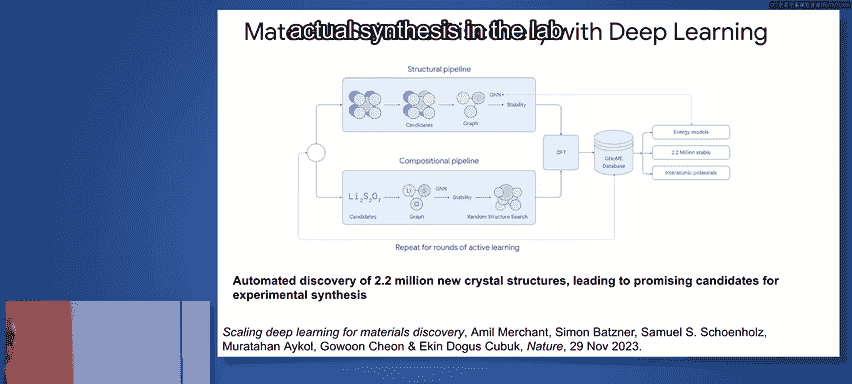

And then I think there's huge potential for using machine learning in all aspects of healthcare。

 really we've been doing a fair amount of work in the space of medical imaging and diagnostics for quite a while。

 and those problems range from ones where you have 2D images to some where you have sort of 3D volumes from MRIs or other kinds of 3D CT scans。

 and then where you have just a single view to ones where you have multiple views and large images。

 very high resolution things for pathology for example。And so there's been a fair body of work。

 I'm going to talk briefly about two of them though。

 So one of the areas we've been working in the longest in this space is the area of diabetic retinopathy。

And so diabetic retinopathy is a degenerative eye disease that can you know if you catch it in time it's very treatable。

 but if you don't， you can suffer full or partial vision loss and really people who are at risk。

 which is sort of anyone with diabetes or prediabetes should be screened every year but in a lot of parts of the world there just aren't enough ophthalmologists to do this screen those who have been trained in sort of interpreting these retinal images And so this is something where machine learning can actually help a lot because you can actually train a model based on you know trained ophthalmologists annotating images to say yes。

 that's a one that's a three， that's a two， that's a five。 And if you train a model。

On board certified ophthalmologists， you can actually train a model that is as effective as board certified ophthalmologists。

If you then go on to get that same training data annotated by retinal specialists who have a lot more expertise and experience in these cases。

 you can actually train a model that is on par with retinal specialist。

 it kind of the gold standard of care in this space and there are very few of those in the world。

 but you can all of a sudden make the screening quality be that of a retinal specialist using a GPU on a laptop。

And so we've actually partnered with organizations in India。

 a network of Indian and eye hospitals and the government of Thailand。

 as well as France and Germany and we're sort of doing lots and lots of screening every year。

And then dermicist， so dermatology is a condition where it's interesting because you actually don't need specialized equipment to sort of gather data that is useful for interpreting you know do you have a dermatological condition or not and so we've got a system now deployed where。

You can take a photo of something as you see in the video and it will give you a sense of what this might be。

 what are other similar looking images in sort of dermatological databases。

 and it can help give you a sense of is this something very serious or is this something fairly benign？

嗯。Okay and then finally， I think deeper and broader understanding of the machine learning methods as we sort of deploy them in more places in the world is really。

 really important and you know as we've gone from doing basic research in machine learning to then using it in a lot of places in all of our products。

 we started to think about you a set of principles by which we want to you know think about the implications of using machine learning。

 what considerations should we have for you various ways in which we might apply it， and we in 2018。

 published a set of principles that we came up with。

 really these were designed to help our own internal teams about machine learning and things you should be thinking about as you're thinking about applying it to problems you care about。

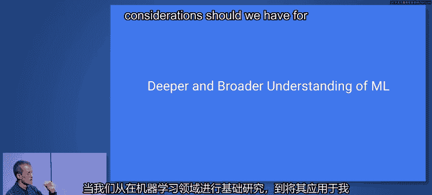

And so， for example， you know， avoid creating or reinforcing unfair bias。

 often when you train these models， they're trained on。data from the real world。

 and that's often the world as not the world as we'd like it to be， but the world as it is。

 And so it's really important when you're deploying machine learning models that you don't sort of train on data that is biased in unfair ways and then accelerate that because now you can automate and make these decisions more rapidly。

So there's a bunch of techniques you can apply on a sort of algorithmic basis to remove some kind of bias。

And what we strive to do is sort of apply the best known current techniques。

 but then also do research on advancing the state of the art in these areas of bias or for example。啊。

Accountable to people we think you making models interpretable is an important aspect of that you know being sensitive to privacy when that makes sense in the setting you're deploying it and be socially beneficial and so I'll point out a lot of these are sort of active areas of research so we've published about 200 different papers in the last five years or so。

 six years related to fairness or bias privacy or safety。You can see those there。Okay， in conclusion。

 you know， I think it's pretty exciting times for computing。

 I think there's a change underway from hand coded software systems to ones that are learned and that can interact with the world in various interesting ways and interact with people in interesting ways。

 the modalities that computers can now sort of ingest and understand and sort of produce are growing and are。

 you know， I think。😊，Going to make using computers much more seamless and natural。 know。

 A lot of times we sort of restrict ourselves to typing on a keyboard or something like that。

 But I think we now have the ability to talk to a computing system in a very natural way。

 and it will understand what we say it'll be able to produce a natural sounding voice in response or a nice image if that's what we asked for And so I think that's pretty exciting。

 So there's tremendous opportunity for sure。 But there's also a lot of responsibility how do we sort of take this work for。

 make sure that it's socially beneficial and really kind of do good things in the world。😊。

Hands over that， Thank you very much。👏I will。I will put up one more plug for the slido number。

 there it is。Thank you very much for your talk。Thank you very， very much for your talk。

 please don't send more questions to Slido。😊，Okay it's a very nice idea but we are overwhelmed at this point so what we are going to do is I'm going to give you some questions。

 there were some trends in the questions that appeared at the Sdo so I'm going to ask you some of these questions and then for those of you who made it to this auditorium we'll take one two questions from the audience。

😊，So one of the questions let me start with a question that you probably expect。

 okay more data is it going to make your model better twice more data are we going to see twice as good a performance yeah I mean it's a good question and it's not a simple answer I think I mean I think we've seen that more high quality data absolutely makes the model perform better when you have the capacity to sort of train on that larger amount of data。

 so it's important to think about the model's capacity you know sometimes you need to increase the scale of the model as well when you have more training data。

We've seen more data actually hurt so if you actually get a lot of low quality data。

 you can actually for example， decrease the model's ability to effectively do mathematics problems or things like that it's a nuanced thing but in general。

 more high quality data and more capacity for the model will make the model better so the next question in this in the slidedo that emerge is okay so what is the future of LLMs now that the vast majority of high quality training data has been exhausted。

How would you react to I would disagree with that assert a bit you know I think we've not really begun to train on say video that much I mean we've done small amounts of video but there's a huge amount of video data in the world I think actually understanding the world through visual and audio data will be different than sort of training on a lot of language you didn't want to do both but I don't think weve really exhausted the training data in the world Yeah I tend to agree with you I think we still have a lot to go multimodal models you emphasize that in your talk do they achieve better performance on all domains than targeted models for each domain separately。

Oh you can paraphrase this question and the of that I mean I think in some cases they do。

 so the question is as you add more modalities。Does that improve the performance on other modalities and you hope so and generally we do see some aspects of that。

But。I。I。You know。I think if you have a narrow problem and you collect a very targeted data set that is designed to tackle just that problem。

 that will often give you good performance on a problem problem but if you have a complicated problem。

 or it's hard to collect very specialized data， what you want is a model that has a huge amount of knowledge of lots of different things in the world。

 you know from language and from images in audio and then to be able to apply that model to the problem you care about。

And then if you have a little bit of data for a problem you care about。

 then you're going to want to start with that base model and then fine tune it or do in context learning or something like that to make the performance quite good maybe I could follow with that another question which is kind of related today the cost of training large bundles prevents small startups from making impact what kind of projects would individuals with less resource work on would you like to comment on that Yeah absolutely I mean I think。

There's a really large set of problems in the machine learning domain I'm going to address it more from a you know what interesting research can one do in the broad area where maybe you don't have access to large data centers of compute and so on and I think there's just a really wide open set of things so I've mentioned the quality of data automatic evaluation of data quality or online curriculum learning or optimization methods or a lot of these kinds of things can actually be demonstrated on one GPU or a handful of GPUs under your desk and actually make pretty significant and innovative advances know the original transformer work was done on eight GPUs I think。

So interest or the sequence to sequence model for sure was8 GPPUs and so I think there's advances to be had from clever ideas。

 good evaluation of them and even demonstration of them at small scale another set of questions that we got is LLMs everything is transformers everything What else is there should we be working on other kinds of models is the emphasis on LLMs stifling other work in machine learning Yeah。

 I mean it is a worry right like are we crowding out other innovative ideas that maybe are you know not as fully developed and so they don't look as good as some of the things that have been you much more fully explored and we' sort of you know in the kind of now gentle exploration of the space around what works well when maybe something over here would work really well？

You know I think a lot of the time showing even at a small scale that some other idea is a really interesting direction can be done with some modest amount of experimental evidence。

 and I think that's an important area to go I would say you know I tend not to use LLM because I think we're moving to a multimodal world and I think multimodal is going to be more than just kind of the human modalities you think about like visual and audio and language but other modalities that are important in the world and you know like time series of interesting you know heart rate sensor data for healthcare applications there's probably 50 to 100 modalities of data you'd want to be able to deal with see just so the clock and we' really around over time so I would like to end here by thinkinging Jing for his talk。

