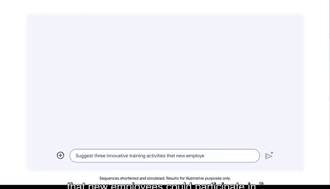

# 谷歌《AI基础知识（LLM、ChatGPT、Stable diffusion等）｜Google AI Essentials》中英字幕 - P16：06_02_02_使用Gemini.zh_en - GPT中英字幕课程资源 - BV1DM4m1r7rJ

Now let's practice creating effective prompts that can guide an AI tool to generate content。

Imagine you want to use an AI tool to help you apply for a new job。I'll focus on simple prompts here。

 and you'll discover prompt engineering best practices later in the course。To use Gemini。

 go to Gemini。google。com。

Sign in with a Google account。If you don't have a Google account。

 you can create one for free by clicking createreate Account。

Once you're signed into your Google account， you can start providing Gemini with prompts。

Let's say the job that you want to apply for is in social media。

 Your prompt might be write a cover letter for a social media position。你。

The response provides you with a useful starting point or template that you can customize to make your cover letter really stand out。

After adding some finishing touches， you send the letter off。 And great news。

 You receive an invitation to interview with the company。😊。

You can continue to use Gemini to help you prepare for the interview。 Your next prompt could be。

 what are some interview tips to help me prepare for a social media position。

The output includes a variety of options to choose from。

They seem to be insightful and tailored to the social media industry。

 offering advice on topics like what to do before and during your interview。

Fast forward a few years down the road。 You landed that social media job， grew within the company。

 and you're now in charge of onboarding new hires。You can turn to a tool like Gemini once more。

 with a prompt like this one。Suggest three innovative training activities that new employees could participate in。

Wow， those suggestions are really fun activities for new employees。When using generative AI tools。

 it's important to write clear and specific prompts， the more you experiment with writing prompts。

 the better you'll get at using AI tools to accomplish your goals。

