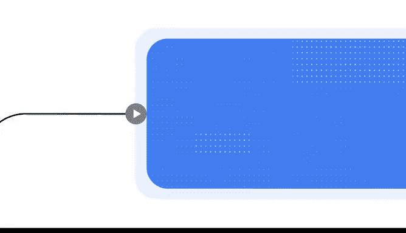

# 谷歌《AI基础知识（LLM、ChatGPT、Stable diffusion等）｜Google AI Essentials》中英字幕 - P1：01_01_01_谷歌AI入门精要.zh_en - GPT中英字幕课程资源 - BV1DM4m1r7rJ

Join me as we uncover the ways AI can enhance your career in life。

There's a big shift happening in the modern work， and AI is at the forefront of this exciting transformation。

Just as the Internet forever changed the way we approach every task。

 AI has the potential to transform the way we work and live。AI stands for artificial Intel。

 It's a practical solution for making routine tasks less time consuming。

Learning to use AI effectively in your job can help you to accomplish your goals and set you up for success in the evolving work landscape。

 For example， consider a typical day at your work。 It's anything like mine。

 You have a lot of tasks to complete。Some days， your todo list might seem never ending。

But what if AI could help， for instance， instead of spending hours reviewing spreadsheets。

 AI can help you analyze the information in seconds。It can also draft a detailed sales report。

 highlighting key insights to share with your team。AI can schedule meetings for you。

 create engaging presentations， enhance your brainstorming sessions。

 and take on a variety of other tasks that will shorten your to do list。

Whether you're curious to learn the basics of AI， interested in making routine tasks easier or focused on enhancing your skill set。

 We've designed Google AI essentials to help。Hi， my name is Maya。

 and I'm the vice president of strategygy and operations at Google Research。 In my role。

 I lead a team that helps Google achieve its mission by accelerating research and fostering an exceptional research environment。

😊，I'm thrilled to be your guide on this journey to explore this technology that's reshaping the business world。

 AI throughout the course， you'll have the opportunity to learn from a diverse group of AI experts at Google whose role span from program management to directors of AI products and services。

😊，They'll each share their insights into AI and how it can elevate your work and advance your career。

Google AIEssentials is designed to fit your schedule。

 You can complete it at your own pace all online， and no previous AI experience is necessary。

This course will include videos from Google employees who work in AI readings to help deepen your understanding of concepts and interactive activities that give you practical experience working with AI。

 At the end of the course， you'll have the opportunity to earn a skill batch that can be displayed on your resume。

 social media profiles and email signature。😊，If you're new to AI。

 you may have many unanswered questions。 You might wonder。

 how do I engage with AI tools to boost my productivity， How do I apply AI responsibly in my job。

 or how should I prepare for the future of AI in the workplace。In Google AI Essentials。

 we'll address each of those questions and more。I hope you're excited to join me as we uncover the ways AI can enhance your career in life。

 Let's get started。😊。