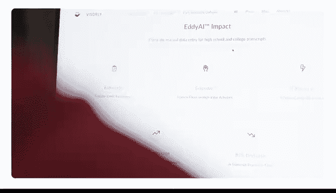

# 谷歌《AI基础知识（LLM、ChatGPT、Stable diffusion等）｜Google AI Essentials》中英字幕 - P20：10_04_02_使用Gemini帮助分析业务表现.zh_en - GPT中英字幕课程资源 - BV1DM4m1r7rJ

🎼Having a technology platform， we get a ton， a ton of data。 And that just means user data。

 performance data and being able to make sense of that data can sometimes be a challenge。

 What's the next most important feature to build， What's the next most important feature to optimize。

 What's the next most important decision to make Leveraging sheets with Gemini has been really phenomenal in terms of helping us inform strategy。

 and then also empowering our team to have the analytics tools to be able to make data driven decisions。

 The ability to use Google sheets with Gemini has had an incredible impact on our business。

 It's been a game changer。 I can't imagine not using this。

There's something really satisfying about a good spreadsheet， it's so organized， it's so contained。

 but let's face it all that data can also take a long time to analyze and make sense of Fortunatelyly Gemini and Google Sheets can speed up the process so that you can get straight to making smart data drivenrin decisions。

Let's give it a try。I'll open up a Google sheet with product feedback survey data and start with a super simple prompt。

We're able to keep it simple because the spreadsheet has all the context Gemini needs。

And a more open ended prompt helps us discover broader trends or patterns in the data。

Analyze this product feedback survey data。And just like that。

 Gemini has analyzed the feedback survey data and is helping me identify areas for improvement There's a few places where I'd like to see higher scores。

 but today I'll just focus on the ease of use score。I'll ask Gemin I for more help。

Based on the feedback， what can I do to improve my ease of use score？

Jim and I offered seven different recommendations on how to improve。

Some items I can address pretty quickly， like improving documentation and tutorials。

 but others will be more challenging like reducing glitches and errors。Overall。

 this information was insightful and will help me improve my customers's experience。

If you're not a data person， don't worry， just prompt Gemini sheets to get you started you can ask simple questions like what are the trends or what data points should I be paying attention to and why this approach of starting broad and getting more narrow is especially useful if you are trying to uncover new trends correlations or insights from a data Finally。

 you can also use Gemini to generate data visualizations once you gather your insights。

 ask for a chart or a graph to represent your data Now you can easily share your findings with others。

Ready to give it a try， what data do you need help analyzing？

