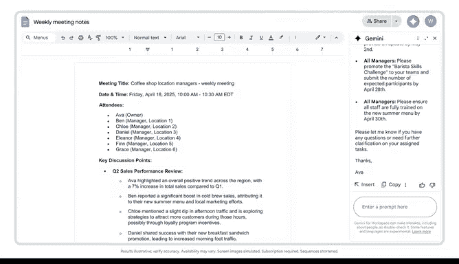
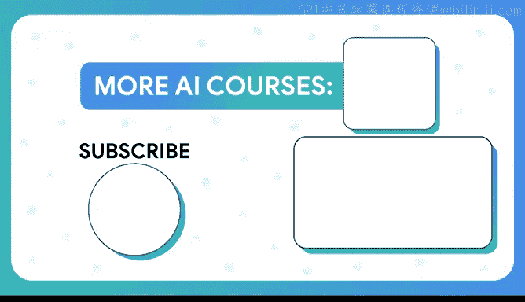

# 谷歌《AI基础知识（LLM、ChatGPT、Stable diffusion等）｜Google AI Essentials》中英字幕 - P21：11_04_03_使用Gemini记录会议笔记.zh_en - GPT中英字幕课程资源 - BV1DM4m1r7rJ

I have 50 employees， six different locations， I have a ton of meetings a week。

 those meetings are often me scrambling to like take notes or。

Trying to set it up or do the things about meetings that no one wants to do so I guess that's my issue so introducing no taking my gemmin I in our meetings has helped me let go of all that my responsibility now is to engage with my employees make sure they're supported and have the answers they need。

There's accountability for both my employees and myself。

 we can look back and reference these things historically。

 so instead of focusing on meeting for meeting's sake。

 now we' going to focus on running a business and having a dialogue and making sure the business is running officially。

Is it important to take notes on what's being discussed and agreed upon in a meeting， yes。

Can the very act of taking notes distract you from what's happening in the meeting？Also， yes。

 but you can direct Gemin I to take notes for you so you can stay engaged and focused。

Here's how it works。When you start a Google Meet， select the Take notes with Gemini feature。

 After you're done with your meeting， you can review the AI generated notes in a Google Doc。

 then you can edit and share them with all the meeting attendees。

You can also prompt Gemini and docs to do more with your notes like summarize key decisions made。

 create the agenda for next week's meeting or draft a follow up email reminding managers of their action items let's give it a try now。

Create a follow up email reminding attendees of their action items。There we have it。

 an email draft I can easily copy and customize so that the team can keep moving forward。

For those of us who attend nonstop meetings or may want some help staying organized。

 this is a game changer。I have a few more tips when you're using Gemini and Docs for meeting follow up。

Say there's a very specific part of the document where I need Geminize's help。

I can highlight that text in direct Gemini and docs to reduce the highlighted part of the meeting notes to a two line summary。

 Another thing I love to do， say I wanted to include a quick reminder about our project's goals that that information lives in another document。

 No problem。 You can pull this information in。 Just use the at symbol and type in the documentss name。

 then tell Gemini what you want to do with it。 Test it out。 What documents are you working on。

 and how might you use Gemini to help you stay organized and on track。

