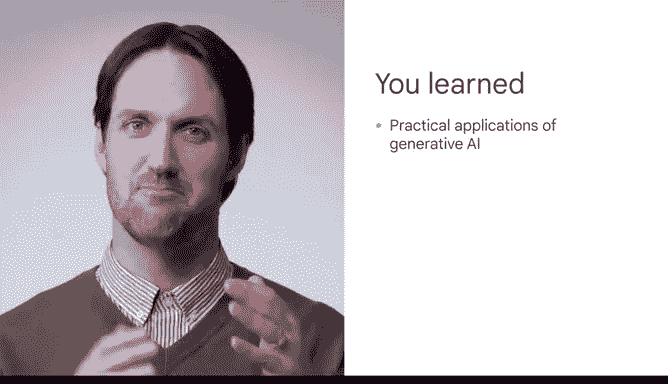

# 谷歌《AI基础知识（LLM、ChatGPT、Stable diffusion等）｜Google AI Essentials》中英字幕 - P22：12_05_01_总结.zh_en - GPT中英字幕课程资源 - BV1DM4m1r7rJ

Hey， nice job completing this section of the course。 Let's review what we've covered。First。

 we explored practical applications of generative AI and how you can use generative AI to help you accomplish many different tasks。

Then we explored how to boost your productivity with AI tools。 Next。

 we investigated using a human and loop approach。 Remember。

 this approach is critical for the responsible use of AI。

It involves integrating human judgment and oversight when using AI。

 ensuring that it aligns with the needs and values of both you and your business。And finally。

 you learned how to use simple guiding questions to help determine if generative AI is right for a task。

These questions can help you make informed decisions about when and how to use this technology。

I've truly enjoyed being a part of your journey as we've explored how to leverage AI in the workplace and boost your productivity。

To continue learning， discover the art of prompt engineering in the upcoming section of Google AI Essentials。

