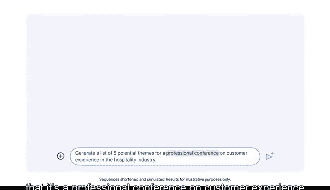

# 谷歌《AI基础知识（LLM、ChatGPT、Stable diffusion等）｜Google AI Essentials》中英字幕 - P26：4_02_01_编写清晰具体的提示.zh_en - GPT中英字幕课程资源 - BV1DM4m1r7rJ

How can you write prompts that produce useful output？

It's generally true that the quality of what you start with greatly affects the quality of what you produce。

Consider cooking， for example。Let's say you're preparing dinner。 If you have fresh。

 high quality ingredients， Well， you're more likely to produce a great meal。Conversely。

 if youre missing an ingredient or the ingredients aren't high quality。

 the resulting meal may not be as good。In a similar way。

 the quality of the prompt that you put into a conversational AI tool can affect the quality of the tool's output。

This is where prompt engineering comes in。Prompt engineering involves designing the best prompt you can to get the output you want from an LLM。

This includes writing clear specific prompts that provide relevant context。

To gain a better understanding of the context LLMs need。

 let's compare how a person and an LLM might respond to the same question。

Suppose a vegetarian asked their friend， what restaurants should I go to in San Francisco。

The friend would likely suggest restaurants with good vegetarian options。However。

 if prompted with the same question， an L L M might recommend restaurants that are not suitable for a vegetarian。

A person would instinctively consider the fact that their friend is a vegetarian when answering the question。

But an L L M does not have this prior knowledge。 So to get the needed information from an L L M。

 the prompt must be more specific。 In this case， the prompt needs to mention that the restaurant should have good vegetarian options。

Let's explore an example that demonstrates how you can use prompt engineering to improve the quality of an LLM's output。

Let's take on the task of planning a company event。

 You need to find a theme for an upcoming conference。

 Let's write a prompt to Gemini to generate a list of five potential themes for an event。

You can use similar prompts in chat GT， Microsoft Copilot， or any other conversational AI tool。

Now let's review the response。Well， this isn't what we wanted。

 We've gotten a list that seems more related to party themes than themes for a professional conference。

Our prompt didn't provide enough context to produce the output we needed。

 It wasn't clear or specific enough。Let's try this again。

 This time we'll type the prompt generate a list of five potential themes for a professional conference on customer experience in the hospitality industry。

This prompt is much more specific， making it clear that it's a professional conference on customer experience in the hospitality industry。

Let's examine the response。This is much better。We engineered our prompt to include specific relevant contexts。

 so Gemini is able to generate useful output。When you provide clear。

 specific instructions that include necessary context， you enable L L Ms to generate useful output。

 Keep in mind that due to L L M limitations， there might be some instances in which you can't get quality output。

Regardless of the quality of your prompt。 For example。

 if you're prompting the L L M to find information about a current event。

 but the L L M doesn't have access to that information。

 it won't be able to provide the output you need。And like in other areas of design。

 prompt engineering is often an iterative process。Sometimes even when you do provide clear and specific instructions。

 you may not get the output you want on your first try。

When our first prompt didn't produce the response we wanted。

 we revised the prompt to improve the output。The second iteration provided instructions that were clear and specific enough to produce a more useful output。

