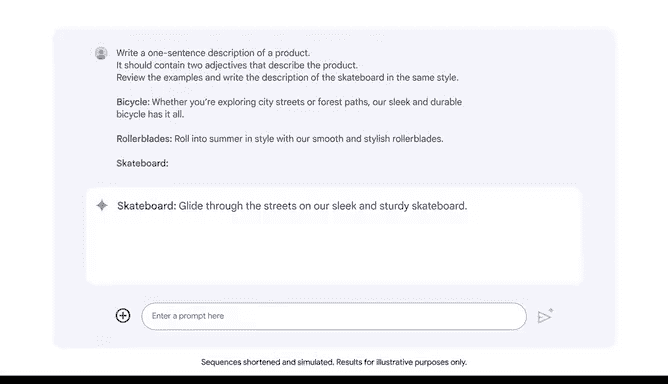

# 谷歌《AI基础知识（LLM、ChatGPT、Stable diffusion等）｜Google AI Essentials》中英字幕 - P29：7_03_01_探索少量样本提示.zh_en - GPT中英字幕课程资源 - BV1DM4m1r7rJ

Have you ever created something new by building upon previous examples。

 perhaps you used a well receivedce report as a reference when writing a similar report。

 or maybe you used a relevant and engaging website as a model when designing your own website。

Examples are also useful for L L Ms， including examples in your prompt。

 can help an LLM better respond to your request and can be an especially effective strategy to get your desired output。

 We're going to explore how to use examples in prompting。 But first。

 Let's briefly discuss a technical term shot。 in prompt engineering。

 the word shot is often used as a synonym for the word example。

 There are different names for prompting techniques based on the number of examples given to the L L M0 shot prompting is a technique that provides no examples in a prompt。

 While one shot prompting provides one example。 And few shot prompting is a technique that provides two or more examples in a prompt。

Because examples aren't included in0 shot prompts。 The model is expected to perform the task based only on its training data and the task description included in the prompt。

0 shot prompting is most likely to be effective when you are seeking simple， direct responses。

0 shot prompting may not be effective for tasks that require the L L M to respond in a more specific。

 nuanced way。 Few shot prompting can improve in L LM's performance by providing additional context and examples in your prompt。

 These additional examples can help clarify the desired format， phrasing or general pattern。

 F shot prompting can be useful for a range of tasks。 For example。

 you might use few shot prompting to generate content in a particular style。

Let's say you work for an online retailer。 You need to write a product description for a new skateboard。

 You already have descriptions for existing products such as a bicycle and roller blades。

 You want the skateboard description to follow a similar style and format。

 We'll start with a prompt that begins with some general instructions。

 Write a one sentence description of a product。 It should contain two adjectives that describe the product。

We also specify that we want Gemini to review the examples we provide。

And write the description of the skateboard in the same style。Because this is a few shot prompt。

 we need to provide examples that model the style we want。

Each example contains a label indicating the product being described， a bicycle， and roller blades。

And each description is one sentence long and contains two adjectives。

 sleek and durable for the bicycle and smooth and stylish for the roller blades。😊，Next。

 we typed a label skateboard When we add this label and leave the product description blank。

 we indicate to Gemini that we want it to complete the description of the skateboard like it did with the other two product descriptions。

Let's review our output。The output offers a product description of the skateboard that meets the criteria we requested and is in the same writing style and format as the examples we included in our prompt。

In this case， two examples were enough to obtain useful results。

 but there is no definitive rule for the optimal number of examples to include in a prompt。

 Some L LMs can accurately reproduce patterns using only a few examples。 while other LLMs need more。

 At the same time， if you include too many examples in LLM's responses may become less flexible and creative。

 and they may reproduce the examples too closely。 experiment with the number of examples to include to get the best results for your specific task。

🎼Now， you know a prompting technique that will help you get better quality output。

 Viewew shot Proing is an effective strategy that can help you guide an LLM to generate more useful responses。

