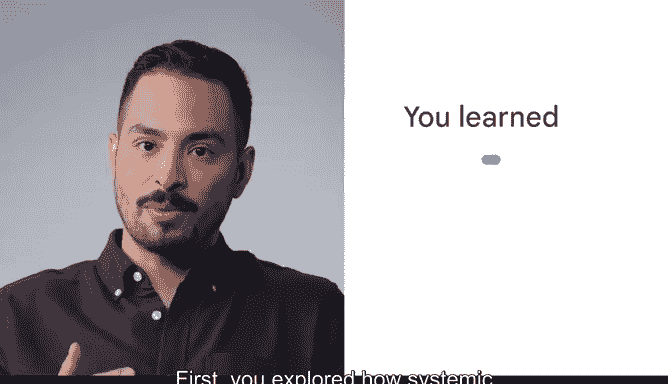

# 谷歌《AI基础知识（LLM、ChatGPT、Stable diffusion等）｜Google AI Essentials》中英字幕 - P39：8_03_01_总结.zh_en - GPT中英字幕课程资源 - BV1DM4m1r7rJ

Congratulations， you're almost done with this section of the course。

 You've discovered how responsible AI helps mitigate bias and avoid societal harms。

 Let's review some of those key points。 First， you explored how systemic and data biases are reflected in AI models。

Training or developing models with incomplete， outdated or inaccurate data increases bias in AI systems。

 You examine the types of harms that are associated with AI。

 especially if AI tools are not paired with human abilities。

 like critical thinking and responsible decision making。 Finally。

 you gain some tips for maintaining privacy and security when using AI。

 The best way to commit to using AI responsibly is to be vigilant about the risks of AI while enjoying its benefits。

😊，Think critically about how you use AI and the output you receive from AI tools。

 Share your awareness of potential biases with others。

 Stay up to date with the latest AI developments is also very important。

 AI tools are changing the world rapidly， But with new technology also comes risk。

 understanding potential harms will help you consider learning how to use these tools responsibly。

 It's been great introducing you to the responsible use of AI To continue learning。

 I encourage you to stay up to date on AI developments as part of Google AI essentials。😊。

